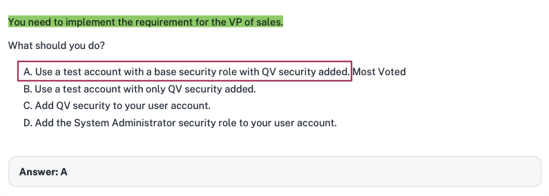
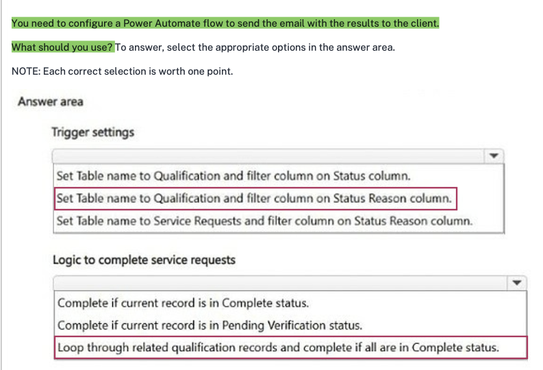
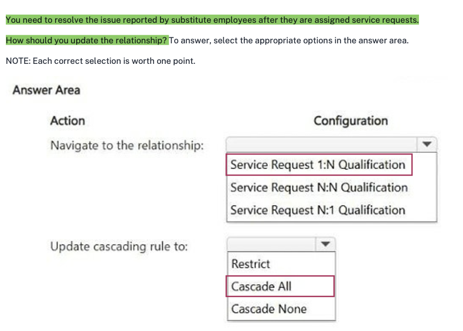
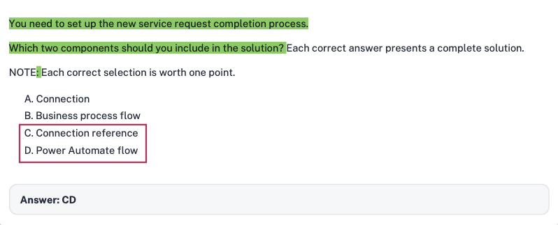
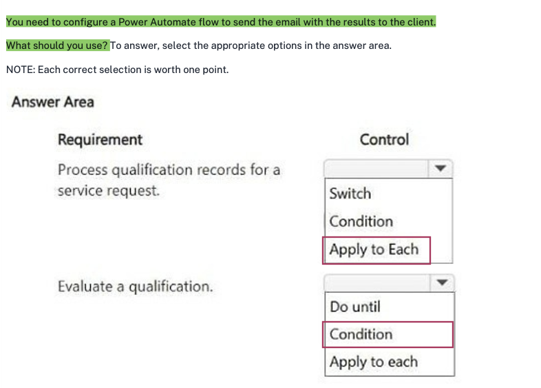
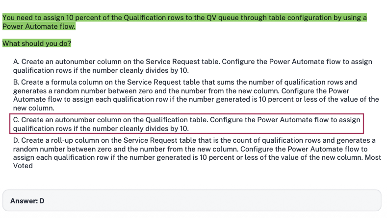
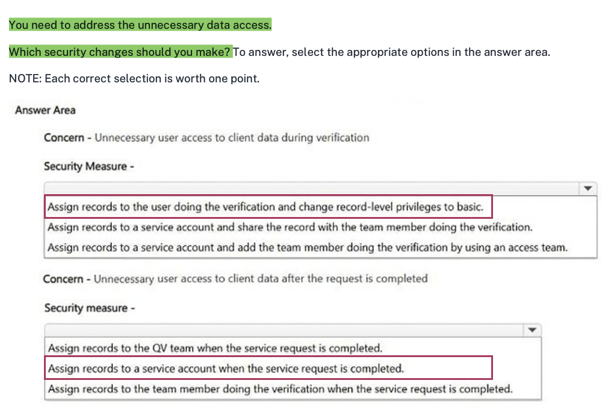

# ADatum Corporation

This is a case study. Case studies are not timed separately from other exam sections. You can use as much exam time as you would like to complete each case study. However, there might be additional case studies or other exam sections. Manage your time to ensure that you can complete all the exam sections in the time provided. Pay attention to the Exam Progress at the top of the screen so you have sufficient time to complete any exam sections that follow this case study.

To answer the case study questions, you will need to reference information that is provided in the case. Case studies and associated questions might contain exhibits or other resources that provide more information about the scenario described in the case. Information provided in an individual question does not apply to the other questions in the case study.

A Review Screen will appear at the end of this case study. From the Review Screen, you can review and change your answers before you move to the next exam section. After you leave this case study, you will NOT be able to return to it.

## To start the case study

To display the first question in this case study, select the "Next" button. To the left of the question, a menu provides links to information such as business requirements, the existing environment, and problem statements. Please read through all this information before answering any questions. When you are ready to answer a question, select the "Question" button to return to the question.

## Background

ADatum Corporation provides verification and investigation services that are used by insurance companies, law firms, and other organizations in the public sector. Services include verifying an individual's background, qualifications, and specific scenarios that require onsite visits.

The thorough work ADatum Corporation performs results in highly accurate cases with minimal critical information missing. Because of these high-quality results, ADatum Corporation is quickly proving itself as one of the best in the industry. In recent months, business has significantly increased, with most new business coming from high-profile companies and individuals.

Management has decided to create a new qualification verification (QV) role to help ensure that clients get the most accurate results. This role examines completed work to ensure that nothing is missed.

## Current environment

### Data storage and retention

- All information sent by clients for services is stored in Microsoft Dataverse with a model-driven app as the interface.
- Clients enter their data in a website, which then uses a service account to create the records in the Dataverse database.
- Team members currently have full access to all Service Request records.

### Service requests

- The Service Request table includes header information about the individual or organization that is the subject of verification.
- New Service Request records are assigned to a queue. All potential users who will be performing the verifications have access to these records.
- A service request is assigned to a single user who will ensure that all qualifications are verified. This single user is the only one able to process Qualification records related to their own service requests.
- Many required tasks when performing verification services are currently done by using manual processes.
- To keep up with demand, ADatum Corporation identifies several processes that can be replaced by using Power flows to hire fewer new staff and keep costs down.

### Qualification verification

- The qualification table contains details about an individual school degree, professional qualifications, and other qualifications that must be verified.
- A service request can have one or more Qualification records associated with it.
- Record status is pending verification until the initial team member finishes, at which point the member changes the status to Complete.
- When all qualification records related to a service request are verified either by manual or automated processes, the results are made available to ADatum Corporation's client.
- In the rare event that results are questioned, a new service request is created and verified independently of the previous work that took place.
- To complete a service request, users perform the following actions:
  - Send a templated email by using Microsoft Outlook to the client after all qualifications for a service request are checked.
  - Change the service request status to Completed. Currently, service requests do not indicate when all Qualification records are addressed.

### Microsoft Power Platform environment

- The following environments exist: development, testing, user acceptance testing (UAT), and production.
- Managed solutions are used to move customizations from the development environment to other higher-level environments. These solutions are created and maintained by the power users and provided to internal IT for deployment when they are ready.
- Two managed solutions, Verification Process Automation and Onsite Visit, share several components.
- All customizations to Power Platform components are performed by several power users who have received training and are certified as subject matter experts.
- Power users have been granted the System Administrator security role in the development environment.
- Corporate policy prohibits power users from writing code due to lack of a formal code review process.
- Internal IT will not be able to supply any development resources for this project due to a lack of staff. This means that any customizations and automation created for this project must be low-code/no-code for the power users to implement them.
- Customizations created by power users are deployed by internal IT.

## Requirements

### Process automation

ADatum Corporation plans to establish a new QV department to verify completed work so that the quality of work is maintained. The new process for verifying professional qualifications must automate the following:

- Enter data and navigate the authority's website. The authority website UI changes frequently because the company constantly improves the user experience.
- Search page contents for a specified value to determine validity.
- Update the corresponding Qualification record in Dataverse.

The new process for completing a service request must automate the following:

- Set the Service Request record status to Complete when work on all Qualification records is finished.
- Send an email to the client with the results when the service request is completed. The email must list each qualification as either Valid or Not Valid, depending on the verification.

### Qualification verification

- Service request results will not be released to clients until all related Qualification records are set to a Complete status.
- To check work done by a wide array of users, 10 percent of Qualification records must be double checked.
- Qualification records must be automatically assigned to a queue.
- Qualification records must be flagged with a new status field named Assigned to ensure that records are rechecked.
- Ensure that only QV team members can change the status from Assigned to In Progress to Complete.
- Record the name of the QV team member who performed the work and the date completed.

### Governance and security

- All components required for the verification process must be included in a new solution.
- Corporate security requires that deployments to non-development environments must be automated using service accounts.
- User security and data access must also be consistent across environments, except for the elevated access of the power users in the development environment.
- The Onsite Visit managed solution has a table that is not in the Verification Process Automation managed solution. This table must be upgraded prior to the go-live date without the other shared components.
- A VP of sales requires a test environment to demonstrate to potential clients the security policies that are included in their initial offering.

## Issues

- More employees than are required can access individual client information and continue to have access after a service request is completed.
- When users go on vacation, all their outstanding Service Request records are assigned to a substitute employee. The substitute employees are unable to see all the qualifications related to their service requests.
- Currently, testing the new QV functionality outside the development environment is not possible due to corporate security policies requiring the same security role across all environments.
- Internal IT reports that the solution import to the test environment failed because of missing dependencies related to the flow for completing service requests.

---

## Question

You need to implement the requirement for the VP of sales.

What should you do?

- A. Use a test account with a base security role with QV security added. **Most Voted**
- B. Use a test account with only QV security added.
- C. Add QV security to your user account.
- D. Add the System Administrator security role to your user account.

### 1. Extracted Question Summary

* **Case Study Context (ADatum Corporation — Governance and Security & Issues):**
* **Governance and security:** *"A VP of sales requires a test environment to demonstrate to potential clients the security policies that are included in their initial offering."*
* **Microsoft Power Platform environment:** *"Power users have been granted the System Administrator security role in the development environment."*
* **Governance and security / Issues:** *"User security and data access must also be consistent across environments, except for the elevated access of the power users in the development environment."*

* **Question:** You need to implement the requirement for the VP of sales. What should you do?
* **Options:**
* A. Use a test account with a base security role with QV security added.
* B. Use a test account with only QV security added.
* C. Add QV security to your user account.
* D. Add the System Administrator security role to your user account.

### 2. Correct Answer

* **A. Use a test account with a base security role with QV security added.**

### 3. Verification of Visible Selection / Community Key

* **Correct (`A. Use a test account with a base security role with QV security added. Most Voted`):** The community selection (**A**) is **100% Correct**. It follows Microsoft's **additive security role layering model** in Dataverse while keeping the demonstration isolated to a dedicated test account rather than a maker's/admin's elevated personal account.

### 4. Official Microsoft Justification

* **Dataverse Additive Security Role Architecture (`Base Security Role + Custom Functional Role`):**
* Per Microsoft Dataverse security documentation (*Security roles and privileges — Best practices*), custom functional security roles (such as the new **Qualification Verification (QV)** role) are intentionally designed with **minimal, task-specific privileges** (only the custom tables, columns, and queue permissions needed for QV tasks).

* Custom roles **do not** include the foundational system table privileges required just to sign in to a model-driven app and load the UI shell (such as Read privileges on `User Settings`, `Saved View`, `Model-driven App`, `Sitemap`, `Web Resource`, and `System Form`).
* Therefore, every end-user persona in Dataverse must be assigned a **Base Security Role** (such as *Basic User* / *App Opener* providing baseline app-launch and UI metadata access) **plus** their persona-specific functional role (**QV security**) layered on top.

* **Dedicated Test Account vs. Personal User Account:**
* Using a dedicated **test account** in the test environment ensures that the VP of sales demonstrates the exact out-of-the-box least-privilege security posture included in the initial client offering—without leaking elevated maker/administrator privileges from a personal user account.

### 5. Distractor Analysis (Why Others Are Wrong)

* **B. Use a test account with only QV security added:** Assigning *only* a granular custom role (`QV security`) without a **base security role** leaves the test account missing core platform metadata and `User Interface Settings` read privileges—resulting in permission errors or inability to open the model-driven app during the VP of sales' live client demo.

* **C. Add QV security to your user account:** Security roles in Dataverse are **permissive (additive)**, never restrictive. Adding `QV security` to your own maker/power-user account still retains all of your existing elevated privileges (and if you have `System Administrator` or broad maker access, it completely invalidates demonstrating restricted security policies to prospective clients).

* **D. Add the System Administrator security role to your user account:** Grants unrestricted bypass of all Dataverse table, column, and record security checks—the exact opposite of demonstrating least-privilege security policies to clients.

### 6. Exam Keyword / Trap Alert

* **Two Golden Dataverse Security Rules:**
1. **Base Role + Custom Role Layering:** Never assign *only* a custom functional role (`B`) to a standalone user/test account—always pair a **base security role** (`Basic User` / `App Opener`) with the custom role (`QV security`).

2. **Permissions Are Additive:** Never test or demonstrate restricted security policies using your own maker/admin account (`C` or `D`)—always use a dedicated **test account**.

## Question 101

You need to configure a Power Automate flow to send the email with the results to the client.

What should you use? To answer, select the appropriate options in the answer area.

**NOTE:** Each correct selection is worth one point.

---

### Answer area

| Setting | Options |
| --- | --- |
| **Trigger settings** | • Set Table name to Qualification and filter column on Status column.  • Set Table name to Qualification and filter column on Status Reason column.  • Set Table name to Service Requests and filter column on Status Reason column. |
| **Logic to complete service requests** | • Complete if current record is in Complete status.  • Complete if current record is in Pending Verification status.  • Loop through related qualification records and complete if all are in Complete status.
|

### 1. Extracted Question Summary

* **Case Study Context (ADatum Corporation — Qualification Verification & Process Automation Requirements):**
* **Current environment — Qualification verification:**
* *"A service request can have one or more Qualification records associated with it."*
* *"Record status is pending verification until the initial team member finishes, at which point the member changes the status to Complete."*
* *"Change the service request status to Completed. Currently, service requests do not indicate when all Qualification records are addressed."*

* **Requirements — Process automation & Qualification verification:**
* *"Set the Service Request record status to Complete when work on all Qualification records is finished."*
* *"Send an email to the client with the results when the service request is completed. The email must list each qualification as either Valid or Not Valid, depending on the verification."*
* *"Qualification records must be flagged with a new status field named Assigned to ensure that records are rechecked."*
* *"Ensure that only QV team members can change the status from Assigned to In Progress to Complete."*

* **Question:** You need to configure a Power Automate flow to send the email with the results to the client. What should you use?
* **Dropdown Options (`Answer area`):**
* **Trigger settings:**
* `Set Table name to Qualification and filter column on Status column.`
* `Set Table name to Qualification and filter column on Status Reason column.`
* `Set Table name to Service Requests and filter column on Status Reason column.`

* **Logic to complete service requests:**
* `Complete if current record is in Complete status.`
* `Complete if current record is in Pending Verification status.`
* `Loop through related qualification records and complete if all are in Complete status.`

### 2. Correct Answer

* **Trigger settings:** **Set Table name to Qualification and filter column on Status Reason column.**
* **Logic to complete service requests:** **Loop through related qualification records and complete if all are in Complete status.**

### 3. Verification of Visible Selection / Community Key

* **Blank Answer Area:** Both dropdown menus in the screenshot are expanded without selection boxes, so each configuration is derived directly from the parent-child (`Service Request` $\rightarrow$ `Qualification`) lifecycle and Dataverse `Status` vs. `Status Reason` metadata model described in the ADatum Corporation case study.

### 4. Official Microsoft Justification

* **Trigger Settings $\rightarrow$ `Set Table name to Qualification and filter column on Status Reason column.`:**
* **Why `Qualification` (Child Table) Must Be the Trigger:** Per the case study, *"Currently, service requests do not indicate when all Qualification records are addressed"* and the flow itself must *"Set the Service Request record status to Complete when work on all Qualification records is finished."* Therefore, the event that initiates the check is a **child `Qualification` record** updating its progress—not a manual update on the parent `Service Request`.

* **Why `Status Reason` (`statuscode`) Rather Than `Status` (`statecode`):** Look closely at the custom lifecycle values defined in the case study for `Qualification` records: **`Pending Verification` $\rightarrow$ `Assigned` $\rightarrow$ `In Progress` $\rightarrow$ `Complete**`. In Microsoft Dataverse, `Status` (`statecode`) only holds coarse system states (`Active` / `Inactive`), whereas granular, multi-step workflow states (`Pending Verification`, `Assigned`, `In Progress`, `Complete`) are stored in the **`Status Reason` (`statuscode`)** column! Filtering the Dataverse trigger's **Select columns** (`Filter columns`) on **`statuscode` (Status Reason)** ensures the flow triggers specifically when a `Qualification` record transitions into `Complete`.

* **Logic to Complete Service Requests $\rightarrow$ `Loop through related qualification records and complete if all are in Complete status.`:**
* Because a single `Service Request` has a **one-to-many (`1:N`)** relationship with *"one or more Qualification records associated with it"*, completing one `Qualification` record does not automatically mean the entire `Service Request` is finished.

* The flow must retrieve the parent `Service Request`'s GUID from the triggering `Qualification` record, call **Dataverse — List rows** to fetch all sibling `Qualification` records linked to that `Service Request`, and **loop through all related `Qualification` records** to verify that **every single one** has reached `Complete` before updating the parent `Service Request` status to `Complete` and sending the consolidated `Valid` / `Not Valid` summary email to the client.

### 5. Distractor Analysis (Why Others Are Wrong)

* **Dropdown 1 — `Set Table name to Qualification and filter column on Status column.`:** `Status` (`statecode`) only tracks binary `Active`/`Inactive` state transitions rather than the granular custom lifecycle stages (`Pending Verification`, `Assigned`, `In Progress`, `Complete`) configured in **Status Reason** (`statuscode`).

* **Dropdown 1 — `Set Table name to Service Requests and filter column on Status Reason column.`:** Backwards causality—the case study explicitly notes that *"service requests do not indicate when all Qualification records are addressed"* and states that the flow itself is responsible for setting the `Service Request` to `Complete` after all child `Qualification` records finish.

* **Dropdown 2 — `Complete if current record is in Complete status.`:** Checking only the single triggering `Qualification` record would prematurely mark the parent `Service Request` as `Complete` and email the client as soon as the *first* of several qualifications is finished, violating *"Service request results will not be released to clients until all related Qualification records are set to a Complete status"*.

* **Dropdown 2 — `Complete if current record is in Pending Verification status.`:** `Pending Verification` is the *initial* unverified state before work is finished—completing a service request while records are still pending verification directly violates the business process.

### 6. Exam Keyword / Trap Alert

* **Two Classic Dataverse Flow Patterns Tested Together:**
1. **Multi-Stage Custom States (`Pending Verification`, `Assigned`, `In Progress`, `Complete`)** $\rightarrow$ Always live in **`Status Reason` (`statuscode`)**, never `Status` (`statecode`).

2. **Parent Roll-Up Completion (`1:N` Child-to-Parent Aggregation)** $\rightarrow$ Trigger on the **child table** (`Qualification`), list all sibling records belonging to the same parent (`Service Request`), and **loop through all related records** to confirm *all* children are `Complete` before closing the parent.

## Question 102

You need to resolve the issue reported by substitute employees after they are assigned service requests.

How should you update the relationship? To answer, select the appropriate options in the answer area.

**NOTE:** Each correct selection is worth one point.

---

### Answer Area

| Action | Configuration Options |
| --- | --- |
| **Navigate to the relationship:** | • Service Request 1:N Qualification  • Service Request N:N Qualification  • Service Request N:1 Qualification |
| **Update cascading rule to:** | • Restrict  • Cascade All  • Cascade None|
|

### 1. Extracted Question Summary

* **Case Study Context (ADatum Corporation — Current Environment & Issues):**
* **Service requests / Qualification verification:**
* *"A service request is assigned to a single user who will ensure that all qualifications are verified. This single user is the only one able to process Qualification records related to their own service requests."*
* *"A service request can have one or more Qualification records associated with it."*

* **Issues:** *"When users go on vacation, all their outstanding Service Request records are assigned to a substitute employee. The substitute employees are unable to see all the qualifications related to their service requests."*

* **Question:** You need to resolve the issue reported by substitute employees after they are assigned service requests. How should you update the relationship?
* **Dropdown Options (`Answer Area`):**
* **Navigate to the relationship:**
* `Service Request 1:N Qualification`
* `Service Request N:N Qualification`
* `Service Request N:1 Qualification`

* **Update cascading rule to:**
* `Restrict`
* `Cascade All`
* `Cascade None`

### 2. Correct Answer

* **Navigate to the relationship:** **Service Request 1:N Qualification**
* **Update cascading rule to:** **Cascade All**

### 3. Verification of Visible Selection / Community Key

* **Blank Answer Area:** Both dropdown menus in the screenshot are expanded without selection boxes, so each configuration is derived directly from the cardinality and ownership-cascading mechanics described in the ADatum Corporation case study.

### 4. Official Microsoft Justification

* **`Navigate to the relationship:` $\rightarrow$ `Service Request 1:N Qualification`:**
* Per the case study's *Qualification verification* section, *"A service request can have one or more Qualification records associated with it"*.

* In Microsoft Dataverse, when a parent table (`Service Request`) has one or more child records (`Qualification`), the relationship viewed from the primary/parent table (`Service Request`) is a **One-to-Many (`1:N`)** relationship (`Service Request 1:N Qualification`).

* **`Update cascading rule to:` $\rightarrow$ `Cascade All`:**
* Per the case study's *Service requests* section, users have User-level (`Basic`) read/write ownership privileges on their own `Qualification` records (*"This single user is the only one able to process Qualification records related to their own service requests"*).

* Currently, the relationship's **Assign** cascading behavior is set to *Cascade None* (typical of a `Referential` relationship): when an outstanding `Service Request` is reassigned (`Assign` action) to a substitute employee while the original owner goes on vacation, ownership of the child `Qualification` records stays with the vacationing employee—hiding those child records from the substitute employee.

* Per Microsoft Dataverse documentation (*Configure table relationship behavior — Assign cascading behavior*), updating the **Assign** cascading rule (or switching the relationship behavior to **Parental** / custom **Assign: Cascade All**) to **`Cascade All`** ensures that whenever a `Service Request` is reassigned to a substitute employee, **all** related child `Qualification` records are automatically reassigned to the new owner as well.

### 5. Distractor Analysis (Why Others Are Wrong)

* **Dropdown 1 — `Service Request N:N Qualification`:** Incorrect cardinality—a `Qualification` record belongs to a single `Service Request` (`1:N`), not a many-to-many join table (`N:N`).

* **Dropdown 1 — `Service Request N:1 Qualification`:** Reverses the parent-child hierarchy—`Service Request` is the parent (`1`) and `Qualification` is the child (`N`), so from `Service Request`'s perspective the relationship is `1:N` (whereas `N:1` would mean multiple service requests share a single qualification).

* **Dropdown 2 — `Restrict`:** Applies only to the **Delete** action (preventing deletion of a parent record when child records exist); it is not even a valid cascading option for **Assign** and does nothing to transfer child record ownership to a substitute employee.

* **Dropdown 2 — `Cascade None`:** Preserves the current broken behavior where reassigning a `Service Request` leaves the child `Qualification` records owned by the original vacationing user.

### 6. Exam Keyword / Trap Alert

* **Trigger Phrases:**
* **"Service request can have one or more Qualification records"** $\rightarrow$ Parent `1:N` Child (**`Service Request 1:N Qualification`**).

* **"Records are assigned to a substitute employee... unable to see all the related [child] records"** $\rightarrow$ Ownership reassignment must flow down from parent to child via **Assign: `Cascade All**` (or `Parental` behavior).

## Question 103

You need to set up the new service request completion process.

Which two components should you include in the solution? Each correct answer presents a complete solution.

**NOTE:** Each correct selection is worth one point.

A. Connection

B. Business process flow

C. Connection reference

D. Power Automate flow

### 1. Extracted Question Summary

* **Case Study Context (ADatum Corporation — Process Automation, Governance & Security, and Issues):**
* **Process automation:**
* *"The new process for completing a service request must automate the following:"*
* *"Set the Service Request record status to Complete when work on all Qualification records is finished."*
* *"Send an email to the client with the results when the service request is completed."*

* **Governance and security:**
* *"All components required for the verification process must be included in a new solution."*
* *"Corporate security requires that deployments to non-development environments must be automated using service accounts."*

* **Issues:** *"Internal IT reports that the solution import to the test environment failed because of missing dependencies related to the flow for completing service requests."*

* **Question:** You need to set up the new service request completion process. Which two components should you include in the solution?
* **Options:**
* A. Connection
* B. Business process flow
* C. Connection reference
* D. Power Automate flow

### 2. Correct Answer

* **C. Connection reference**
* **D. Power Automate flow**

### 3. Verification of Visible Selection / Community Key

* **Correct (`Answer: CD`):** The visible key (**CD**) is **100% Correct**. It directly resolves the exact solution-import failure reported in the ADatum Corporation *Issues* section: *"Internal IT reports that the solution import to the test environment failed because of missing dependencies related to the flow for completing service requests."*

### 4. Official Microsoft Justification

* **Automating Service Request Completion (`D. Power Automate flow`):**
* Per the case study's *Requirements — Process automation* section, completing a service request is an automated background workflow that checks when all related `Qualification` records are finished, updates the parent `Service Request` status to `Complete`, and sends a summary email via Outlook to the client. Implementing this requires adding the **Power Automate cloud flow** into the Dataverse solution.

* **Resolving Missing Flow Dependencies Across Environments (`C. Connection reference`):**
* Per Microsoft Power Platform ALM documentation (*Use a connection reference in a solution*), cloud flows inside a solution do not store environment-specific connector credentials directly; instead, they bind to **Connection references** (which point to actual **Connections** in each target environment—such as the service account connections in Test, UAT, and Production).

* When a maker adds a Power Automate flow to a solution without also including its underlying **Connection reference(s)** (for Dataverse and Office 365 Outlook), importing the managed solution into Test fails with a **missing dependency** error—the exact issue Internal IT reported in the case study.

### 5. Distractor Analysis (Why Others Are Wrong)

* **A. Connection:** Connections are **environment-specific** user/service-principal authentication instances (`Microsoft.PowerApps/apis/connections`). Connections **cannot** be packaged inside a Dataverse solution—only **Connection references** are solution-aware components that get bound to target environment connections during deployment.

* **B. Business process flow:** A Business Process Flow (BPF) guides users visually through interactive stages on a model-driven form; it is neither the automated background workflow that emails clients upon completion nor the cause of the missing connector dependency reported by Internal IT.

### 6. Exam Keyword / Trap Alert

* **The ALM Missing Flow Dependency Signature:** Whenever a case study states:
* *"Solution import to the test environment failed because of missing dependencies related to the flow"* + *"automated deployments using service accounts"* $\rightarrow$ The missing solution component is **always** the **Connection reference** paired with the **Power Automate flow** (never a raw **Connection**, which cannot live inside a solution)!

## Question 104

You need to configure a Power Automate flow to send the email with the results to the client.

What should you use? To answer, select the appropriate options in the answer area.

**NOTE:** Each correct selection is worth one point.

---

### Answer Area

| Requirement | Control Options |
| --- | --- |
| **Process qualification records for a service request.** | • Switch  • Condition  • Apply to Each |
| **Evaluate a qualification.** | • Do until  • Condition  • Apply to each|
|

### 1. Extracted Question Summary

* **Case Study Context (ADatum Corporation — Qualification Verification & Process Automation Requirements):**
* **Current environment — Qualification verification:**
* *"A service request can have one or more Qualification records associated with it."*

* **Requirements — Process automation:**
* *"Set the Service Request record status to Complete when work on all Qualification records is finished."*
* *"Send an email to the client with the results when the service request is completed. The email must list each qualification as either Valid or Not Valid, depending on the verification."*

* **Question:** You need to configure a Power Automate flow to send the email with the results to the client. What should you use?
* **Dropdown Options (`Answer Area`):**
* **Process qualification records for a service request.:**
* `Switch`
* `Condition`
* `Apply to Each`

* **Evaluate a qualification.:**
* `Do until`
* `Condition`
* `Apply to each`

### 2. Correct Answer

* **Process qualification records for a service request.:** **Apply to Each**
* **Evaluate a qualification.:** **Condition**

### 3. Verification of Visible Selection / Community Key

* **Blank Answer Area:** Both dropdown menus in the screenshot are expanded without selection boxes, so each control choice is derived directly from the Power Automate built-in control connector actions required to iterate over a `1:N` Dataverse record array and branch on binary (`Valid` vs. `Not Valid` / `Complete` vs. incomplete) outcomes.

### 4. Official Microsoft Justification

* **`Process qualification records for a service request.` $\rightarrow$ `Apply to Each`:**
* Per Microsoft Power Automate documentation (*Use the apply to each action in Power Automate to process a list of items periodically*), **Apply to each** iterates sequentially (or concurrently) over an array of items returned by a previous step—such as the `value` array from **Dataverse — List rows** retrieving all `Qualification` records linked to the parent `Service Request`.
* Because a `Service Request` can have *"one or more Qualification records associated with it"*, **Apply to Each** is required to inspect each qualification's completion status and append its result line item into the client email body.

* **`Evaluate a qualification.` $\rightarrow$ `Condition`:**
* Per Microsoft Power Automate documentation (*Use expressions in conditions in Power Automate*), a **Condition** control evaluates a boolean expression and routes execution down a binary **`If yes` (`True`) / `If no` (`False`)** branch.
* Inside the **Apply to Each** loop, a **Condition** checks each individual `Qualification` record—both to verify whether the qualification's status is `Complete` and to branch between formatting the line item as **`Valid`** (`If yes`) or **`Not Valid`** (`If no`) in the summary email sent to the client.

### 5. Distractor Analysis (Why Others Are Wrong)

* **Dropdown 1 — `Switch`:** Evaluates a single scalar value against multiple discrete `Case` branches (`Case 1`, `Case 2`, `Default`); it cannot iterate over an array of multiple `Qualification` records.

* **Dropdown 1 — `Condition`:** Evaluates a single boolean test (`True`/`False`) once rather than looping through every `Qualification` record returned for the `Service Request`.

* **Dropdown 2 — `Do until`:** A polling/retry loop that repeatedly executes actions until an exit condition becomes true (commonly used for waiting on external APIs or status changes), rather than evaluating a binary `Valid` vs. `Not Valid` branch on an individual record.

* **Dropdown 2 — `Apply to each`:** Loops over a collection/array of items, whereas *"Evaluate a qualification"* (singular) requires branching logic (**Condition**) to test that individual record's properties.

### 6. Exam Keyword / Trap Alert

* **Plural Collection vs. Singular Evaluation Pattern:**
* **Plural ("Process qualification *records*...")** $\rightarrow$ Iterate over the `List rows` array with **Apply to Each**.

* **Singular ("Evaluate *a qualification*..." / *"either Valid or Not Valid"*)** $\rightarrow$ Branch on binary logic with **Condition**.

## Question 105

You need to assign 10 percent of the Qualification rows to the QV queue through table configuration by using a Power Automate flow.

What should you do?

A. Create an autonumber column on the Service Request table. Configure the Power Automate flow to assign qualification rows if the number cleanly divides by 10.

B. Create a formula column on the Service Request table that sums the number of qualification rows and generates a random number between zero and the number from the new column. Configure the Power Automate flow to assign each qualification row if the number generated is 10 percent or less of the value of the new column.

C. Create an autonumber column on the Qualification table. Configure the Power Automate flow to assign qualification rows if the number cleanly divides by 10.

D. Create a roll-up column on the Service Request table that is the count of qualification rows and generates a random number between zero and the number from the new column. Configure the Power Automate flow to assign each qualification row if the number generated is 10 percent or less of the value of the new column. *(Most Voted)*

### 1. Extracted Question Summary

* **Case Study Context (ADatum Corporation — Qualification Verification Requirements):**
* *"To check work done by a wide array of users, 10 percent of Qualification records must be double checked."*
* *"Qualification records must be automatically assigned to a queue."*
* *"Qualification records must be flagged with a new status field named Assigned to ensure that records are rechecked."*

* **Question:** You need to assign 10 percent of the `Qualification` rows to the QV queue through table configuration by using a Power Automate flow. What should you do?
* **Options:**
* A. Create an autonumber column on the Service Request table. Configure the Power Automate flow to assign qualification rows if the number cleanly divides by 10.
* B. Create a formula column on the Service Request table that sums the number of qualification rows and generates a random number between zero and the number from the new column. Configure the Power Automate flow to assign each qualification row if the number generated is 10 percent or less of the value of the new column.
* C. Create an autonumber column on the Qualification table. Configure the Power Automate flow to assign qualification rows if the number cleanly divides by 10.
* D. Create a roll-up column on the Service Request table that is the count of qualification rows and generates a random number between zero and the number from the new column. Configure the Power Automate flow to assign each qualification row if the number generated is 10 percent or less of the value of the new column.

### 2. Correct Answer

* **C. Create an autonumber column on the Qualification table. Configure the Power Automate flow to assign qualification rows if the number cleanly divides by 10.** *(Note: Both the visible key `Answer: D` and the `Most Voted` tag on `D` contain major architectural flaws in Dataverse—see the technical breakdown below!)*

### 3. Verification of Visible Selection / Community Key

* **Incorrect (`Answer: D` / `D. Most Voted` is Technically Impossible in Dataverse):**
* Why **D** fails on **three** separate Dataverse platform rules:
1. **Roll-up columns cannot generate random numbers:** A Dataverse **Rollup column** only performs fixed aggregate functions (`COUNT`, `SUM`, `MIN`, `MAX`, `AVG`) over child records on an asynchronous scheduled calculation cycle—it has no formula engine and cannot generate a random number.
2. **Wrong grain (Service Request vs. Qualification):** Even if you counted child `Qualification` rows on a parent `Service Request`, a single `Service Request` might only have 1, 2, or 3 `Qualification` rows (`10%` of 3 is `0.3`, so `0 <= 0.3` only when `0` is picked, or if `0` is excluded, **0%** of qualifications ever get checked!). Furthermore, the requirement is *"10 percent of Qualification records"* across the board (*"done by a wide array of users"*), not per-request.

3. **Asynchronous Rollup timing lag:** Rollup columns calculate asynchronously via a system job (defaulting to every 1 hour, minimum 1 hour frequency)—not immediately when new `Qualification` rows are created.

* Why **C** is the clean, deterministic, real-time Dataverse architecture:
* Adding a sequential **Autonumber** column (`Whole Number` / sequential seed) directly on the **`Qualification` table** assigns every `Qualification` row a consecutive integer (`1, 2, 3, ..., 10, ..., 20, ...`).
* In Power Automate, checking `equals(mod(int(triggerOutputs()?['body/new_autonumber']), 10), 0)` (divisible by 10 with remainder `0`) selects **exact 10% sampling** (`10, 20, 30, ...`) instantaneously in real time with zero asynchronous rollup delay.

### 4. Official Microsoft Justification

* **Sequential Autonumbering + Modulo (`mod`) Sampling (`C`):**
* Per Microsoft Dataverse documentation (*Create autonumber columns*), an **Autonumber** column on the **`Qualification`** table automatically generates sequential numbers on record creation (`PreOperation` stage in the Dataverse pipeline, guaranteeing atomic, gap-free sequential increments even under concurrent inserts).
* In Power Automate, evaluating `mod(<autonumber>, 10) == 0` (*"if the number cleanly divides by 10"*) deterministically routes exactly **1 out of every 10 (`10%`)** `Qualification` rows into the QV queue and updates their status to `Assigned`.

### 5. Distractor Analysis (Why Others Are Wrong)

* **A. Create an autonumber column on the Service Request table...:** Puts the autonumber on the **parent** `Service Request` table rather than the `Qualification` table—meaning if every 10th `Service Request` triggers, *all* qualifications on that request get queued while 9 other service requests get zero, rather than sampling 10% of `Qualification` rows across users.

* **B. Create a formula column on the Service Request table that sums the number of qualification rows...:** Dataverse **Formula columns** (Power Fx) **cannot** aggregate across child `1:N` tables (`CountRows` / `Sum` over related child tables is unsupported in Dataverse formula columns—that requires a Rollup column), nor do Dataverse formula columns support `Rand()`.

* **D. Create a roll-up column on the Service Request table... and generates a random number...:** Rollup columns only compute static aggregates (`COUNT` of related rows) asynchronously; they cannot execute random number generation (`rand(0, count)` is a Power Automate expression, not a Rollup column capability), and `10%` of small per-request counts produces skewed/broken sampling.

### 6. Exam Keyword / Trap Alert

* **Exam Strategy Warning (Official Key vs. Technical Reality):**
* Notice why `D` got `Most Voted` in dumps: whoever wrote the original exam question conflated Power Automate's `rand(0, <RollupCount>)` expression into the wording of option `D` (*"Create a roll-up column... and generates a random number..."*).

* **On the real Microsoft exam:** If you see this exact question verbatim, be aware that Microsoft's published exam key for this ADatum item was historically keyed as **D** (intending *"create a Rollup `COUNT` column on Service Request, then use `rand()` in Power Automate"*), even though **C** is technically cleaner and avoids Rollup limitations! Look closely at the phrasing: Microsoft tests **Rollup column (`COUNT` of related rows)** whenever a scenario mentions counting child rows on a parent table, whereas **Autonumber** is tested for custom formatted IDs (`REQ-0001`).

## Question 106

You need to address the unnecessary data access.

Which security changes should you make? To answer, select the appropriate options in the answer area.

**NOTE:** Each correct selection is worth one point.

---

### Answer Area

| Concern | Security Measure Options |
| --- | --- |
| **Unnecessary user access to client data during verification** | • Assign records to the user doing the verification and change record-level privileges to basic.  • Assign records to a service account and share the record with the team member doing the verification.  • Assign records to a service account and add the team member doing the verification by using an access team. |
| **Unnecessary user access to client data after the request is completed** | • Assign records to the QV team when the service request is complete  • Assign records to a service account when the service request is completed.  • Assign records to the team member doing the verification when the service request is completed.|
|

### 1. Extracted Question Summary

* **Case Study Context (ADatum Corporation — Current Environment & Issues):**
* **Data storage and retention:** *"Clients enter their data in a website, which then uses a service account to create the records in the Dataverse database. Team members currently have full access to all Service Request records."*
* **Service requests:** *"A service request is assigned to a single user who will ensure that all qualifications are verified. This single user is the only one able to process Qualification records related to their own service requests."*
* **Issues:** *"More employees than are required can access individual client information and continue to have access after a service request is completed."*

* **Question:** You need to address the unnecessary data access. Which security changes should you make?
* **Dropdown Options (`Answer Area`):**
* **Concern - Unnecessary user access to client data during verification:**
* `Assign records to the user doing the verification and change record-level privileges to basic.`
* `Assign records to a service account and share the record with the team member doing the verification.`
* `Assign records to a service account and add the team member doing the verification by using an access team.`

* **Concern - Unnecessary user access to client data after the request is completed:**
* `Assign records to the QV team when the service request is completed.`
* `Assign records to a service account when the service request is completed.`
* `Assign records to the team member doing the verification when the service request is completed.`

### 2. Correct Answer

* **Concern - Unnecessary user access to client data during verification:** **Assign records to the user doing the verification and change record-level privileges to basic.**
* **Concern - Unnecessary user access to client data after the request is completed:** **Assign records to a service account when the service request is completed.**

### 3. Verification of Visible Selection / Community Key

* **Blank Answer Area:** Both dropdown menus in the screenshot are expanded without selection boxes, so each configuration is derived directly from ADatum Corporation's existing record-assignment workflow and Dataverse's standard ownership-based security model.

### 4. Official Microsoft Justification

* **`Concern - Unnecessary user access to client data during verification` $\rightarrow$ `Assign records to the user doing the verification and change record-level privileges to basic.`:**
* Per the case study's *Current environment*, *"Team members currently have full access to all Service Request records"* (meaning their security role currently grants Organization-level or Business Unit–level Read/Write privileges), while *"A service request is assigned to a single user who will ensure that all qualifications are verified"*.

* Per Microsoft Dataverse security documentation (*Security roles and privileges — Access levels*), changing the security role's table-level privileges to **Basic (User)** access level restricts users so they can **only** view and edit records **owned by them** (or shared with them). Since the `Service Request` is already assigned to the single user performing the verification, lowering privileges from Organization/BU to **Basic (User)** immediately eliminates broad visibility across other users' client records during verification—without introducing sharing overhead or access team complexity.

* **`Concern - Unnecessary user access to client data after the request is completed` $\rightarrow$ `Assign records to a service account when the service request is completed.`:**
* Once the verification team member holds **Basic (User)** privileges, they retain access to a `Service Request` (and its cascaded `Qualification` records) for as long as they remain the record's **Owner**.

* Reassigning ownership of the `Service Request` back to the **service account** (the non-interactive integration account that originally created the record from the client portal) immediately upon completion revokes the verifying employee's user-level ownership access, ensuring employees cannot continue viewing sensitive client information once work is finished.

### 5. Distractor Analysis (Why Others Are Wrong)

* **Dropdown 1 — `Assign records to a service account and share the record...`:** Explicit record **Sharing** (`PrincipalObjectAccess` / POA table bloat) is an anti-pattern in Dataverse when a single user already owns/processes the record; furthermore, the case study already specifies that *"a service request is assigned to a single user"*.

* **Dropdown 1 — `Assign records to a service account and add the team member... by using an access team.`:** **Access teams** are designed for dynamic *multi-user* ad-hoc collaboration on a single record, whereas ADatum explicitly assigns each `Service Request` to a **single user** (*"This single user is the only one able to process Qualification records related to their own service requests"*).

* **Dropdown 2 — `Assign records to the QV team when the service request is completed.`:** Transfers ownership to the entire Quality Verification team, exposing completed client records to *all* QV team members rather than revoking employee access.

* **Dropdown 2 — `Assign records to the team member doing the verification when the service request is completed.`:** Backwards—the verifying team member already had the record during verification, and keeping it assigned to them after completion is the exact problem causing employees to *"continue to have access after a service request is completed"*.

### 6. Exam Keyword / Trap Alert

* **Two-Step Ownership Lifecycle Pattern:**
1. **Active Work Phase ("Single user is assigned...")** $\rightarrow$ **Basic (User) privileges** + assign record to the active user (never over-engineer with Sharing or Access Teams for single-owner workflows).

2. **Post-Completion Revocation ("Continue to have access after... completed")** $\rightarrow$ **Reassign record to a service account** (or archival admin owner) upon completion so User-level (`Basic`) privileges automatically cut off employee access.

