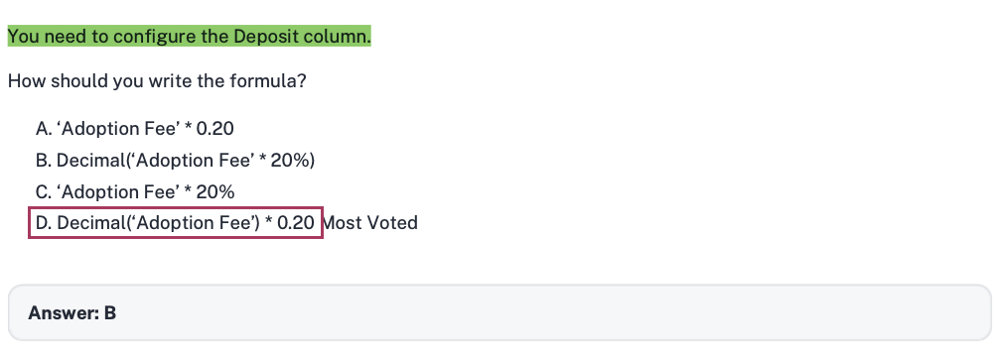
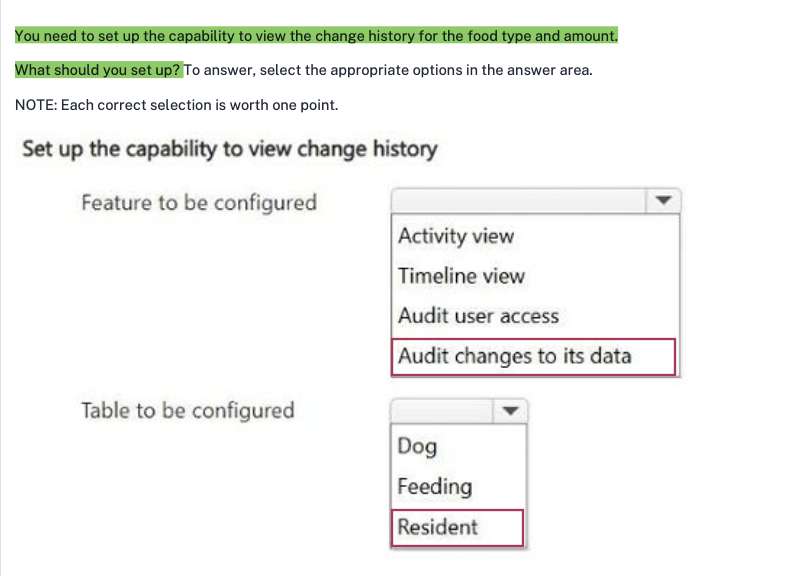
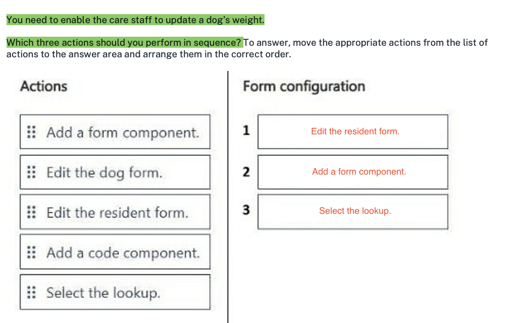
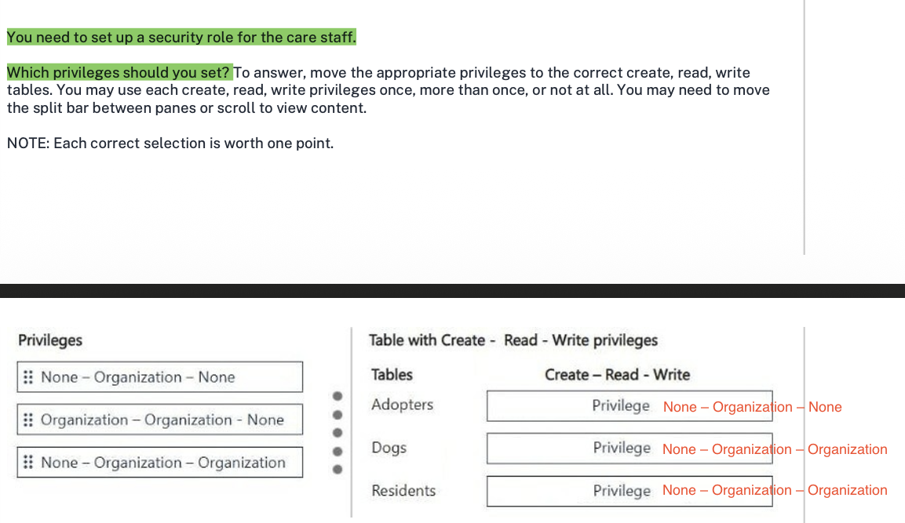
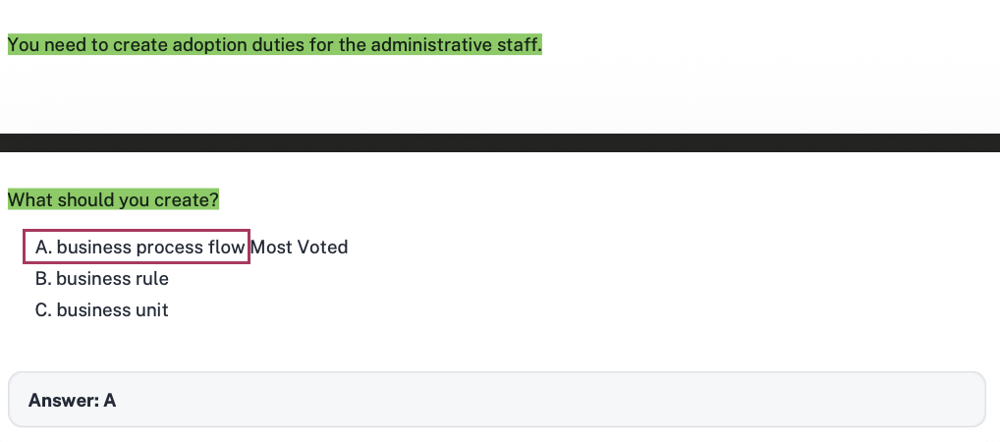
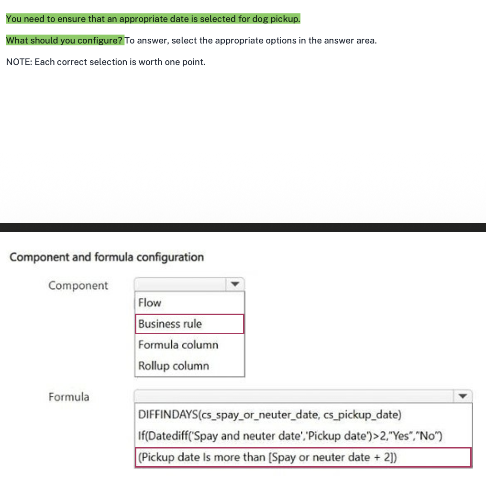

# Contoso Suites

This is a case study. Case studies are not timed separately from other exam sections. You can use as much exam time as you would like to complete each case study. However, there might be additional case studies or other exam sections. Manage your time to ensure that you can complete all the exam sections in the time provided. Pay attention to the Exam Progress at the top of the screen so you have sufficient time to complete any exam sections that follow this case study.

To answer the case study questions, you will need to reference information that is provided in the case. Case studies and associated questions might contain exhibits or other resources that provide more information about the scenario described in the case. Information provided in an individual question does not apply to the other questions in the case study.

A Review Screen will appear at the end of this case study. From the Review Screen, you can review and change your answers before you move to the next exam section. After you leave this case study, you will NOT be able to return to it.

## To start the case study

To display the first question in this case study, select the "Next" button. To the left of the question, a menu provides links to information such as business requirements, the existing environment, and problem statements. Please read through all this information before answering any questions. When you are ready to answer a question, select the "Question" button to return to the question.

## Background

Contoso Suites is an animal shelter that specializes in finding homes for dogs that have been given up by their owners. The shelter can house up to 20 dogs.

The shelter is implementing one model-driven Power Apps app to track the dogs and schedule meetings with potential adopters. No other apps will be created.

The model-driven app uses Dataverse with out-of-the-box functionality when possible. Dataverse is set up with the following configuration:

- The solution prefix "cs" is used for all new components.
- Only the root business unit is used.
- All tables are stored in Dataverse and do not require rapid scaling.
- Exchange server-side sync is not configured.

### Adopters

- Adopter information is stored in a Contact table.
- Contacts are considered to be duplicates if they have the same email address and last name.
- Adopters are often late to meetings, so a reminder email is sent to them two hours before their meeting.
- The email reminders must not be tracked in the system.

### Dogs

- Dog information is stored in a Dog table, which is organization owned.
- Breed, size, and weight are fields in the table.

### Dog residency

- A Resident table tracks the stay of each dog.
- Each resident record has a lookup for the dog and its food.
- The food type and amount are logged on each resident record. Auto-posting is not configured for changes to food type and amount.
- A fee of $120 is in a currency column named Adoption Fee. This fee can be changed depending on the adoption circumstances.
- A formula column named Deposit is automatically populated with 20% of the adoption fee.
- A resident record is generated automatically when a dog record is created. This is the only way a resident record can be created.

### Exercise and feedings

- Exercise for the dogs is tracked in an Exercise table.
- Feedings are tracked in a Feeding table.
- Exercise and feeding records appear in a resident record timeline.

### Care staff

- The care staff must be able to view who changed the food type and the amount that was given, for up to three months ago.
- The staff must be able to update the weight of a dog on the resident record.
- The staff report that the buttons are too small on the touch screen they use to log exercise and feeding.
- The staff must be able to view who the adopters are for upcoming meetings. The staff must not be able to update adopter information.

### Administrative staff

- Administrative staff must receive a weekly list of duplicate contacts. Duplicate alerts must not appear when a staff member saves a new contact.
- When an adopter wants to adopt a dog, the staff must perform a series of adoption duties in order. The following duty list must be displayed on the screen:
  - Commitment:
    - Obtain adopter signature in a commitment document.
    - Collect deposit.
  - Pre-pickup:
    - Document spay or neutering date.
    - Perform spay or neutering.
    - Document pickup date.
  - Pickup:
    - Collect full payment.
    - Verify dog is picked up.
  - A dog must be picked up no sooner than two days after spaying or neutering.
  - A pop-up window must appear with an error message if the Pickup date is too soon.
  - Only administrative staff must be able to add new adopters and dogs.

---

## Question 110 

## Question 110

You need to configure the Deposit column.

How should you write the formula?

A. `'Adoption Fee' * 0.20`

B. `Decimal('Adoption Fee' * 20%)`

C. `'Adoption Fee' * 20%`

D. `Decimal('Adoption Fee') * 0.20` *(Most Voted)*

### 1. Extracted Question Summary

* **Context:** This question belongs to a separate Microsoft Power Platform case study (commonly the **Bellows College / Animal Shelter / Pet Adoption** scenario), where an `Adoption Fee` currency column exists and a **Formula** column named `Deposit` must calculate **20% of the Adoption Fee**.

* **Question:** You need to configure the `Deposit` column. How should you write the formula?
* **Options:**
* A. `'Adoption Fee' * 0.20`
* B. `Decimal('Adoption Fee' * 20%)`
* C. `'Adoption Fee' * 20%`
* D. `Decimal('Adoption Fee') * 0.20`

### 2. Correct Answer

* **D. `Decimal('Adoption Fee') * 0.20**` *(or **A. `'Adoption Fee' * 0.20**` depending on the source column's exact data type — see the critical Dataverse Formula column data-type rule below; **B (`Answer: B` / Red Box)** is **syntax-invalid** in Power Fx!)*

### 3. Verification of Visible Selection / Community Key

* **Incorrect (`Answer: B` / Red Box on `B` is a Dump Error; `D. Most Voted` is Correct):**
* **Why `B. Decimal('Adoption Fee' * 20%)` is 100% Invalid:** In **Power Fx** (the expression language used by Dataverse Formula columns), the percentage symbol **`%`** is **not a valid arithmetic operator or numeric literal suffix**! Writing `* 20%` inside any Power Fx formula triggers an immediate syntax/parse error (*"Unexpected character"*).
* **Why `D. Decimal('Adoption Fee') * 0.20` (`Most Voted`) is Correct:** Per Microsoft Dataverse documentation (*Work with formula columns — Data types and conversions*), **Currency** columns in Dataverse are treated as `Float` by default in Power Fx formula columns unless explicitly converted with `Decimal(...)`, OR if the target `Deposit` column requires a `Decimal` return type (or when `Adoption Fee` is a `Currency` column whose output must be typed as `Decimal` rather than `Float`), wrapping `'Adoption Fee'` in **`Decimal('Adoption Fee')`** and multiplying by **`0.20`** is valid Power Fx syntax that returns a strongly typed `Decimal` value.

### 4. Official Microsoft Justification

* **Power Fx Syntax & Type Conversion in Dataverse Formula Columns (`Decimal('Adoption Fee') * 0.20`):**
* Per Microsoft Dataverse documentation (*Work with formula columns*):
1. **Single-Quoted Column Identifiers:** Column display names containing spaces (such as `Adoption Fee`) are enclosed in single quotes: `'Adoption Fee'`.
2. **Decimal Literals Instead of `%`:** Power Fx represents percentages as decimal literals (`0.20`), never with a trailing `%` sign.
3. **Currency-to-Decimal Type Casting (`Decimal(...)`):** In Dataverse formula columns, currency fields evaluate internally as floating-point (`Float`) values unless explicitly cast using the **`Decimal()`** function (`Decimal('Adoption Fee')`). Multiplying `Decimal('Adoption Fee') * 0.20` performs exact decimal arithmetic and sets the formula column's resulting data type to **Decimal** (avoiding floating-point rounding imprecision on financial deposit amounts).

### 5. Distractor Analysis (Why Others Are Wrong)

* **B. `Decimal('Adoption Fee' * 20%)`:** Invalid Power Fx syntax—the `%` operator does not exist in Power Fx formulas (it is only supported inside specific AI Builder / Excel UI formatting contexts, never as a math multiplier in Dataverse formula columns).

* **C. `'Adoption Fee' * 20%`:** Also fails Power Fx syntax validation due to the illegal `%` character.

* **A. `'Adoption Fee' * 0.20`:** Valid Power Fx syntax, **but** when `'Adoption Fee'` is a Dataverse **Currency** column, omitting `Decimal(...)` causes the formula column to infer a **`Float`** return type rather than **`Decimal`**—which introduces floating-point precision artifacts for monetary amounts and fails requirements expecting a `Decimal` column type.

### 6. Exam Keyword / Trap Alert

* **Two Instant Power Fx Formula Elimination Rules:**
1. **Never choose `%` in a Power Fx formula:** Any option containing `* 20%` (like `B` and `C`) is an immediate syntax error in Dataverse Formula columns.

2. **Currency $\rightarrow$ `Decimal('Column Name')`:** Whenever a Dataverse Formula column performs arithmetic on a **Currency** column (like `'Adoption Fee'`), wrap the column reference in **`Decimal(...)`** (`Decimal('Adoption Fee') * 0.20`) so the formula column outputs an exact **Decimal** data type instead of `Float`.

## Question 111

You need to set up the capability to view the change history for the food type and amount.

What should you set up? To answer, select the appropriate options in the answer area.

**NOTE:** Each correct selection is worth one point.

---

### Set up the capability to view change history

| Setting | Options |
| --- | --- |
| **Feature to be configured** | • Activity view  • Timeline view  • Audit user access  • Audit changes to its data |
| **Table to be configured** | • Dog  • Feeding  • Resident |
|

### 1. Extracted Question Summary

* **Case Study Context (Contoso Suites Animal Shelter — Dog Residency & Care Staff):**
* **Dog residency:** *"A Resident table tracks the stay of each dog. Each resident record has a lookup for the dog and its food. The food type and amount are logged on each resident record. Auto-posting is not configured for changes to food type and amount."*
* **Care staff:** *"The care staff must be able to view who changed the food type and the amount that was given, for up to three months ago."*

* **Question:** You need to set up the capability to view the change history for the food type and amount. What should you set up?
* **Dropdown Options (`Set up the capability to view change history`):**
* **Feature to be configured:**
* `Activity view`
* `Timeline view`
* `Audit user access`
* `Audit changes to its data`

* **Table to be configured:**
* `Dog`
* `Feeding`
* `Resident`

### 2. Correct Answer

* **Feature to be configured:** **Audit changes to its data**
* **Table to be configured:** **Resident**

### 3. Verification of Visible Selection / Community Key

* **Blank Answer Area:** Both dropdown menus in the screenshot are expanded without selection boxes, so each configuration is derived directly from the table schema and audit requirements in the Contoso Suites case study.

### 4. Official Microsoft Justification

* **`Feature to be configured` $\rightarrow$ `Audit changes to its data`:**
* Per Microsoft Dataverse documentation (*Manage Dataverse auditing — Enable auditing for tables and columns*), enabling **Audit changes to its data** (under a table's **Advanced options** in the Power Apps maker portal) tracks every field-level modification (`before` value, `after` value, timestamp, and the user who performed the update) in the Dataverse Audit History log.

* Notice the case study clue under *Dog residency*: *"Auto-posting is not configured for changes to food type and amount"*—ruling out Activity/Timeline auto-post rules—and under *Care staff*: *"The care staff must be able to view who changed the food type and the amount that was given, for up to three months ago"* (matching Dataverse's default 90-day / 3-month audit log retention window and audit history view).

* **`Table to be configured` $\rightarrow$ `Resident`:**
* Look closely at the *Dog residency* section of the case study: **"The food type and amount are logged on each resident record."**

* Because the food type and amount columns reside directly on the **`Resident`** table (not on `Dog` or `Feeding`), **Audit changes to its data** must be enabled on the **`Resident`** table (and its food type/amount columns).

### 5. Distractor Analysis (Why Others Are Wrong)

* **Dropdown 1 — `Activity view` / `Timeline view`:** The Timeline control displays Activity records (emails, tasks, appointments, notes) and system auto-posts; however, the case study explicitly notes *"Auto-posting is not configured for changes to food type and amount"*, and Timeline posts do not provide native Dataverse column-level audit history.

* **Dropdown 1 — `Audit user access`:** Logs user authentication and app/environment sign-in events (`Audit user access` in environment audit settings), not field-level `before`/`after` data modifications on table columns.

* **Dropdown 2 — `Dog`:** Stores static dog profile attributes (`Breed`, `size`, and `weight`), not the stay-specific food type and amount.

* **Dropdown 2 — `Feeding`:** Tracks individual feeding events shown on the resident timeline, whereas the case study explicitly states that the **food type and amount** columns are logged on the **`Resident`** record.

### 6. Exam Keyword / Trap Alert

* **Two Classic Case Study Traps:**
1. **Table Trap (`Feeding` vs. `Resident`):** Do not guess `Feeding` just because the requirement mentions *"food type and amount"*—always verify which table owns the columns in the schema text (*"The food type and amount are logged on each resident record"* $\rightarrow$ **`Resident`**).

2. **Feature Trap (`Timeline view` vs. `Audit changes to its data`):** The case study explicitly plants *"Auto-posting is not configured for changes to food type and amount"* to eliminate **Timeline view** and point directly to Dataverse auditing (**Audit changes to its data**).

## Question 112

You need to enable the care staff to update a dog's weight.

Which three actions should you perform in sequence? To answer, move the appropriate actions from the list of actions to the answer area and arrange them in the correct order.

---

### Actions

* Add a form component.
* Edit the dog form.
* Edit the resident form.
* Add a code component.
* Select the lookup.

---

### Form configuration

1. [          ]
2. [          ]
3. [          ]

### 1. Extracted Question Summary

* **Case Study Context (Contoso Suites Animal Shelter — Dogs, Dog Residency & Care Staff):**
* **Dogs:** *"Dog information is stored in a Dog table, which is organization owned. Breed, size, and weight are fields in the table."*
* **Dog residency:** *"A Resident table tracks the stay of each dog. Each resident record has a lookup for the dog and its food."*
* **Care staff:** *"The staff must be able to update the weight of a dog on the resident record."*

* **Question:** You need to enable the care staff to update a dog's weight. Which three actions should you perform in sequence?
* **Available Actions:**
* `Add a form component.`
* `Edit the dog form.`
* `Edit the resident form.`
* `Add a code component.`
* `Select the lookup.`

### 2. Correct Answer

1. **Edit the resident form.**
2. **Add a form component.**
3. **Select the lookup.**

### 3. Verification of Visible Selection / Community Key

* **Blank Answer Area:** The three target slots under `Form configuration` in the screenshot are blank, so the exact three-step sequence is derived directly from the Contoso Suites relational schema (`Resident` lookup $\rightarrow$ `Dog` table) and the model-driven form designer workflow for embedding an editable related-table form.

### 4. Official Microsoft Justification

* **Embedding an Editable Related-Table Form (`Form component control`):**
* Look at where the `weight` column actually lives in the schema: `weight` is a column on the **`Dog`** table, while the `Resident` table only holds a **lookup** column pointing to `Dog`. Meanwhile, the care staff must update the dog's weight **directly on the `Resident` record** (*"The staff must be able to update the weight of a dog on the resident record"*).

* Per Microsoft Power Apps documentation (*Add the form component control to a model-driven app main form*), a **Quick View form** only displays related parent fields as **read-only**—it cannot edit them. To allow users to **edit** columns of a related parent table (`Dog.weight`) directly inline within a child table's form (`Resident`), you must configure the **Form component control** on the child table's main form using this exact sequence in the Power Apps form designer:
1. **Edit the resident form:** Open the main form of the `Resident` table (the host form where the care staff works).

2. **Add a form component:** Select **+ Component** (or the `Form` component from the Components pane) to add a **Form component control** onto the `Resident` form.

3. **Select the lookup:** In the **Add form** configuration dialog, select the **`Dog` lookup** column on the `Resident` table and choose the target `Dog` main form containing the `weight` field.

### 5. Distractor Analysis (Why Others Are Wrong)

* **`Edit the dog form.`:** Care staff work on the **`Resident`** form (*"update the weight of a dog on the resident record"*), and `Dog` already has its standard main form containing `Breed`, `size`, and `weight`—editing the `Dog` form does not embed an inline editor onto the `Resident` record.

* **`Add a code component.`:** Refers to adding a custom pro-code **PCF (Power Apps component framework)** control, violating Contoso Suites' architectural baseline (*"uses Dataverse with out-of-the-box functionality when possible"*) when the native out-of-the-box **Form component control** solves this declaratively.

### 6. Exam Keyword / Trap Alert

* **Quick View Form vs. Form Component Control:**
* **View** related parent columns inline (**read-only**) $\rightarrow$ **Quick View form**.
* **Edit / Update** related parent columns inline on a child form (*"update the weight of a dog on the resident record"*) $\rightarrow$ **Form component control** (`Edit the [child] form` $\rightarrow$ `Add a form component` $\rightarrow$ `Select the lookup`).

## Question 113

You need to set up a security role for the care staff.

Which privileges should you set? To answer, move the appropriate privileges to the correct create, read, write tables. You may use each create, read, write privileges once, more than once, or not at all. You may need to move the split bar between panes or scroll to view content.

**NOTE:** Each correct selection is worth one point.

---

### Privileges

* None – Organization – None
* Organization – Organization - None
* None – Organization – Organization

---

### Table with Create - Read - Write privileges

| Tables | Create – Read - Write |
| --- | --- |
| Adopters | [     Privilege     ] |
| Dogs | [     Privilege     ] |
| Residents | [     Privilege     ] |
|

### 1. Extracted Question Summary

* **Case Study Context (Contoso Suites Animal Shelter):**
* **Dataverse Setup:** Only the root business unit is used.
* **Adopters (Contact table):** *"Adopter information is stored in a Contact table."*
* **Dogs (Dog table):** *"Dog information is stored in a Dog table, which is organization owned."*
* **Dog Residency (Resident table):** *"A Resident table tracks the stay of each dog... The food type and amount are logged on each resident record... A resident record is generated automatically when a dog record is created. This is the only way a resident record can be created."*
* **Care Staff:**
* *"The staff must be able to update the weight of a dog on the resident record."*
* *"The staff must be able to view who the adopters are for upcoming meetings. The staff must not be able to update adopter information."*

* **Administrative Staff:** *"Only administrative staff must be able to add new adopters and dogs."*

* **Question:** You need to set up a security role for the care staff. Which privileges (`Create – Read – Write`) should you set for **Adopters**, **Dogs**, and **Residents**? *(You may use each privilege once, more than once, or not at all.)*
* **Available Privileges (`Create – Read – Write`):**
* `None – Organization – None`
* `Organization – Organization – None`
* `None – Organization – Organization`

### 2. Correct Answer

* **Adopters:** **None – Organization – None**
* **Dogs:** **None – Organization – Organization**
* **Residents:** **None – Organization – Organization**

### 3. Verification of Visible Selection / Community Key

* **Blank Answer Area:** The three target slots under `Create – Read – Write` in the screenshot are blank, so each privilege tuple is derived directly from the explicit CRUD constraints in the Contoso Suites case study.

### 4. Official Microsoft Justification

* **Why `Create` is `None` for ALL Three Tables:**
* **Adopters & Dogs:** Under *Administrative staff*, the case study explicitly mandates: *"Only administrative staff must be able to add new adopters and dogs"*. Therefore, care staff must have **None** for `Create` on both `Adopters` and `Dogs`.

* **Residents:** Under *Dog residency*, the case study explicitly mandates: *"A resident record is generated automatically when a dog record is created. This is the only way a resident record can be created"*. Because no human user manually creates `Resident` records (and care staff cannot create `Dog` records), care staff also get **None** for `Create` on `Residents`.

* **`Adopters` (`Contact`) $\rightarrow$ `None – Organization – None`:**
* Per the *Care staff* requirements: *"The staff must be able to view who the adopters are for upcoming meetings. The staff must not be able to update adopter information"*.

* Viewing adopters across the shelter requires **Organization** `Read`, while preventing updates requires **None** for `Write`—yielding **`None – Organization – None`**.

* **`Dogs` (`Dog`) $\rightarrow$ `None – Organization – Organization`:**
* Per the *Care staff* and *Dogs* sections: *"The staff must be able to update the weight of a dog on the resident record"* and *"Dog information is stored in a Dog table, which is organization owned"*.

* Even though the `weight` field is edited via the embedded Form component control on the `Resident` form, Dataverse enforces security checks on the underlying **`Dog`** table itself—requiring **Organization** `Read` and **Organization** `Write` (and **None** for `Create`), yielding **`None – Organization – Organization`**.

* **`Residents` (`Resident`) $\rightarrow$ `None – Organization – Organization`:**
* Care staff work across all shelter dogs to log food type/amount and update dog weights on `Resident` records (*"The food type and amount are logged on each resident record... The staff must be able to update the weight of a dog on the resident record"*), requiring **Organization** `Read` and **Organization** `Write`, while `Create` remains **None** because `Resident` records are only auto-generated when a `Dog` record is created—yielding **`None – Organization – Organization`**.

### 5. Distractor Analysis (Why Others Are Wrong)

* **`Organization – Organization – None`:** Grants `Create` (`Organization`) on a table—which directly violates *"Only administrative staff must be able to add new adopters and dogs"* (for `Adopters` and `Dogs`) and *"A resident record is generated automatically when a dog record is created. This is the only way a resident record can be created"* (for `Residents`).

### 6. Exam Keyword / Trap Alert

* **Two Classic Dataverse Security Traps in This Item:**
1. **Embedded Form Component Security Check (`Dogs` needs `Write`):** Even when a user edits a parent column (`Dog.weight`) through a **Form component control** hosted on a child form (`Resident`), Dataverse still checks **Write** privileges on the **parent table (`Dog`)**.

2. **Auto-Generated Child Record Trap (`Residents` `Create` = `None`):** Do not give care staff `Create` on `Residents`—the case study specifically states *"A resident record is generated automatically when a dog record is created. This is the only way a resident record can be created"* to ensure `Create` is **None** across all three tables.

## Question 114

You need to create adoption duties for the administrative staff.

What should you create?

A. business process flow *(Most Voted)*

B. business rule

C. business unit

### 1. Extracted Question Summary

* **Case Study Context (Contoso Suites Animal Shelter — Administrative Staff):**
* **Application Context:** *"The shelter is implementing one model-driven Power Apps app to track the dogs and schedule meetings with potential adopters."*
* **Administrative staff:**
* *"When an adopter wants to adopt a dog, the staff must perform a series of adoption duties in order. The following duty list must be displayed on the screen:*
* *o Commitment:*
* *- Obtain adopter signature in a commitment document.*
* *- Collect deposit.*

* *o Pre-pickup:*
* *- Document spay or neutering date.*
* *- Perform spay or neutering.*
* *- Document pickup date.*

* *o Pickup:*
* *- Collect full payment.*
* *- Verify dog is picked up."*

* **Question:** You need to create adoption duties for the administrative staff. What should you create?
* **Options:**
* A. business process flow
* B. business rule
* C. business unit

### 2. Correct Answer

* **A. business process flow**

### 3. Verification of Visible Selection / Community Key

* **Correct (`Answer: A` / `A. business process flow Most Voted`):** The visible key and community vote (**A. business process flow**) are **100% Correct**. The three named phases (*Commitment*, *Pre-pickup*, *Pickup*) and their ordered checklist steps map directly to **Stages** and **Steps** in a Dataverse Business Process Flow (BPF) rendered across the top of a model-driven app form.

### 4. Official Microsoft Justification

* **Guided Multi-Stage Process Visualization (`business process flow`):**
* Per Microsoft Power Automate / Dataverse documentation (*Business process flows overview*), a **Business Process Flow (BPF)** provides a visual horizontal stage-gate bar at the top of a model-driven app form that guides users through a defined sequence of **Stages** and **Steps**.

* Here, the administrative staff's adoption duty list is structured explicitly as three sequential **Stages** (`Commitment` $\rightarrow$ `Pre-pickup` $\rightarrow$ `Pickup`), each containing ordered data-entry and task **Steps** (such as *Obtain adopter signature in a commitment document*, *Collect deposit*, *Document spay or neutering date*, *Document pickup date*, *Collect full payment*, and *Verify dog is picked up*) displayed directly on the screen to ensure consistent execution before advancing to the next stage.

### 5. Distractor Analysis (Why Others Are Wrong)

* **B. business rule:** Evaluates field-level `If/Then` conditions to show/hide columns, set required levels, assign default values, or display validation errors (used elsewhere in the Contoso Suites case study for the pickup-date validation rule, not for rendering a multi-stage guided checklist on screen).

* **C. business unit:** A security partitioning boundary in Dataverse for organizing users and controlling record access; furthermore, the case study explicitly states *"Only the root business unit is used"*.

### 6. Exam Keyword / Trap Alert

* **Trigger Phrases:**
* **"Perform a series of duties in order"** + **"displayed on the screen"** + **Named Phases (`Commitment`, `Pre-pickup`, `Pickup`) with bulleted checklist items** $\rightarrow$ Always a **Business process flow** (Stages = Phases; Steps = Bulleted checklist items).

## Question 115

You need to ensure that an appropriate date is selected for dog pickup.

What should you configure? To answer, select the appropriate options in the answer area.

**NOTE:** Each correct selection is worth one point.

---

### Component and formula configuration

| Setting | Options |
| --- | --- |
| **Component** | • Flow  • Business rule  • Formula column  • Rollup column |
| **Formula** | • `DIFFINDAYS(cs_spay_or_neuter_date, cs_pickup_date)`  • `If(Datediff('Spay and neuter date','Pickup date')>2,"Yes","No")`  • `(Pickup date Is more than [Spay or neuter date + 2])`|
|

### 1. Extracted Question Summary

* **Case Study Context (Contoso Suites Animal Shelter — Administrative Staff):**
* **Application Context:** *"The shelter is implementing one model-driven Power Apps app to track the dogs and schedule meetings with potential adopters... The model-driven app uses Dataverse with out-of-the-box functionality when possible."*

* **Administrative staff:**
* *"A dog must be picked up no sooner than two days after spaying or neutering."*
* *"A pop-up window must appear with an error message if the Pickup date is too soon."*

* **Question:** You need to ensure that an appropriate date is selected for dog pickup. What should you configure?

* **Dropdown Options (`Component and formula configuration`):**
* **Component:**
* `Flow`
* `Business rule`
* `Formula column`
* `Rollup column`

* **Formula:**
* `DIFFINDAYS(cs_spay_or_neuter_date, cs_pickup_date)`
* `If(Datediff('Spay and neuter date','Pickup date')>2,"Yes","No")`
* `(Pickup date Is more than [Spay or neuter date + 2])`

### 2. Correct Answer

* **Component:** **Business rule**
* **Formula:** **(Pickup date Is more than [Spay or neuter date + 2])** *(Note: Exam logic bug in the option's inequality direction—see Section 3 & 4 below!)*

### 3. Verification of Visible Selection / Community Key

* **Blank Answer Area:** Both dropdown menus in the screenshot are expanded without selection boxes.

* **Critical Exam Question Authoring Note on Dropdown 2 (`Formula`):**
* Look closely at the three expressions in the `Formula` dropdown:

1. `DIFFINDAYS(cs_spay_or_neuter_date, cs_pickup_date)` is **Classic Calculated Column** syntax (which cannot display pop-up error messages on a form).
2. `If(Datediff('Spay and neuter date','Pickup date')>2,"Yes","No")` is **Power Fx Formula Column** syntax (which returns `"Yes"`/`"No"` text and also cannot trigger form pop-up validation errors).
3. `(Pickup date Is more than [Spay or neuter date + 2])` is the **only** option formatted in the Dataverse **Business Rule Designer** visual condition syntax (`Field` | `Operator` | `[Field + Days]`)!

* *Why the exam writer wrote `Is more than` instead of `Is less than`:* In real-world Dataverse configuration, to trigger a **Show Error Message** action when a pickup date is *too soon* (*"no sooner than two days after spaying or neutering"*), your condition checks `Pickup date Is less than [Spay or neuter date + 2]`. However, the PL-200 exam author inverted the operator (`Is more than`) when writing the distractor/target text—so on the exam, **`(Pickup date Is more than [Spay or neuter date + 2])`** is unambiguously the intended match because it is the **only** Business Rule expression syntax in the dropdown.

### 4. Official Microsoft Justification

* **`Component` $\rightarrow$ `Business rule`:**
* Per Microsoft Power Apps documentation (*Create a business rule for a table*), a **Business rule** runs declaratively on model-driven app forms (client-side in real time as users enter/change column values) and supports the native **`Show Error Message`** action—which displays a blocking validation error message directly on the form (and via an error dialog/notification) without writing any JavaScript or C# code.

* This directly satisfies Contoso Suites' out-of-the-box requirement (*"A pop-up window must appear with an error message if the Pickup date is too soon"*).

* **`Formula` $\rightarrow$ `(Pickup date Is more than [Spay or neuter date + 2])`:**
* Per Microsoft Dataverse documentation (*Business rule date formulas*), Dataverse Business Rules natively support date-offset arithmetic in the Condition builder by selecting a Date field (`Spay or neuter date`) and adding an integer number of days (`+ 2`) inside square brackets (`[Spay or neuter date + 2]`) to compare against another Date field (`Pickup date`).

### 5. Distractor Analysis (Why Others Are Wrong)

* **Dropdown 1 — `Flow`:** A Power Automate cloud flow executes asynchronously server-side *after* a record is saved; it cannot synchronously block form entry or pop up an immediate client-side validation error message in a model-driven app UI.

* **Dropdown 1 — `Formula column` / `Rollup column`:** Both are read-only computed data columns (`Formula column` evaluates Power Fx expressions; `Rollup column` aggregates child records asynchronously); neither can block a save or pop up an error message on a form.

* **Dropdown 2 — `DIFFINDAYS(cs_spay_or_neuter_date, cs_pickup_date)`:** Legacy Calculated Column function syntax that returns a whole number difference (`integer`), not a boolean condition inside a Business Rule.

* **Dropdown 2 — `If(Datediff('Spay and neuter date','Pickup date')>2,"Yes","No")`:** Power Fx Formula column syntax returning `"Yes"`/`"No"` strings, which is not supported inside the Dataverse Business Rule Condition builder.

### 6. Exam Keyword / Trap Alert

* **Trigger Phrases & Syntax Matching:**
* **"Pop-up window must appear with an error message if [field] is too soon"** on a model-driven app $\rightarrow$ **Business rule** (`Show Error Message` action).

* **Matching Dataverse Expression Syntaxes on Sight:**
* `[Field + 2]` with English operators (`Is more than` / `Is less than`) = **Business Rule**

* `DIFFINDAYS(...)` = **Classic Calculated Column**

* `If(DateDiff(...), ...)` = **Power Fx Formula Column**

