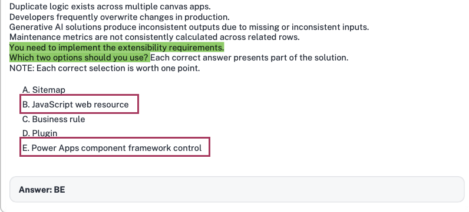
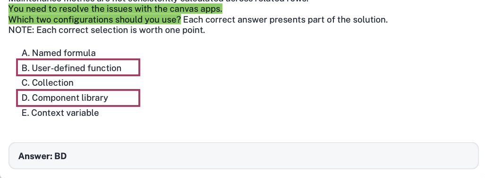
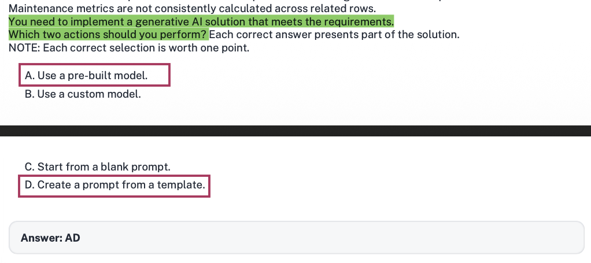
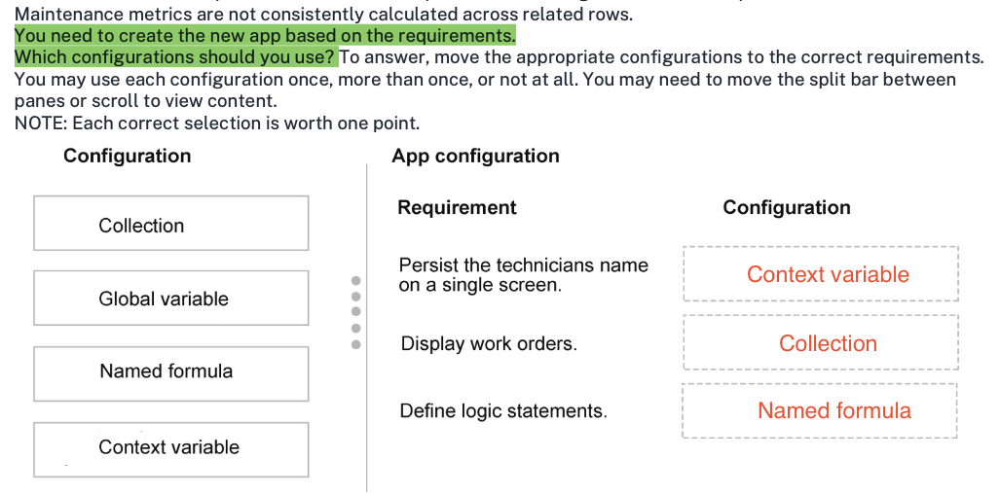
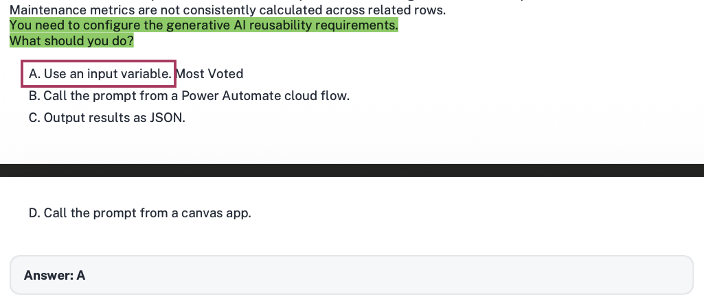
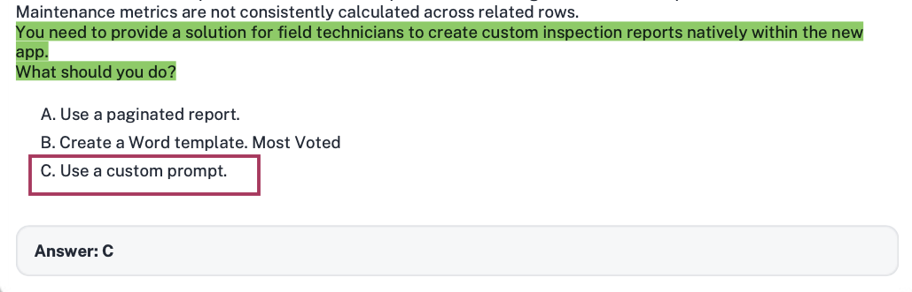
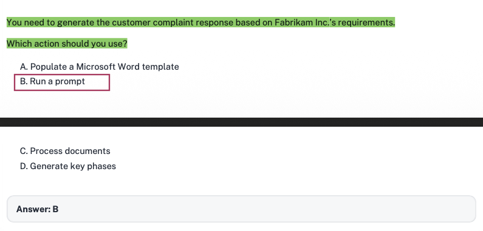
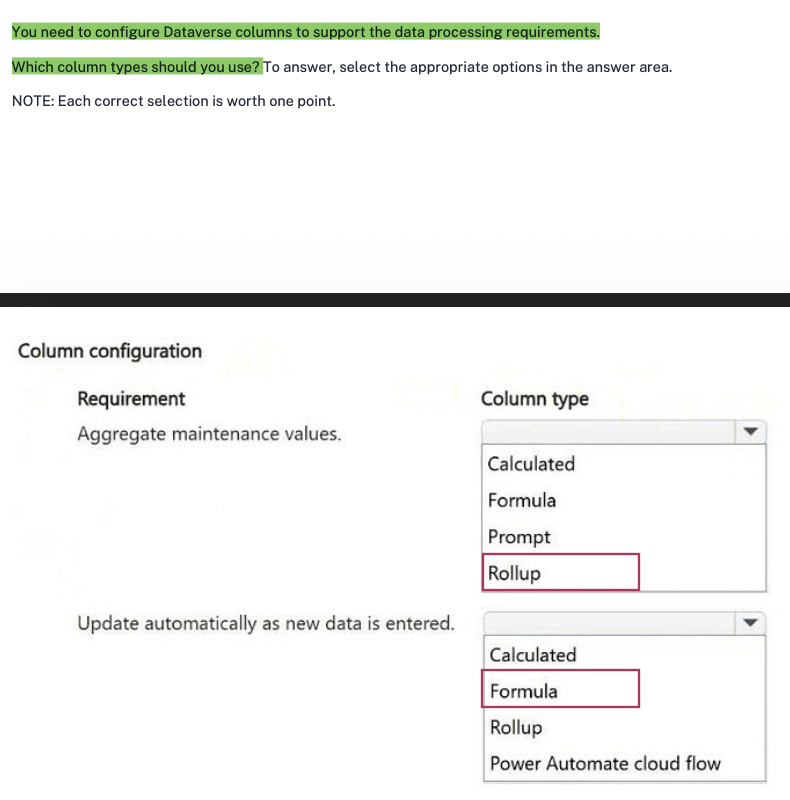
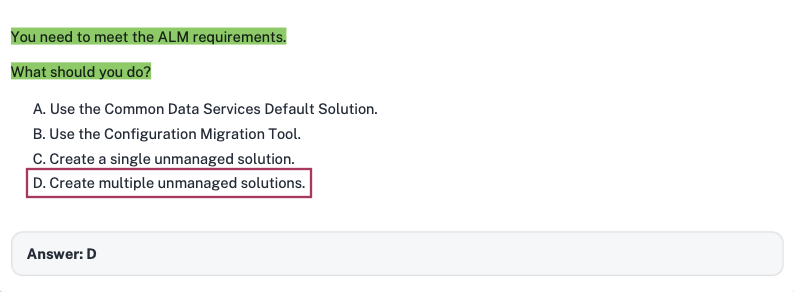
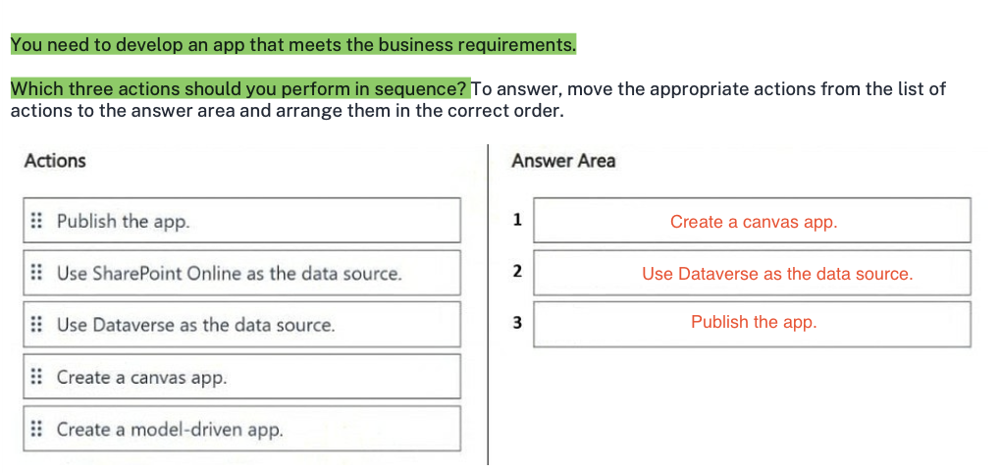

# Fabrikam Inc.

This is a case study. Case studies are not timed separately from other exam sections. You can use as much exam time as you would like to complete each case study. However, there might be additional case studies or other exam sections. Manage your time to ensure that you can complete all the exam sections in the time provided. Pay attention to the Exam Progress at the top of the screen so you have sufficient time to complete any exam sections that follow this case study.

To answer the case study questions, you will need to reference information that is provided in the case. Case studies and associated questions might contain exhibits or other resources that provide more information about the scenario described in the case. Information provided in an individual question does not apply to the other questions in the case study.

A Review Screen will appear at the end of this case study. From the Review Screen, you can review and change your answers before you move to the next exam section. After you leave this case study, you will NOT be able to return to it.

## To start the case study

To display the first question in this case study, select the "Next" button. To the left of the question, a menu provides links to information such as business requirements, the existing environment, and problem statements. Please read through all this information before answering any questions. When you are ready to answer a question, select the "Question" button to return to the question.

## Background

Fabrikam Inc. is an energy provider that operates wind and solar farms across multiple countries and regions. The company uses Microsoft Power Platform to manage asset maintenance, technician workflows, and predictive analytics.

Field technicians use canvas apps on mobile devices to capture inspection and repair data. Operations managers use model-driven apps to monitor asset performance and maintenance history.

The company plans to enhance its platform by introducing AI-driven insights, improving reuse across applications, and establishing a formal application lifecycle management (ALM) strategy.

## Current environment

### Applications

- Field technicians use an outdated mobile app to log maintenance activities and capture asset readings in SharePoint Online.
- Operations managers use a model-driven app to review maintenance records and asset performance trends.

### Development practices

- Developers build and modify applications directly in the production environment.
- There is NO structured ALM process.
- Solutions are NOT consistently used to package or deploy application components.
- Reusable components are inconsistently implemented across apps, leading to duplication.

### AI integration

- Fabrikam Inc. plans to actively explore generative AI usage as part of the next phase of work.

## Business requirement

### Application development

- The outdated mobile app must be replaced with a new app that supports responsive design principles, provides full control over the UI, and allows technicians to take and upload photos directly from their mobile devices.
- The new app for the field technicians requires the name of the technician to be persisted on the home screen only. In addition, work orders must be displayed within a gallery.
- All new apps must connect to a scalable, cloud-based relational data store.
- Apps must support efficient data entry for technicians in the field.
- Reusable UI elements must be implemented to reduce duplication.

### AI capabilities

- The company requires a generative AI solution to manage customer complaint responses and create custom inspection reports that align to an existing template.
- Customer complaint responses must be generated in applications and based on emails being sent to a mailbox.
- Custom AI development must be minimized.

### Generative AI reusability

- Generative AI solutions must accept dynamic inputs to adapt to different scenarios.
- Generative AI solutions must be reusable across different Power Platform services.

### Extensibility

- Custom UI form components must be reusable across applications.
- Use of server-side custom code must be minimized where possible.

## Technical requirements

### Application lifecycle management (ALM)

- Separate environments must be used for development, testing, and production.
- Solutions must be used to package application components, segmented based on functional areas.
- Managed solutions must be deployed to the production environment.
- Validation must occur before deployment to production.

### Data processing

- Aggregated values across related rows must be displayed for reporting.
- Calculations must update automatically as new data is entered. Calculation data must be limited to a maximum length of 10.

## Issues

- Duplicate logic exists across multiple canvas apps.
- Developers frequently overwrite changes in production.
- Generative AI solutions produce inconsistent outputs due to missing or inconsistent inputs.
- Maintenance metrics are not consistently calculated across related rows.

---

## Question

You need to implement the extensibility requirements.

Which two options should you use? Each correct answer presents part of the solution.

**NOTE:** Each correct selection is worth one point.

- A. Sitemap
- B. JavaScript web resource
- C. Business rule
- D. Plugin
- E. Power Apps component framework control

### 1. Extracted Question Summary

* **Case Study Context (Fabrikam Inc. — Extensibility & Issues):**
* **Extensibility:**
* *"Custom UI form components must be reusable across applications."*
* *"Use of server-side custom code must be minimized where possible."*

* **Issues:** *"Duplicate logic exists across multiple canvas apps."*

* **Question:** You need to implement the extensibility requirements. Which two options should you use? (Each correct answer presents part of the solution.)
* **Options:**
* A. Sitemap
* B. JavaScript web resource
* C. Business rule
* D. Plugin
* E. Power Apps component framework control

### 2. Correct Answer

* **B. JavaScript web resource**
* **E. Power Apps component framework control**

### 3. Verification of Visible Selection / Community Key

* **Correct (`Answer: BE`):** The visible key (**BE**) is **100% Correct**. Both options directly satisfy Fabrikam Inc.'s **Extensibility** section by delivering reusable client-side UI/form extensibility across applications while strictly avoiding server-side custom code (C# plugins).

### 4. Official Microsoft Justification

* **Reusable Custom UI Controls Across Apps (`E. Power Apps component framework control`):** Per Microsoft Power Apps documentation (*Power Apps component framework overview*), **PCF (Power Apps component framework) controls** allow developers to build custom, reusable UI form and dataset components using TypeScript/HTML/CSS that can be packaged in solutions and reused across both **model-driven apps** and **canvas apps**—directly satisfying *"Custom UI form components must be reusable across applications"*.

* **Client-Side Form Logic Without Server-Side Code (`B. JavaScript web resource`):** Per Microsoft Dataverse / model-driven app documentation (*Client scripting in model-driven apps using JavaScript*), **JavaScript web resources** execute client-side on form events (`OnLoad`, `OnChange`, `OnSave`) and command bar buttons across multiple model-driven forms and apps—fulfilling complex client-side extensibility requirements while honoring *"Use of server-side custom code must be minimized where possible"*.

### 5. Distractor Analysis (Why Others Are Wrong)

* **A. Sitemap:** Defines the left-hand navigation structure (areas, groups, and subareas) of a single model-driven app; it is neither a reusable UI form component nor an extensibility mechanism.

* **C. Business rule:** A declarative no-code configuration tool for basic form/table field logic (show/hide, set required, set value, error messages), not a pro-code extensibility mechanism for building custom UI form components.

* **D. Plugin:** Compiled C#/.NET code that executes inside the server-side Dataverse Event Execution Pipeline—directly violating the explicit constraint *"Use of server-side custom code must be minimized where possible"*.

### 6. Exam Keyword / Trap Alert

* **Trigger Phrases:**
* **"Extensibility requirements"** + **"Custom UI form components must be reusable across applications"** $\rightarrow$ **Power Apps component framework (PCF) control**.

* **"Minimize server-side custom code"** (eliminates **Plugin**) $\rightarrow$ Pair **PCF control** with **JavaScript web resource** (client-side extensibility).

* **Fabrikam Inc. Case Study Roadmap:** Keep these case study anchors in mind for the next questions in this set:
* **Canvas app (`Set()` vs. `UpdateContext()`):** *"Name of the technician to be persisted on the home screen only"* $\rightarrow$ `UpdateContext()` (screen-scoped variable).

* **Data processing:** *"Aggregated values across related rows... maximum length of 10"* $\rightarrow$ **Rollup** column (`Text` vs. `Whole Number`/`Decimal` formatting).

* **Generative AI:** *"Accept dynamic inputs... reusable across different Power Platform services"* $\rightarrow$ **AI Builder custom prompt** with dynamic input variables.

## Question 27

Maintenance metrics are not consistently calculated across related rows.

You need to resolve the issues with the canvas apps.

Which two configurations should you use? Each correct answer presents part of the solution.

**NOTE:** Each correct selection is worth one point.

A. Named formula

B. User-defined function

C. Collection

D. Component library

E. Context variable

### 1. Extracted Question Summary

* **Case Study Context (Fabrikam Inc. — Issues & Application Development Requirements):**
* **Issues:** *"Duplicate logic exists across multiple canvas apps."*
* **Development practices:** *"Reusable components are inconsistently implemented across apps, leading to duplication."*
* **Application development:** *"Reusable UI elements must be implemented to reduce duplication."*

* **Question:** You need to resolve the issues with the canvas apps. Which two configurations should you use? (Each correct answer presents part of the solution.)
* **Options:**
* A. Named formula
* B. User-defined function
* C. Collection
* D. Component library
* E. Context variable

### 2. Correct Answer

* **B. User-defined function**
* **D. Component library**

### 3. Verification of Visible Selection / Community Key

* **Correct (`Answer: BD`):** The visible key (**BD**) is **100% Correct**. Look at how each choice maps directly to one half of the duplication problem described in the Fabrikam Inc. case study:

* **Duplicate logic across multiple canvas apps** $\rightarrow$ **User-defined function (UDFs)** (when authored and shared inside a Component Library, or encapsulating parameterized Power Fx business logic cleanly without copy-pasting expressions).
* **Reusable UI elements / inconsistent components across apps** $\rightarrow$ **Component library**.

### 4. Official Microsoft Justification

* **Sharing Reusable UI & Logic Across Multiple Canvas Apps (`D. Component library`):**
* Per Microsoft Power Apps documentation (*Component library — Create, update, and reuse canvas components*), a **Component library** is the centralized repository for building, versioning, and sharing reusable canvas UI components (headers, navigation bars, custom dialogs, input cards) across **multiple canvas apps** in an environment. When a maker updates a component inside the Component library and publishes it, consuming canvas apps receive update notifications—eliminating copy-pasted UI controls and inconsistent implementations.

* **Encapsulating Parameterized Power Fx Logic (`B. User-defined function`):**
* Per Microsoft Power Fx documentation (*User-defined functions (UDFs) in Power Fx*), **User-defined functions** let makers define reusable, strongly typed, parameterized Power Fx formulas (`FunctionName(Param1: Type): ReturnType = Formula;`) inside `App.Formulas` (or within components inside a Component library). Instead of duplicating complex business logic across dozens of controls and screens, makers invoke the single named function with parameters—centralizing business logic maintenance and eliminating formula duplication.

### 5. Distractor Analysis (Why Others Are Wrong)

* **A. Named formula:** Named formulas (`App.Formulas`, e.g., `CurrentUserEmail = User().Email;`) define read-only, parameterless, app-scoped constants/expressions within a **single** canvas app. They cannot accept dynamic arguments like a **User-defined function** (`B`), nor can they be packaged and shared across **multiple canvas apps** like a **Component library** (`D`).

* **C. Collection:** An in-memory table variable (`Collect()` / `ClearCollect()`) scoped to a single running app session for temporary data manipulation—not a cross-app reusability mechanism.

* **E. Context variable:** A screen-scoped variable (`UpdateContext()`) valid only on a single screen within one app—used elsewhere in the Fabrikam case study specifically for *"the name of the technician to be persisted on the home screen only"*, not for resolving cross-app duplication.

### 6. Exam Keyword / Trap Alert

* **Distinguishing the Three Canvas App Reusability Mechanisms:**
* **Across multiple canvas apps (UI + shared building blocks)** $\rightarrow$ **Component library**.

* **Parameterized, reusable Power Fx business logic** $\rightarrow$ **User-defined function**.

* **Single-screen state only** (*"persisted on the home screen only"*) $\rightarrow$ **Context variable** (`UpdateContext`).

## Q28

Maintenance metrics are not consistently calculated across related rows.

You need to implement a generative AI solution that meets the requirements.

Which two actions should you perform? Each correct answer presents part of the solution.

**NOTE:** Each correct selection is worth one point.

A. Use a pre-built model.

B. Use a custom model.

C. Start from a blank prompt.

D. Create a prompt from a template.

### 1. Extracted Question Summary

* **Case Study Context (Fabrikam Inc. — AI Capabilities & Generative AI Reusability):**
* **AI capabilities:**
* *"The company requires a generative AI solution to manage customer complaint responses and create custom inspection reports that align to an existing template."*
* *"Customer complaint responses must be generated in applications and based on emails being sent to a mailbox."*
* *"Custom AI development must be minimized."*

* **Generative AI reusability:**
* *"Generative AI solutions must accept dynamic inputs to adapt to different scenarios."*
* *"Generative AI solutions must be reusable across different Power Platform services."*

* **Issues:** *"Generative AI solutions produce inconsistent outputs due to missing or inconsistent inputs."*

* **Question:** You need to implement a generative AI solution that meets the requirements. Which two actions should you perform? (Each correct answer presents part of the solution.)
* **Options:**
* A. Use a pre-built model.
* B. Use a custom model.
* C. Start from a blank prompt.
* D. Create a prompt from a template.

### 2. Correct Answer

* **A. Use a pre-built model.**
* **D. Create a prompt from a template.**

### 3. Verification of Visible Selection / Community Key

* **Correct (`Answer: AD`):** The visible key (**AD**) is **100% Correct**. Both actions align directly with the AI requirements in the Fabrikam Inc. case study—minimizing custom AI model training while using AI Builder's pre-built generative prompt templates with structured dynamic input variables across Power Apps and Power Automate.

### 4. Official Microsoft Justification

* **Minimizing Custom AI Development (`A. Use a pre-built model.`):**
* Per Microsoft AI Builder documentation (*Overview of AI Builder models* and *Use a prebuilt prompt in Power Automate / Power Apps*), **pre-built AI Builder models** (including pre-built Azure OpenAI / GPT generative text capabilities) require zero model training, labeling, or custom machine learning development—directly satisfying *"Custom AI development must be minimized"* while enabling generative text responses across Power Platform services.

* **Standardized Dynamic Inputs & Existing Template Alignment (`D. Create a prompt from a template.`):**
* Per Microsoft AI Builder documentation (*Create a custom prompt — Start from a template*), AI Builder's prompt library provides ready-made **prompt templates** (such as *Respond to a complaint* / *Summarize text* / structured report generation templates) that already include pre-configured instructions and **typed dynamic input placeholders**.

* Starting from a prompt template satisfies three requirements simultaneously:
1. Aligns with the requirement to *"create custom inspection reports that align to an existing template"*.

2. Enforces structured **dynamic inputs** (*"accept dynamic inputs to adapt to different scenarios"*), fixing the case study issue where *"Generative AI solutions produce inconsistent outputs due to missing or inconsistent inputs"*.

3. Produces a reusable AI Builder prompt asset that can be called natively from **both** Power Apps (applications) and Power Automate flows (triggered by emails sent to a mailbox).

### 5. Distractor Analysis (Why Others Are Wrong)

* **B. Use a custom model:** Custom AI Builder models (such as custom Document Processing, Prediction, or Object Detection models) require gathering sample datasets, tagging fields, and training/publishing custom ML models—directly violating the explicit constraint *"Custom AI development must be minimized"*.

* **C. Start from a blank prompt:** Requires authoring prompt instructions, output formatting rules, and input variables from scratch rather than leveraging an existing template, increasing the risk of inconsistent outputs and violating the requirement to align to an existing template while minimizing custom AI development.

### 6. Exam Keyword / Trap Alert

* **Trigger Phrases:**
* **"Custom AI development must be minimized"** $\rightarrow$ Always eliminate **Use a custom model** and choose **Use a pre-built model**.

* **"Align to an existing template"** + **"accept dynamic inputs"** + **"inconsistent outputs due to missing or inconsistent inputs"** $\rightarrow$ Choose **Create a prompt from a template** over **Start from a blank prompt**.

## Question 29

Maintenance metrics are not consistently calculated across related rows.

You need to create the new app based on the requirements.

Which configurations should you use? To answer, move the appropriate configurations to the correct requirements. You may use each configuration once, more than once, or not at all. You may need to move the split bar between panes or scroll to view content.

**NOTE:** Each correct selection is worth one point.

---

### Configuration

* Collection
* Global variable
* Named formula
* Context variable

---

### App configuration

| Requirement | Configuration |
| --- | --- |
| Persist the technicians name on a single screen. | [          ] |
| Display work orders. | [          ] |
| Define logic statements. | [          ] |

### 1. Extracted Question Summary

* **Case Study Context (Fabrikam Inc. — Application Development Requirements):**
* *"The outdated mobile app must be replaced with a new app that supports responsive design principles, provides full control over the UI, and allows technicians to take and upload photos directly from their mobile devices."* (Canvas app)
* *"The new app for the field technicians requires the name of the technician to be persisted on the home screen only."*
* *"In addition, work orders must be displayed within a gallery."*
* *"Duplicate logic exists across multiple canvas apps."*

* **Question:** You need to create the new app based on the requirements. Which configurations should you use? *(Each configuration may be used once, more than once, or not at all.)*
* **Available Configurations:**
* `Collection`
* `Global variable`
* `Named formula`
* `Context variable`

### 2. Correct Answer

* **Persist the technicians name on a single screen.:** **Context variable**
* **Display work orders.:** **Collection**
* **Define logic statements.:** **Named formula**

### 3. Verification of Visible Selection / Community Key

* **Blank Answer Area:** The `App configuration` target boxes in the screenshot are blank, so the three selections above are mapped directly from the Fabrikam Inc. case study requirements and Power Apps canvas app state-management primitives.

### 4. Official Microsoft Justification

* **`Persist the technicians name on a single screen.` $\rightarrow$ `Context variable`:**
* Per Microsoft Power Apps documentation (*Understand variables in canvas apps — Context variables*), a **Context variable**—created and updated using the `UpdateContext({ TechnicianName: ... })` function (or passed via `Navigate()`)—is **strictly scoped to a single screen**. It cannot be read or modified from other screens in the app, directly satisfying *"persisted on the home screen only"* while honoring the principle of least scope.

* **`Display work orders.` $\rightarrow$ `Collection`:**
* Per Microsoft Power Apps documentation (*Create and update a collection in a canvas app*), a **Collection** (`Collect()` / `ClearCollect()`) stores a **tabular array of records** in memory that binds directly to a **Gallery** control's `Items` property (and is especially critical for field technicians working in mobile scenarios where work order records are cached and displayed inside a gallery). Unlike scalar variables (`Global variable` or `Context variable`), a Collection natively holds multi-row tabular datasets.

* **`Define logic statements.` $\rightarrow$ `Named formula`:**
* Per Microsoft Power Apps documentation (*App.Formulas — Named formulas*), **Named formulas** allow makers to declare reusable, declarative Power Fx logic expressions and calculated values in one central location (`App.Formulas`). Power Apps automatically evaluates and keeps Named formulas up to date without imperative `Set()` calls, eliminating duplicated logic statements across screens and controls.

### 5. Distractor Analysis (Why Others Are Wrong)

* **`Global variable`:** Created via `Set(VarName, Value)`, a Global variable is accessible across **every screen** in the canvas app—violating the explicit constraint that the technician's name must be persisted *"on the home screen only"* (`Persist the technicians name on a single screen.`). Furthermore, Global variables hold single values/records rather than serving as the primary tabular data source for displaying a list of work orders or defining declarative logic statements.

### 6. Exam Keyword / Trap Alert

* **Power Apps Canvas App State Matrix (Instant Mapping):**
* **Single screen only** $\rightarrow$ **Context variable** (`UpdateContext`)
* **Entire app (all screens)** $\rightarrow$ **Global variable** (`Set`)
* **Tabular rows / Gallery list / Offline caching** $\rightarrow$ **Collection** (`ClearCollect` / `Collect`)
* **Declarative, reusable Power Fx logic / constants** $\rightarrow$ **Named formula** (`App.Formulas`)

## Question 41

You need to configure the generative AI reusability requirements.

What should you do?

A. Use an input variable. *(Most Voted)*

B. Call the prompt from a Power Automate cloud flow.

C. Output results as JSON.

D. Call the prompt from a canvas app.

### 1. Extracted Question Summary

* **Case Study Context (Fabrikam Inc. — Generative AI Reusability & Issues):**
* **Generative AI reusability:**
* *"Generative AI solutions must accept dynamic inputs to adapt to different scenarios."*
* *"Generative AI solutions must be reusable across different Power Platform services."*

* **Issues:** *"Generative AI solutions produce inconsistent outputs due to missing or inconsistent inputs."*

* **Question:** You need to configure the generative AI reusability requirements. What should you do?
* **Options:**
* A. Use an input variable.
* B. Call the prompt from a Power Automate cloud flow.
* C. Output results as JSON.
* D. Call the prompt from a canvas app.

### 2. Correct Answer

* **A. Use an input variable.**

### 3. Verification of Visible Selection / Community Key

* **Correct (`Answer: A` / `A. Use an input variable. Most Voted`):** The visible key and community vote (**A. Use an input variable.**) are **100% Correct**. Defining typed **input variables** inside an AI Builder prompt template directly satisfies the requirement to accept dynamic inputs across scenarios while preventing inconsistent outputs caused by missing or unstructured inputs.

### 4. Official Microsoft Justification

* **Dynamic Parameterization & Cross-Service Reuse (`Use an input variable.`):**
* Per Microsoft AI Builder documentation (*Create a custom prompt — Add dynamic inputs to your prompt*), **input variables** (inserted via `+ Add input` in the AI Builder prompt builder) act as parameterized placeholders inside a saved prompt definition.
* **Why It Solves Every Requirement in the Case Study:**
1. **Adapts to Different Scenarios:** Instead of hardcoding static text or duplicating prompts per scenario, callers pass context-specific values (such as customer complaint details, asset telemetry, or inspection notes) into the prompt's **input variables** at runtime.

2. **Enforces Input Consistency:** Defining explicit input variables (paired with sample test values) ensures every invocation supplies required, structured context—directly resolving Fabrikam Inc.'s issue where *"Generative AI solutions produce inconsistent outputs due to missing or inconsistent inputs"*.

3. **Reusable Across Power Platform Services:** Once saved with input variables, a single AI Builder prompt is exposed natively across **Power Apps** (via Power Fx), **Power Automate** (*Create text with GPT using a prompt*), and **Microsoft Copilot Studio**—without rewriting or duplicating prompt instructions.

### 5. Distractor Analysis (Why Others Are Wrong)

* **B. Call the prompt from a Power Automate cloud flow:** Consumes the prompt inside a single service (Power Automate), which neither parameterizes the prompt to accept dynamic inputs nor makes the prompt reusable across *other* Power Platform services.

* **C. Output results as JSON:** Configures the **response format** (structured output schema) returned *by* the model rather than enabling the prompt to **accept dynamic inputs** or fixing missing/inconsistent input data.

* **D. Call the prompt from a canvas app:** Consumes the prompt inside a single service (Power Apps), failing to address how the prompt itself is parameterized for dynamic inputs and cross-service reuse.

### 6. Exam Keyword / Trap Alert

* **Trigger Phrases:**
* **"Configure the generative AI reusability requirements"** + **"accept dynamic inputs to adapt to different scenarios"** + **"inconsistent outputs due to missing or inconsistent inputs"** $\rightarrow$ **Use an input variable**.

* *(Contrast with **Output results as JSON**, which only applies when a downstream system/flow requires structured schema parsing of the AI response.)*

## Question 42

You need to provide a solution for field technicians to create custom inspection reports natively within the new app.

What should you do?

A. Use a paginated report.

B. Create a Word template. *(Most Voted)*

C. Use a custom prompt.

### 1. Extracted Question Summary

* **Case Study Context (Fabrikam Inc. — Application Development & AI Capabilities):**
* **New App Type:** *"The outdated mobile app must be replaced with a new app that supports responsive design principles, provides full control over the UI, and allows technicians to take and upload photos directly from their mobile devices."* $\rightarrow$ This is a **Canvas app**.

* **AI Capabilities:** *"The company requires a generative AI solution to manage customer complaint responses and create custom inspection reports that align to an existing template."*

* **Question:** You need to provide a solution for field technicians to create custom inspection reports **natively within the new app**. What should you do?
* **Options:**
* A. Use a paginated report.
* B. Create a Word template.
* C. Use a custom prompt.

### 2. Correct Answer

* **C. Use a custom prompt.**

### 3. Verification of Visible Selection / Community Key

* **Correct (`Answer: C`) / Community Trap (`B. Create a Word template. Most Voted` is Wrong):**
* The visible answer key (**Answer: C**) is **100% Correct**, while the `Most Voted` tag on `B. Create a Word template.` is a classic community trap.

* Why `B` fails on **two** architectural grounds:
1. **Canvas App vs. Model-Driven App:** Dataverse Word templates are a native command-bar feature of **model-driven apps**—they are **not** natively supported inside a **canvas app** (which is what the "new app" for field technicians is).

2. **Case Study AI Section:** The Fabrikam Inc. case study explicitly places *"create custom inspection reports that align to an existing template"* under the **AI capabilities** heading (*"The company requires a generative AI solution to manage customer complaint responses and create custom inspection reports that align to an existing template"*).

### 4. Official Microsoft Justification

* **Native Canvas App Consumption + Generative AI Template Alignment (`Use a custom prompt.`):**
* Per Microsoft AI Builder and Power Apps documentation (*Use your prompt in Power Apps*), an **AI Builder custom prompt** (created using a prompt template with structured output formatting and dynamic input variables) can be added directly as a data source inside a **canvas app** and invoked natively via **Power Fx** (`'InspectionReportPrompt'.Predict(...)`).

* This directly satisfies every requirement in the Fabrikam Inc. scenario:
* **Native Execution in the New Canvas App:** Technicians generate the custom inspection report directly inside the canvas app UI using Power Fx without leaving the app or relying on model-driven app–only features.

* **Aligns to an Existing Template & AI Capabilities:** Fulfils the case study's explicit **AI capabilities** requirement to use generative AI to draft custom inspection reports formatted to an existing template structure.

### 5. Distractor Analysis (Why Others Are Wrong)

* **A. Use a paginated report:** Power BI paginated reports require Power BI Report Builder authoring, external workspace embedding/licensing, and are designed for pixel-perfect BI data exports rather than generative AI report creation natively inside a canvas app.

* **B. Create a Word template:** Dataverse Word templates are built for **model-driven apps** (accessible via the *Word Templates* ribbon button on model-driven forms/views) and require Power Automate workarounds to trigger from a **canvas app**—so they cannot be generated *natively* within the technicians' new canvas app, nor do they fulfill the **AI capabilities** generative AI requirement.

### 6. Exam Keyword / Trap Alert

* **Two Crucial Case Study Clues:**
1. Always check **which app type** "the new app" is: *"responsive design... full control over the UI... take and upload photos directly from mobile devices"* = **Canvas app** (which immediately disqualifies model-driven–only features like **Word templates**).

2. Always check **which heading** a requirement lives under: *"create custom inspection reports that align to an existing template"* sits directly under **AI capabilities** in the Fabrikam case study, pointing straight to **Use a custom prompt**.

## Question 142

You need to generate the customer complaint response based on Fabrikam Inc.’s requirements.

Which action should you use?

A. Populate a Microsoft Word template

B. Run a prompt

C. Process documents

D. Generate key phases

### 1. Extracted Question Summary

* **Case Study Context (Fabrikam Inc. — AI Capabilities & Generative AI Reusability):**
* **AI capabilities:**
* *"The company requires a generative AI solution to manage customer complaint responses and create custom inspection reports that align to an existing template."*
* *"Customer complaint responses must be generated in applications and based on emails being sent to a mailbox."*
* *"Custom AI development must be minimized."*

* **Generative AI reusability:**
* *"Generative AI solutions must accept dynamic inputs to adapt to different scenarios."*
* *"Generative AI solutions must be reusable across different Power Platform services."*

* **Question:** You need to generate the customer complaint response based on Fabrikam Inc.'s requirements. Which action should you use?
* **Options:**
* A. Populate a Microsoft Word template
* B. Run a prompt
* C. Process documents
* D. Generate key phases

### 2. Correct Answer

* **B. Run a prompt**

### 3. Verification of Visible Selection / Community Key

* **Correct (`Answer: B`):** The visible key (**Answer: B**) is **100% Correct**. It directly maps to the Power Automate **AI Builder** connector action (**Run a prompt** / *Create text with GPT using a prompt*) that executes a reusable generative AI prompt when an email arrives in a shared mailbox.

### 4. Official Microsoft Justification

* **Executing Generative AI Prompts in Power Automate (`Run a prompt`):**
* Per Microsoft AI Builder documentation (*Use a custom prompt in Power Automate — Run a prompt action*), the **AI Builder** connector provides the **Run a prompt** action inside Power Automate cloud flows.
* When an email arrives in a mailbox (triggered by *When a new email arrives (V3)*), the flow passes the email subject/body into the saved AI Builder prompt's dynamic input variables via **Run a prompt**, generating a tailored customer complaint response without building or training a custom ML model.

* Because the underlying AI Builder prompt is a shared solution asset, the exact same prompt is also reusable inside Power Apps applications (*"Customer complaint responses must be generated in applications and based on emails being sent to a mailbox"*).

### 5. Distractor Analysis (Why Others Are Wrong)

* **A. Populate a Microsoft Word template:** A Word Online (Business) connector action that fills static content controls in a `.docx` file; it is not a generative AI solution and cannot draft contextual responses to incoming customer complaint emails.

* **C. Process documents:** An AI Builder action used with Document Processing models to extract structured fields/tables from forms and invoices—not to generate narrative text responses to complaints.

* **D. Generate key phases:** Not a valid generative AI prompt execution action for drafting email responses (and resembles key-phrase extraction rather than text generation).

### 6. Exam Keyword / Trap Alert

* **Trigger Phrases:**
* **"Generative AI solution"** + **"customer complaint responses... based on emails being sent to a mailbox"** + **"reusable across different Power Platform services"** $\rightarrow$ Always **Run a prompt** (the AI Builder Power Automate action that invokes a saved GPT prompt with input variables).

## Question 143

You need to configure Dataverse columns to support the data processing requirements.

Which column types should you use? To answer, select the appropriate options in the answer area.

**NOTE:** Each correct selection is worth one point.

---

### Column configuration

| Requirement | Column type Options |
| --- | --- |
| **Aggregate maintenance values.** | • Calculated  • Formula  • Prompt  • Rollup |
| **Update automatically as new data is entered.** | • Calculated  • Formula  • Rollup  • Power Automate cloud flow|
|

### 1. Extracted Question Summary

* **Case Study Context (Fabrikam Inc. — Data Processing & Issues):**
* **Data processing:**
* *"Aggregated values across related rows must be displayed for reporting."*
* *"Calculations must update automatically as new data is entered. Calculation data must be limited to a maximum length of 10."*

* **Issues:** *"Maintenance metrics are not consistently calculated across related rows."*

* **Question:** You need to configure Dataverse columns to support the data processing requirements. Which column types should you use?
* **Dropdown Options (`Column configuration`):**
* **Aggregate maintenance values.:**
* `Calculated`
* `Formula`
* `Prompt`
* `Rollup`

* **Update automatically as new data is entered.:**
* `Calculated`
* `Formula`
* `Rollup`
* `Power Automate cloud flow`

### 2. Correct Answer

* **Aggregate maintenance values.:** **Rollup**
* **Update automatically as new data is entered.:** **Formula**

### 3. Verification of Visible Selection / Community Key

* **Blank Answer Area:** Both dropdown menus in the screenshot are expanded without selection boxes, so each column type is derived directly from the two distinct *Data processing* bullet points in the Fabrikam Inc. case study and Dataverse's native computed-column architecture.

### 4. Official Microsoft Justification

* **`Aggregate maintenance values.` $\rightarrow$ `Rollup`:**
* Per Microsoft Dataverse documentation (*Define rollup columns that aggregate values*), a **Rollup** column is the **only** native Dataverse column type capable of aggregating values (`SUM`, `COUNT`, `MIN`, `MAX`, `AVG`) across **related child rows** (`1:N` relationship—such as aggregating maintenance records up to a parent asset).

* Neither `Calculated` columns nor Power Fx `Formula` columns support vertical aggregation functions (`Sum`, `CountRows`, `Average`) across `1:N` child tables—making **Rollup** mandatory for *"Aggregated values across related rows must be displayed for reporting"* and resolving *"Maintenance metrics are not consistently calculated across related rows"*.

* **`Update automatically as new data is entered.` $\rightarrow$ `Formula`:**
* Look closely at the second bullet under *Data processing* in the Fabrikam Inc. case study: **"Calculations must update automatically as new data is entered. Calculation data must be limited to a maximum length of 10."**

* Per Microsoft Dataverse documentation (*Work with formula columns*), a Power Fx **Formula** column evaluates **synchronously in real time** whenever data is entered or retrieved (unlike `Rollup` columns, which calculate asynchronously via scheduled system jobs) **and** exposes a configurable **Maximum length** property (defaulting to 100, adjustable down to **10** characters) for text-based Power Fx formula outputs—whereas classic `Calculated` columns do not enforce that modern Power Fx formula column configuration.

### 5. Distractor Analysis (Why Others Are Wrong)

* **Dropdown 1 — `Calculated` & `Formula`:** Both operate horizontally on columns within the **same row** (or via `N:1` parent lookups), and neither can aggregate across multiple `1:N` child rows.

* **Dropdown 1 — `Prompt`:** An AI Builder generative prompt column designed for unstructured text generation/summarization, not deterministic numeric rollups across relational tables.

* **Dropdown 2 — `Rollup`:** Updates **asynchronously** via a background system job (by default every 1 hour, minimum 1-hour recurrence) rather than immediately as new data is entered.

* **Dropdown 2 — `Calculated`:** Legacy classic calculated columns are superseded by Power Fx **Formula** columns for modern Dataverse table calculations and lack the modern Power Fx formula column's synchronous expression engine and text-length constraint setup described in the requirement.

* **Dropdown 2 — `Power Automate cloud flow`:** Not a Dataverse column type at all (the question explicitly asks *"Which column types should you use?"*) and executes asynchronously after save.

### 6. Exam Keyword / Trap Alert

* **Two Instant Dataverse Computed-Column Signatures:**
* **"Aggregated values across related rows"** (`1:N` child-to-parent `SUM`/`COUNT`/`AVG`) $\rightarrow$ Always **Rollup**.

* **"Calculations must update automatically as new data is entered" + "limited to a maximum length of 10"** $\rightarrow$ Always **Formula** (Power Fx formula column).

## Question 144

You need to meet the ALM requirements.

What should you do?

A. Use the Common Data Services Default Solution.

B. Use the Configuration Migration Tool.

C. Create a single unmanaged solution.

D. Create multiple unmanaged solutions.

### 1. Extracted Question Summary

* **Case Study Context (Fabrikam Inc. — Application Lifecycle Management Requirements):**
* **Current environment — Development practices:**
* *"Developers build and modify applications directly in the production environment."*
* *"There is NO structured ALM process."*
* *"Solutions are NOT consistently used to package or deploy application components."*

* **Technical requirements — Application lifecycle management (ALM):**
* *"Separate environments must be used for development, testing, and production."*
* *"Solutions must be used to package application components, segmented based on functional areas."*
* *"Managed solutions must be deployed to the production environment."*
* *"Validation must occur before deployment to production."*

* **Question:** You need to meet the ALM requirements. What should you do?

* **Options:**
* A. Use the Common Data Services Default Solution.
* B. Use the Configuration Migration Tool.
* C. Create a single unmanaged solution.
* D. Create multiple unmanaged solutions.

### 2. Correct Answer

* **D. Create multiple unmanaged solutions.**

### 3. Verification of Visible Selection / Community Key

* **Correct (`Answer: D`):** The visible key (**Answer: D**) is **100% Correct**. In Power Platform ALM, all development begins inside **unmanaged solutions** in the development environment (which are then exported as **managed** solutions for Test and Production), and segmenting components *"based on functional areas"* requires **multiple** unmanaged solutions.

### 4. Official Microsoft Justification

* **Functional Area Segmentation + Unmanaged-to-Managed ALM Pipeline (`Create multiple unmanaged solutions.`):**
* Per Microsoft Power Platform ALM documentation (*Organize your solutions — Segment your solutions*):
1. **Why "Multiple" Solutions:** Fabrikam Inc.'s ALM requirements explicitly state: *"Solutions must be used to package application components, segmented based on functional areas"*. Separating components into **multiple** focused solutions (e.g., Field Maintenance/Inspection, Asset Analytics, and Generative AI/Customer Complaints) reduces cross-team merge conflicts, enables independent release cadences, and isolates functional dependencies.

2. **Why "Unmanaged" Solutions (at Creation/Development Time):** You cannot create or edit components directly inside a managed solution; in Microsoft Power Platform ALM, makers always create **unmanaged solutions** inside the **Development** environment, add/customize components there, and subsequently export those unmanaged solutions as **managed solutions** for deployment into **Testing** and **Production**.

### 5. Distractor Analysis (Why Others Are Wrong)

* **A. Use the Common Data Services Default Solution:** The Default Solution exposes *every* system and custom component in the environment in one monolithic container; it cannot be exported as a managed solution and fails to segment components by functional area.

* **B. Use the Configuration Migration Tool:** Used for migrating **reference/configuration data records** (rows inside tables, such as lookup lists or postal codes) across environments—not for packaging or deploying application metadata/schema components (apps, flows, tables, prompts).

* **C. Create a single unmanaged solution:** Violates the explicit requirement that solutions must be *"segmented based on functional areas"*, creating a monolithic solution prone to deployment bottlenecks and developer collisions.

### 6. Exam Keyword / Trap Alert

* **Two Classic ALM Distinctions:**
* **"Segmented based on functional areas"** $\rightarrow$ **Multiple** solutions (eliminating a single solution or the Default Solution).

* **"Create ... solutions" (in Development)** $\rightarrow$ Always **unmanaged** solutions during development, which are later exported as **managed** solutions when deploying to downstream Testing and Production environments.

## Question 145

You need to develop an app that meets the business requirements.

Which three actions should you perform in sequence? To answer, move the appropriate actions from the list of actions to the answer area and arrange them in the correct order.

---

### Actions

* Publish the app.
* Use SharePoint Online as the data source.
* Use Dataverse as the data source.
* Create a canvas app.
* Create a model-driven app.

---

### Answer Area

1. [          ]
2. [          ]
3. [          ]

### 1. Extracted Question Summary

* **Case Study Context (Fabrikam Inc. — Business Requirement: Application Development):**
* *"The outdated mobile app must be replaced with a new app that supports responsive design principles, provides full control over the UI, and allows technicians to take and upload photos directly from their mobile devices."*
* *"The new app for the field technicians requires the name of the technician to be persisted on the home screen only. In addition, work orders must be displayed within a gallery."*
* *"All new apps must connect to a scalable, cloud-based relational data store."*
* *"Apps must support efficient data entry for technicians in the field."*
* *"Reusable UI elements must be implemented to reduce duplication."*

* **Question:** You need to develop an app that meets the business requirements. Which three actions should you perform in sequence?
* **Available Actions:**
* `Publish the app.`
* `Use SharePoint Online as the data source.`
* `Use Dataverse as the data source.`
* `Create a canvas app.`
* `Create a model-driven app.`

### 2. Correct Answer

1. **Create a canvas app.**
2. **Use Dataverse as the data source.**
3. **Publish the app.**

### 3. Verification of Visible Selection / Community Key

* **Blank Answer Area:** The three slots under `Answer Area` in the screenshot are blank, so the sequence is mapped directly from Fabrikam Inc.'s *Application development* business requirements and standard Power Apps canvas app build-and-release lifecycle.

### 4. Official Microsoft Justification

* **Step 1 — `Create a canvas app.`:**
* Per the case study's *Application development* requirements, the replacement app must provide *"full control over the UI"*, display work orders inside a *"gallery"*, use screen-scoped variables (*"persisted on the home screen only"*), and implement *"reusable UI elements"* (Canvas Components) while allowing technicians to capture and upload photos directly from mobile devices.

* Per Microsoft Power Apps documentation (*Overview of building canvas apps*), pixel-level UI layout control, Gallery controls, screen context variables, and Canvas Component libraries are native capabilities of a **canvas app** (whereas model-driven apps generate form/view UI automatically from table metadata).

* **Step 2 — `Use Dataverse as the data source.`:**
* Per the case study's explicit data requirement, *"All new apps must connect to a scalable, cloud-based relational data store"*.

* **Microsoft Dataverse** is Power Platform's enterprise, cloud-based **relational** data store (supporting relational tables, referential integrity, role-based security, and rollup/formula columns), replacing the legacy SharePoint Online lists mentioned in *Current environment*.

* **Step 3 — `Publish the app.`:**
* Per Microsoft Power Apps documentation (*Save and publish canvas apps*), after creating the canvas app and connecting its data source(s), you must **publish** the app so the latest version becomes live and available to field technicians.

### 5. Distractor Analysis (Why Others Are Wrong)

* **`Use SharePoint Online as the data source.`:** SharePoint Online is a flat list/document store—not a true relational database—and the case study explicitly identifies SharePoint Online as the *outdated* current-state storage that must be replaced by a *"scalable, cloud-based relational data store"* (Dataverse).

* **`Create a model-driven app.`:** Model-driven apps enforce standardized metadata-driven forms and views rather than giving makers *"full control over the UI"*, custom galleries, or screen-scoped context variables required for the field technicians' mobile app.

### 6. Exam Keyword / Trap Alert

* **Instant Architecture Mapping in Fabrikam Inc.:**
* **"Full control over the UI" + "gallery" + "persisted on the home screen only" + "reusable UI elements"** $\rightarrow$ **Create a canvas app**.

* **"Scalable, cloud-based relational data store"** $\rightarrow$ **Use Dataverse as the data source** (always eliminates SharePoint Online).

