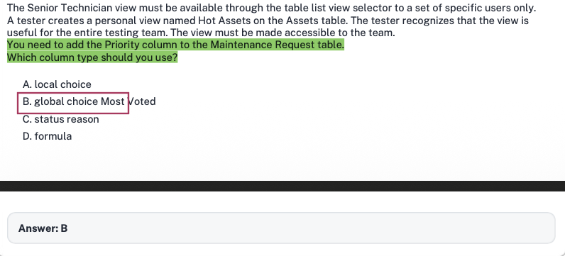
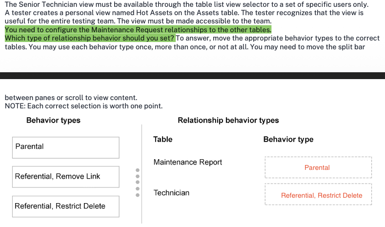
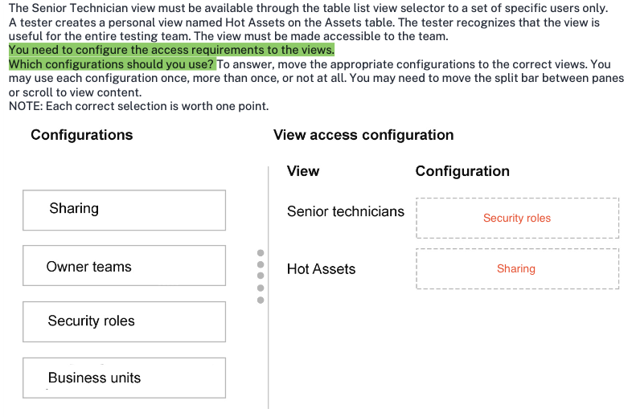
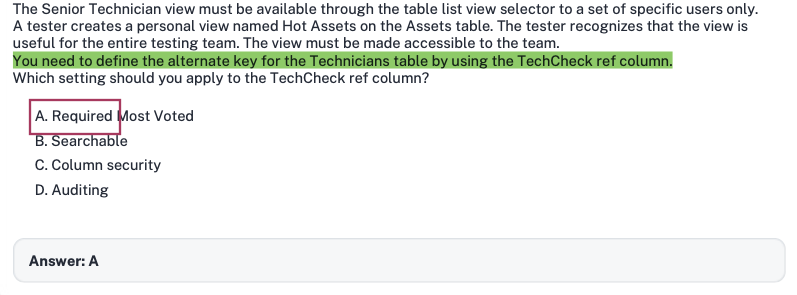
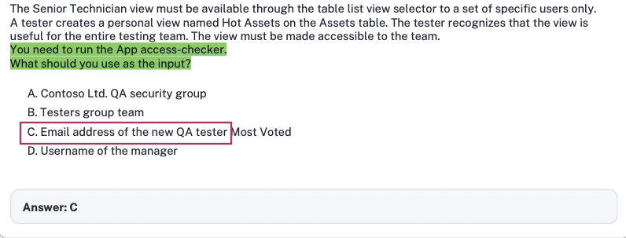
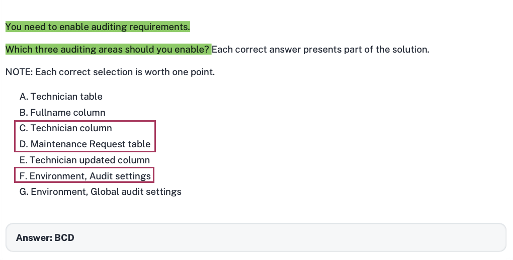
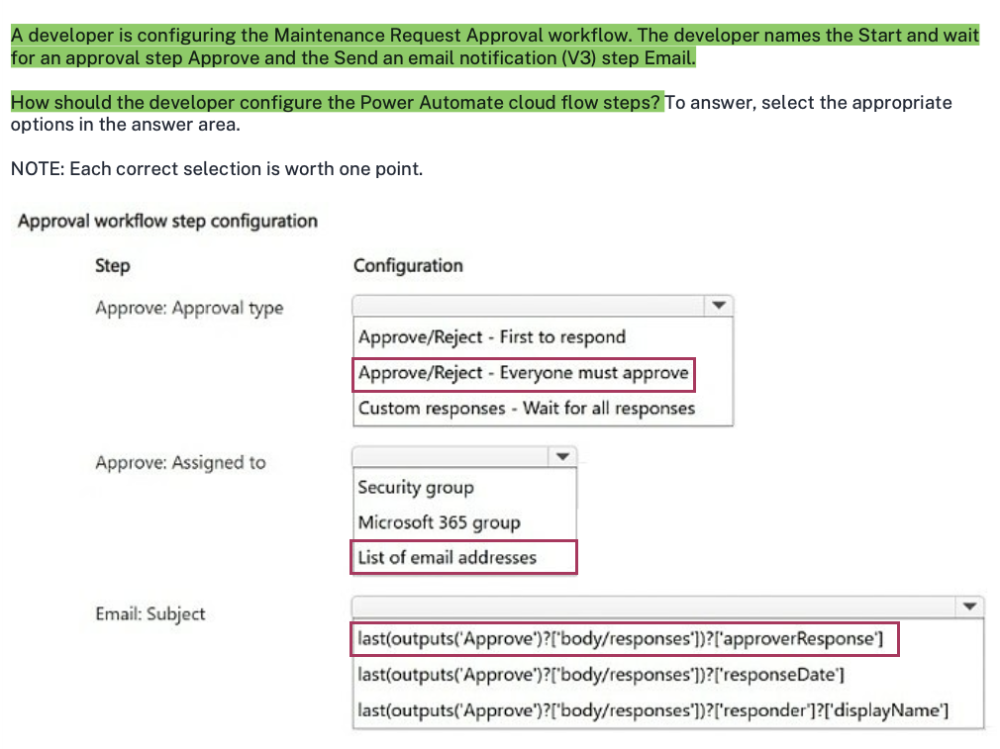
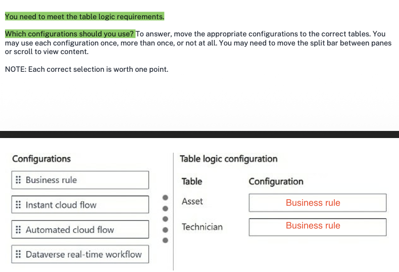
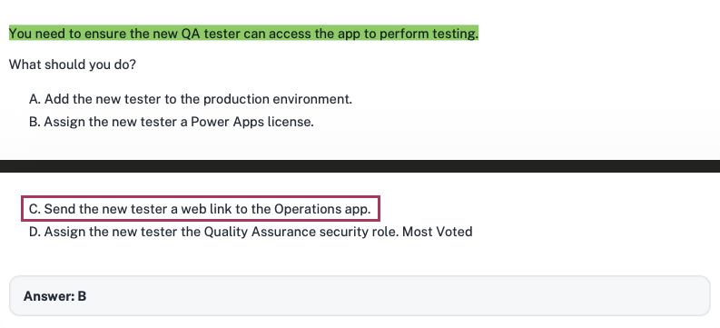

# Case Study: Contoso Ltd.

This is a case study. Case studies are not timed separately from other exam sections. You can use as much exam time as you would like to complete each case study. However, there might be additional case studies or other exam sections. Manage your time to ensure that you can complete all the exam sections in the time provided. Pay attention to the Exam Progress at the top of the screen so you have sufficient time to complete any exam sections that follow this case study.

To answer the case study questions, you will need to reference information that is provided in the case. Case studies and associated questions might contain exhibits or other resources that provide more information about the scenario described in the case. Information provided in an individual question does not apply to the other questions in the case study.

A Review Screen will appear at the end of this case study. From the Review Screen, you can review and change your answers before you move to the next exam section. After you leave this case study, you will NOT be able to return to it.

## To start the case study

To display the first question in this case study, select the "Next" button. To the left of the question, a menu provides links to information such as business requirements, the existing environment, and problem statements. Please read through all this information before answering any questions. When you are ready to answer a question, select the "Question" button to return to the question.

---

## Background

Contoso Ltd. is a global renewable energy provider that operates wind farms and solar installations. The company is modernizing its maintenance and operations platform. The company plans to implement a Microsoft Power Platform solution for the operations team. The implementation will include Microsoft Dataverse, a model-driven app, and Power Automate cloud flows.

The company is building and testing a new model-driven app named Operations. The solution will support operations managers, regional coordinators, and field technicians. The app must integrate with an external cloud-based system that manages onboarding of field technicians.

Contoso Ltd. plans to improve data quality and enforce consistent business logic across the app and automation processes.

## Technical environment

Contoso Ltd. has an Identity and Access Management (IDAM) department that manages security. The company has one Power Platform environment named Production, where all building and configuration take place. Auditing is disabled.

The Production environment has the following security configurations:

- IDAM has a Microsoft Entra security group named Contoso Ltd. QA. This security group will assign all members a Power Apps license.
- IDAM created a Quality Assurance security role that grants read and write access to all custom tables.
- IDAM also created a team named Testers in Dataverse, of a Microsoft Entra group team type. The team is configured for the Contoso Ltd. QA security group. The Testers team is assigned the Quality Assurance security role.

### Microsoft 365 environment

All Contoso Ltd. managers are included in a Microsoft 365 group named Managers. The group is NOT enabled for email.

The company shares a SharePoint list with a key customer: Alpine Ski House. Alpine Ski House staff members can add new maintenance requests, which are then checked and marked as reviewed by Contoso Ltd.

### Current issue

A new QA tester joins Contoso Ltd. The IDAM department adds the new tester to the Contoso Ltd. QA security group. However, the new tester is not listed in the Testers team as a member.

### Other applications

A separate software-as-a-service (SaaS) solution named TechCheck manages technician onboarding. The TechCheck solution is set up as follows:

- TechCheck assigns a unique number named Ref to all technicians.
- Users cannot make changes to the TechCheck data model.
- Users cannot use the same TechCheck ref on more than one Technician row.

## Automation requirements

Contoso plans to use Power Automate to develop a Maintenance Request Approval flow. The flow must meet the following requirements:

- Create a Maintenance Request row in Dataverse when either of the following occurs:
  - An item is added to the SharePoint list by the customer with the Priority property set to High.
  - Any item is checked and marked as reviewed by a Contoso Ltd. representative.
- Seek maintenance request approvals from managers through both email and a Microsoft Teams message after they have been reviewed:
  - Requests require approval from all managers.
  - If one manager rejects the request, approval must not be granted.
- The result of the approval request must be sent to the initial reviewer in an email. The subject line must set the response as either Approve or Reject.

## Table logic

Contoso Ltd. requires the following table logic:

- If a user tries to enter a price greater than the cost on a new Asset row, the row must display an inline error message.
- If a user tries to save changes to a Technician row where the TechCheck ref column is empty, the action must be prevented and a message explaining the action must be displayed.
- Any updates made to Technician profiles in TechCheck must be mirrored in Dataverse by using a custom integration. The developers building the integration require an index for performant searches on the Technician table.

## Data model and app design

Contoso Ltd. plans to use Dataverse as its central data platform. Log storage must be minimized.

### Tables

The following tables are required for data modeling and the app design:

- **Assets:** Stores information about solar panels and wind turbines.
- **Maintenance Requests:** Tracks issues and maintenance activities. The table must include the following columns:
  - Request ID (auto-number)
  - External Request Code (text)
  - Assigned
  - Technician (lookup to Technicians)
  - Report (lookup to Maintenance Reports)
  - Technician updated (Yes/No)
- **Maintenance Reports:** Tracks the results of maintenance reports.
- **Technicians:** Stores technician assignment data. The table must include the following columns:
  - Full Name (Text)
  - Mobile phone number (Text)
  - Email (Text)
  - Seniority (Choice)
  - TechCheck ref (Text)

### Data modeling

The data model must provide the following functionality:

- Maintenance Requests must:
  - be uniquely identifiable across systems.
  - have two inactive statuses, Cancelled and Duplicate.
- If a new option is added to an existing set of options, it must be made available automatically for selection on all columns that use the set.
- A new column named Priority must be added to multiple tables. Users must be able to select only one option from the following set per row:
  - Low
  - Medium
  - High
  - Critical
- Changes to the Technician column on Maintenance Requests must be tracked for compliance purposes. Rows must include the names of previous and current technicians and the time of the change.

### Relationship requirements

- One asset can be related to many maintenance requests. A maintenance request can have many assets.
- A maintenance request can have only zero or one maintenance report.
- Only one Technician can be related to a Maintenance Request at a time.
- When a Maintenance Request is deleted, any Maintenance Reports associated with it must also be deleted, but this action should be prevented if there is value in the Technician lookup.
- When a Maintenance Request is assigned to a different owner, the Maintenance Report associated with it must be reassigned to the new owner as well, but the associated Technician should stay with the current owner.

### App design

The Technicians table contains the following public views:

- Senior Technicians
- Junior Technicians

The Senior Technician view must be available through the table list view selector to a set of specific users only.

A tester creates a personal view named Hot Assets on the Assets table. The tester recognizes that the view is useful for the entire testing team. The view must be made accessible to the team.

---

## Question 1



You need to add the Priority column to the Maintenance Request table.

Which column type should you use?

- A. local choice
- B. global choice Most Voted
- C. status reason
- D. formula


### 1. Extracted Question Summary

* **Case Study Context (Contoso Ltd. — Data Modeling Requirements):**
* A new column named **`Priority`** must be added to **multiple tables**.
* Users must be able to select **only one option** per row from the list: `Low`, `Medium`, `High`, `Critical`.
* *"If a new option is added to an existing set of options, it must be made available automatically for selection on all columns that use the set."*


* **Question:** You need to add the `Priority` column to the `Maintenance Request` table. Which column type should you use?
* **Options:**
* A. local choice
* B. global choice
* C. status reason
* D. formula


### 2. Correct Answer

* **B. global choice**


### 3. Verification of Visible Selection / Community Key

* **Correct (`B. global choice Most Voted`):** The community vote (**B. global choice**) is **100% Correct**. Every requirement in the *Data modeling* section of the case study points directly to a single-select **Global Choice** (reusable Option Set).


### 4. Official Microsoft Justification

* **Reusable Option Sets Across Multiple Tables (`global choice`):** Per Microsoft Dataverse documentation (*Create and edit global choices for Microsoft Dataverse*), a **Global Choice** (formerly Global Option Set) defines a centralized, environment-wide list of label/integer value pairs that can be bound to columns across **multiple tables** (such as `Maintenance Requests`, `Assets`, etc.).
* **Centralized Maintenance & Automatic Propagation:** Because all columns bound to that Global Choice reference the single shared metadata definition, adding, editing, or reordering an option in the Global Choice automatically propagates to **all columns and tables** referencing that set upon publishing—eliminating duplicate option lists and manual synchronization.
* **Single-Select vs. Multi-Select:** Notice the requirement *"Users must be able to select only one option from the following set per row"*, confirming a single-select **Choice** (`Picklist`) rather than a multi-select **Choices** (`MultiSelectPicklist`) column.


### 5. Distractor Analysis (Why Others Are Wrong)

* **A. local choice:** Scoped exclusively to a single column on a single table (`Maintenance Requests`). If you create local choices on multiple tables, adding a new option to one table's local choice will **not** automatically make it available on the other tables.
* **C. status reason:** A system-managed attribute (`statuscode`) tied directly to the record's active/inactive `Status` (`statecode`) lifecycle—used in this case study for the requirement *"have two inactive statuses, Cancelled and Duplicate"*, not for a reusable `Priority` column across multiple tables.


* **D. formula:** A Power Fx computed column that derives read-only values from expressions; it is not an interactive drop-down option list.

### 6. Exam Keyword / Trap Alert

* **Case Study Navigation Strategy:** In Microsoft certification case studies (like this classic *Contoso Ltd.* PL-100 / PL-200 / AB-410 scenario), don't read the entire two-page wall of text first—scan the final two sentences of the question first (*"add the Priority column to the Maintenance Request table"*), then jump straight to the **Data modeling** heading to match the exact keywords:
* **"Added to multiple tables"** + **"available automatically... on all columns that use the set"** $\rightarrow$ **Global choice**.


* *(Bonus Case Study Preview: Notice the other bullet right above it—**"have two inactive statuses, Cancelled and Duplicate"**—that is the classic setup for the next case study question asking about **Status reason**!)*


## Question 2




You need to configure the Maintenance Request relationships to the other tables. Which type of relationship behavior should you set? 

**NOTE:** Each correct selection is worth one point.

---

### Behavior types

* Parental
* Referential, Remove Link
* Referential, Restrict Delete


---

### Relationship behavior types

| Table | Behavior type |
| --- | --- |
| Maintenance Report | [          ] |
| Technician | [          ]|


### 1. Extracted Question Summary

* **Case Study Context (Contoso Ltd. — Relationship Requirements):**
* **Tables & Lookups:** The `Maintenance Requests` table includes lookup columns to `Technicians` (`Technician`) and `Maintenance Reports` (`Report`), while `Maintenance Reports` is associated with `Maintenance Requests` (`1:N` / `N:1`).


* **Cascading Rules:**
1. *"When a Maintenance Request is deleted, any Maintenance Reports associated with it must also be deleted, but this action should be prevented if there is value in the Technician lookup."*
2. *"When a Maintenance Request is assigned to a different owner, the Maintenance Report associated with it must be reassigned to the new owner as well, but the associated Technician should stay with the current owner."*


* **Question:** You need to configure the `Maintenance Request` relationships to the other tables. Which type of relationship behavior should you set for **Maintenance Report** and **Technician**?
* **Available Behavior Types:**
* `Parental`
* `Referential, Remove Link`
* `Referential, Restrict Delete`


### 2. Correct Answer

* **Maintenance Report:** **Parental**
* **Technician:** **Referential, Restrict Delete**


### 3. Verification of Visible Selection / Community Key

* **Blank Answer Area:** The `Relationship behavior types` answer area in the screenshot is blank, so the selections above are derived directly from the relationship cascading rules specified in the case study's **Relationship requirements** section.


### 4. Official Microsoft Justification

* **`Maintenance Report` $\rightarrow$ `Parental`:** Per Microsoft Dataverse documentation (*Configure table relationship behavior*), **Parental** relationship behavior cascades **all** parent-record actions (`Assign`, `Share`, `Unshare`, `Reparent`, and `Delete` $\rightarrow$ *Cascade All*) down to child records.
* When a `Maintenance Request` is **deleted**, all associated `Maintenance Reports` are automatically deleted (*Cascade All*).
* When a `Maintenance Request` is **reassigned** to a new owner, the associated `Maintenance Report` is automatically reassigned to that new owner as well (*Cascade All*).


* **`Technician` $\rightarrow$ `Referential, Restrict Delete`:** Per Microsoft Dataverse documentation (*Referential, Restrict Delete*), this behavior prevents a parent record from being deleted while any child records still reference it via the lookup relationship (`Delete` $\rightarrow$ *Restrict*), while setting **all other cascading actions** (`Assign`, `Share`, `Unshare`, `Reparent`) to **Cascade None**.
* If a `Maintenance Request` has a value populated in the `Technician` lookup, attempting to delete the `Maintenance Request` is **blocked/prevented** (*Restrict Delete*).
* When a `Maintenance Request` is **reassigned** to a different owner, the associated `Technician` record remains untouched with its current owner (*Assign: Cascade None*).


### 5. Distractor Analysis (Why Others Are Wrong)

* **`Referential, Remove Link`:** Clears (nulls out) the lookup column on related records when a record is deleted rather than blocking deletion—violating the requirement that deletion *"must be prevented if there is value in the Technician lookup"*. (Also fails to cascade deletes or owner reassignments to `Maintenance Report`).


### 6. Exam Keyword / Trap Alert

* **Trigger Phrases:**
* **"Deleted... must also be deleted"** + **"assigned to a different owner... must be reassigned... as well"** $\rightarrow$ **Parental** (all actions cascade).
* **"Action should be prevented if there is value in the lookup"** + **"should stay with the current owner"** $\rightarrow$ **Referential, Restrict Delete** (blocks deletion when referenced; never cascades ownership changes).


* **Schema Cardinality Check:** Note how the case study describes `Maintenance Requests` having a `Technician (lookup to Technicians)` column (making `Technicians` the primary/parent table in the `1:N` relationship), yet still tests the standard Dataverse relationship behavior presets (`Parental` vs. `Referential, Restrict Delete`) directly against the two behavioral clauses in the text.


## Question 3



You need to configure the access requirements to the views.

Which configurations should you use? To answer, move the appropriate configurations to the correct views. You may use each configuration once, more than once, or not at all. You may need to move the split bar between panes or scroll to view content.

**NOTE:** Each correct selection is worth one point.

---

### Configurations

* Sharing
* Owner teams
* Security roles
* Business units


---

### View access configuration

| View | Configuration |
| --- | --- |
| Senior technicians | [          ] |
| Hot Assets | [          ]|


### 1. Extracted Question Summary

* **Case Study Context (Contoso Ltd. — App Design Requirements):**
* **Senior Technicians (Public View on `Technicians` table):** *"The Senior Technician view must be available through the table list view selector to a set of specific users only."*
* **Hot Assets (Personal View on `Assets` table):** *"A tester creates a personal view named Hot Assets on the Assets table. The tester recognizes that the view is useful for the entire testing team. The view must be made accessible to the team."*


* **Question:** You need to configure the access requirements to the views. Which configurations should you use?
* **Available Configurations:**
* `Sharing`
* `Owner teams`
* `Security roles`
* `Business units`


### 2. Correct Answer

* **Senior technicians:** **Security roles**
* **Hot Assets:** **Sharing**


### 3. Verification of Visible Selection / Community Key

* **Blank Answer Area:** The `View access configuration` boxes in the screenshot are blank, so the two selections above are derived directly from Microsoft Dataverse's distinct access-control mechanisms for **Public (System) Views** versus **Personal (User) Views**.


### 4. Official Microsoft Justification

* **Restricting a Public / System View (`Senior technicians` $\rightarrow$ `Security roles`):**
* Per the case study's *App design* section, `Senior Technicians` is a **public view** (`savedquery` table) on the `Technicians` table.
* Per Microsoft Dataverse documentation (*Manage access to public system views*), public views are organization-owned metadata records—they cannot be shared with individual users or teams via the Share dialog. Instead, administrators restrict visibility of a public view in the model-driven app's view selector by opening the view's **View settings** (or *Manage roles* in the classic designer) and assigning specific **Security roles** so only users holding those roles can see and select the view.


* **Granting Team Access to a Personal View (`Hot Assets` $\rightarrow$ `Sharing`):**
* Per the case study text, `Hot Assets` is a **personal view** (`userquery` table) created by an individual tester.
* Per Microsoft Dataverse documentation (*Create and manage personal views in a model-driven app*), personal views are **user-owned** records visible only to their creator by default. To make a personal view accessible to the entire testing team (`Testers`), the creator uses the **Share** (`Sharing`) functionality (under *Manage and share views* / *Saved Views*) to share the personal view directly with the team (granting Read, Write, Assign, or Share permissions as needed).


### 5. Distractor Analysis (Why Others Are Wrong)

* **`Owner teams`:** While `Testers` is a Dataverse team in the Contoso environment, creating or configuring an **Owner team** alone does not expose a personal view (`Hot Assets`) or restrict a public view (`Senior technicians`)—the tester must explicitly use **Sharing** to grant the team access to the personal view.
* **`Business units`:** Business Units partition record ownership and security role depth (`User`, `Business Unit`, `Parent: Child`), but public views (`savedquery`) are organization-owned and personal views (`userquery`) require explicit **Sharing** rather than Business Unit restructuring.

### 6. Exam Keyword / Trap Alert

* **Public View vs. Personal View Access Rule (Classic PL-100 / PL-200 / AB-410 Distinction):**
* **Public view** + *"available through the view selector to specific users only"* $\rightarrow$ **Security roles** (Manage roles on the public view).
* **Personal view** + *"created by a user... must be made accessible to the team / other users"* $\rightarrow$ **Sharing** (Share the personal view with users or a Dataverse team).


## Question 4




You need to define the alternate key for the Technicians table by using the TechCheck ref column.

Which setting should you apply to the TechCheck ref column?

A. Required *(Most Voted)*

B. Searchable

C. Column security

D. Auditing


### 1. Extracted Question Summary

* **Case Study Context (Contoso Ltd. — External Integration & Data Requirements):**
* *"TechCheck assigns a unique number named Ref to all technicians."*
* *"Users cannot use the same TechCheck ref on more than one Technician row."*
* *"If a user tries to save changes to a Technician row where the TechCheck ref column is empty, the action must be prevented and a message explaining the action must be displayed."*
* *"Any updates made to Technician profiles in TechCheck must be mirrored in Dataverse by using a custom integration. The developers building the integration require an index for performant searches on the Technician table."*


* **Question:** You need to define the **alternate key** for the `Technicians` table by using the `TechCheck ref` column. Which setting should you apply to the `TechCheck ref` column?
* **Options:**
* A. Required
* B. Searchable
* C. Column security
* D. Auditing


### 2. Correct Answer

* **A. Required**

### 3. Verification of Visible Selection / Community Key

* **Correct (`Answer: A` / `A. Required Most Voted`):** The visible key and community vote (**A. Required**) are **100% Correct**. In Dataverse, columns participating in an **Alternate Key** must have a non-null value to guarantee uniqueness across records (and satisfy both Dataverse alternate key creation guidelines and the case study's rule preventing saves when `TechCheck ref` is empty).

### 4. Official Microsoft Justification

* **Alternate Key Prerequisites & Data Integrity (`Required`):** Per Microsoft Dataverse documentation (*Define alternate keys to reference rows*), an **Alternate Key** creates a unique index in the underlying Dataverse SQL database on one or more supported columns (`Single line of text`, `Whole number`, `Decimal number`, `Date and time`, `Lookup`, or `Choice`) so external integrations (like the custom `TechCheck` sync) can perform fast indexed lookups and `Upsert` operations without knowing the internal Dataverse GUID.
* **Why `Required` (`Business Required`) Must Be Applied:**
1. **Database Uniqueness & Null Handling:** Per Microsoft's alternate key best practices, any column used in an alternate key should be configured as **Required** (`Business Required`) because **null values are not treated as unique key values**—leaving the column optional allows multiple rows with blank values, undermining key integrity and breaking external integration lookups.
2. **Case Study Requirement Alignment:** The case study explicitly specifies: *"If a user tries to save changes to a Technician row where the TechCheck ref column is empty, the action must be prevented and a message explaining the action must be displayed"*—which is natively enforced at the column metadata level by setting the column's requirement level to **Required** (`Business Required`).


### 5. Distractor Analysis (Why Others Are Wrong)

* **B. Searchable:** Controls whether the column appears in **Advanced Find** and query filter builders (`IsValidForAdvancedFind`). Defining an **Alternate Key** automatically creates the underlying SQL database index needed for performant API searches—setting `Searchable` on the column is neither required for an alternate key nor enforces non-null uniqueness.
* **C. Column security:** Enables **Column-Level Security** (Field Security Profiles) to restrict read/create/update access to sensitive columns (like SSNs or salaries). Applying column security to an alternate key column can actually *block* integration service principals or users from reading/matching the key if they lack the field security profile.
* **D. Auditing:** Records historical change logs (`before` and `after` values) in the Dataverse Audit log. Furthermore, the case study explicitly notes under *Technical environment* and *Data model* that **Auditing is disabled** and **log storage must be minimized** (and note that the case study's compliance tracking requirement applies to the `Technician` lookup column on `Maintenance Requests`, not `TechCheck ref`).

### 6. Exam Keyword / Trap Alert

* **Trigger Phrases:** **"Define the alternate key"** + **"column is empty, the action must be prevented"** $\rightarrow$ Always set the column to **Required** (`Business Required`).
* **Architectural Takeaway:** Remember the two things an **Alternate Key** gives you automatically in Dataverse: (1) a **unique constraint** preventing duplicate `TechCheck ref` values across rows, and (2) a **database index** enabling fast `Upsert` and filtered queries for custom external integrations—which is why Microsoft recommends making alternate key columns **Required** so records are never saved without a valid key!


## Q25



You need to run the App access-checker.

What should you use as the input?

A. Contoso Ltd. QA security group

B. Testers group team

C. Email address of the new QA tester *(Most Voted)*

D. Username of the manager


### 1. Extracted Question Summary

* **Case Study Context (Contoso Ltd. — Technical Environment & Current Issue):**
* IDAM maintains a Microsoft Entra security group named `Contoso Ltd. QA` (which assigns a Power Apps license) mapped to a Dataverse Entra group team named `Testers` (which holds the `Quality Assurance` security role).
* **Current Issue:** *"A new QA tester joins Contoso Ltd. The IDAM department adds the new tester to the Contoso Ltd. QA security group. However, the new tester is not listed in the Testers team as a member."*


* **Question:** You need to run the **App access-checker**. What should you use as the input?
* **Options:**
* A. Contoso Ltd. QA security group
* B. Testers group team
* C. Email address of the new QA tester
* D. Username of the manager


### 2. Correct Answer

* **C. Email address of the new QA tester**


### 3. Verification of Visible Selection / Community Key

* **Correct (`Answer: C` / `C. Email address of the new QA tester Most Voted`):** The visible key and community vote (**C. Email address of the new QA tester**) are **100% Correct**.


### 4. Official Microsoft Justification

* **How the Power Platform App Access Checker Works (`Email address of the new QA tester`):** Per Microsoft Power Apps documentation (*Use the app access checker to troubleshoot user access issues*), the **App access-checker** diagnostic tool (accessible in the Power Platform admin center or via `https://<environment-url>/tools/appaccesschecker/appaccesschecker.aspx`) evaluates a **single individual user's** effective access to a model-driven app by inspecting their Microsoft Entra ID account, Power Apps license assignment, environment status, Dataverse `systemuser` record, security roles, and team memberships.
* **Required Input Parameter:** The App access-checker prompt accepts **only an individual user's email address (UPN)** (or Azure AD Object ID)—it does not accept Microsoft Entra security groups or Dataverse group teams as search inputs. Entering the **new QA tester's email address** runs the diagnostic check on that specific user and reveals why they are not yet synchronized into the `Testers` Dataverse group team (for instance, because an Entra group team syncs lazily upon the user's first login/access attempt, or due to a provisioning/license delay).

### 5. Distractor Analysis (Why Others Are Wrong)

* **A. Contoso Ltd. QA security group:** The App access-checker evaluates an individual user identity, not a Microsoft Entra security group object.
* **B. Testers group team:** Dataverse teams cannot be entered into the App access-checker lookup; furthermore, the diagnostic goal is specifically to troubleshoot why the **individual new QA tester** is missing from that team.
* **D. Username of the manager:** Checking a manager's account diagnoses the *manager's* licenses and roles, which sheds zero light on why the newly hired QA tester has not synced into the `Testers` group team.

### 6. Exam Keyword / Trap Alert

* **Trigger Phrases:** **"Run the App access-checker"** + **"input"** $\rightarrow$ Always select the **individual user's email address** (UPN), never a security group or Dataverse team.
* **Architectural Side Note (Why the issue happened in Contoso):** In Dataverse, **Microsoft Entra group teams** synchronize membership **just-in-time (lazily)** when a user actually signs in or attempts to open the environment/app—until that first sign-in (or an explicit `ForceSyncUser` call), the user will not appear in the Dataverse `Testers` team member list even after being added to the Entra security group!


## Question 70



You need to enable auditing requirements.

Which three auditing areas should you enable? Each correct answer presents part of the solution.

**NOTE:** Each correct selection is worth one point.

A. Technician table

B. Fullname column

C. Technician column

D. Maintenance Request table

E. Technician updated column

F. Environment, Audit settings

G. Environment, Global audit settings


### 1. Extracted Question Summary

* **Case Study Context (Contoso Ltd. — Technical Environment, Data Model & Compliance Requirements):**
* **Technical environment:** *"The company has one Power Platform environment named Production, where all building and configuration take place. Auditing is disabled."*
* **Data model and app design:** *"Log storage must be minimized."*
* **Data modeling:** *"Changes to the Technician column on Maintenance Requests must be tracked for compliance purposes. Rows must include the names of previous and current technicians and the time of the change."*


* **Question:** You need to enable auditing requirements. Which three auditing areas should you enable? (Each correct answer presents part of the solution.)
* **Options:**
* A. Technician table
* B. Fullname column
* C. Technician column
* D. Maintenance Request table
* E. Technician updated column
* F. Environment, Audit settings
* G. Environment, Global audit settings


### 2. Correct Answer

* **C. Technician column**
* **D. Maintenance Request table**
* **F. Environment, Audit settings** *(or **G. Environment, Global audit settings** — see detailed verification below; the visible key `Answer: BCD` is a major dump error!)*

### 3. Verification of Visible Selection / Community Key

* **Incorrect (`Answer: BCD` is a Trap / Dump Error):** The visible key (**Answer: BCD**) is **Incorrect** on **two** critical counts:
1. **It misses the Environment-level audit switch (`F`):** The case study explicitly states in *Technical environment*: **"Auditing is disabled"** in the Production environment! In Microsoft Dataverse, auditing is **hierarchical (3 tiers)**—enabling auditing on a table and column does **nothing** unless auditing is first turned on at the **Environment** level (`Start Auditing` under **Environment $\rightarrow$ Settings $\rightarrow$ Audit and logs $\rightarrow$ Audit settings**).
2. **It erroneously includes `B. Fullname column`:** `Fullname` is a column on the **`Technicians` table**, NOT on `Maintenance Requests`, and auditing `Fullname` violates the explicit architectural constraint **"Log storage must be minimized."** When a lookup column (`Technician`) is audited on `Maintenance Requests`, Dataverse natively records both the previous and current lookup record display names (`Full Name`) and the timestamp of the change without needing to enable auditing on the `Technicians` table or `Fullname` column.


### 4. Official Microsoft Justification

* **Dataverse's Three-Tier Auditing Hierarchy:** Per Microsoft Dataverse documentation (*Manage Dataverse auditing*), capturing column-level audit history requires enabling auditing at **three sequential levels**—and turning off auditing on all non-target columns to satisfy *"Log storage must be minimized"*:
1. **Tier 1 — Environment Level (`F. Environment, Audit settings`):** In the Power Platform admin center (**Environments $\rightarrow$ Production $\rightarrow$ Settings $\rightarrow$ Audit and logs $\rightarrow$ Audit settings**), you must enable **Start Auditing** (the global environment audit switch, which is currently disabled in Contoso's Production environment). *(Note: In the classic Dynamics 365 System Settings dialog, the tab was titled **Auditing** / Global Audit Settings, which is why `F` and `G` look similar—in the modern Power Platform admin center path, the exact blade name is **Audit settings**).*
2. **Tier 2 — Table Level (`D. Maintenance Request table`):** On the **`Maintenance Requests`** table properties (**Advanced options $\rightarrow$ Audit changes to its data**), you must enable table-level auditing.
3. **Tier 3 — Column Level (`C. Technician column`):** Because *"Log storage must be minimized"* and only *"Changes to the Technician column on Maintenance Requests must be tracked"*, you disable auditing on all other columns of `Maintenance Requests` and enable **Auditing** specifically on the **`Technician`** lookup column. Dataverse's audit log automatically captures the old value (previous technician's display name), new value (current technician's display name), user who made the change, and timestamp.


### 5. Distractor Analysis (Why Others Are Wrong)

* **A. Technician table:** The compliance requirement tracks changes to the `Technician` **lookup column** on the `Maintenance Requests` table, not edits to technician profile records in the `Technicians` table. Enabling auditing on `Technicians` wastes log storage and violates *"Log storage must be minimized."*
* **B. Fullname column:** `Fullname` belongs to the `Technicians` table; auditing a lookup column (`Technician` on `Maintenance Requests`) already logs the referenced record's primary name (`Full Name`) before and after the change.
* **E. Technician updated column:** `Technician updated (Yes/No)` is a boolean flag column on `Maintenance Requests`—it only records `Yes`/`No`, not the previous and current technician names required by the compliance rule.
* **G. Environment, Global audit settings:** While "Global audit settings" is legacy phrasing from the classic System Settings UI, **F. Environment, Audit settings** matches the exact modern Power Platform admin center navigation path (**Environment $\rightarrow$ Settings $\rightarrow$ Audit and logs $\rightarrow$ Audit settings**).

### 6. Exam Keyword / Trap Alert

* **The 3-Tier Dataverse Auditing Checklist:** Whenever a case study states **"Auditing is disabled"** in the environment and asks for **three** auditing areas to enable, your answer **must** span all three levels of the hierarchy:
1. **Environment** (`Audit settings`)
2. **Table** (`Maintenance Request table`)
3. **Column** (`Technician column`)


* **Never fall for `BCD`:** Any three-answer combination that lacks an **Environment** setting when the case study explicitly says *"Auditing is disabled"* is guaranteed to fail in Dataverse!


## Question 71


A Power Platform developer is configuring the trigger for the Maintenance Request approval workflow.

The developer adds the following trigger condition.

```text
@or(
  and(
    equals(triggerBody()?['Priority'], 'High'),
    endsWith(toLower(triggerBody()?['Author']?['Email']), '@alpineskihouse.com')
  ),
  equals(triggerBody()?['Reviewed'], true)
)

```

For each of the following statements, select Yes if the statement is true. Otherwise, select No.

**NOTE:** Each correct selection is worth one point.

---

### Automated cloud flow trigger condition

| Statement | Yes | No |
| --- | --- | --- |
| The workflow trigger meets the requirements of Contoso Ltd. | ○ | ○ |
| The workflow runs when either the Priority of an item is set to High or the item is reviewed. | ○ | ○ |
| A workflow run is created each time a new item is added to or updated in the SharePoint list. | ○ | ○ |


### 1. Extracted Question Summary

* **Case Study Context (Contoso Ltd. — Microsoft 365 Environment & Automation Requirements):**
* **Customer SharePoint List:** *"The company shares a SharePoint list with a key customer: Alpine Ski House. Alpine Ski House staff members can add new maintenance requests, which are then checked and marked as reviewed by Contoso Ltd."*
* **Automation Trigger Requirements:**
1. *"An item is added to the SharePoint list by the customer with the Priority property set to High."*
2. *"Any item is checked and marked as reviewed by a Contoso Ltd. representative."*


* **Developer's Trigger Condition Expression:**
```text
@or(
  and(
    equals(triggerBody()?['Priority'], 'High'),
    endsWith(toLower(triggerBody()?['Author']?['Email']), '@alpineskihouse.com')
  ),
  equals(triggerBody()?['Reviewed'], true)
)

```


* **Statements (`Yes` / `No`):**
1. *"The workflow trigger meets the requirements of Contoso Ltd."*
2. *"The workflow runs when either the Priority of an item is set to High or the item is reviewed."*
3. *"A workflow run is created each time a new item is added to or updated in the SharePoint list."*


### 2. Correct Answer

* **Statement 1 (*The workflow trigger meets the requirements of Contoso Ltd.*):** **Yes**
* **Statement 2 (*The workflow runs when either the Priority of an item is set to High or the item is reviewed.*):** **No**
* **Statement 3 (*A workflow run is created each time a new item is added to or updated in the SharePoint list.*):** **No**


### 3. Verification of Visible Selection / Community Key

* **Blank Answer Area:** All radio buttons (`Yes` / `No`) in the screenshot are blank, so each boolean evaluation is derived directly from parsing the Power Automate Workflow Definition Language (`@or(...)`) expression against the Contoso Ltd. case study requirements and Power Automate trigger condition behavior.


### 4. Official Microsoft Justification

* **Statement 1 — `Yes`:**
* The outer `@or(...)` expression evaluates two branches:
1. `and(equals(triggerBody()?['Priority'], 'High'), endsWith(toLower(triggerBody()?['Author']?['Email']), '@alpineskihouse.com'))` — verifies both that `Priority` equals `'High'` **and** that the creator (`Author/Email`) is an **Alpine Ski House** customer staff member (`@alpineskihouse.com`).
2. `equals(triggerBody()?['Reviewed'], true)` — verifies that the item has been checked and marked as `Reviewed = true`.


* This directly implements both of Contoso Ltd.'s trigger conditions. *(Note: Even if a Contoso representative marks a `High` priority item as reviewed, the second `@or` branch `Reviewed == true` evaluates to `true`, satisfying the second requirement.)*


* **Statement 2 — `No`:**
* Look closely at the first branch of `@or(...)`: it is wrapped inside an **`and(...)`** function requiring **both** `Priority == 'High'` **AND** `Author/Email` ending in `'@alpineskihouse.com'`.
* If a **Contoso Ltd.** employee (`@contoso.com`) creates an unreviewed item (`Reviewed = false`) with `Priority = 'High'`, the `and(...)` branch evaluates to **`false`** and the `Reviewed` branch evaluates to **`false`**—so the workflow will **not** run merely because *any* user set `Priority` to `High`.


* **Statement 3 — `No`:**
* Per Microsoft Power Automate documentation (*Add a trigger condition to a flow*), **trigger conditions** filter incoming events *before* a flow run is ever instantiated. When a new SharePoint item is added or updated that fails the `@or(...)` condition (for example, a `Low` or `Medium` priority item created by Alpine Ski House where `Reviewed` is `false`), **no flow run is created or billed** in the run history.


### 5. Distractor Analysis (Why Others Are Wrong)

* **Why Statement 2 is a Classic Logic Trap:** Skimmers see `or(` at the top of the expression and `Priority == 'High'` and `Reviewed == true` inside, and mistakenly mark **Yes**—completely overlooking the nested **`and(..., endsWith(..., '@alpineskihouse.com'))`** restriction on the `High` priority branch!
* **Why Statement 3 is a Classic Trigger Condition Trap:** Without trigger conditions, a *When an item is created or modified* SharePoint trigger starts a flow run on every item change and uses a *Condition* action inside the run to stop early. With **trigger conditions** configured in the trigger's **Settings**, Power Automate suppresses run creation entirely whenever the expression returns `false`.

### 6. Exam Keyword / Trap Alert

* **Read Nested Boolean Operators Inside-Out:** Whenever a Power Automate question displays a `@or(and(...), ...)` trigger condition, check **every** argument inside `and(...)` against the statement wording—if the statement omits one of the `and(...)` clauses (such as the `@alpineskihouse.com` author domain check), that statement is **No**!


## Question 72




A developer is configuring the Maintenance Request Approval workflow. The developer names the Start and wait for an approval step Approve and the Send an email notification (V3) step Email.

How should the developer configure the Power Automate cloud flow steps? To answer, select the appropriate options in the answer area.

**NOTE:** Each correct selection is worth one point.

---

### Approval workflow step configuration

| Step | Configuration Options |
| --- | --- |
| **Approve: Approval type** | • Approve/Reject - First to respond<br><br>• Approve/Reject - Everyone must approve<br><br>• Custom responses - Wait for all responses |
| **Approve: Assigned to** | • Security group<br><br>• Microsoft 365 group<br><br>• List of email addresses |
| **Email: Subject** | • `last(outputs('Approve')?['body/responses'])?['approverResponse']`<br><br>• `last(outputs('Approve')?['body/responses'])?['responseDate']`<br><br>• `last(outputs('Approve')?['body/responses'])?['responder']?['displayName']`|


### 1. Extracted Question Summary

* **Case Study Context (Contoso Ltd. — Microsoft 365 Environment & Automation Requirements):**
* **Microsoft 365 environment:** *"All Contoso Ltd. managers are included in a Microsoft 365 group named Managers. The group is NOT enabled for email."*
* **Automation requirements:**
* *"Seek maintenance request approvals from managers through both email and a Microsoft Teams message after they have been reviewed:"*
* *"Requests require approval from all managers."*
* *"If one manager rejects the request, approval must not be granted."*
* *"The result of the approval request must be sent to the initial reviewer in an email. The subject line must set the response as either Approve or Reject."*


* **Question:** A developer names the *Start and wait for an approval* step `Approve` and the *Send an email notification (V3)* step `Email`. How should the developer configure the Power Automate cloud flow steps?
* **Dropdown Options (`Approval workflow step configuration`):**
* **Approve: Approval type:**
* `Approve/Reject - First to respond`
* `Approve/Reject - Everyone must approve`
* `Custom responses - Wait for all responses`


* **Approve: Assigned to:**
* `Security group`
* `Microsoft 365 group`
* `List of email addresses`


* **Email: Subject:**
* `last(outputs('Approve')?['body/responses'])?['approverResponse']`
* `last(outputs('Approve')?['body/responses'])?['responseDate']`
* `last(outputs('Approve')?['body/responses'])?['responder']?['displayName']`


### 2. Correct Answer

* **Approve: Approval type:** **Approve/Reject - Everyone must approve**
* **Approve: Assigned to:** **List of email addresses**
* **Email: Subject:** **`last(outputs('Approve')?['body/responses'])?['approverResponse']`**


### 3. Verification of Visible Selection / Community Key

* **Blank Answer Area:** All three dropdown menus in the screenshot are expanded without red selection boxes, so each configuration is derived directly from the Contoso Ltd. case study constraints and Power Automate Approvals connector specifications.


### 4. Official Microsoft Justification

* **`Approve: Approval type` $\rightarrow$ `Approve/Reject - Everyone must approve`:**
* Per Microsoft Power Automate documentation (*Create an approval flow that requires everyone to approve*), **Approve/Reject - Everyone must approve** sends the approval request to every specified approver simultaneously and requires **all** assigned approvers to select **Approve** before the overall `outcome` returns `Approve`.
* Crucially, if **any single manager selects Reject**, the approval action immediately short-circuits and resolves to **`Reject`** without waiting for remaining approvers—matching both *"Requests require approval from all managers"* and *"If one manager rejects the request, approval must not be granted."*
* Furthermore, using the standard **Approve/Reject** action natively delivers the approval request via **both email and Microsoft Teams** (Actionable Messages + Approvals app in Teams) and restricts response choices strictly to `Approve` or `Reject`.


* **`Approve: Assigned to` $\rightarrow$ `List of email addresses`:**
* Look closely at the trap planted in the *Microsoft 365 environment* section of the case study: **"All Contoso Ltd. managers are included in a Microsoft 365 group named Managers. The group is NOT enabled for email."**
* Per Microsoft Power Automate Approvals documentation (*Assign approvals to groups or users*), the **Assigned to** field in *Start and wait for an approval* only resolves **mail-enabled security groups** or **mail-enabled Microsoft 365 groups** via an email address (and even then, assigning to a group treats the group as a single approval entity unless expanded). Because the `Managers` Microsoft 365 group is **not mail-enabled** (and every manager must individually approve), you must pass a semicolon-separated **List of email addresses** (for example, retrieved via the *Office 365 Groups — List group members* action and joined into a string).


* **`Email: Subject` $\rightarrow$ `last(outputs('Approve')?['body/responses'])?['approverResponse']`:**
* Per the requirement, *"The subject line must set the response as either Approve or Reject."*
* In `Approve/Reject - Everyone must approve`:
* If all managers approve, every element in `body/responses` has `approverResponse` equal to **`Approve`**, so `last(...)['approverResponse']` evaluates to **`Approve`**.
* If any one manager rejects, the action immediately terminates upon that rejection, making that rejecting manager's response the **final (`last`)** entry in `body/responses` with `approverResponse` equal to **`Reject`**!
* *(Note: While `outputs('Approve')?['body/outcome']` is the shorthand top-level property, among the three `last(...)` expressions provided in the dropdown, `['approverResponse']` is the only property returning the string `'Approve'` or `'Reject'`.)*


### 5. Distractor Analysis (Why Others Are Wrong)

* **Dropdown 1 — `Approve/Reject - First to respond`:** Completes as soon as *one* manager responds, violating *"Requests require approval from all managers."*
* **Dropdown 1 — `Custom responses - Wait for all responses`:** Used for custom non-binary choices (such as *Escalate / Hold / Reassign*) and waits for all responses even after a rejection rather than using standard `Approve`/`Reject` short-circuiting.
* **Dropdown 2 — `Security group` / `Microsoft 365 group`:** Cannot be entered directly into `Assigned to` because the `Managers` group is explicitly **NOT enabled for email** (and assigning to a single group address would allow a single member to approve on behalf of the entire group rather than requiring every manager's individual approval).
* **Dropdown 3 — `last(outputs('Approve')?['body/responses'])?['responseDate']`:** Outputs an ISO-8601 timestamp (e.g., `2026-11-27T11:55:00Z`), not `Approve` or `Reject`.
* **Dropdown 3 — `last(outputs('Approve')?['body/responses'])?['responder']?['displayName']`:** Outputs the approver's full name (e.g., `Alex Wilber`), not `Approve` or `Reject`.

### 6. Exam Keyword / Trap Alert

* **The Hidden Case Study Trap (`NOT enabled for email`):** Whenever a case study mentions a Microsoft 365 group or Entra group and drops a seemingly minor sentence saying **"The group is NOT enabled for email"**, that sentence exists for **one specific reason**: to disqualify assigning an Approval action directly to the group and force you to select **List of email addresses**!


## Question 73



You need to meet the table logic requirements.

Which configurations should you use? To answer, move the appropriate configurations to the correct tables. You may use each configuration once, more than once, or not at all. You may need to move the split bar between panes or scroll to view content.

**NOTE:** Each correct selection is worth one point.

---

### Configurations

* Business rule
* Instant cloud flow
* Automated cloud flow
* Dataverse real-time workflow


---

### Table logic configuration

| Table | Configuration |
| --- | --- |
| Asset | [          ] |
| Technician | [          ] |


### 1. Extracted Question Summary

* **Case Study Context (Contoso Ltd. — Table Logic Requirements):**
* **Asset Table:** *"If a user tries to enter a price greater than the cost on a new Asset row, the row must display an inline error message."*
* **Technician Table:** *"If a user tries to save changes to a Technician row where the TechCheck ref column is empty, the action must be prevented and a message explaining the action must be displayed."*


* **Question:** You need to meet the table logic requirements. Which configurations should you use for **Asset** and **Technician**? *(Each configuration may be used once, more than once, or not at all.)*
* **Available Configurations:**
* `Business rule`
* `Instant cloud flow`
* `Automated cloud flow`
* `Dataverse real-time workflow`


### 2. Correct Answer

* **Asset:** **Business rule**
* **Technician:** **Business rule** *(Note: While a `Dataverse real-time workflow` with a `Stop Workflow (Canceled)` step can also block a save and display a custom error dialog on `Technician`, **Business rule** is the primary declarative no-code mechanism that meets **both** requirements—see full architectural comparison below)*.


### 3. Verification of Visible Selection / Community Key

* **Blank Answer Area:** The `Table logic configuration` boxes in the screenshot are blank, so the selections above are derived directly from the two rules specified under *"Contoso Ltd. requires the following table logic"* in the Contoso Ltd. case study.


### 4. Official Microsoft Justification

* **`Asset` $\rightarrow$ `Business rule`:**
* Per Microsoft Dataverse documentation (*Create a business rule in Microsoft Dataverse*), a **Business rule** evaluates conditions (`Price > Cost`) directly inside the form and executes the **Show Error Message** action on a specified column.
* This renders an **inline error message** directly next to the column on the form immediately as the user enters the value (and prevents saving until resolved)—making **Business rule** the *only* option among the choices capable of displaying an **inline error message** on a form.


* **`Technician` $\rightarrow$ `Business rule` (and why `Dataverse real-time workflow` is the classic alternative):**
* Using a **Business rule** (set to **Entity / Table** scope so it runs both on forms and on the server) with a condition checking `TechCheck ref Does not contain data` and a **Show Error Message** action prevents saving the `Technician` row and displays an explanatory error message to the user.


* (Nuance on `Dataverse real-time workflow`: A synchronous classic Dataverse workflow triggered **Before** `Record fields change` (`TechCheck ref`) with a **Stop Workflow (`Canceled`)** step also rolls back the save transaction and pops up a custom error dialog—making it a valid server-side fallback in real implementations, though Microsoft's PL-100/PL-200 exam key standardizes on **Business rule** for declarative field-level validation across both tables, especially since the question explicitly reminds you: *"You may use each configuration once, **more than once**, or not at all."*)


### 5. Distractor Analysis (Why Others Are Wrong)

* **`Instant cloud flow`:** Manually triggered on demand by a user (e.g., clicking a button or selecting a row and running a flow from the command bar); it does not intercept record creation or updates to block saves or show inline validation messages.


* **`Automated cloud flow`:** Executes **asynchronously** *after* a Dataverse record has already been committed to the database (`PostOperation` webhook). Because it runs after the save completes, it cannot prevent a user from saving an invalid row or display an inline validation error message in the UI.


* **`Dataverse real-time workflow` (for `Asset`):** Synchronous classic workflows execute on the server during the save pipeline and display a modal **Business Process Error** dialog when canceled—they **cannot** display an **inline error message** next to a field on a form before saving.


### 6. Exam Keyword / Trap Alert

* **Trigger Phrases:**
* **"Display an inline error message"** $\rightarrow$ Exclusively **Business rule** (`Show Error Message` action).


* **"Action must be prevented and a message explaining the action must be displayed"** + *"You may use each configuration once, **more than once**, or not at all"* $\rightarrow$ **Business rule** for **both** `Asset` and `Technician`.


* **Asynchronous vs. Synchronous Rule:** Never choose an **Automated cloud flow** when a requirement asks to **prevent a user from saving** a record—cloud flows are always asynchronous and fire only *after* the save has already succeeded.


## Question 74



You need to ensure the new QA tester can access the app to perform testing.

What should you do?

A. Add the new tester to the production environment.

B. Assign the new tester a Power Apps license.

C. Send the new tester a web link to the Operations app.

D. Assign the new tester the Quality Assurance security role. *(Most Voted)*


### 1. Extracted Question Summary

* **Case Study Context (Contoso Ltd. — Technical Environment & Current Issue):**
* **Technical environment:**
* *"IDAM has a Microsoft Entra security group named Contoso Ltd. QA. This security group will assign all members a Power Apps license."*
* *"IDAM created a Quality Assurance security role that grants read and write access to all custom tables."*
* *"IDAM also created a team named Testers in Dataverse, of a Microsoft Entra group team type. The team is configured for the Contoso Ltd. QA security group. The Testers team is assigned the Quality Assurance security role."*


* **Current issue:** *"A new QA tester joins Contoso Ltd. The IDAM department adds the new tester to the Contoso Ltd. QA security group. However, the new tester is not listed in the Testers team as a member."*


* **Question:** You need to ensure the new QA tester can access the app to perform testing. What should you do?
* **Options:**
* A. Add the new tester to the production environment.
* B. Assign the new tester a Power Apps license.
* C. Send the new tester a web link to the Operations app.
* D. Assign the new tester the Quality Assurance security role.


### 2. Correct Answer

* **C. Send the new tester a web link to the Operations app.** *(Note: Both the visible key `Answer: B` and the community `Most Voted` tag on `D` are classic exam-dump errors—see the exact Dataverse Entra group team synchronization mechanics below!)*


### 3. Verification of Visible Selection / Community Key

* **Incorrect (`Answer: B` and `D. Most Voted` are Both Traps):**
* **Why `Answer: B` is wrong:** The case study explicitly states under *Technical environment*: **"IDAM has a Microsoft Entra security group named Contoso Ltd. QA. This security group will assign all members a Power Apps license"**—and under *Current issue*: **"The IDAM department adds the new tester to the Contoso Ltd. QA security group."** Group-based licensing in Microsoft Entra ID has *already* assigned the Power Apps license.


* **Why `D. Assign the new tester the Quality Assurance security role` (`Most Voted`) is wrong:** First, you **cannot** assign a Dataverse security role directly to a user who has not yet been synced/provisioned into the Dataverse environment's `Users` table (and the case study explicitly tells you the tester isn't even synced into the Dataverse `Testers` team yet). Second, the entire architectural purpose of configuring `Testers` as a **Microsoft Entra group team** mapped to `Contoso Ltd. QA` with the `Quality Assurance` role is so administrators **never** have to manually assign security roles to individual testers!


### 4. Official Microsoft Justification

* **Just-in-Time (Lazy) Membership Synchronization of Microsoft Entra Group Teams (`Send the new tester a web link to the Operations app.`):**
* Per Microsoft Dataverse security documentation (*Manage group teams — How group team members are added and removed*), when a Dataverse team is configured as a **Microsoft Entra group team** (`Testers` mapped to `Contoso Ltd. QA`), Dataverse does **not** proactively poll Entra ID to pre-populate every new member into the Dataverse `Users` (`systemuser`) table or team membership list the instant they are added to the Entra security group.


* Instead, **membership synchronization happens dynamically at runtime when the user first signs in and accesses the environment or app**.
* Simply **sending the new tester the direct web link (URL) to the `Operations` model-driven app** causes the tester to authenticate into the environment, which automatically:
1. Provisions their `systemuser` record in the Production Dataverse environment (since their Power Apps license is already active via `Contoso Ltd. QA`).
2. Synchronizes their membership into the `Testers` Dataverse Entra group team.
3. Grants them the `Quality Assurance` security role inherited from the `Testers` team and opens the `Operations` app immediately.


### 5. Distractor Analysis (Why Others Are Wrong)

* **A. Add the new tester to the production environment:** Unnecessary and premature—there is no security group restricting the Production environment in the case study, and users licensed via `Contoso Ltd. QA` are provisioned into the environment automatically upon accessing the app URL.


* **B. Assign the new tester a Power Apps license:** Redundant—adding the user to `Contoso Ltd. QA` already assigns a Power Apps license via Microsoft Entra group-based licensing.


* **D. Assign the new tester the Quality Assurance security role:** Defeats the Entra group team architecture (`Testers` already holds `Quality Assurance` for all `Contoso Ltd. QA` members) and cannot even be performed until the user triggers their first app/environment login to synchronize into Dataverse.


### 6. Exam Keyword / Trap Alert

* **The Microsoft Entra Group Team "Missing Member" Signature:** Whenever a Microsoft Power Platform exam scenario states:
1. User is added to a **Microsoft Entra security group** (which handles licensing),
2. A **Dataverse Entra group team** is mapped to that security group and already holds the required **security role**, and
3. *"The new user is not listed in the Dataverse team as a member"* $\rightarrow$ Do **not** manually assign licenses or security roles; **send the user the direct web link to the app** so their first login triggers just-in-time Entra group team sync!


