# Question Answers

## Q5

### 1. Extracted Question Summary

* **Scenario:** A company uses a model-driven app across multiple departments. A public view intended only for managers currently exposes sensitive columns and filters to all users.

* **Requirements:**
* Restrict access to the specific public view to managers.

* Display only context-relevant views for other users.

* **Question:** You need to configure view access. What should you do?

* **Options:**
* **A.** Restrict the view by assigning it to the manager security role. *(Marked "Most Voted")*

* **B.** Configure table-level permissions for managers only.

* **C.** Remove the view from the app navigation.

* **D.** Set up the quick find view.

---

### 2. Correct Answer

* **A: Restrict the view by assigning it to the manager security role.**

---

### 3. Verification of Visible Selection / Community Key

* The visible community selection (**Option A**, labeled "Most Voted") is **Correct** because Dataverse supports role-based view management, allowing administrators to restrict specific public views to designated security roles.

---

### 4. Official Microsoft Justification

* In Microsoft Dataverse and model-driven apps, **manage access to public views** (role-based views) allows makers and administrators to associate specific public views with one or more Dataverse security roles.
* By default, public views are visible to all users who have read access to the underlying table. Configuring **View Settings** to restrict access to specific security roles (such as the manager security role) ensures that only users assigned that role see the view in the view selector, decluttering the UI for other departments while keeping the view available inside the app for managers.
* *Important Architectural Caveat:* While role-based views hide the view from the UI for non-managers, they are a user-experience and view-visibility control rather than a hard data-security boundary—users with table read access could still query those columns via Advanced Find or APIs unless **Column Security Profiles (Field-Level Security)** are also applied. However, strictly within the scope of configuring *view access* and showing context-relevant views per role, assigning the view to the security role is the exact platform feature designed for this requirement.

---

### 5. Distractor Analysis (Why Others Are Wrong)

* **B. Configure table-level permissions for managers only:** Blocking table-level permissions for non-managers would prevent other departments from viewing *any* records or context-relevant views for that table, breaking the requirement to display context-relevant views for other users.

* **C. Remove the view from the app navigation:** Removing the view from the app designer's included views removes it for *everyone* using that app, including managers, failing the requirement that managers retain access to the view.

* **D. Set up the quick find view:** A Quick Find view defines the search behavior and filter columns used when a user searches a table; it does not restrict access to a specific public view by user role.

---

### 6. Exam Keyword / Trap Alert

* **Trigger Phrases:** *"Restrict access to the specific public view"* and *"Display only context-relevant views"* map directly to **Role-Based Views** (assigning security roles to a public view in Power Apps).
* **Exam Trap:** Do not confuse **view visibility** (hiding a public view via security roles) with **hard column security**—if a future question states that non-managers must be prevented from accessing sensitive field data *anywhere* in Dataverse (including exports or APIs), the answer shifts to **Column Security Profiles**.

---

### Feedback on Your Updated Gem Instructions

Your updated Gem instructions are well-structured and cleanly address multi-image handling, dump verification, and Microsoft Learn alignment. A quick refinement to consider before finalizing them:

* **Drop the hardcoded URL in Section 4:** Instead of pinning a single certification overview URL (`.../intelligent-applications-builder-associate/...`), instruct the model to cite the specific **Microsoft Learn documentation topic or feature area** (e.g., *Power Apps model-driven app views*, *Dataverse security roles*, *Copilot Studio topics*). That prevents the model from forcing a generic certification landing page link when explaining specific technical mechanisms.

---

## Q6

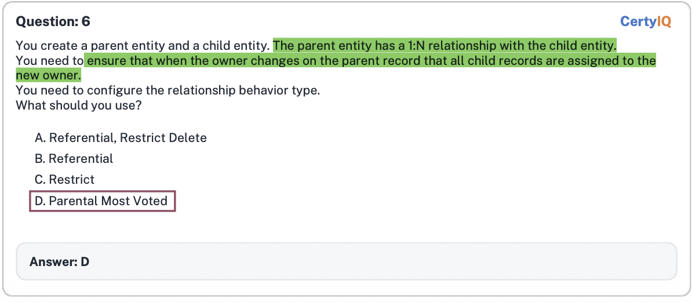

### 1. Extracted Question Summary

* **Scenario:** You create a parent entity (table) and a child entity (table), where the parent entity has a 1:N relationship with the child entity. When the owner changes on the parent record, all child records must be assigned to the new owner.

* **Question:** You need to configure the relationship behavior type. What should you use?

* **Options:**
* **A.** Referential, Restrict Delete

* **B.** Referential

* **C.** Restrict

* **D.** Parental *(Highlighted inside red box, labeled "Most Voted", and marked "Answer: D")*

---

### 2. Correct Answer

* **D: Parental**

---

### 3. Verification of Visible Selection / Community Key

* The visible selection (**Answer: D**, boxed in red and labeled "Most Voted") is **Correct** because the **Parental** relationship behavior preset automatically cascades record ownership changes (**Assign: Cascade All**) from a parent record to all associated child records.

---

### 4. Official Microsoft Justification

* Under Microsoft Learn documentation for **Create and edit 1:N (one-to-many) or N:1 (many-to-one) table relationships in Microsoft Dataverse** (part of the Intelligent Applications Builder Associate learning path), relationship **Type of behavior** defines how actions performed on a parent table record propagate to related child table records.
* Selecting **Parental** configures every cascading rule—**Assign**, **Share**, **Unshare**, **Reparent**, and **Delete**—to **Cascade All**. When the **Assign** action is set to *Cascade All*, changing the owner on the parent record automatically reassigns all related child records to that same new owner.
* *(Note on Terminology: The question uses the legacy Dataverse term "entity," which corresponds to **Table** in current Microsoft Power Platform documentation.)*

---

### 5. Distractor Analysis (Why Others Are Wrong)

* **A. Referential, Restrict Delete:** Sets **Assign** to *Cascade None* (changing the parent owner does not reassign child records) and blocks deleting a parent record if any child records exist.

* **B. Referential:** Sets **Assign** to *Cascade None* (child records retain their existing owners when the parent owner changes) and sets **Delete** to *Remove Link*.

* **C. Restrict:** Is not a valid standalone relationship behavior preset in Dataverse (the available presets are *Parental*, *Referential*, *Referential, Restrict Delete*, and *Custom*).

---

### 6. Exam Keyword / Trap Alert

* **Trigger Phrase:** *"when the owner changes on the parent record that all child records are assigned to the new owner"* maps directly to **Assign: Cascade All**, the signature behavior of a **Parental** relationship.

* **Exam Trap:** If a scenario asks to cascade ownership changes (*Assign*) to child records *without* cascading deletions when a parent record is deleted, **Parental** will fail—you must select **Custom** behavior instead and configure *Assign = Cascade All* while keeping *Delete = Remove Link* or *Restrict*.

---

### Thoughts on Your Updated Gem Instructions

Your updated Gem instructions are ready to save and use as-is—the 6-part schema, silent intake rules, dump-key verification, and terminology normalization work reliably across single-choice, multi-select, and annotated screenshots.

One small polish if you want to make them even cleaner before pasting into your Gem:

* **Refine Section 4's citation rule:** Instead of pinning the static certification landing page URL (`.../intelligent-applications-builder-associate/?practice-assessment-type=certification`), change that bullet to: *"Cite the specific Microsoft Learn documentation topic or architectural rule (e.g., Dataverse table relationship behaviors, Role-based views, Formula vs. Calculated columns)."* That ensures the model names the exact official documentation topic for every question rather than repeating a generic certification overview URL.

---

## Q7

### 1. Extracted Question Summary

* **Scenario:** A company tracks order processing duration using a model-driven app.

* **Requirements:**
* The age of the order, based on the created date, must be displayed on forms and views.

* The value must update dynamically when viewed without storing the result.

* The value must NOT be stored in the database.

* **Question:** You need to configure the column types. Which two column types should you use? (Each correct answer presents part of the solution).

* **Options:**
* **A.** Formula *(Highlighted inside red box)*

* **B.** Calculated *(Highlighted inside red box)*

* **C.** BigInt

* **D.** Prompt

* **Visible Answer Key:** `Answer: AB`

---

### 2. Correct Answer

* **A: Formula** and **B: Calculated**

---

### 3. Verification of Visible Selection / Community Key

* The visible selection (**Answer: AB**, boxed in red) is **Correct**. Both **Formula** columns (using Power Fx functions like `DateDiff(CreatedOn, Now())` or `UTCNow()`) and **Calculated** columns (using traditional Dataverse calculated field actions like `DIFFINDAYS(createdon, NOW())`) compute values dynamically at read time whenever a record is retrieved on a form or view, without persisting the computed result in the underlying Dataverse database table.

---

### 4. Official Microsoft Justification

* Under Microsoft Learn documentation for **Formula columns in Microsoft Dataverse** and **Define calculated columns in Microsoft Dataverse**:
* **Formula columns (A):** Use Power Fx expressions to perform real-time, read-only calculations on Dataverse records. Because they are evaluated dynamically on retrieval (using non-deterministic date/time functions such as `Now()` or `UTCNow()` against `CreatedOn`), the resulting value is never stored physically in the database.

* **Calculated columns (B):** Use classic Dataverse calculation rules (supporting built-in functions such as `NOW()`, `DIFFINDAYS()`, and `DIFFINHOURS()`) to compute values on-the-fly when a record is queried or displayed in forms, views, charts, or reports. Like formula columns, calculated columns execute dynamically upon read and do not store the calculated output in the database.

---

### 5. Distractor Analysis (Why Others Are Wrong)

* **C. BigInt:** A standard whole-number data type (`BigInt` / 64-bit integer) that stores static, persisted integer values directly in the database; it cannot dynamically compute elapsed time on read.

* **D. Prompt:** An AI Builder / Copilot Studio prompt column type in Dataverse that executes generative AI prompts when records are created or updated and stores the generated text output in the database rather than calculating real-time date durations on read.

---

### 6. Exam Keyword / Trap Alert

* **Trigger Phrases:** *"update dynamically when viewed without storing the result"* and *"value must NOT be stored in the database"* are the classic Dataverse architectural signatures distinguishing **Formula** and **Calculated** columns (evaluated at read time, unpersisted) from **Rollup** columns (which *are* stored in the database and updated asynchronously via scheduled system jobs).

* **Exam Trap:** Do not confuse **Calculated/Formula** columns with **Rollup** columns—Rollup columns store their aggregated values in the database and refresh periodically (or via manual recalculation), whereas Formula and Calculated columns calculate live on every read and never store the result.

---

## Q8

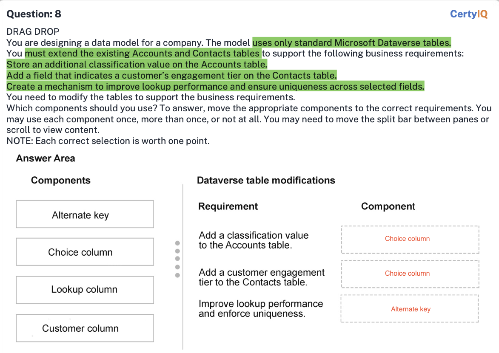

### 1. Extracted Question Summary

* **Scenario:** You are designing a data model using only standard Microsoft Dataverse tables and must extend the existing **Accounts** and **Contacts** tables to support three business requirements.

* **Question:** Drag and drop the appropriate components to the correct requirements (components may be used once, more than once, or not at all).

* **Available Components:**
* `Alternate key`

* `Choice column`

* `Lookup column`

* `Customer column`

* **Target Requirements:**
1. Add a classification value to the Accounts table.

2. Add a customer engagement tier to the Contacts table.

3. Improve lookup performance and enforce uniqueness.

---

### 2. Correct Answer

| Requirement | Correct Component |
| --- | --- |
| **Add a classification value to the Accounts table.**

 | **Choice column**

 |
| **Add a customer engagement tier to the Contacts table.**

 | **Choice column**

 |
| **Improve lookup performance and enforce uniqueness.**

 | **Alternate key**

 |

---

### 3. Verification of Visible Selection / Community Key

* The Answer Area in the screenshot is blank (no drag-and-drop selections or community answer key are visible). Notice the prompt rule: *"You may use each component once, more than once, or not at all"*—this explicitly authorizes reusing **Choice column** for both the first and second requirements.

---

### 4. Official Microsoft Justification

* **Choice column (Requirements 1 & 2):** Under Microsoft Learn documentation for **Create and edit columns in Microsoft Dataverse**, a **Choice** (formerly Option Set) column provides a standardized dropdown list of discrete, predefined values. Both an Account *classification* (e.g., Partner, Vendor, Prospect) and a Contact *engagement tier* (e.g., Bronze, Silver, Gold) represent finite, categorical sets of values best modeled with Choice columns (either local choices or reusable global choices).
* **Alternate key (Requirement 3):** Under Microsoft Learn documentation for **Define alternate keys to reference rows in Microsoft Dataverse**, creating an **Alternate key** on one or more columns automatically creates a unique database index on those columns. This enforces uniqueness across the selected fields and improves query/lookup performance—especially when integrating external systems or upserting records via APIs/Power Automate without knowing the internal Dataverse GUID.

---

### 5. Distractor Analysis (Why Others Are Wrong)

* **Lookup column:** Creates a many-to-one (`N:1`) relationship linking a row to a single parent row in another table. Neither a classification value nor an engagement tier requires a separate relational table when the available options are fixed categorical labels, and lookup columns do not enforce uniqueness across arbitrary selected fields.

* **Customer column:** A special polymorphic lookup column in Dataverse that allows a record to reference *either* an **Account** or a **Contact** row in a single field. It is used to associate a record with a customer entity, not to store categorical classification/tier attributes or enforce column uniqueness.

---

### 6. Exam Keyword / Trap Alert

* **Trigger Phrases:**
* *"classification value"* and *"engagement tier"* $\rightarrow$ Discrete, predefined option lists $\rightarrow$ **Choice column**.

* *"improve lookup performance and ensure uniqueness across selected fields"* $\rightarrow$ Database-level unique indexing for external/business identifiers $\rightarrow$ **Alternate key**.

* **Exam Trap:** Candidates often hesitate to reuse an option in drag-and-drop questions and mistakenly pick **Lookup column** for one of the first two rows. Always check the prompt instructions: when Microsoft states *"You may use each component once, more than once, or not at all,"* reusing a component like **Choice column** is frequently the exact intended solution.

## Q9

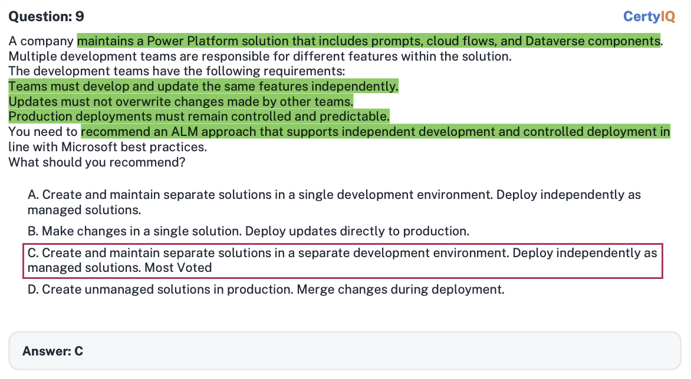

### 1. Extracted Question Summary

* **Scenario:** A company maintains a Power Platform solution containing prompts, cloud flows, and Dataverse components, with multiple development teams responsible for different features.

* **Requirements:**
* Teams must develop and update features independently.

* Updates must not overwrite changes made by other teams.

* Production deployments must remain controlled and predictable.

* **Question:** Recommend an Application Lifecycle Management (ALM) approach that supports independent development and controlled deployment in line with Microsoft best practices.

* **Options:**
* **A.** Create and maintain separate solutions in a single development environment. Deploy independently as managed solutions.

* **B.** Make changes in a single solution. Deploy updates directly to production.

* **C.** Create and maintain separate solutions in a separate development environment. Deploy independently as managed solutions *(Labeled "Most Voted")*.

* **D.** Create unmanaged solutions in production. Merge changes during deployment.

* **Visible Answer Key:** `Answer: C`

---

### 2. Correct Answer

* C: Create and maintain separate solutions in a separate development environment. Deploy independently as managed solutions.

---

### 3. Verification of Visible Selection / Community Key

* The visible selection (**Answer: C**, labeled "Most Voted") is **Correct**. Isolating work into separate unmanaged solutions within dedicated development environments—paired with source control and deploying downstream as **managed solutions**—prevents teams from overwriting shared component definitions during active development while enabling controlled, predictable releases into test and production environments.

---

### 4. Official Microsoft Justification

* Under Microsoft Learn documentation for **Application Lifecycle Management (ALM) with Microsoft Power Platform** (*Organize solutions* and *ALM basics with Microsoft Power Platform*):
* **Environment Isolation:** Multiple development teams working on overlapping or shared Dataverse tables, flows, and AI prompts should work in **isolated development environments** (backed by source control such as Git/Azure DevOps) rather than a single shared dev environment. In a shared environment, modifying the same underlying component (such as a table form, view, or flow) causes active unmanaged layer collisions and last-writer-wins overwrites.
* **Solution Segmentation & Managed Deployments:** Segmenting features into **separate solutions** (with a shared base/core solution for common dependencies and feature-specific solutions for each team) and exporting them as **managed solutions** ensures deterministic layering, clean upgrades/patches, and controlled promotion through validation/test stages into production.

---

### 5. Distractor Analysis (Why Others Are Wrong)

* **A. Create and maintain separate solutions in a single development environment. Deploy independently as managed solutions:** In Dataverse, all unmanaged solutions inside the *same* development environment share a single **unmanaged active layer**. If two teams edit the same shared table, form, or flow inside one environment—even across separate solutions—their unmanaged changes directly overwrite one another.

* **B. Make changes in a single solution. Deploy updates directly to production:** Violates both requirements—a single monolithic solution creates merge/dependency bottlenecks across teams, and deploying directly to production bypasses testing/staging gates, making releases unpredictable.

* **D. Create unmanaged solutions in production. Merge changes during deployment:** Directly violates Microsoft ALM best practices. Production environments must never be used for active unmanaged development or manual change merging; production should only receive tested **managed solutions**.

---

### 6. Exam Keyword / Trap Alert

* **Trigger Phrases:** *"Multiple development teams"*, *"develop and update... independently"*, *"must not overwrite changes"*, and *"controlled and predictable"* $\rightarrow$ **Separate development environments + Separate solutions + Managed deployments**.

* **Exam Trap:** Option **A** is the classic distractor. Candidates often think putting two solutions in the *same* dev environment isolates changes, forgetting that Dataverse merges all unmanaged customizations in a single environment into one shared active layer. True isolation requires **separate development environments**.

## Q10

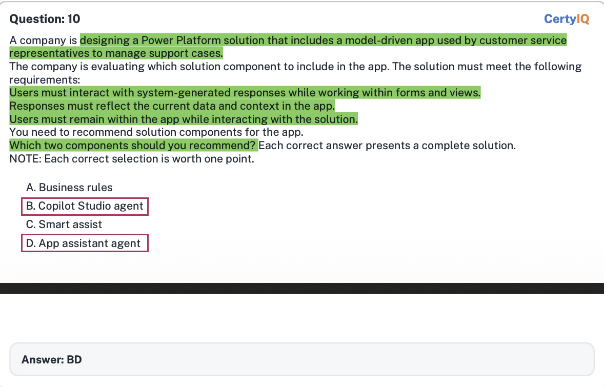

### 1. Extracted Question Summary

* **Scenario:** A company is designing a Power Platform solution that includes a model-driven app used by customer service representatives to manage support cases.

* **Requirements:**
* Users must interact with system-generated responses while working within forms and views.

* Responses must reflect the current data and context in the app.

* Users must remain within the app while interacting with the solution.

* **Question:** You need to recommend solution components for the app. Which two components should you recommend? (Each correct answer presents a complete solution).

* **Options:**
* **A.** Business rules

* **B.** Copilot Studio agent

* **C.** Smart assist

* **D.** App assistant agent

* **Visible Answer Key:** `Answer: BD`

---

### 2. Correct Answer

* **B: Copilot Studio agent** and **D: App assistant agent**

---

### 3. Verification of Visible Selection / Community Key

* The visible selection (**Answer: BD**) is **Correct**. Both a custom **Copilot Studio agent** embedded/connected inside a model-driven app and the native **App assistant agent** (Copilot in model-driven apps) operate directly inside the app's side pane, read the active form/view data context, generate conversational AI responses, and keep users inside the app without context-switching.

---

### 4. Official Microsoft Justification

* Under Microsoft Learn documentation for **Add a Copilot Studio agent to a model-driven app** and **Use Copilot (App assistant) in model-driven apps** (part of the AB-620 Intelligent Applications Builder Associate learning path):
* **Copilot Studio agent (B):** Makers can connect or embed an interactive Copilot Studio agent directly within a model-driven app's Copilot side pane. By passing app context (such as current table name, record ID, and form/view data), the agent generates context-aware responses while the user remains inside the model-driven app.

* **App assistant agent (D):** The built-in Copilot / App assistant agent in model-driven apps provides an integrated conversational experience directly alongside forms and views. It automatically understands the current record and view context in Dataverse, answers natural-language questions about the active data, and keeps representatives working entirely within the app interface.

---

### 5. Distractor Analysis (Why Others Are Wrong)

* **A. Business rules:** Execute deterministic client-side or server-side form logic (such as showing/hiding columns, setting field values, or displaying static error messages). They do not provide conversational or system-generated interactive responses across forms and views.

* **C. Smart assist:** A legacy Dynamics 365 Customer Service / Omnichannel productivity pane feature that surfaces static suggestion cards (such as similar cases or knowledge articles) during live conversations, rather than a modern Power Platform model-driven app component providing interactive, context-aware conversational responses across forms and views.

---

### 6. Exam Keyword / Trap Alert

* **Trigger Phrases:** *"system-generated responses while working within forms and views"*, *"reflect the current data and context in the app"*, and *"remain within the app"* $\rightarrow$ **Copilot Studio agent** and **App assistant agent**.

* **Exam Trap:** Notice the instruction **"Each correct answer presents a complete solution"**. In AB-620 questions, when Microsoft asks for two independent in-app conversational AI mechanisms that can read active model-driven app form/view context without leaving the app, **Copilot Studio agent** (custom conversational agent) and **App assistant agent** (built-in model-driven app Copilot) are the two standard Power Platform capabilities.

## Q11

### 1. Extracted Question Summary

* **Scenario:** A company plans to use Microsoft Dataverse to manage sales opportunities containing confidential financial data accessible only to specific groups of employees.

* **Requirements:**
* Sales representatives must only view and update records they create.

* Sales managers must have visibility into all opportunities within their organization.

* **Question:** Select the appropriate Dataverse security configuration options in the answer area.

* **Dropdown Options:**
* **Requirement 1:** *Sales representatives can only view and update records they create* — Options: `User-level access`, `Organization-level access`, `Team-level access`.

* **Requirement 2:** *Sales managers have visibility into all opportunities in the organization* — Options: `Organization-level access`, `Parent: Child Business Unit-Level access`, `Business Unit-level access`.

---

### 2. Correct Answer

| Requirement | Correct Configuration |
| --- | --- |
| **Sales representatives can only view and update records they create.**

 | **User-level access**

 |
| **Sales managers have visibility into all opportunities in the organization.**

 | **Organization-level access**

 |

---

### 3. Verification of Visible Selection / Community Key

* The answer area in the screenshot shows expanded dropdown menus with no pre-selected answers or community answer key visible. Both selections map directly to Dataverse's standard record-level privilege depth tiers.

---

### 4. Official Microsoft Justification

* Under Microsoft Learn documentation for **Security roles and privileges in Microsoft Dataverse**, user-owned and team-owned tables enforce access depth across four standard privilege levels:
* **User-level access (Basic):** Grants access strictly to records that the user owns (which by default includes records they create) or records explicitly shared with them. Setting **Read** and **Write** privileges to **User** level for the Sales Representative security role ensures representatives can only view and update their own records.

* **Organization-level access (Global):** Grants access to all records across the entire Dataverse environment regardless of business unit hierarchy or individual record ownership. Setting **Read** privilege to **Organization** level for the Sales Manager security role gives managers visibility into every opportunity across the entire organization.

---

### 5. Distractor Analysis (Why Others Are Wrong)

* **Requirement 1 Distractors:**
* **Organization-level access:** Would allow sales representatives to view and update *everyone's* confidential opportunity records across the company, violating the requirement.

* **Team-level access:** Is not a standalone privilege depth tier in Dataverse security roles (team-owned records are governed by the team's assigned security role privileges, typically at *User* or *Business Unit* depth).

* **Requirement 2 Distractors:**
* **Parent: Child Business Unit-Level access (Deep):** Restricts managers to records within their own business unit and any subordinate child business units, excluding sibling or parent business units elsewhere in the organization.

* **Business Unit-level access (Local):** Restricts managers strictly to records owned by users in their immediate business unit, hiding opportunities owned by other business units in the organization.

---

### 6. Exam Keyword / Trap Alert

* **Trigger Phrases:**
* *"only view and update records they create"* $\rightarrow$ **User-level access**.

* *"visibility into all opportunities within their organization"* $\rightarrow$ **Organization-level access**.

* **Exam Trap:** Watch the boundary wording carefully—if a question states *"within their own department and regional sub-departments,"* the answer shifts to **Parent: Child Business Unit-Level access**; when it explicitly says *"within their organization"* or *"in the organization,"* always choose **Organization-level access**.

## Q12

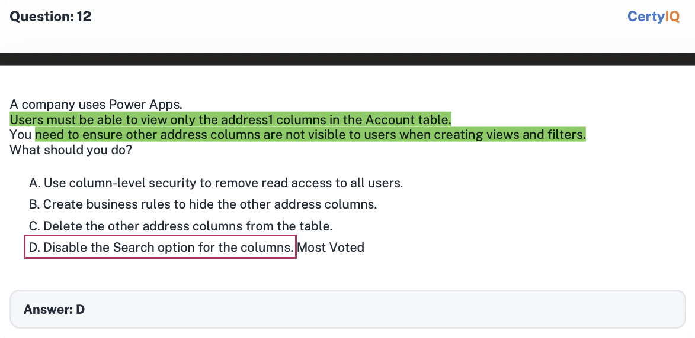

### 1. Extracted Question Summary

* **Scenario:** A company uses Power Apps. Users must be able to view only the `address1` columns in the **Account** table.

* **Requirement:** Ensure other address columns (such as `address2` or `address3` fields) are not visible to users when creating views and filters.

* **Question:** What should you do?

* **Options:**
* **A.** Use column-level security to remove read access to all users.

* **B.** Create business rules to hide the other address columns.

* **C.** Delete the other address columns from the table.

* **D.** Disable the Search option for the columns *(Highlighted inside red box, labeled "Most Voted", and marked "Answer: D")*.

---

### 2. Correct Answer

* D: Disable the Search option for the columns.

---

### 3. Verification of Visible Selection / Community Key

* The visible selection (**Answer: D**, boxed in red and labeled "Most Voted") is **Correct**. Setting a Dataverse column's **Searchable** (`IsValidForAdvancedFind`) property to **No** (disabling the Search option) hides that column from the column picker when users build personal views, Advanced Find queries, and grid filter conditions.

---

### 4. Official Microsoft Justification

* Under Microsoft Learn documentation for **Create and edit columns in Microsoft Dataverse** (*Advanced options — Searchable*):
* Each Dataverse column includes a **Searchable** property (exposed in the Power Apps maker portal under *Advanced options* as the **Searchable** checkbox, corresponding to the metadata attribute `IsValidForAdvancedFind`).
* When **Searchable** is disabled (set to `False`), the column no longer appears in the **Edit columns** or **Edit filters** dialogs when users create or customize personal views and grid filters in a model-driven app. This directly fulfills the requirement to prevent other address columns from appearing while users create views and filters without breaking underlying platform dependencies.

---

### 5. Distractor Analysis (Why Others Are Wrong)

* **A. Use column-level security to remove read access to all users:** Even if column-level security restricts data values (masking values with `****`), the column name still remains visible in the view/filter column selector unless its **Searchable** property is disabled—and system administrators still retain full access by default.

* **B. Create business rules to hide the other address columns:** Business rules only control field visibility on **forms**; they have no effect on which columns appear in the view designer or Advanced Find filter builders.

* **C. Delete the other address columns from the table:** Standard out-of-the-box system columns on the **Account** table (such as `address2_*` fields) are managed system components and cannot be deleted from Dataverse.

---

### 6. Exam Keyword / Trap Alert

* **Trigger Phrase:** *"not visible to users when creating views and filters"* $\rightarrow$ **Disable the Search option (Searchable = No)**.

* **Exam Trap:** Do not confuse **form visibility** (Business Rules / form field properties) or **data masking** (Column-Level Security) with **view/filter picker visibility**—hiding a column from Advanced Find and view/filter builders is specifically controlled by the column's **Searchable** metadata setting.

## Q13

### 1. Extracted Question Summary

* **Scenario:** An insurance company is implementing a customer service solution in Microsoft Dataverse with tables for customer information, support cases, and agents.

* **Question:** Drag and drop the appropriate relationship types to the correct requirements (each relationship may be used once, more than once, or not at all).

* **Available Relationships:**
* `One-to-one`

* `Connections`

* `One-to-many`

* `Many-to-many`

* **Target Requirements:**
1. Link each support case to a customer.

2. Provide information on children of customers.

3. Record history of agents assigned to customers.

---

### 2. Correct Answer

| Requirement | Correct Relationship |
| --- | --- |
| **Link each support case to a customer.**

 | **One-to-many**

 |
| **Provide information on children of customers.**

 | **Connections**

 |
| **Record history of agents assigned to customers.**

 | **Many-to-many** *(or **Connections** — see important nuance below)*

 |

---

### 3. Verification of Visible Selection / Community Key

* The answer area in the screenshot is blank (no drag-and-drop selections or community key are visible).

* **Important Certification Note on Row 2 vs. Row 3:** In official Microsoft Power Platform exam items of this exact pattern, **Connections** is specifically tested for flexible, role-based personal/family relationships (such as *Child*, *Spouse*, or *Beneficiary* on a customer record without creating dedicated tables), while **One-to-many** links one customer to multiple support cases, and **Many-to-many** links customers to multiple assigned agents over time. (In real-world Dataverse architecture, if you need metadata such as assignment start/end dates on the history itself, you would use a custom intersect table or Connections with roles; however, within the standard 4-choice exam drag-and-drop mapping, **Many-to-many** is the standard table relationship option paired with the third slot).

---

### 4. Official Microsoft Justification

* **One-to-many (Requirement 1 — Link each support case to a customer):** Under Microsoft Learn documentation for **Create and edit 1:N (one-to-many) or N:1 (many-to-one) table relationships in Microsoft Dataverse**, a single customer can open multiple support cases, while each support case belongs to one customer. Configuring a `1:N` relationship from Customer to Support Case places a lookup column on the Support Case table.

* **Connections (Requirement 2 — Provide information on children of customers):** Under Microsoft Learn documentation for **Configure connection roles in Microsoft Dataverse**, **Connections** provide a flexible way to associate records across tables (or within the same table, such as Contact-to-Contact) using descriptive **Connection Roles** (e.g., *Parent* / *Child*, *Dependent*) and optional descriptions, without requiring rigid schema changes or dedicated child tables.

* **Many-to-many (Requirement 3 — Record history of agents assigned to customers):** Under Microsoft Learn documentation for **Create N:N (many-to-many) table relationships in Microsoft Dataverse**, multiple agents can be assigned to a customer over time, and each agent handles many customers. An `N:N` relationship (either native or manual intersect) models multi-agent-to-multi-customer associations.

---

### 5. Distractor Analysis (Why Others Are Wrong)

* **One-to-one:** Dataverse does not provide a separate native "One-to-one" relationship type in the maker portal (a 1:1 pattern is only simulated via a 1:N relationship with unique constraints), and none of the three requirements represent a strict 1:1 cardinality (a customer can have multiple cases, multiple children, and multiple assigned agents over time).

---

### 6. Exam Keyword / Trap Alert

* **Trigger Phrases:**
* *"Link each [child record] to a [parent]"* $\rightarrow$ **One-to-many** (`1:N`).

* *"children of customers"* / family or role-based associations $\rightarrow$ **Connections** (using Connection Roles).

* *"agents assigned to customers"* (multiple agents $\leftrightarrow$ multiple customers) $\rightarrow$ **Many-to-many** (`N:N`).

* **Exam Trap:** Candidates often reverse **Connections** and **Many-to-many**. Remember: Microsoft specifically uses **Connections** in exam scenarios involving personal, family, or ad-hoc role relationships (like *children*, *spouses*, or *referrers* of a customer), whereas core operational entity pairings (like *Agents* and *Customers*) map to standard **Many-to-many** (`N:N`) table relationships.

## Q14

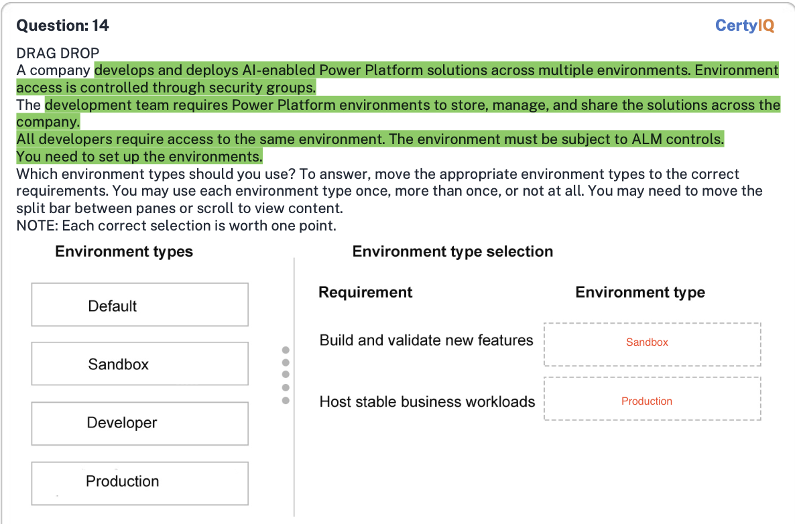

### 1. Extracted Question Summary

* **Scenario:** A company develops and deploys AI-enabled Power Platform solutions across multiple environments where environment access is controlled through security groups. All developers require access to the same shared environment, and the environment must be subject to Application Lifecycle Management (ALM) controls.

* **Question:** Drag and drop the appropriate environment types to the correct requirements.

* **Available Environment Types:**
* `Default`

* `Sandbox`

* `Developer`

* `Production`

* **Target Requirements:**
1. Build and validate new features

2. Host stable business workloads

---

### 2. Correct Answer

| Requirement | Correct Environment Type |
| --- | --- |
| **Build and validate new features**

 | **Sandbox**

 |
| **Host stable business workloads**

 | **Production**

 |

---

### 3. Verification of Visible Selection / Community Key

* The answer area in the screenshot is blank (no drag-and-drop selections or community key are visible). Notice the explicit constraints in the prompt: *"Environment access is controlled through security groups"* and *"All developers require access to the same environment"*. These two constraints eliminate the `Developer` environment type and lock in **Sandbox** for the first requirement.

---

### 4. Official Microsoft Justification

* **Sandbox (Requirement 1 — Build and validate new features):** Under Microsoft Learn documentation for **Environments overview** and **Establish an environment strategy** (*Power Platform Well-Architected*), a **Sandbox** environment is a non-production environment designed for shared development, testing, and validation. Crucially, unlike a personal *Developer* environment (which is restricted to a single maker/owner and does not support Microsoft Entra security group access control), a **Sandbox** environment supports **Microsoft Entra security group** access assignment, allows multiple developers to collaborate in the same environment, and supports full ALM operations (backup/restore, copy, reset, and managed solution pipelines).

* **Production (Requirement 2 — Host stable business workloads):** Under Microsoft Learn documentation for **Environments overview**, a **Production** environment is intended for permanent, live organizational operations and stable, tested workloads. It is governed by strict ALM release controls (receiving only validated managed solutions) and supports security group access control and enterprise SLA/backup governance.

---

### 5. Distractor Analysis (Why Others Are Wrong)

* **Developer:** A Developer environment (created via the Power Apps Developer Plan) is strictly a **single-user personal environment** intended for one individual maker to learn and build privately. You cannot assign a Microsoft Entra security group to grant multiple developers shared access to a Developer environment, directly violating the prompt's constraints.

* **Default:** The Default environment is automatically created per tenant and automatically grants *Environment Maker* access to all licensed users in the tenant. Because you cannot restrict access to the Default environment via a Microsoft Entra security group, Microsoft best practices explicitly prohibit using it for ALM-governed development or production workloads.

---

### 6. Exam Keyword / Trap Alert

* **Trigger Phrases:**
* *"Environment access is controlled through security groups"* + *"All developers require access to the same environment"* + *"Build and validate new features"* $\rightarrow$ **Sandbox** (not *Developer*!).

* *"Host stable business workloads"* $\rightarrow$ **Production**.

* **Exam Trap:** Seeing the words *"developers"* and *"Build... new features"* is a classic bait-and-switch for the **Developer** environment type. Always check whether the scenario requires **multi-developer collaboration** or **security group access control**—the moment either appears, **Developer** environments are disqualified and **Sandbox** is the only valid choice.

## Q15

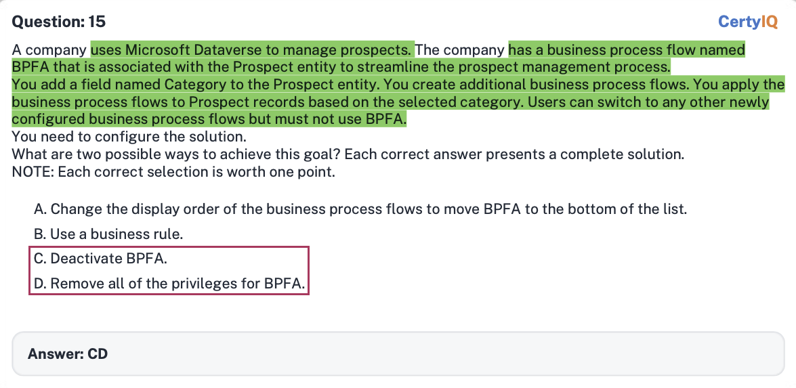

### 1. Extracted Question Summary

* **Scenario:** A company uses Microsoft Dataverse to manage prospects and currently has a business process flow named **BPFA** associated with the **Prospect** entity (table). You add a `Category` field to Prospect and create additional business process flows applied based on the selected category.

* **Requirement:** Users can switch to any of the other newly configured business process flows, but must not use **BPFA**.

* **Question:** What are two possible ways to achieve this goal? (Each correct answer presents a complete solution).

* **Options:**
* **A.** Change the display order of the business process flows to move BPFA to the bottom of the list.

* **B.** Use a business rule.

* **C.** Deactivate BPFA *(Highlighted inside red box)*.

* **D.** Remove all of the privileges for BPFA *(Highlighted inside red box)*.

* **Visible Answer Key:** `Answer: CD`

---

### 2. Correct Answer

* **C: Deactivate BPFA** and **D: Remove all of the privileges for BPFA**

---

### 3. Verification of Visible Selection / Community Key

* The visible selection (**Answer: CD**, boxed in red) is **Correct**. Both deactivating **BPFA** globally and stripping all security role privileges for **BPFA** (via **Enable Security Roles** in the Business Process Flow designer) prevent end users from seeing, triggering, or switching to **BPFA** on Prospect records.

---

### 4. Official Microsoft Justification

* Under Microsoft Learn documentation for **Business process flows overview** and **Assign security roles to a business process flow**:
* **Deactivate BPFA (C):** Only **active** business process flows can be applied to newly created records or selected in the **Switch Process** dialog on a model-driven app form. Deactivating **BPFA** turns off the process flow instance across the environment, immediately removing it from the available business process flows for all users.

* **Remove all of the privileges for BPFA (D):** Every business process flow has an underlying Dataverse table whose access is governed by security role privileges (configurable via **Edit Security Roles** inside the Business Process Flow designer). When all privileges for **BPFA** are removed from users' security roles, Dataverse hides **BPFA** from those users and prevents them from selecting or switching to it, while leaving the other newly configured business process flows accessible.

* *(Note on Terminology: The question uses the legacy Dataverse terms "entity" and "field," which correspond to **Table** and **Column** in current Microsoft Power Platform documentation.)*

---

### 5. Distractor Analysis (Why Others Are Wrong)

* **A. Change the display order of the business process flows to move BPFA to the bottom of the list:** Changing the process flow order only determines which active business process flow is applied *by default* when a user has access to multiple flows. Users can still open the **Process $\rightarrow$ Switch Process** menu on the form and manually select **BPFA**, violating the requirement that they must not use it.

* **B. Use a business rule:** Business rules operate on table columns (showing/hiding fields, setting values, locking fields, or validating data on forms). Business rules cannot disable, hide, or switch business process flows.

---

### 6. Exam Keyword / Trap Alert

* **Trigger Phrases:** *"Users can switch to any other newly configured business process flows but must not use BPFA"* + *"two possible ways... Each correct answer presents a complete solution"* $\rightarrow$ **Deactivate** the BPF or **remove security role privileges** for the BPF.

* **Exam Trap:** Option **A** (process order) is the classic distractor. Process flow ordering only controls *default assignment* upon record creation; it does **not** block users from manually switching to a lower-ranked flow via the **Switch Process** command. To completely block usage, you must either **deactivate** the flow or **remove its security role privileges**.

## Q16

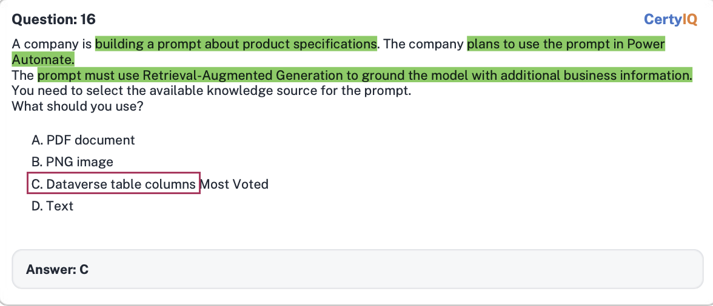

### 1. Extracted Question Summary

* **Scenario:** A company is building a prompt about product specifications and plans to use the prompt in Power Automate.

* **Requirement:** The prompt must use Retrieval-Augmented Generation (RAG) to ground the model with additional business information.

* **Question:** You need to select the available knowledge source for the prompt. What should you use?

* **Options:**
* **A.** PDF document

* **B.** PNG image

* **C.** Dataverse table columns *(Highlighted inside red box, labeled "Most Voted", and marked "Answer: C")*

* **D.** Text

---

### 2. Correct Answer

* **C: Dataverse table columns**

---

### 3. Verification of Visible Selection / Community Key

* The visible selection (**Answer: C**, boxed in red and labeled "Most Voted") is **Correct**. In AI Builder / Copilot Studio **Prompt Builder**, native **Knowledge** grounding (which performs Retrieval-Augmented Generation to dynamically retrieve relevant enterprise rows at runtime) connects directly to **Microsoft Dataverse** tables and columns.

---

### 4. Official Microsoft Justification

* Under Microsoft Learn documentation for **Use your own data in a prompt (Add knowledge to a prompt)** in AI Builder and Copilot Studio:
* Prompt Builder provides a dedicated **Knowledge** (or **Data**) section designed specifically for **Retrieval-Augmented Generation (RAG)**—retrieving relevant business records from an enterprise data store to ground the LLM's response without manually passing every record into the prompt text.

* In Power Platform Prompt Builder (when invoked from Power Automate or Copilot Studio), **Dataverse** (selecting a Dataverse table and specific filter/retrieval columns) is the native built-in knowledge source for RAG grounding. When the prompt executes in Power Automate, Prompt Builder searches the configured Dataverse table columns using the prompt's input context and injects the retrieved records into the model's context window.

---

### 5. Distractor Analysis (Why Others Are Wrong)

* **A. PDF document:** In Prompt Builder, a PDF file is passed as a **Document/File input** parameter at runtime (so the model can summarize, extract, or reason over that specific uploaded file), rather than serving as a built-in RAG knowledge source.

* **B. PNG image:** In Prompt Builder, a PNG file is passed as an **Image input** parameter for multimodal visual analysis (such as OCR or image description), not as a RAG knowledge store.

* **D. Text:** **Text** is a standard runtime **Input variable** type in Prompt Builder (used to pass dynamic strings from a Power Automate flow into the prompt template), not an indexed RAG knowledge source.

---

### 6. Exam Keyword / Trap Alert

* **Trigger Phrases:** *"building a prompt"*, *"use Retrieval-Augmented Generation to ground the model"*, and *"select the available knowledge source"* $\rightarrow$ **Dataverse table columns**.

* **Exam Trap:** Distinguish clearly between Prompt Builder **Inputs** vs. **Knowledge**:
* **Inputs** = `Text`, `Image` (PNG/JPG), and `Document` (PDF) — passed explicitly per run.

* **Knowledge (RAG)** = **Dataverse** tables/columns — queried dynamically via semantic/keyword retrieval to ground the prompt with additional business data.

## Q17

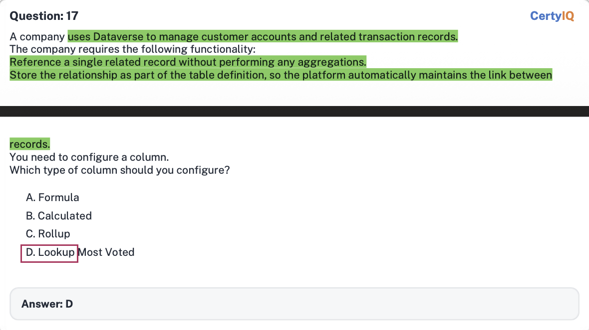

### 1. Extracted Question Summary

* **Scenario:** A company uses Dataverse to manage customer accounts and related transaction records.

* **Requirements:**
* Reference a single related record without performing any aggregations.

* Store the relationship as part of the table definition, so the platform automatically maintains the link between records.

* **Question:** You need to configure a column. Which type of column should you configure?

* **Options:**
* **A.** Formula

* **B.** Calculated

* **C.** Rollup

* **D.** Lookup *(Highlighted inside red box, labeled "Most Voted", and marked "Answer: D")*

---

### 2. Correct Answer

* **D: Lookup**

---

### 3. Verification of Visible Selection / Community Key

* The visible selection (**Answer: D**, boxed in red and labeled "Most Voted") is **Correct**. A **Lookup** column in Dataverse creates a many-to-one (`N:1`) table relationship in the metadata definition, stores the foreign key reference to a single parent record, and enforces referential integrity automatically without performing aggregations.

---

### 4. Official Microsoft Justification

* Under Microsoft Learn documentation for **Create and edit columns in Microsoft Dataverse** and **Create and edit 1:N (one-to-many) or N:1 (many-to-one) table relationships in Microsoft Dataverse**:
* Creating a **Lookup** column on a child table (such as Transactions) automatically establishes an `N:1` relationship in the Dataverse table schema linking each child record to a single parent record (such as Customer Account).

* Dataverse stores this relationship directly in the table metadata definition, automatically maintaining the relational link, enforcing cascading/referential behaviors, and rendering a record selector control on model-driven forms without computing any summary or aggregate calculations.

---

### 5. Distractor Analysis (Why Others Are Wrong)

* **A. Formula:** Uses Power Fx expressions to compute dynamic, read-only values on the fly (such as text formatting or date math); it does not define a schema-level table relationship or store a foreign-key pointer to a parent record.

* **B. Calculated:** Evaluates automated calculations using classic Dataverse calculation rules (such as `DIFFINDAYS` or arithmetic across columns) at read time; it cannot create or maintain a relational link between tables.

* **C. Rollup:** Explicitly performs **aggregations** (`SUM`, `COUNT`, `MIN`, `MAX`, `AVG`) across child records over an *existing* relationship. The prompt specifically states *"without performing any aggregations"* and asks to create the relationship itself.

---

### 6. Exam Keyword / Trap Alert

* **Trigger Phrases:** *"Reference a single related record"*, *"without performing any aggregations"*, and *"Store the relationship as part of the table definition"* $\rightarrow$ **Lookup**.

* **Exam Trap:** Watch the distinction between **Lookup** and **Rollup**—a **Lookup** column *creates* the `N:1` relationship pointer to a single parent record, whereas a **Rollup** column *aggregates* data from multiple child records across an already-established `1:N` relationship.

## Q18

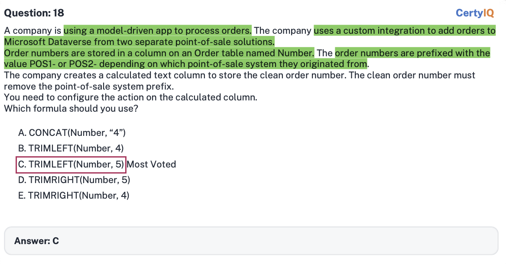

### 1. Extracted Question Summary

* **Scenario:** A company uses a model-driven app to process orders added to Microsoft Dataverse from two separate point-of-sale solutions. Order numbers are stored in a column named `Number` on the `Order` table, prefixed with either `POS1-` or `POS2-`.

* **Requirement:** Configure an action on a calculated text column to store the clean order number by removing the point-of-sale system prefix.

* **Question:** Which formula should you use?

* **Options:**
* **A.** `CONCAT(Number, “4”)`

* **B.** `TRIMLEFT(Number, 4)`

* **C.** `TRIMLEFT(Number, 5)` *(Highlighted inside red box, labeled "Most Voted", and marked "Answer: C")*

* **D.** `TRIMRIGHT(Number, 5)`

* **E.** `TRIMRIGHT(Number, 4)`

---

### 2. Correct Answer

* **C: `TRIMLEFT(Number, 5)**`

---

### 3. Verification of Visible Selection / Community Key

* The visible selection (**Answer: C**, boxed in red and labeled "Most Voted") is **Correct**. Counting each character of the prefix `POS1-` or `POS2-` gives **5 characters** (`P` [1], `O` [2], `S` [3], `1`/`2` [4], `-` [5]) at the beginning (left side) of the string. `TRIMLEFT(Number, 5)` removes those first 5 leading characters, leaving only the clean order number.

---

### 4. Official Microsoft Justification

* Under Microsoft Learn documentation for **Define calculated columns in Microsoft Dataverse** (*Function syntax — TRIMLEFT*):
* `TRIMLEFT(Single line of text, Whole number)` returns a string after removing the specified number of characters from the **beginning (left)** of the input string.
* Because both prefixes (`POS1-` and `POS2-`) consist of 5 characters including the trailing hyphen (`-`), passing `5` as the character count to `TRIMLEFT(Number, 5)` strips the entire prefix and outputs the clean order identifier.

---

### 5. Distractor Analysis (Why Others Are Wrong)

* **A. `CONCAT(Number, “4”)`:** Appends the literal string `"4"` to the end of `Number` rather than removing characters from the prefix.

* **B. `TRIMLEFT(Number, 4)`:** Removes only the first 4 characters (`POS1` or `POS2`), leaving a stray leading hyphen (`-12345`) on the clean order number.

* **D. `TRIMRIGHT(Number, 5)`:** Removes 5 characters from the **end (right)** of the order number, leaving the `POS1-`/`POS2-` prefix intact while truncating the actual order digits.

* **E. `TRIMRIGHT(Number, 4)`:** Removes 4 characters from the **end (right)** of the string instead of stripping the 5-character prefix from the left.

---

### 6. Exam Keyword / Trap Alert

* **Trigger Phrases:** *"prefixed with the value POS1- or POS2-"* and *"remove the point-of-sale system prefix"* $\rightarrow$ **`TRIMLEFT`** + **exact character count including punctuation (`5`)**.

* **Exam Trap:** Option **B (`TRIMLEFT(Number, 4)`)** is a classic off-by-one trap—candidates frequently count `POS1` as 4 characters and forget to include the hyphen (`-`) as the 5th character. Always count delimiters/hyphens explicitly when calculating `TRIMLEFT` or `TRIMRIGHT` lengths!

## Q19

### 1. Extracted Question Summary

* **Scenario:** A company uses a model-driven app and needs to dynamically control how form components behave as users interact with the form, modifying the form in real time and enforcing client-side behavior dynamically.

* **Proposed Solution:** Use business rules to show inline error messages.

* **Question:** Does the solution meet the goal?

* **Options:**
* **A.** Yes *(Highlighted inside red box, labeled "Most Voted", and marked "Answer: A")*

* **B.** No

---

### 2. Correct Answer

* **A: Yes**

---

### 3. Verification of Visible Selection / Community Key

* The visible selection (**Answer: A**, boxed in red and labeled "Most Voted") is **Correct**. Business rules execute client-side in real time on model-driven app forms whenever column values change or the form loads, and showing inline error messages on specific columns is one of the core native actions supported by Dataverse business rules.

---

### 4. Official Microsoft Justification

* Under Microsoft Learn documentation for **Create a business rule in Microsoft Dataverse**:
* **Client-Side Real-Time Execution:** When a business rule's scope is set to a specific form or **All Forms**, Dataverse compiles the rule into client-side logic that evaluates immediately in the browser as users enter or modify data—without requiring a server round-trip or custom JavaScript.

* **Supported Form Component Actions:** Business rules natively support six real-time form actions:
1. **Show error message** (displays an inline validation error message next to a specific column and prevents saving until resolved)

2. **Set field value**
3. **Set business required**
4. **Set visibility** (show or hide columns)
5. **Lock or unlock field** (enable or disable columns)
6. **Set default value**

* Because displaying inline error messages dynamically controls form behavior and validation in real time on the client side, the proposed solution meets the stated goal.

---

### 5. Distractor Analysis (Why Others Are Wrong)

* **B. No:** Incorrect because **Show error message** is an out-of-the-box business rule action that runs dynamically on the client side as users interact with a model-driven form. *(In a "Yes/No" series of questions with this same stem, "No" would only apply if a variant proposed a server-side/asynchronous mechanism such as a Power Automate cloud flow, a synchronous/asynchronous Dataverse plug-in, or a business rule scoped strictly to `Entity` without form-level UI feedback—though note that even `Entity`-scoped rules run on forms too, whereas plug-ins and cloud flows cannot dynamically modify form UI components in real time while a user types.)*

---

### 6. Exam Keyword / Trap Alert

* **Trigger Phrases:** *"dynamically control how components of the form behave"*, *"modify the form in real time while the user interacts with the interface"*, and *"enforce client-side behavior dynamically"* $\rightarrow$ **Business rules** (or **Client-side JavaScript form scripting**).

* **Exam Trap:** Remember that this is a **repeated-scenario series** question. In upcoming variants of Question 19:

* **Business rules** (showing inline error messages, showing/hiding columns, locking columns) $\rightarrow$ **Yes**.

* **Client-side JavaScript / Form scripts** $\rightarrow$ **Yes**.
* **Power Automate cloud flows** or **Dataverse C# plug-ins** $\rightarrow$ **No** (they execute server-side upon data events rather than dynamically modifying form components in real time during user interaction).

## Q20

### 1. Extracted Question Summary

* **Scenario:** A company uses a model-driven app and must dynamically control how components of the form behave as users interact with it, modifying the form in real time and enforcing client-side behavior dynamically. *(Part of a repeated-scenario series)*.

* **Proposed Solution:** Use Power Automate cloud flows to update column values.

* **Question:** Does the solution meet the goal?

* **Options:**
* **A.** Yes

* **B.** No *(Highlighted inside red box, labeled "Most Voted", and marked "Answer: B")*

---

### 2. Correct Answer

* **B: No**

---

### 3. Verification of Visible Selection / Community Key

* The visible selection (**Answer: B**, boxed in red and labeled "Most Voted") is **Correct**. Power Automate cloud flows run **asynchronously on the server side** after a record is created, updated, or deleted in Dataverse—they do not run on the client side in real time while a user is actively interacting with a form.

---

### 4. Official Microsoft Justification

* Under Microsoft Learn documentation for **Overview of automated flows** and **Apply business logic in Microsoft Dataverse**:
* **Asynchronous Server-Side Execution:** Automated Power Automate cloud flows connected to Microsoft Dataverse execute in the background *after* a transaction commits to the server (e.g., *When a row is added, modified or deleted*).
* **No Client-Side UI Control:** Cloud flows have no access to the model-driven form's browser DOM or client-side form context (`formContext`), cannot dynamically modify form components (such as hiding/showing sections, locking fields, or displaying inline errors) in real time as a user types, and require a manual form refresh for server-updated column values to appear in the UI.

* To enforce real-time, client-side form behavior in a model-driven app, Microsoft prescribes **Business Rules** (for declarative no-code logic) or **Client-side JavaScript form scripting** (web resources bound to `OnLoad`/`OnChange` events).

---

### 5. Distractor Analysis (Why Others Are Wrong)

* **A. Yes:** Incorrect because Power Automate cloud flows operate asynchronously on the server rather than dynamically on the client side while the user interacts with the form interface.

---

### 6. Exam Keyword / Trap Alert

* **Trigger Phrases:** *"dynamically control how components of the form behave"*, *"modify the form in real time while the user interacts with the interface"*, and *"enforce client-side behavior dynamically"* $\rightarrow$ **Client-side logic only** (Business Rules or JavaScript).

* **Exam Trap:** Any proposed solution in this series that relies on **Power Automate cloud flows**, **Dataverse C# plug-ins**, or **classic background workflows** is a server-side mechanism and therefore **No** whenever the prompt requires **real-time client-side UI/form interaction**.

## Q21

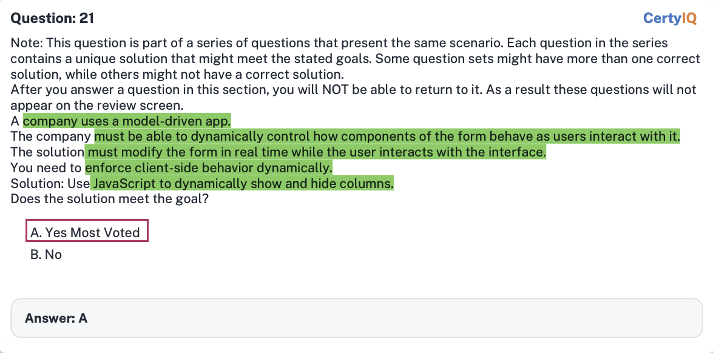

### 1. Extracted Question Summary

* **Scenario:** A company uses a model-driven app and must dynamically control how components of the form behave as users interact with it, modifying the form in real time and enforcing client-side behavior dynamically. *(Part of a repeated-scenario series)*.

* **Proposed Solution:** Use Power Automate cloud flows to update column values.

* **Question:** Does the solution meet the goal?

* **Options:**
* **A.** Yes

* **B.** No *(Highlighted inside red box, labeled "Most Voted", and marked "Answer: B")*

---

### 2. Correct Answer

* **B: No**

---

### 3. Verification of Visible Selection / Community Key

* The visible selection (**Answer: B**, boxed in red and labeled "Most Voted") is **Correct**. Power Automate cloud flows run **asynchronously on the server side** after a record is created, updated, or deleted in Dataverse—they do not run on the client side in real time while a user is actively interacting with a form.

---

### 4. Official Microsoft Justification

* Under Microsoft Learn documentation for **Overview of automated flows** and **Apply business logic in Microsoft Dataverse**:
* **Asynchronous Server-Side Execution:** Automated Power Automate cloud flows connected to Microsoft Dataverse execute in the background *after* a transaction commits to the server (e.g., *When a row is added, modified or deleted*).
* **No Client-Side UI Control:** Cloud flows have no access to the model-driven form's browser DOM or client-side form context (`formContext`), cannot dynamically modify form components (such as hiding/showing sections, locking fields, or displaying inline errors) in real time as a user types, and require a manual form refresh for server-updated column values to appear in the UI.

* To enforce real-time, client-side form behavior in a model-driven app, Microsoft prescribes **Business Rules** (for declarative no-code logic) or **Client-side JavaScript form scripting** (web resources bound to `OnLoad`/`OnChange` events).

---

### 5. Distractor Analysis (Why Others Are Wrong)

* **A. Yes:** Incorrect because Power Automate cloud flows operate asynchronously on the server rather than dynamically on the client side while the user interacts with the form interface.

---

### 6. Exam Keyword / Trap Alert

* **Trigger Phrases:** *"dynamically control how components of the form behave"*, *"modify the form in real time while the user interacts with the interface"*, and *"enforce client-side behavior dynamically"* $\rightarrow$ **Client-side logic only** (Business Rules or JavaScript).

* **Exam Trap:** Any proposed solution in this series that relies on **Power Automate cloud flows**, **Dataverse C# plug-ins**, or **classic background workflows** is a server-side mechanism and therefore **No** whenever the prompt requires **real-time client-side UI/form interaction**.

## Q22

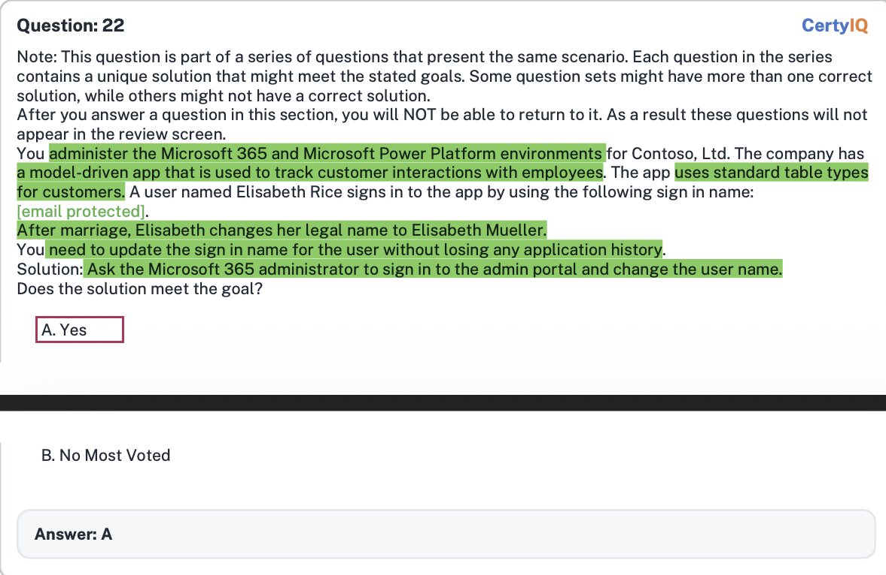

### 1. Extracted Question Summary

* **Scenario:** You administer Microsoft 365 and Microsoft Power Platform environments for Contoso, Ltd., which uses a model-driven app with standard table types to track customer interactions with employees. A user named Elisabeth Rice changes her legal name to Elisabeth Mueller after marriage. *(Part of a repeated-scenario series)*.

* **Requirement:** Update the sign-in name for the user without losing any application history.

* **Proposed Solution:** Ask the Microsoft 365 administrator to sign in to the admin portal and change the user name.

* **Question:** Does the solution meet the goal?

* **Options:**
* **A.** Yes *(Highlighted inside red box and marked "Answer: A")*

* **B.** No *(Labeled "Most Voted")*

---

### 2. Correct Answer

* **A: Yes**

---

### 3. Verification of Visible Selection / Community Key

* Notice the conflict in the screenshot: **Option A ("Yes")** is boxed in red and listed in the official key (`Answer: A`), whereas **Option B ("No")** carries the community `"Most Voted"` tag.

* **The red-boxed official key (`Answer: A — Yes`) is Correct, and the `"Most Voted"` community vote (`B. No`) is Wrong**. Changing a user's username / User Principal Name (UPN) in the **Microsoft 365 admin center** updates the existing Microsoft Entra ID account in place while preserving its immutable `Object ID` and Dataverse `SystemUser` GUID—retaining 100% of the user's record ownership, audit logs, and application history.

---

### 4. Official Microsoft Justification

* Under Microsoft Learn documentation for **Change a user name and email address** (*Microsoft 365 admin center*) and **Manage users in Dataverse** (*Power Platform admin center*):
* **Identity Linkage via Object ID:** A Dataverse user record (`systemuser`) is bound to Microsoft Entra ID via the user's immutable **Microsoft Entra Object ID** (`AzureActiveDirectoryObjectId`), not their mutable UPN or display name.
* **In-Place UPN & Display Name Update:** When a Global Administrator or User Administrator signs into the **Microsoft 365 admin center** and edits the user's **username** (primary email/UPN) and display name, Entra ID preserves the underlying user identity (`Object ID`). Dataverse automatically synchronizes the updated `DomainName` and `FullName` onto the existing `systemuser` record, preserving all created/modified metadata, record ownership, security roles, and application history.

---

### 5. Distractor Analysis (Why Others Are Wrong)

* **B. No ("Most Voted" community trap):** Community voters often confuse **editing an existing user's username** with **creating a brand-new user account** (or assume you must manually update the `systemuser` table directly inside the Power Platform admin center). Creating a *new* user account would generate a new Entra Object ID and orphan application history, whereas **changing the username** on the existing account in the Microsoft 365 admin center seamlessly preserves all history.

---

### 6. Exam Keyword / Trap Alert

* **Trigger Phrases:** *"changes her legal name"*, *"update the sign in name for the user without losing any application history"*, and *"sign in to the [Microsoft 365] admin portal and change the user name"* $\rightarrow$ **Yes**.

* **Exam Trap:** Watch the variations in this repeated-scenario series:
* **Change the user name in the Microsoft 365 admin center** $\rightarrow$ **Yes** (updates UPN in place; keeps the same Entra Object ID and Dataverse `systemuser` record).

* **Create a new user account in Microsoft 365 and delete/disable the old one** $\rightarrow$ **No** (creates a new `systemuser` GUID and breaks continuity of application history).

* **Ask the Power Platform administrator to edit the username directly in Dataverse / Power Platform admin center** $\rightarrow$ **No** (sign-in names/UPNs are mastered in Microsoft 365 / Entra ID, not directly editable as independent sign-in credentials in Dataverse).

## Q23

### 1. Extracted Question Summary

* **Scenario:** You administer Microsoft 365 and Microsoft Power Platform environments for Contoso, Ltd., which uses a model-driven app with standard table types to track customer interactions with employees. A user named Elisabeth Rice changes her legal name to Elisabeth Mueller after marriage. *(Part of a repeated-scenario series)*.

* **Requirement:** Update the sign-in name for the user without losing any application history.

* **Proposed Solution:** Change Elisabeth’s username in the user record for the app.

* **Question:** Does the solution meet the goal?

* **Options:**
* **A.** Yes

* **B.** No *(Highlighted inside red box, labeled "Most Voted", and marked "Answer: B")*

---

### 2. Correct Answer

* **B: No**

---

### 3. Verification of Visible Selection / Community Key

* The visible selection (**Answer: B**, boxed in red and labeled "Most Voted") is **Correct**. In Microsoft Dataverse, a user's sign-in name (`DomainName` / User Principal Name) is read-only and mastered by Microsoft Entra ID (Microsoft 365)—it cannot be changed directly inside the Dataverse `User` (`systemuser`) record for the app.

---

### 4. Official Microsoft Justification

* Under Microsoft Learn documentation for **Manage users in Dataverse** (*Power Platform admin center*) and **Change a user name and email address** (*Microsoft 365 admin center*):
* **Microsoft Entra ID as the Source of Authority:** Dataverse synchronizes user identity attributes (such as `DomainName`, `FullName`, and `InternalEmailAddress`) one-way from Microsoft Entra ID into the Dataverse `User` (`systemuser`) table.
* **Read-Only Sign-In Credentials in Dataverse:** Inside a model-driven app or the Power Platform admin center, the **User Name** (sign-in UPN) field on the Dataverse user record is locked/read-only and cannot be edited directly. Even if an administrator edits display attributes locally, sign-in authentication is governed exclusively by Microsoft Entra ID. To change a user's sign-in name while preserving their Dataverse `systemuser` record and application history, the username must be updated in the **Microsoft 365 admin center** (or **Microsoft Entra admin center**).

---

### 5. Distractor Analysis (Why Others Are Wrong)

* **A. Yes:** Incorrect because the Dataverse `User` record within the app is merely a synchronized projection of the Microsoft Entra ID user account—you cannot modify a user's sign-in name (UPN) from inside the model-driven app's user record.

---

### 6. Exam Keyword / Trap Alert

* **Trigger Phrases:** *"update the sign in name for the user"* + *"Change Elisabeth’s username in the user record for the app"* $\rightarrow$ **No**.

* **Series Recap (Compare Question 22 vs. Question 23):**
* **Question 22:** *"Ask the Microsoft 365 administrator to sign in to the admin portal and change the user name"* $\rightarrow$ **Yes** (updates the UPN at the identity source in Entra ID while preserving the immutable `Object ID` and Dataverse history).

* **Question 23:** *"Change Elisabeth’s username in the user record for the app"* $\rightarrow$ **No** (the sign-in UPN is mastered in Microsoft 365 / Entra ID and cannot be edited from the Dataverse user record).

## Q24

### 1. Extracted Question Summary

* **Scenario:** You administer the Microsoft 365 and Microsoft Power Platform environments for Contoso, Ltd., which uses a model-driven app with standard table types to track customer interactions with employees. A user named Elisabeth Rice changes her legal name to Elisabeth Mueller after marriage. *(Part of a repeated-scenario series)*.

* **Requirement:** Update the sign-in name for the user without losing any application history.

* **Proposed Solution:** From Dynamics 365 Settings, select Email Configuration. In the active mailbox for the user, update the name.

* **Question:** Does the solution meet the goal?

* **Options:**
* **A.** Yes

* **B.** No *(Highlighted inside red box, labeled "Most Voted", and marked "Answer: B")*

---

### 2. Correct Answer

* **B: No**

---

### 3. Verification of Visible Selection / Community Key

* The visible selection (**Answer: B**, boxed in red and labeled "Most Voted") is **Correct**. Updating a user's **Mailbox** record under Dynamics 365 Email Configuration only affects server-side email synchronization settings—it does not modify the user's Microsoft Entra ID sign-in credential (User Principal Name) or Dataverse `User` (`systemuser`) sign-in identity.

---

### 4. Official Microsoft Justification

* Under Microsoft Learn documentation for **Connect to Exchange Online (Email Configuration / Mailboxes)** in Power Platform and **Change a user name and email address** (*Microsoft 365 admin center*):
* **Mailbox Record Scope:** A Dataverse **Mailbox** record (`mailbox`) manages incoming/outgoing email routing, appointments, contacts, and tasks synchronization between Dataverse and Exchange Online. Changing the display name on a mailbox record neither updates the user's authentication identity nor changes the sign-in name used to access model-driven apps.

* **Identity Authority in Entra ID:** Authentication for Power Platform and model-driven apps is governed by **Microsoft Entra ID** (administered via the Microsoft 365 admin center or Microsoft Entra admin center). Only updating the user's username / User Principal Name (UPN) in Microsoft 365 updates their sign-in name while preserving their immutable Entra `Object ID` and Dataverse `systemuser` history.

---

### 6. Distractor Analysis (Why Others Are Wrong)

* **A. Yes:** Incorrect because Email Configuration mailboxes control email synchronization rather than user authentication or sign-in usernames.

---

### 6. Exam Keyword / Trap Alert

* **Trigger Phrases:** *"update the sign in name for the user"* + *"select Email Configuration. In the active mailbox for the user, update the name"* $\rightarrow$ **No**.

* **Complete Series Wrap-Up (Questions 22–24):**
* **Question 22:** Update the username in the **Microsoft 365 admin portal** $\rightarrow$ **Yes** (modifies the UPN at the identity source while keeping the same Entra `Object ID` and Dataverse history).

* **Question 23:** Update the username in the **Dataverse user record** for the app $\rightarrow$ **No** (sign-in UPN is read-only in Dataverse and synced one-way from Entra ID).

* **Question 24:** Update the name in the **Email Configuration mailbox** $\rightarrow$ **No** (mailboxes handle email sync only, not sign-in credentials).

## Q30

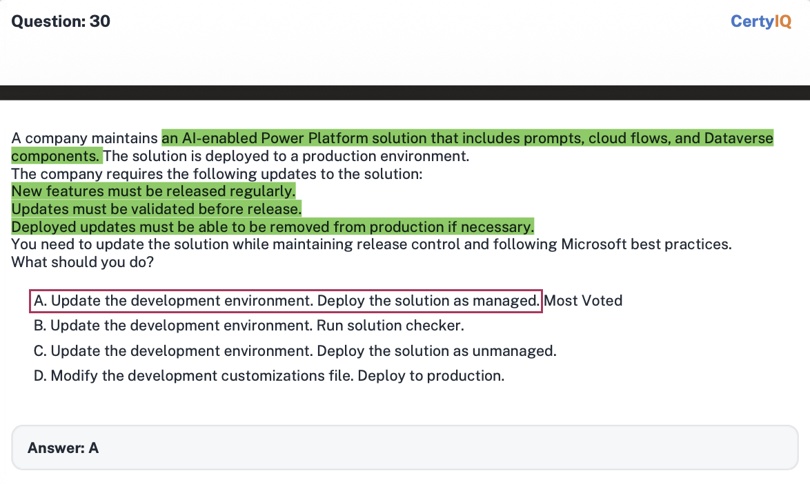

### 1. Extracted Question Summary

* **Scenario:** A company maintains an AI-enabled Power Platform solution containing prompts, cloud flows, and Dataverse components deployed to a production environment.

* **Requirements:**
* New features must be released regularly.

* Updates must be validated before release.

* Deployed updates must be able to be removed from production if necessary.

* **Question:** You need to update the solution while maintaining release control and following Microsoft best practices. What should you do?

* **Options:**
* **A.** Update the development environment. Deploy the solution as managed. *(Highlighted inside red box, labeled "Most Voted", and marked "Answer: A")*

* **B.** Update the development environment. Run solution checker.

* **C.** Update the development environment. Deploy the solution as unmanaged.

* **D.** Modify the development customizations file. Deploy to production.

---

### 2. Correct Answer

* **A: Update the development environment. Deploy the solution as managed.**

---

### 3. Verification of Visible Selection / Community Key

* The visible selection (**Answer: A**, boxed in red and labeled "Most Voted") is **Correct**. Developing changes in an isolated development environment and deploying them downstream as a **managed solution** enforces release control, supports pre-release validation in staging/test environments, and allows updates or solutions to be cleanly uninstalled (rolled back/removed) from production if necessary.

---

### 4. Official Microsoft Justification

* Under Microsoft Learn documentation for **Application Lifecycle Management (ALM) with Microsoft Power Platform** (*Solution concepts — Managed and unmanaged solutions*):
* **Rollback / Removal Capability:** Only **managed solutions** can be cleanly uninstalled to remove all components introduced by that solution or update from a target environment. Unmanaged solutions merge their components directly into the target environment's default unmanaged layer, meaning deleting the unmanaged solution container leaves all underlying components behind in production.
* **Controlled Release & Validation:** Following Microsoft ALM best practices, makers modify components inside an unmanaged solution in a dedicated **development** environment, export it as a **managed** solution, validate it in a downstream test/staging environment (and via Power Platform Pipelines / Solution Checker), and deploy the managed artifact into **production**.

---

### 5. Distractor Analysis (Why Others Are Wrong)

* **B. Update the development environment. Run solution checker:** Running Solution Checker performs static analysis on solution components, but it is incomplete because it never deploys the updated solution to test/production or establishes a removable managed release artifact.

* **C. Update the development environment. Deploy the solution as unmanaged:** Violates Microsoft ALM best practices and directly fails the requirement that *"deployed updates must be able to be removed from production if necessary"*. Components imported via an unmanaged solution cannot be removed simply by uninstalling the solution.

* **D. Modify the development customizations file. Deploy to production:** Manually editing exported `customizations.xml` files is unsupported for standard ALM workflows and does not guarantee a controlled, removable managed deployment.

---

### 6. Exam Keyword / Trap Alert

* **Trigger Phrases:** *"Deployed updates must be able to be removed from production if necessary"* and *"maintaining release control and following Microsoft best practices"* $\rightarrow$ **Deploy the solution as managed**.

* **Exam Trap:** Whenever a Power Platform ALM question mentions **uninstalling, rolling back, or removing** deployed updates from a test or production environment, the answer is always **Managed Solution**—never *Unmanaged Solution*.

## Q31

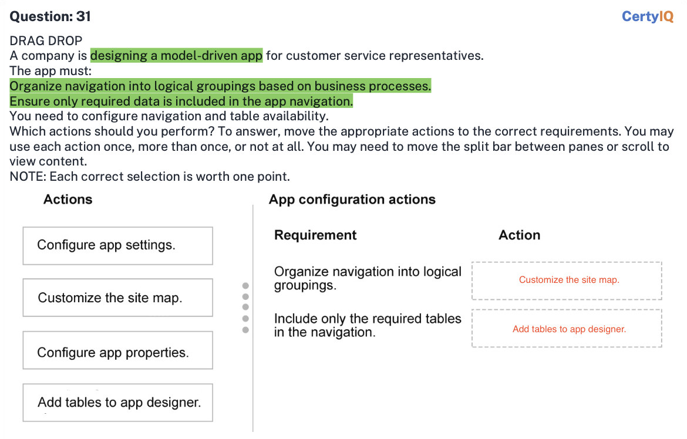

### 1. Extracted Question Summary

* **Scenario:** A company is designing a model-driven app for customer service representatives.

* **Requirements:**
* Organize navigation into logical groupings based on business processes.

* Ensure only required data is included in the app navigation.

* **Question:** You need to configure navigation and table availability. Drag and drop the appropriate actions to the correct requirements.

* **Available Actions:**
* `Configure app settings.`

* `Customize the site map.`

* `Configure app properties.`

* `Add tables to app designer.`

* **Target Requirements:**
1. Organize navigation into logical groupings.

2. Include only the required tables in the navigation.

---

### 2. Correct Answer

| Requirement | Correct Action |
| --- | --- |
| **Organize navigation into logical groupings.**

 | **Customize the site map.**

 |
| **Include only the required tables in the navigation.**

 | **Add tables to app designer.**

 |

---

### 3. Verification of Visible Selection / Community Key

* The answer area in the screenshot is blank (no drag-and-drop selections or community key are visible). Both actions map directly to the core navigation and component-scoping mechanics of the Power Apps model-driven app designer.

---

### 4. Official Microsoft Justification

* **Customize the site map (Requirement 1 — Organize navigation into logical groupings):** Under Microsoft Learn documentation for **Create a model-driven app site map** (*Power Apps*), the **site map** defines the navigation hierarchy of a model-driven app. Makers organize navigation into logical business-process groupings using three structural tiers: **Areas** (top-level functional modules), **Groups** (logical headings inside an area), and **Subareas** (individual tables, dashboards, or custom pages).
* **Add tables to app designer (Requirement 2 — Include only the required tables in the navigation):** Under Microsoft Learn documentation for **Add or edit model-driven app components in the Power Apps app designer**, adding specific **tables** (pages) in the app designer controls which Dataverse tables are scoped to the app and exposed in its navigation pane, ensuring representatives only see the data tables required for their role.

---

### 5. Distractor Analysis (Why Others Are Wrong)

* **Configure app settings:** Controls global app-level behavior toggles and features (such as enabling offline mode, upcoming/preview features, or Copilot chat integration), not navigation grouping or table scoping.

* **Configure app properties:** Defines descriptive metadata for the app (such as Name, Unique Name, Description, Icon, and Welcome Page), rather than structural navigation hierarchy or included tables.

---

### 6. Exam Keyword / Trap Alert

* **Trigger Phrases:**
* *"Organize navigation into logical groupings"* $\rightarrow$ **Customize the site map** (Areas $\rightarrow$ Groups $\rightarrow$ Subareas).

* *"Include only the required tables in the navigation"* $\rightarrow$ **Add tables to app designer**.

* **Exam Trap:** Do not confuse **App Settings** or **App Properties** with **Site Map**—any requirement involving left-hand navigation structure, areas, groups, or subareas always points to **Site Map** customization.

## Q32

### 1. Extracted Question Summary

* **Scenario:** A company deploys a model-driven app to multiple departments.

* **Requirements:**
* Enable users to open the app.

* Determine why users cannot access the app.

* **Question:** Select the appropriate actions in the model-driven app access configuration answer area.

* **Dropdown Options:**
* **Requirement 1:** *Enable users to open the app* — Options: `Share the app and assign appropriate security roles.` *(boxed in red)*, `Configure app visibility privileges.`, `Configure the app to the site map.`, `Grant table-level permissions to security roles.`

* **Requirement 2:** *Determine why users cannot access the app* — Options: `Run the App access checker.` *(boxed in red)*, `Review table permissions.`, `Reassign security roles.`, `Run the solution checker.`

---

### 2. Correct Answer

| Requirement | Correct Action |
| --- | --- |
| **Enable users to open the app.**

 | **Share the app and assign appropriate security roles.**

 |
| **Determine why users cannot access the app.**

 | **Run the App access checker.**

 |

---

### 3. Verification of Visible Selection / Community Key

* Both visible selections highlighted inside the red boxes—**Share the app and assign appropriate security roles.** for the first requirement and **Run the App access checker.** for the second requirement—are **Correct**.

---

### 4. Official Microsoft Justification

* **Share the app and assign appropriate security roles (Requirement 1 — Enable users to open the app):** Under Microsoft Learn documentation for **Share a model-driven app using Power Apps**, a model-driven app cannot be opened by end users until it is published, explicitly **shared** with the users or Microsoft Entra security groups, and associated with one or more **Dataverse security roles** that grant access to the app module and its underlying tables.

* **Run the App access checker (Requirement 2 — Determine why users cannot access the app):** Under Microsoft Learn documentation for **Troubleshoot model-driven app access issues (App access checker)**, the built-in **App access checker** diagnostic tool (accessible in the Power Platform admin center or via direct environment URL `/apps/appaccesschecker`) evaluates a specific user against a target app and reports exact blockers—such as missing security roles, missing environment membership, unshared app status, or missing Power Apps license assignments.

---

### 5. Distractor Analysis (Why Others Are Wrong)

* **Requirement 1 Distractors:**
* **Configure app visibility privileges:** Not a standalone action; app visibility is controlled specifically through sharing the app and assigning security roles.

* **Configure the app to the site map:** Backwards—a site map is configured *inside* a model-driven app to organize navigation, not to grant users permission to open the app.

* **Grant table-level permissions to security roles:** Incomplete on its own; even if users have table privileges, they still cannot launch or see the model-driven app unless the app itself is shared with their security role.

* **Requirement 2 Distractors:**
* **Review table permissions:** Only inspects Dataverse table privileges and misses other common access blockers such as missing Power Apps licenses, missing security group membership, or the app not being shared.

* **Reassign security roles:** Blindly alters user permissions rather than diagnosing the root cause of why access is failing.

* **Run the solution checker:** Performs static code and configuration analysis on solution components (such as plug-ins, web resources, and flows) for performance and reliability issues; it does not diagnose individual user access or licensing failures.

---

### 6. Exam Keyword / Trap Alert

* **Trigger Phrases:**
* *"Enable users to open the app"* $\rightarrow$ **Share the app and assign appropriate security roles**.

* *"Determine why users cannot access the app"* $\rightarrow$ **Run the App access checker**.

* **Exam Trap:** Do not confuse **App access checker** (diagnoses *user runtime access, licensing, and security role* blockers for a specific app) with **Solution checker** (performs *static build/design validation* on solution components).

## Q33

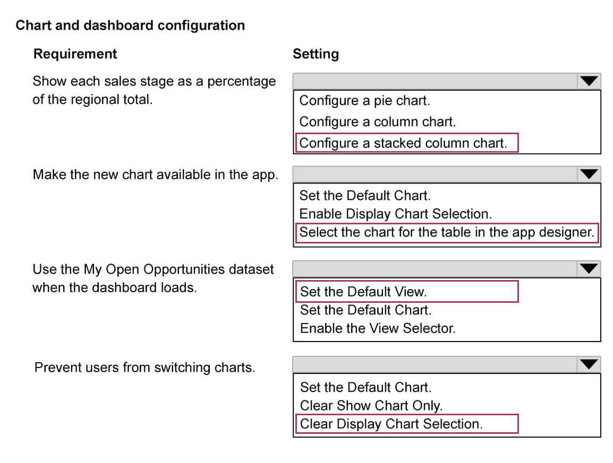

### 1. Extracted Question Summary

* **Scenario:** You are configuring a dashboard in a model-driven app for sales managers displaying opportunity pipeline data from the `Opportunities` table.

* **Requirements:**
* Show how each sales stage contributes to the total pipeline for each sales region (show each sales stage as a percentage of the regional total).

* Ensure a newly created chart is available to users in the app.

* Use the `My Open Opportunities` dataset when the dashboard component loads.

* Prevent users from switching to a different chart at runtime.

* **Question:** Select the appropriate configuration settings in the answer area.

* **Dropdown Options:**
* **Requirement 1:** *Show each sales stage as a percentage of the regional total.* — `Configure a pie chart.`, `Configure a column chart.`, `Configure a stacked column chart.`

* **Requirement 2:** *Make the new chart available in the app.* — `Set the Default Chart.`, `Enable Display Chart Selection.`, `Select the chart for the table in the app designer.`

* **Requirement 3:** *Use the My Open Opportunities dataset when the dashboard loads.* — `Set the Default View.`, `Set the Default Chart.`, `Enable the View Selector.`

* **Requirement 4:** *Prevent users from switching charts.* — `Set the Default Chart.`, `Clear Show Chart Only.`, `Clear Display Chart Selection.`

---

### 2. Correct Answer

| Requirement | Correct Setting |
| --- | --- |
| **Show each sales stage as a percentage of the regional total.**

 | **Configure a stacked column chart.**

 |
| **Make the new chart available in the app.**

 | **Select the chart for the table in the app designer.**

 |
| **Use the My Open Opportunities dataset when the dashboard loads.**

 | **Set the Default View.**

 |
| **Prevent users from switching charts.**

 | **Clear Display Chart Selection.**

 |

---

### 3. Verification of Visible Selection / Community Key

* The answer area shows open dropdown lists with no pre-selected values or visible community answer key. Each selection maps directly to standard Dataverse chart visualization and classic model-driven dashboard component properties.

---

### 4. Official Microsoft Justification

* **Configure a stacked column chart (Requirement 1):** Under Microsoft Learn documentation for **Create or edit a system chart in Dataverse**, a **stacked column chart** (specifically a 100% stacked column chart, which is a configuration option under stacked column charts) compares part-to-whole percentage contributions across multiple categories—showing how each sales stage contributes to the total pipeline within each sales region.

* **Select the chart for the table in the app designer (Requirement 2):** Under Microsoft Learn documentation for **Add or edit model-driven app components in the Power Apps app designer**, when an app explicitly scopes specific artifacts for a table rather than including *All* components, a newly created system chart must be selected under that table's **Charts** subcomponent list in the app designer before it becomes available inside the app.

* **Set the Default View (Requirement 3):** Under Microsoft Learn documentation for **Create or edit model-driven app dashboards**, a dashboard chart component renders data from an underlying Dataverse table view. Setting **Default View** to `My Open Opportunities` defines the exact dataset queried when the dashboard component initially loads.

* **Clear Display Chart Selection (Requirement 4):** In the dashboard component's **Set Properties** dialog, the **Display Chart Selection** checkbox controls whether the chart switcher dropdown is shown at runtime. Clearing **Display Chart Selection** locks the visual to the configured default chart and prevents users from switching to other charts.

---

### 5. Distractor Analysis (Why Others Are Wrong)

* **Requirement 1 Distractors:**
* **Configure a pie chart:** Displays a single series as slices of one whole; it cannot simultaneously break down part-to-whole percentages across multiple sales regions.

* **Configure a column chart:** A standard clustered column chart displays raw values side by side rather than stacking stage contributions into a regional total.

* **Requirement 2 Distractors:**
* **Set the Default Chart:** Only specifies which chart loads first on a specific dashboard component; if the chart is not included in the app designer's table metadata, users in that app will not have access to it.

* **Enable Display Chart Selection:** Displays the chart dropdown selector on a dashboard component, which violates Requirement 4 and does not add a chart to the app definition.

* **Requirement 3 Distractors:**
* **Set the Default Chart:** Chooses the visual chart layout, not the underlying `My Open Opportunities` record filter/dataset.

* **Enable the View Selector:** Allows users to manually switch between different views at runtime rather than specifying which dataset loads initially.

* **Requirement 4 Distractors:**
* **Set the Default Chart:** Controls the initial chart loaded, but if *Display Chart Selection* remains enabled, users can still switch charts at runtime.

* **Clear Show Chart Only:** Controls whether the underlying data grid (list) is displayed alongside the chart on the dashboard, not whether users can switch between charts.

---

### 6. Exam Keyword / Trap Alert

* **Trigger Phrases:**
* *"percentage of the regional total"* (two dimensions: sales stage + sales region) $\rightarrow$ **Stacked column chart** (not *pie chart*).

* *"available in the app"* $\rightarrow$ **App designer** table component selection.

* *"dataset when the dashboard loads"* $\rightarrow$ **Default View**.

* *"Prevent users from switching charts"* $\rightarrow$ **Clear Display Chart Selection**.

* **Exam Trap:** Do not pick **Pie chart** when a question mentions both a breakdown series (*sales stage*) and a grouping axis (*each sales region*)—pie charts only handle one dimension, whereas **stacked column charts** handle two-dimensional part-to-whole comparisons.

## Q34

### 1. Extracted Question Summary

* **Scenario:** A company builds a canvas app to display and manipulate large datasets across multiple screens, and users report that the app takes a long time to load data when opened.

* **Requirement:** Optimize performance when the app is started.

* **Question:** What are three actions you can perform? (Each correct answer presents a complete solution).

* **Options:**
* **A.** Move data transformation logic from the source to Power Fx.

* **B.** Remove data retrieval calls from the `App.OnStart` *(Highlighted inside red box)*.

* **C.** Enable preloading in app settings.

* **D.** Use the `Concurrent()` function for data retrieval calls *(Highlighted inside red box)*.

* **E.** Use the `ClearCollect()` function to cache data *(Highlighted inside red box)*.

* **Visible Answer Key:** `Answer: BDE`

---

### 2. Correct Answer

* **B: Remove data retrieval calls from the `App.OnStart**`

* **D: Use the `Concurrent()` function for data retrieval calls**

* **E: Use the `ClearCollect()` function to cache data**

---

### 3. Verification of Visible Selection / Community Key

* The visible selection (**Answer: BDE**, boxed in red) is **Correct**. All three techniques are foundational Microsoft Power Apps canvas performance optimizations for reducing startup latency and avoiding redundant network round-trips across screens.

---

### 4. Official Microsoft Justification

* Under Microsoft Learn documentation for **Optimize canvas app performance** (*Tips and best practices to improve performance of canvas apps*):
* **Remove data retrieval calls from `App.OnStart` (B):** Heavy blocking data queries in `App.OnStart` delay rendering the first screen until every formula completes. Moving non-essential calls out of `App.OnStart` (and leveraging declarative `App.Formulas` / named formulas or screen-level `OnVisible` deferred loading) lets the initial screen render immediately.

* **Use the `Concurrent()` function for data retrieval calls (D):** By default, sequential statements separated by semicolons (`;`) in `App.OnStart` or `OnVisible` execute one after another. Wrapping independent connector/Dataverse queries inside `Concurrent(...)` executes them in parallel, cutting total wait time from the *sum* of all calls down to the duration of the *single slowest* call.

* **Use the `ClearCollect()` function to cache data (E):** Caching frequently referenced lookup or static datasets in an in-memory collection via `ClearCollect()` eliminates repeated network queries as users navigate across multiple screens.

---

### 5. Distractor Analysis (Why Others Are Wrong)

* **A. Move data transformation logic from the source to Power Fx:** Doing heavy transformations client-side in Power Fx (rather than pushing views, computed columns, or query shaping down to the server/data source) increases client memory/CPU overhead and risks non-delegable queries, *degrading* startup and runtime performance.

* **C. Enable preloading in app settings:** Power Apps canvas apps do not have a general "enable preloading" setting that speeds up large dataset loading at app startup (preloading is a feature associated with embedded Power BI tiles/reports or specific caching behaviors, not a canvas app startup toggle).

---

### 6. Exam Keyword / Trap Alert

* **Trigger Phrases:** *"canvas app"*, *"large datasets across multiple screens"*, and *"optimize performance when the app is started"* $\rightarrow$ **Minimize `App.OnStart` blocking calls + `Concurrent()` parallelization + `ClearCollect()` local caching**.

* **Exam Trap:** Watch the nuance between **B** and **E** in real-world vs. exam questions—in modern Power Apps architecture, Microsoft prefers declarative **Named Formulas (`App.Formulas`)** over imperatively loading large collections in `App.OnStart`, because `ClearCollect()` in `App.OnStart` blocks initial load; however, in multiple-choice exam items asking for *three* standard performance patterns across multi-screen apps, **B**, **D**, and **E** are the three canonical Microsoft Learn best practices tested together.

## Q35

### 1. Extracted Question Summary

* **Scenario:** A remote Power Apps user experiences an issue with a canvas app that cannot be reproduced locally. You must analyze the issue in near real-time using Power Apps Monitor, and session data must be available for later review.

* **Question:** Select the appropriate configuration options in the answer area to troubleshoot the canvas app.

* **Dropdown Options:**
* **Requirement 1:** *Monitor events while a remote user runs the app.* — `Initiate the Test Studio.`, `Launch the App checker.`, `Use the Connect user feature.` *(boxed in red)*

* **Requirement 2:** *Share a troubleshooting session for later review.* — `Use Application Insights.`, `Download the Monitor session file.` *(boxed in red)*, `Collect the session ID and correlation ID.`

---

### 2. Correct Answer

| Requirement | Correct Configuration |
| --- | --- |
| **Monitor events while a remote user runs the app.**

 | **Use the Connect user feature.**

 |
| **Share a troubleshooting session for later review.**

 | **Download the Monitor session file.**

 |

---

### 3. Verification of Visible Selection / Community Key

* Both visible selections highlighted inside the red boxes—**Use the Connect user feature.** for the first requirement and **Download the Monitor session file.** for the second requirement—are **Correct**.

---

### 4. Official Microsoft Justification

* **Use the Connect user feature (Requirement 1 — Monitor events while a remote user runs the app):** Under Microsoft Learn documentation for **Collaborative debugging with Monitor** (*Power Apps Monitor*), launching Monitor for a published canvas app and selecting **Connect user** generates a direct session link that you share with the remote user. When the remote user opens that link and runs the app in their browser, every network call, control event, and formula evaluation streams in near real-time into your Monitor session.

* **Download the Monitor session file (Requirement 2 — Share a troubleshooting session for later review):** Under Microsoft Learn documentation for **Monitor overview** (*Save and open Monitor logs*), clicking **Download** in the Monitor command bar exports the entire captured event trace as a `.json` session file. Another maker or support engineer can later open Monitor and click **Upload** to reload and inspect the full trace offline or asynchronously.

---

### 5. Distractor Analysis (Why Others Are Wrong)

* **Requirement 1 Distractors:**
* **Initiate the Test Studio:** Test Studio is used for authoring and running automated UI regression tests on a canvas app; it does not attach a live telemetry session to a remote user's runtime instance.

* **Launch the App checker:** App checker performs static design-time checks inside Power Apps Studio (such as formula syntax errors, delegation warnings, and accessibility issues); it cannot observe live remote user traffic.

* **Requirement 2 Distractors:**
* **Use Application Insights:** Application Insights provides long-term aggregate Azure telemetry across all users over time, rather than exporting and sharing a specific point-in-time Monitor debugging session.

* **Collect the session ID and correlation ID:** Session and correlation IDs are diagnostic identifiers used when opening a Microsoft Support ticket for backend platform investigation; they do not export or share the local Monitor event trace for later review.

---

### 6. Exam Keyword / Trap Alert

* **Trigger Phrases:**
* *"remote Power Apps user"* + *"analyze the issue in near real-time"* + *"Monitor"* $\rightarrow$ **Connect user**.

* *"Session data must be available for later review"* / *"Share a troubleshooting session"* $\rightarrow$ **Download the Monitor session file** (`.json`).

* **Exam Trap:** Do not confuse **Monitor (`Connect user` / `Download`)** with **Application Insights** or **App checker**—whenever a question specifically mentions **Power Apps Monitor** and debugging a **remote user** in near real-time, **Connect user** and downloading/uploading the `.json` session file are the exact platform capabilities tested.

## Q36

### 1. Extracted Question Summary

* **Scenario:** A remote Power Apps user experiences an issue with a canvas app that cannot be reproduced locally. You must analyze the issue in near real-time using Power Apps Monitor, and session data must be available for later review.

* **Question:** Select the appropriate configuration options in the answer area to troubleshoot the canvas app.

* **Dropdown Options:**
* **Requirement 1:** *Monitor events while a remote user runs the app.* — `Initiate the Test Studio.`, `Launch the App checker.`, `Use the Connect user feature.` *(boxed in red)*

* **Requirement 2:** *Share a troubleshooting session for later review.* — `Use Application Insights.`, `Download the Monitor session file.` *(boxed in red)*, `Collect the session ID and correlation ID.`

---

### 2. Correct Answer

| Requirement | Correct Configuration |
| --- | --- |
| **Monitor events while a remote user runs the app.**

 | **Use the Connect user feature.**

 |
| **Share a troubleshooting session for later review.**

 | **Download the Monitor session file.**

 |

---

### 3. Verification of Visible Selection / Community Key

* Both visible selections highlighted inside the red boxes—**Use the Connect user feature.** for the first requirement and **Download the Monitor session file.** for the second requirement—are **Correct**.

---

### 4. Official Microsoft Justification

* **Use the Connect user feature (Requirement 1 — Monitor events while a remote user runs the app):** Under Microsoft Learn documentation for **Collaborative debugging with Monitor** (*Power Apps Monitor*), launching Monitor for a published canvas app and selecting **Connect user** generates a direct session link that you share with the remote user. When the remote user opens that link and runs the app in their browser, every network call, control event, and formula evaluation streams in near real-time into your Monitor session.

* **Download the Monitor session file (Requirement 2 — Share a troubleshooting session for later review):** Under Microsoft Learn documentation for **Monitor overview** (*Save and open Monitor logs*), clicking **Download** in the Monitor command bar exports the entire captured event trace as a `.json` session file. Another maker or support engineer can later open Monitor and click **Upload** to reload and inspect the full trace offline or asynchronously.

---

### 5. Distractor Analysis (Why Others Are Wrong)

* **Requirement 1 Distractors:**
* **Initiate the Test Studio:** Test Studio is used for authoring and running automated UI regression tests on a canvas app; it does not attach a live telemetry session to a remote user's runtime instance.

* **Launch the App checker:** App checker performs static design-time checks inside Power Apps Studio (such as formula syntax errors, delegation warnings, and accessibility issues); it cannot observe live remote user traffic.

* **Requirement 2 Distractors:**
* **Use Application Insights:** Application Insights provides long-term aggregate Azure telemetry across all users over time, rather than exporting and sharing a specific point-in-time Monitor debugging session.

* **Collect the session ID and correlation ID:** Session and correlation IDs are diagnostic identifiers used when opening a Microsoft Support ticket for backend platform investigation; they do not export or share the local Monitor event trace for later review.

---

### 6. Exam Keyword / Trap Alert

* **Trigger Phrases:**
* *"remote Power Apps user"* + *"analyze the issue in near real-time"* + *"Monitor"* $\rightarrow$ **Connect user**.

* *"Session data must be available for later review"* / *"Share a troubleshooting session"* $\rightarrow$ **Download the Monitor session file** (`.json`).

* **Exam Trap:** Do not confuse **Monitor (`Connect user` / `Download`)** with **Application Insights** or **App checker**—whenever a question specifically mentions **Power Apps Monitor** and debugging a **remote user** in near real-time, **Connect user** and downloading/uploading the `.json` session file are the exact platform capabilities tested.

## Q37

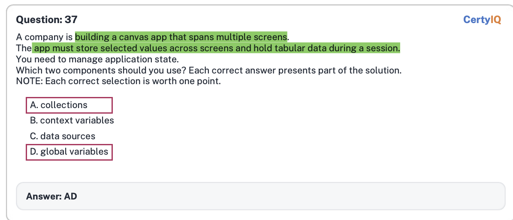

### 1. Extracted Question Summary

* **Scenario:** A company is building a canvas app that spans multiple screens.

* **Requirement:** The app must store selected values across screens and hold tabular data during a session.

* **Question:** You need to manage application state. Which two components should you use? (Each correct answer presents part of the solution).

* **Options:**
* **A.** collections *(Highlighted inside red box)*

* **B.** context variables

* **C.** data sources

* **D.** global variables *(Highlighted inside red box)*

* **Visible Answer Key:** `Answer: AD`

---

### 2. Correct Answer

* **A: collections** and **D: global variables**

---

### 3. Verification of Visible Selection / Community Key

* The visible selection (**Answer: AD**, boxed in red) is **Correct**. In Power Apps canvas apps, **global variables** (`Set()`) store scalar values, records, or single selected items accessible across *all* screens during a session, while **collections** (`Collect()` / `ClearCollect()`) hold in-memory **tabular data** (multi-row tables) across all screens for the duration of the user session.

---

### 4. Official Microsoft Justification

* Under Microsoft Learn documentation for **Understand variables in canvas apps** (*Global variables*, *Context variables*, and *Collections*):
* **Collections (A — Hold tabular data during a session):** Collections are special variables that store tables of rows and columns in device memory for the active app session. Created and updated with `Collect()` or `ClearCollect()`, collections are globally accessible across every screen in the app and persist only until the app is closed or refreshed (unless explicitly saved offline via `SaveData()`).

* **Global variables (D — Store selected values across screens):** Created with the `Set()` function (e.g., `Set(gblSelectedOrder, Gallery1.Selected)`), global variables hold single values, numbers, text strings, or individual records in memory and can be read or updated from *any* screen throughout the active session.

---

### 5. Distractor Analysis (Why Others Are Wrong)

* **B. context variables:** Created via `UpdateContext()` or passed via `Navigate()`, context variables are strictly scoped to a **single screen**—other screens cannot directly read or reference a context variable defined on another screen, failing the requirement to store selected values *across screens*.

* **C. data sources:** External persistent storage connections (such as Dataverse tables, SharePoint lists, or SQL Server) persist records permanently on the backend rather than managing transient, in-memory application state during a user session.

---

### 6. Exam Keyword / Trap Alert

* **Trigger Phrases:**
* *"store selected values across screens"* $\rightarrow$ **Global variables** (`Set()`).

* *"hold tabular data during a session"* $\rightarrow$ **Collections** (`Collect()` / `ClearCollect()`).

* **Exam Trap:** Memorize the three-tier Power Apps canvas state matrix:
* **Context variable (`UpdateContext`)** = Single screen only.

* **Global variable (`Set`)** = App-wide across all screens (single values/records).

* **Collection (`Collect` / `ClearCollect`)** = App-wide across all screens (**tabular/multi-row data** in memory for the session).

## Q38

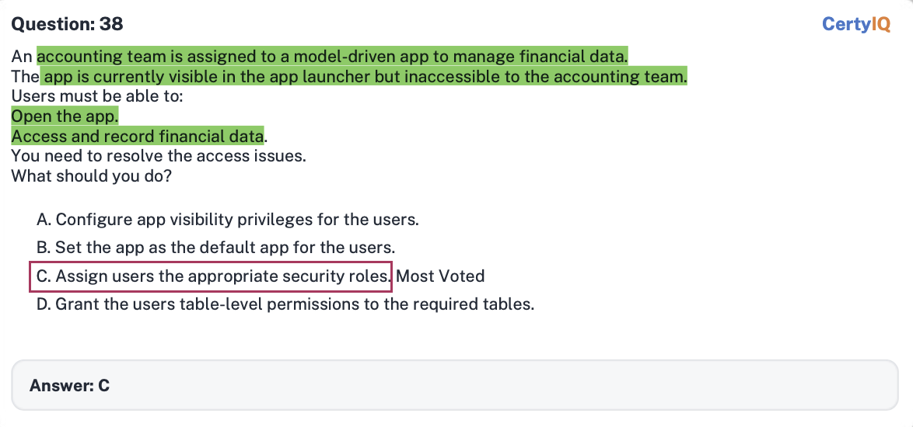

### 1. Extracted Question Summary

* **Scenario:** An accounting team is assigned to a model-driven app to manage financial data. The app is currently visible in the app launcher, but it is inaccessible to the accounting team.

* **Requirements:**
* Open the app.

* Access and record financial data.

* **Question:** You need to resolve the access issues. What should you do?

* **Options:**
* **A.** Configure app visibility privileges for the users.

* **B.** Set the app as the default app for the users.

* **C.** Assign users the appropriate security roles *(Highlighted inside red box, labeled "Most Voted", and marked "Answer: C")*.

* **D.** Grant the users table-level permissions to the required tables.

---

### 2. Correct Answer

* **C: Assign users the appropriate security roles.**

---

### 3. Verification of Visible Selection / Community Key

* The visible selection (**Answer: C**, boxed in red and labeled "Most Voted") is **Correct**. In Microsoft Dataverse and Power Apps, access to both a model-driven app module and its underlying Dataverse tables is governed exclusively through **Dataverse security roles** assigned directly to users (or via group teams).

---

### 4. Official Microsoft Justification

* Under Microsoft Learn documentation for **Share a model-driven app using Power Apps** and **Security roles and privileges in Microsoft Dataverse**:
* **Dual Role Requirement:** For a user to open a model-driven app and interact with its records, two conditions must be met: the app must be shared with the user (or their Microsoft Entra security group), and the user must be assigned one or more **Dataverse security roles** that both (1) are associated with the model-driven app and (2) grant Read/Create/Write privileges to the underlying financial tables.

* **Why the App Appears in the Launcher Yet Fails to Open:** When an app has been shared with a user or group (making its tile appear in the app launcher) but the user lacks an assigned security role granting app module and table privileges, attempting to launch the app fails with a permissions error. Assigning the appropriate security role resolves both opening the app and recording financial data.

---

### 5. Distractor Analysis (Why Others Are Wrong)

* **A. Configure app visibility privileges for the users:** There is no standalone "app visibility privilege" setting in Power Apps—app visibility and launch access are controlled through app sharing and **security role** associations.

* **B. Set the app as the default app for the users:** Power Apps does not have a per-user "default app" configuration that bypasses missing security roles; without the required security roles, users still cannot open the app or access financial records.

* **D. Grant the users table-level permissions to the required tables:** In Dataverse, table-level privileges are *never* granted directly to individual users outside of a security role—privileges exist only inside **security roles**, and granting table privileges alone without assigning the app-associated security role would still fail to grant app-level access.

---

### 6. Exam Keyword / Trap Alert

* **Trigger Phrases:** *"visible in the app launcher but inaccessible"*, *"Open the app"*, and *"Access and record financial data"* $\rightarrow$ **Assign users the appropriate security roles**.

* **Exam Trap:** Option **D ("Grant the users table-level permissions...")** is a classic Power Platform trap. Remember that Dataverse uses strict **Role-Based Access Control (RBAC)**—you never assign table permissions directly to users; you always assign **security roles** that bundle both app access and table privileges together.

## Q39

### 1. Extracted Question Summary

* **Scenario:** An accounting team is assigned to a model-driven app to manage financial data. The app is currently visible in the app launcher, but it is inaccessible to the accounting team.

* **Requirements:**
* Open the app.

* Access and record financial data.

* **Question:** You need to resolve the access issues. What should you do?

* **Options:**
* **A.** Configure app visibility privileges for the users.

* **B.** Set the app as the default app for the users.

* **C.** Assign users the appropriate security roles *(Highlighted inside red box, labeled "Most Voted", and marked "Answer: C")*.

* **D.** Grant the users table-level permissions to the required tables.

---

### 2. Correct Answer

* **C: Assign users the appropriate security roles.**

---

### 3. Verification of Visible Selection / Community Key

* The visible selection (**Answer: C**, boxed in red and labeled "Most Voted") is **Correct**. In Microsoft Dataverse and Power Apps, access to both a model-driven app module and its underlying Dataverse tables is governed exclusively through **Dataverse security roles** assigned directly to users (or via group teams).

---

### 4. Official Microsoft Justification

* Under Microsoft Learn documentation for **Share a model-driven app using Power Apps** and **Security roles and privileges in Microsoft Dataverse**:
* **Dual Role Requirement:** For a user to open a model-driven app and interact with its records, two conditions must be met: the app must be shared with the user (or their Microsoft Entra security group), and the user must be assigned one or more **Dataverse security roles** that both (1) are associated with the model-driven app and (2) grant Read/Create/Write privileges to the underlying financial tables.

* **Why the App Appears in the Launcher Yet Fails to Open:** When an app has been shared with a user or group (making its tile appear in the app launcher) but the user lacks an assigned security role granting app module and table privileges, attempting to launch the app fails with a permissions error. Assigning the appropriate security role resolves both opening the app and recording financial data.

---

### 5. Distractor Analysis (Why Others Are Wrong)

* **A. Configure app visibility privileges for the users:** There is no standalone "app visibility privilege" setting in Power Apps—app visibility and launch access are controlled through app sharing and **security role** associations.

* **B. Set the app as the default app for the users:** Power Apps does not have a per-user "default app" configuration that bypasses missing security roles; without the required security roles, users still cannot open the app or access financial records.

* **D. Grant the users table-level permissions to the required tables:** In Dataverse, table-level privileges are *never* granted directly to individual users outside of a security role—privileges exist only inside **security roles**, and granting table privileges alone without assigning the app-associated security role would still fail to grant app-level access.

---

### 6. Exam Keyword / Trap Alert

* **Trigger Phrases:** *"visible in the app launcher but inaccessible"*, *"Open the app"*, and *"Access and record financial data"* $\rightarrow$ **Assign users the appropriate security roles**.

* **Exam Trap:** Option **D ("Grant the users table-level permissions...")** is a classic Power Platform trap. Remember that Dataverse uses strict **Role-Based Access Control (RBAC)**—you never assign table permissions directly to users; you always assign **security roles** that bundle both app access and table privileges together.

## Q40

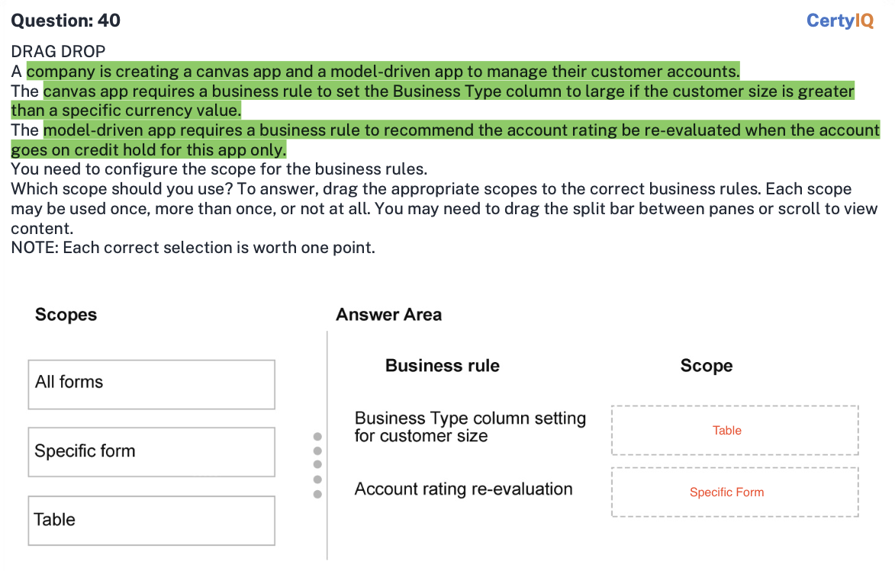

### 1. Question Summary

* **Scenario:** A company is building both a canvas app and a model-driven app to manage customer accounts.
* **Requirements:**
* **Rule 1 (Canvas App):** Automatically set the Business Type column to large when customer size exceeds a defined currency threshold.
* **Rule 2 (Model-Driven App):** Display a recommendation to re-evaluate the account rating when an account is placed on credit hold, restricted strictly to that specific model-driven app.

* **Task:** Assign the appropriate Dataverse business rule scope (`All forms`, `Specific form`, or `Table`) to each business rule.

---

### 2. Correct Answer

| Business Rule | Correct Scope |
| --- | --- |
| **Business Type column setting for customer size** (Canvas app) | **Table** |
| **Account rating re-evaluation** (Model-driven app only) | **Specific form** |

---

### 3. Verification of Visible Selection / Community Key

* The red text pre-filled in the answer area—**Table** for the first rule and **Specific Form** for the second rule—is **Correct**.

---

### 4. Official Microsoft Justification

* **Table Scope (Canvas App Rule):** Under Microsoft Learn documentation for **Create a business rule in Microsoft Dataverse**, business rules scoped to **All forms** or a **Specific form** execute only as client-side logic within model-driven app forms and never trigger from canvas apps, Power Automate flows, or API calls. To make a Dataverse business rule execute server-side whenever a canvas app creates or updates a record, its scope must be set to **Table** (formerly *Entity*).
* **Specific Form Scope (Model-Driven App Only Rule):** When a recommendation or UI action should appear exclusively inside a single model-driven app without affecting other apps built on the same table, scoping the rule to the **Specific form** used by that app isolates the behavior to that form's client-side context. (Note also that *Show recommendation* is a form-level UI action that is unsupported at the server-side *Table* scope anyway.)

---

### 5. Distractor Analysis (Why Others Are Wrong)

* **All forms:** Applies the business rule across every model-driven form on the table, which violates the requirement to restrict the credit-hold recommendation to the single model-driven app and fails to trigger for canvas app updates.

---

### 6. Exam Keyword / Trap Alert

* **Trigger Phrases:**
* *"canvas app requires a business rule"* $\rightarrow$ **Table** scope (the only scope that enforces business rules server-side across canvas apps and APIs).
* *"for this app only"* + *"recommend"* $\rightarrow$ **Specific form** scope (isolates UI recommendations to the form used by that app).

* **Exam Trap:** Always check which app type triggers the rule—**Canvas app** always demands **Table** scope, whereas **model-driven app-specific** UI recommendations demand **Specific form** scope.

## 43

### 1. Extracted Question Summary

* **Scenario:** A company plans to implement an automated process to retrieve and analyze customer feedback.

* **Requirements:**
* Autonomously analyzes feedback.

* Stores results for reporting.

* Triggers an escalation for negative sentiment.

* **Question:** You need to design the solution. Which three components should you use? (Each correct answer presents part of the solution.)

* **Options:**
* **A.** AI builder prompt *(Highlighted inside red box)*

* **B.** Cloud flow *(Highlighted inside red box)*

* **C.** Canvas app

* **D.** Business rule

* **E.** Dataverse table *(Highlighted inside red box)*

* **Visible Answer Key:** `Answer: ABE`

---

### 2. Correct Answer

* **A: AI builder prompt**

* **B: Cloud flow**

* **E: Dataverse table**

---

### 3. Verification of Visible Selection / Community Key

* The visible selection (**Answer: ABE**, boxed in red) is **Correct**. Each of the three selected components maps one-to-one to the three functional requirements in the end-to-end automated architecture.

---

### 4. Official Microsoft Justification

* **AI builder prompt (A — Autonomously analyzes feedback):** Under Microsoft Learn documentation for **Use a custom prompt in Power Automate** (*AI Builder / Prompt Builder*), custom generative AI prompts analyze unstructured customer feedback text to classify sentiment, extract key themes, and return structured outputs (such as JSON sentiment scores/labels) without manual human review.

* **Cloud flow (B — Automated retrieval & triggers an escalation for negative sentiment):** Under Microsoft Learn documentation for **Overview of cloud flows** (*Power Automate*), an automated or scheduled cloud flow orchestrates the end-to-end workflow—retrieving incoming feedback, invoking the AI Builder prompt action, writing the parsed results to Dataverse, and evaluating a conditional branch (`If sentiment == "Negative"`) to trigger an escalation (such as sending an adaptive card in Teams, creating a high-priority case, or emailing a manager).

* **Dataverse table (E — Stores results for reporting):** Under Microsoft Learn documentation for **Tables in Microsoft Dataverse**, Dataverse provides structured relational storage where the analyzed feedback and sentiment classifications are persisted as records for downstream Power BI reporting, views, and dashboards.

---

### 5. Distractor Analysis (Why Others Are Wrong)

* **C. Canvas app:** A canvas app is an interactive front-end user interface for manual human data entry or browsing; the scenario explicitly requires an **automated, autonomous** background process rather than a user-facing app.

* **D. Business rule:** Business rules execute simple declarative field logic (such as setting field values, showing error messages, or locking columns) on Dataverse tables/forms; they cannot retrieve external feedback, perform generative AI sentiment analysis, or orchestrate multi-step escalation notifications.

---

### 6. Exam Keyword / Trap Alert

* **Trigger Phrases:**
* *"Autonomously analyzes feedback"* $\rightarrow$ **AI builder prompt**.

* *"Stores results for reporting"* $\rightarrow$ **Dataverse table**.

* *"automated process to retrieve... Triggers an escalation"* $\rightarrow$ **Cloud flow**.

* **Exam Trap:** Look at how cleanly each requirement maps to one component in the Power Platform architecture—whenever a question combines **unstructured text analysis + structured persistence + conditional workflow orchestration**, the canonical trio is **AI Builder prompt + Dataverse table + Power Automate cloud flow**.

## Q44

### 1. Extracted Question Summary

* **Scenario:** A company is using Microsoft Dataverse and must integrate Dataverse with a third-party AI service.

* **Requirements:** The integration requires authentication and custom request handling to send and receive data.

* **Question:** You need to enable the integration. What should you do?

* **Options:**
* **A.** Use Power Fx.

* **B.** Create a custom connector *(Highlighted inside red box, labeled "Most Voted", and marked "Answer: B")*.

* **C.** Use Microsoft 365 Copilot chat.

* **D.** Configure an environment variable.

---

### 2. Correct Answer

* **B: Create a custom connector.**

---

### 3. Verification of Visible Selection / Community Key

* The visible selection (**Answer: B**, boxed in red and labeled "Most Voted") is **Correct**. When integrating Power Platform / Dataverse with an external third-party REST API or AI service that has no prebuilt standard connector—especially when custom authentication schemes and custom request/response payload handling are required—building a **custom connector** is the standard Microsoft Power Platform extensibility mechanism.

---

### 4. Official Microsoft Justification

* Under Microsoft Learn documentation for **Custom connectors overview** (*Microsoft Power Platform*):
* **Wrapping External REST APIs:** A custom connector acts as a wrapper around a REST API (defined via OpenAPI/Swagger specification, Postman collection, or from scratch) that enables Power Automate, Power Apps, and Copilot Studio to communicate cleanly with external services.

* **Authentication & Custom Request Handling:** Custom connectors natively support configurable authentication methods (No authentication, Basic authentication, API Key, and OAuth 2.0) along with custom actions, triggers, request headers/parameters, and **policy templates** (or custom C# code transformations) to shape outbound requests and parse inbound responses.

---

### 5. Distractor Analysis (Why Others Are Wrong)

* **A. Use Power Fx:** Power Fx is the low-code formula language used inside canvas apps, custom pages, and Dataverse formula columns; it cannot directly authenticate with arbitrary external REST APIs or encapsulate custom HTTP request/response handling without an underlying connector.

* **C. Use Microsoft 365 Copilot chat:** Microsoft 365 Copilot chat is an end-user conversational AI assistant for Microsoft 365 productivity data; it is not an API integration bridge between Dataverse and a third-party AI service.

* **D. Configure an environment variable:** Environment variables store configuration keys, endpoints, or secrets across ALM environments (Dev/Test/Prod); while they can *parameterize* a connector or flow, an environment variable alone cannot handle API authentication or send/receive HTTP requests.

---

### 6. Exam Keyword / Trap Alert

* **Trigger Phrases:** *"integrate Dataverse with a third-party AI service"* + *"requires authentication and custom request handling to send and receive data"* $\rightarrow$ **Create a custom connector**.

* **Exam Trap:** Whenever a scenario mentions integrating Power Platform with an external/third-party REST service requiring custom authentication (API Key, OAuth 2.0, Basic) and custom request/response schemas, immediately look for **Custom connector**.

## Q45

### 1. Extracted Question Summary

* **Scenario:** A company uses a Dataverse table to manage support cases. Employees need an automated summary of case information derived from multiple columns without requiring manual review of the data.

* **Requirements:**
* Generate a case summary following the given instructions.

* Include the context of the current record in the generated output.

* **Question:** You need to configure the solution. Which two actions should you perform? (Each correct answer presents part of the solution.)

* **Options:**
* **A.** Define a prompt that references the case fields *(Highlighted inside red box)*.

* **B.** Configure a formula column to generate the response text.

* **C.** Configure a business rule to populate the field automatically.

* **D.** Create the column by using the prompt data type *(Highlighted inside red box)*.

* **Visible Answer Key:** `Answer: AD`

---

### 2. Correct Answer

* **A: Define a prompt that references the case fields.**

* **D: Create the column by using the prompt data type.**

---

### 3. Verification of Visible Selection / Community Key

* The visible selection (**Answer: AD**, boxed in red) is **Correct**. Dataverse natively supports **Prompt columns** (creating a table column with the **Prompt** data type backed by an AI Builder / Copilot Studio generative AI prompt that dynamically references columns from the current Dataverse record).

---

### 4. Official Microsoft Justification

* Under Microsoft Learn documentation for **Create a prompt column in Microsoft Dataverse** (*Use AI prompts directly inside a Dataverse table*):
* **Create the column by using the prompt data type (D):** Makers can add a column directly to a Dataverse table and select **Prompt** as its data type. Whenever a row is created or the referenced input columns change, Dataverse automatically executes the linked prompt and stores the generated AI response directly in that column.

* **Define a prompt that references the case fields (A):** Inside the prompt designer launched from the Prompt column configuration, you write natural-language summarization instructions and bind **Dataverse table columns** (the current record's fields) as dynamic context inputs so the generative model produces a tailored case summary for each row.

---

### 5. Distractor Analysis (Why Others Are Wrong)

* **B. Configure a formula column to generate the response text:** Formula columns evaluate deterministic **Power Fx** expressions (such as string concatenation, math, or date calculations); they cannot execute generative AI instructions or natural-language summarization prompts.

* **C. Configure a business rule to populate the field automatically:** Business rules only support simple conditional logic (`If/Then`) and deterministic field assignments; they cannot invoke generative AI models to summarize unstructured multi-column context.

---

### 6. Exam Keyword / Trap Alert

* **Trigger Phrases:** *"summary of case information derived from multiple columns"*, *"following the given instructions"*, and *"context of the current record"* $\rightarrow$ **Prompt data type column** + **Prompt referencing the record's fields**.

* **Exam Trap:** Do not confuse **Formula columns** (deterministic Power Fx expressions) with **Prompt columns** (generative AI instructions bound to current-row Dataverse fields)—whenever an exam question asks for AI-generated summaries or text stored natively in a Dataverse column based on current record fields, the exact feature is the **Prompt data type** column.

## Q46

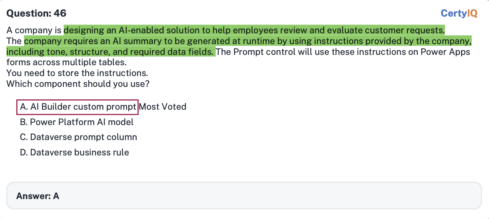

### 1. Extracted Question Summary

* **Scenario:** A company is designing an AI-enabled solution to help employees review and evaluate customer requests.

* **Requirements:**
* Generate an AI summary at runtime using company-provided instructions covering tone, structure, and required data fields.

* The **Prompt control** will use these instructions on Power Apps forms across **multiple tables**.

* **Question:** You need to store the instructions. Which component should you use?

* **Options:**
* **A.** AI Builder custom prompt *(Highlighted inside red box, labeled "Most Voted", and marked "Answer: A")*

* **B.** Power Platform AI model

* **C.** Dataverse prompt column

* **D.** Dataverse business rule

* **Visible Answer Key:** `Answer: A`

---

### 2. Correct Answer

* **A: AI Builder custom prompt**

---

### 3. Verification of Visible Selection / Community Key

* The visible selection (**Answer: A**, boxed in red and labeled "Most Voted") is **Correct**. Storing the natural-language prompt template—including tone, formatting structure, and input placeholders—as an **AI Builder custom prompt** creates a standalone, reusable generative AI component that can be bound to the **Prompt control** across forms on multiple tables.

---

### 4. Official Microsoft Justification

* Under Microsoft Learn documentation for **Use a custom prompt in Power Apps** (*AI Builder / Prompt Builder*) and **Add the Prompt control to a model-driven app form**:
* **Reusable Custom Prompt Definition:** An **AI Builder custom prompt** encapsulates natural-language instructions (specifying persona/tone, output structure, and dynamic input variables) as an independent, solution-aware Power Platform component.

* **Cross-Table Form Binding via the Prompt Control:** Because the custom prompt is decoupled from any single Dataverse table schema, makers can add the **Prompt control** onto forms across **multiple tables** and bind each form's relevant columns to the custom prompt's input parameters at runtime.

---

### 5. Distractor Analysis (Why Others Are Wrong)

* **B. Power Platform AI model:** Refers broadly to traditional prebuilt or custom-trained machine learning models (such as Object Detection, Form Processing/Document Processing, or Prediction models) rather than generative natural-language prompt instructions consumed by the form **Prompt control**.

* **C. Dataverse prompt column:** A Dataverse prompt column is tightly bound to a **single table** and persists generated output into a specific column on that table; it is not a reusable prompt component shared across forms on *multiple tables* via the UI **Prompt control**.

* **D. Dataverse business rule:** Business rules execute deterministic conditional field logic on a single table and cannot store generative AI prompt instructions or control AI tone and summarization structure.

---

### 6. Exam Keyword / Trap Alert

* **Trigger Phrases:** *"instructions provided by the company, including tone, structure, and required data fields"*, *"Prompt control... across multiple tables"*, and *"store the instructions"* $\rightarrow$ **AI Builder custom prompt**.

* **Exam Trap:** Compare **Question 45** vs. **Question 46** carefully:

* **Question 45** asks how to store an AI-generated summary inside a *single Dataverse table's column* $\rightarrow$ **Dataverse prompt column** (`Prompt` data type).

* **Question 46** asks how to store reusable prompt instructions used by the **Prompt control** on forms *across multiple tables* $\rightarrow$ **AI Builder custom prompt**.

## Q47

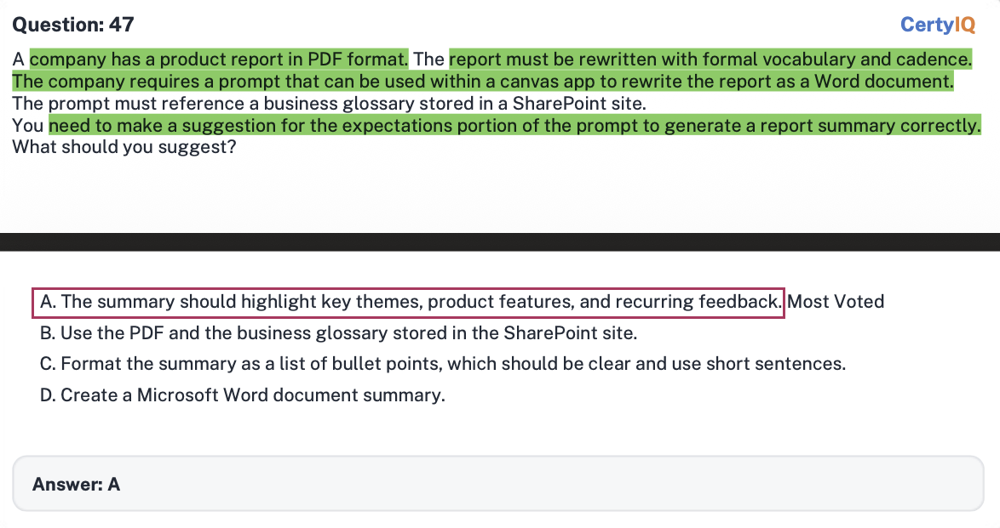

### 1. Extracted Question Summary

* **Scenario:** A company has a product report in PDF format that must be rewritten with formal vocabulary and cadence. They require a prompt used within a canvas app to rewrite the report as a Word document, referencing a business glossary stored in a SharePoint site.

* **Requirement:** Make a suggestion for the **expectations** portion of the prompt to generate a report summary correctly.

* **Question:** What should you suggest?

* **Options:**
* **A.** The summary should highlight key themes, product features, and recurring feedback. *(Highlighted inside red box, labeled "Most Voted", and marked "Answer: A")*

* **B.** Use the PDF and the business glossary stored in the SharePoint site.

* **C.** Format the summary as a list of bullet points, which should be clear and use short sentences.

* **D.** Create a Microsoft Word document summary.

* **Visible Answer Key:** `Answer: A`

---

### 2. Correct Answer

* **A: The summary should highlight key themes, product features, and recurring feedback.**

---

### 3. Verification of Visible Selection / Community Key

* The visible selection (**Answer: A**, boxed in red and labeled "Most Voted") is **Correct**. Under Microsoft's **Prompt Engineering framework** for Copilot and AI Builder prompts (**Goal, Context, Source, Expectations**), each of the four options represents one distinct pillar of a well-structured prompt—and **Option A** specifically defines the **Expectations** (what content/substance the AI must prioritize and include in the generated output).

---

### 4. Official Microsoft Justification

* Under Microsoft Learn documentation for **Prompt engineering guide** (*Learn about prompts — The four ingredients of a prompt: Goal, Context, Source, Expectations*):
1. **Goal:** What you want the AI to do (*"Create a Microsoft Word document summary"* — Option D).

2. **Context:** Why you need it, who it is for, or stylistic/structural constraints on how the response should be written (*"Format the summary as a list of bullet points, which should be clear and use short sentences"* / formal vocabulary and cadence — Option C).

3. **Source:** Which information sources or knowledge data the AI should use (*"Use the PDF and the business glossary stored in the SharePoint site"* — Option B).

4. **Expectations:** Specific instructions on how the AI should meet your requirements—specifically the substantive elements, themes, or criteria the response must cover to be accurate and useful (*"The summary should highlight key themes, product features, and recurring feedback"* — Option A).

---

### 5. Distractor Analysis (Why Others Are Wrong)

* **B. Use the PDF and the business glossary stored in the SharePoint site:** Represents the **Source** ingredient of a prompt (specifying which grounding documents and SharePoint knowledge files the model must reference), not the **Expectations**.

* **C. Format the summary as a list of bullet points, which should be clear and use short sentences:** Represents formatting/stylistic constraints (typically categorized under output formatting/context instructions rather than substantive content **Expectations**—and note that the prompt scenario asks to rewrite the report as a formal Word document, not short bullet points).

* **D. Create a Microsoft Word document summary:** Represents the **Goal** ingredient of a prompt (stating the primary deliverable/objective at the start of the prompt), rather than the **Expectations**.

---

### 6. Exam Keyword / Trap Alert

* **Trigger Phrases:** *"expectations portion of the prompt"* $\rightarrow$ Look for the statement defining **what substantive points, themes, or criteria the output must highlight**.

* **Exam Trap:** Memorize Microsoft's 4-part prompt anatomy (**Goal, Context, Source, Expectations**):
* **Goal** = Action/deliverable (*"Create a... summary"*)

* **Source** = Grounding files/data (*"Use the PDF and the business glossary..."*)

* **Context / Format** = Audience, tone, and layout (*"Format... as a list of bullet points..."*)

* **Expectations** = Substantive content requirements (*"...highlight key themes, product features, and recurring feedback"*)

## Q48

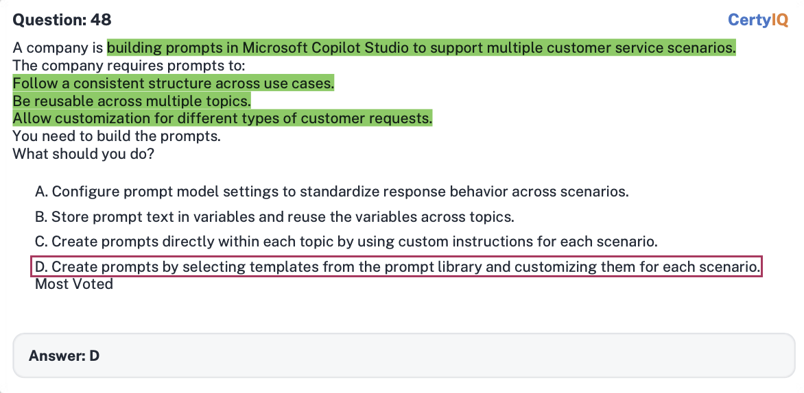

### 1. Extracted Question Summary

* **Scenario:** A company is building prompts in Microsoft Copilot Studio to support multiple customer service scenarios.

* **Requirements:**
* Follow a consistent structure across use cases.

* Be reusable across multiple topics.

* Allow customization for different types of customer requests.

* **Question:** You need to build the prompts. What should you do?

* **Options:**
* **A.** Configure prompt model settings to standardize response behavior across scenarios.

* **B.** Store prompt text in variables and reuse the variables across topics.

* **C.** Create prompts directly within each topic by using custom instructions for each scenario.

* **D.** Create prompts by selecting templates from the prompt library and customizing them for each scenario *(Highlighted inside red box, labeled "Most Voted", and marked "Answer: D")*.

* **Visible Answer Key:** `Answer: D`

---

### 2. Correct Answer

* **D: Create prompts by selecting templates from the prompt library and customizing them for each scenario.**

---

### 3. Verification of Visible Selection / Community Key

* The visible selection (**Answer: D**, boxed in red and labeled "Most Voted") is **Correct**. Starting from built-in templates in the Copilot Studio / AI Builder **prompt library** enforces a standardized prompt structure, creates modular prompt tools that can be called across multiple Copilot Studio topics, and lets makers tailor instructions, input variables, and grounding data for each specific customer service scenario.

---

### 4. Official Microsoft Justification

* Under Microsoft Learn documentation for **Prompt library** and **Add a prompt tool to a topic** in Microsoft Copilot Studio:
* **Consistent Structure via Prompt Library Templates:** Microsoft provides a curated **Prompt library** containing pre-engineered, structured prompt templates (e.g., for summarization, sentiment analysis, classification, and response drafting). Starting from prompt library templates guarantees a uniform, best-practice prompt layout across all customer service use cases.

* **Cross-Topic Reusability & Customization:** Prompts created in Copilot Studio / Prompt Builder are standalone, solution-aware assets with parameterized inputs. Once customized for a scenario, a prompt can be invoked as a reusable tool across any number of Copilot Studio topics while accepting dynamic topic variables for different customer request types.

---

### 5. Distractor Analysis (Why Others Are Wrong)

* **A. Configure prompt model settings to standardize response behavior across scenarios:** Adjusting model parameters (such as model version or temperature) only governs randomness/creativity at inference time; it does not enforce a structural prompt template or make prompts reusable across topics.

* **B. Store prompt text in variables and reuse the variables across topics:** Storing raw prompt strings inside Power Fx / topic variables creates brittle, unmanageable text blocks without Prompt Builder's native input parameterization, structured JSON output schemas, Dataverse/SharePoint knowledge grounding, or content moderation guardrails.

* **C. Create prompts directly within each topic by using custom instructions for each scenario:** Embedding one-off custom instructions directly inside individual topics sacrifices structural consistency across use cases and prevents the prompt from being centrally maintained and reused across multiple topics.

---

### 6. Exam Keyword / Trap Alert

* **Trigger Phrases:** *"consistent structure across use cases"*, *"reusable across multiple topics"*, and *"allow customization for different types"* $\rightarrow$ **Select templates from the prompt library and customize them**.

* **Exam Trap:** Option **C** (authoring ad-hoc instructions inline inside every individual topic) is the classic anti-pattern in Copilot Studio—whenever a question emphasizes **consistency + reusability across multiple topics**, always choose standalone parameterized prompts built from the **prompt library**.

## Q49

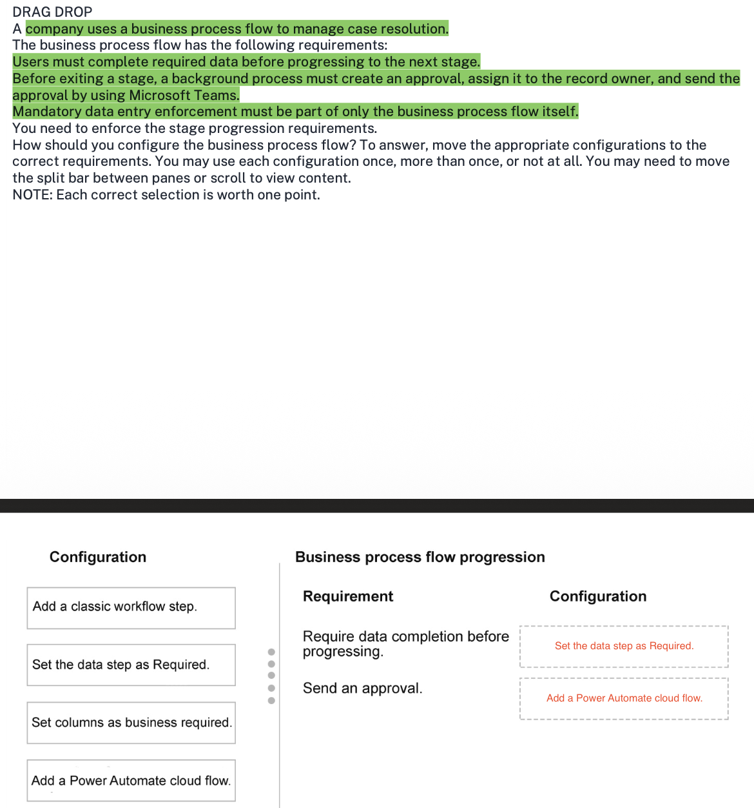

### 1. Extracted Question Summary

* **Scenario:** A company uses a business process flow (BPF) to manage case resolution.

* **Requirements:**
* Users must complete required data before progressing to the next stage.

* Before exiting a stage, a background process must create an approval, assign it to the record owner, and send the approval by using Microsoft Teams.

* Mandatory data entry enforcement must be part of **only the business process flow itself**.

* **Question:** Drag and drop the appropriate configurations to the correct requirements in the answer area.

* **Available Configurations:**
* `Add a classic workflow step.`

* `Set the data step as Required.`

* `Set columns as business required.`

* `Add a Power Automate cloud flow.`

* **Target Requirements:**
1. Require data completion before progressing.

2. Send an approval.

---

### 2. Correct Answer

| Requirement | Correct Configuration |
| --- | --- |
| **Require data completion before progressing.**

 | **Set the data step as Required.**

 |
| **Send an approval.**

 | **Add a Power Automate cloud flow.**

 |

---

### 3. Verification of Visible Selection / Community Key

* The answer area in the screenshot is blank (no drag-and-drop selections or community key are visible). Both configurations map directly to native Dataverse Business Process Flow designer capabilities: **Required Data Steps** for stage-gating and **Flow Steps** (Power Automate cloud flows) for stage-entry/exit automation.

---

### 4. Official Microsoft Justification

* **Set the data step as Required (Requirement 1 — Require data completion before progressing):** Under Microsoft Learn documentation for **Create a business process flow in Power Automate / Dataverse**, selecting a **Data Step** inside a BPF stage and enabling its **Required** checkbox blocks users from advancing (`Next Stage`) out of that stage until the field is populated—while keeping the mandatory enforcement scoped *strictly* to the BPF stage rather than forcing the underlying table column to be required across every form, view, or API call.

* **Add a Power Automate cloud flow (Requirement 2 — Send an approval):** Under Microsoft Learn documentation for **Add a flow step to a business process flow**, makers can add a **Flow Step** inside a BPF stage triggered on **Stage Entry** or **Stage Exit** (or run on demand). A **Power Automate cloud flow** natively integrates with the **Approvals** connector and **Microsoft Teams** connector to create an approval request, assign it to the record owner, and deliver an actionable adaptive card in Teams before exiting the stage.

---

### 5. Distractor Analysis (Why Others Are Wrong)

* **Set columns as business required:** Changing the column requirement level to *Business Required* in the Dataverse table schema enforces mandatory entry globally across *all* forms, canvas apps, and data imports—directly violating the requirement that *"mandatory data entry enforcement must be part of only the business process flow itself"*.

* **Add a classic workflow step:** Classic Dataverse background workflows cannot natively generate Power Automate Approvals or post interactive Microsoft Teams approval cards without custom code extensions, and Microsoft recommends Power Automate cloud flows for modern approval and Teams integrations.

---

### 6. Exam Keyword / Trap Alert

* **Trigger Phrases:**
* *"complete required data before progressing"* + *"part of only the business process flow itself"* $\rightarrow$ **Set the data step as Required** (never *Set columns as business required*).

* *"Before exiting a stage... create an approval... send the approval by using Microsoft Teams"* $\rightarrow$ **Add a Power Automate cloud flow** (BPF Flow Step on Stage Exit).

* **Exam Trap:** Watch the distinction between **BPF Data Step Required** (enforced *only* when advancing through that BPF stage) vs. **Column Business Required** (enforced globally at the Dataverse table/form level).

## Q50

### 1. Extracted Question Summary

* **Scenario:** A company uses a business process flow (BPF) to manage case resolution.

* **Requirements:**
* Users must complete required data before progressing to the next stage.

* Before exiting a stage, a background process must create an approval, assign it to the record owner, and send the approval by using Microsoft Teams.

* Mandatory data entry enforcement must be part of **only the business process flow itself**.

* **Question:** Drag and drop the appropriate configurations to the correct requirements in the answer area.

* **Available Configurations:**
* `Add a classic workflow step.`

* `Set the data step as Required.`

* `Set columns as business required.`

* `Add a Power Automate cloud flow.`

* **Target Requirements:**
1. Require data completion before progressing.

2. Send an approval.

---

### 2. Correct Answer

| Requirement | Correct Configuration |
| --- | --- |
| **Require data completion before progressing.**

 | **Set the data step as Required.**

 |
| **Send an approval.**

 | **Add a Power Automate cloud flow.**

 |

---

### 3. Verification of Visible Selection / Community Key

* The answer area in the screenshot is blank (no drag-and-drop selections or community key are visible). Both configurations map directly to native Dataverse Business Process Flow designer capabilities: **Required Data Steps** for stage-gating and **Flow Steps** (Power Automate cloud flows) for stage-entry/exit automation.

---

### 4. Official Microsoft Justification

* **Set the data step as Required (Requirement 1 — Require data completion before progressing):** Under Microsoft Learn documentation for **Create a business process flow in Power Automate / Dataverse**, selecting a **Data Step** inside a BPF stage and enabling its **Required** checkbox blocks users from advancing (`Next Stage`) out of that stage until the field is populated—while keeping the mandatory enforcement scoped *strictly* to the BPF stage rather than forcing the underlying table column to be required across every form, view, or API call.

* **Add a Power Automate cloud flow (Requirement 2 — Send an approval):** Under Microsoft Learn documentation for **Add a flow step to a business process flow**, makers can add a **Flow Step** inside a BPF stage triggered on **Stage Entry** or **Stage Exit** (or run on demand). A **Power Automate cloud flow** natively integrates with the **Approvals** connector and **Microsoft Teams** connector to create an approval request, assign it to the record owner, and deliver an actionable adaptive card in Teams before exiting the stage.

---

### 5. Distractor Analysis (Why Others Are Wrong)

* **Set columns as business required:** Changing the column requirement level to *Business Required* in the Dataverse table schema enforces mandatory entry globally across *all* forms, canvas apps, and data imports—directly violating the requirement that *"mandatory data entry enforcement must be part of only the business process flow itself"*.

* **Add a classic workflow step:** Classic Dataverse background workflows cannot natively generate Power Automate Approvals or post interactive Microsoft Teams approval cards without custom code extensions, and Microsoft recommends Power Automate cloud flows for modern approval and Teams integrations.

---

### 6. Exam Keyword / Trap Alert

* **Trigger Phrases:**
* *"complete required data before progressing"* + *"part of only the business process flow itself"* $\rightarrow$ **Set the data step as Required** (never *Set columns as business required*).

* *"Before exiting a stage... create an approval... send the approval by using Microsoft Teams"* $\rightarrow$ **Add a Power Automate cloud flow** (BPF Flow Step on Stage Exit).

* **Exam Trap:** Watch the distinction between **BPF Data Step Required** (enforced *only* when advancing through that BPF stage) vs. **Column Business Required** (enforced globally at the Dataverse table/form level).

## Q51

### 1. Extracted Question Summary

* **Scenario:** A company uses Dataverse to configure derived values for sales records.

* **Requirements:**
* Evaluate an expression by using numerical columns in the same row.

* Calculate the result dynamically when accessed.

* Ensure the result is **NOT** stored as part of the table data.

* Minimize use of custom code.

* **Question:** You need to configure the app. What should you do?

* **Options:**
* **A.** Create a formula column *(Highlighted inside red box and marked "Answer: A")*

* **B.** Use a real-time workflow to update the value

* **C.** Use a business rule to populate the value

* **D.** Use a plugin to calculate

* **Visible Answer Key:** `Answer: A`

---

### 2. Correct Answer

* **A: Create a formula column.**

---

### 3. Verification of Visible Selection / Community Key

* The visible selection (**Answer: A**, boxed in red) is **Correct**. A Dataverse **Formula** column uses Power Fx expressions to compute read-only values dynamically at read/query time from columns in the same row (or related `N:1` lookup rows) without persisting the computed result in underlying database storage or requiring custom C# code.

---

### 4. Official Microsoft Justification

* Under Microsoft Learn documentation for **Work with formula columns (preview/GA) in Microsoft Dataverse**:
* **Real-Time Evaluation on Read (Not Persisted):** Formula columns (like classic Calculated columns) are computed dynamically at the moment a record is retrieved or displayed—meaning the calculated value is **not stored** as static physical data in the Dataverse database table.

* **Same-Row Numerical Power Fx Expressions:** Formula columns use low-code **Power Fx** syntax to perform arithmetic, logical, string, and date calculations across numerical columns within the same row, fulfilling the requirement to minimize custom code.

---

### 5. Distractor Analysis (Why Others Are Wrong)

* **B. Use a real-time workflow to update the value:** A real-time (synchronous) workflow writes the computed value into a standard database column upon record create/update—which **stores** the result as part of the table data and calculates on *write* rather than dynamically on *read*.

* **C. Use a business rule to populate the value:** A business rule sets the value of a physical column on the record, meaning the result **is stored** in the database table and only updates when the rule triggers on form interaction or record save rather than dynamically on every read.

* **D. Use a plugin to calculate:** Writing a C# Dataverse plug-in violates the requirement to **minimize custom code**, and plug-ins typically persist values on write events (or require complex `Retrieve`/`RetrieveMultiple` intercepts).

---

### 6. Exam Keyword / Trap Alert

* **Trigger Phrases:** *"Evaluate an expression by using numerical columns in the same row"*, *"Calculate the result dynamically when accessed"*, *"NOT stored as part of the table data"*, and *"minimize use of custom code"* $\rightarrow$ **Formula column** (or **Calculated column** if offered).

* **Exam Trap:** Whenever a Dataverse question explicitly states that a derived value must be **calculated on read / when accessed** and **NOT stored in the database**, immediately eliminate workflows, business rules, Power Automate flows, and standard columns—only **Formula** and **Calculated** columns compute on read without persisting the result in table storage.

## Q52

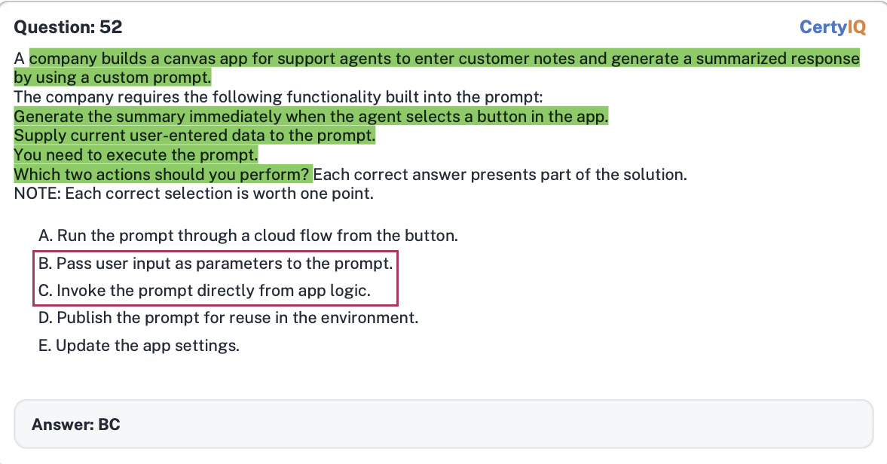

### 1. Extracted Question Summary

* **Scenario:** A company builds a canvas app for support agents to enter customer notes and generate a summarized response by using a custom prompt.

* **Requirements:**
* Generate the summary immediately when the agent selects a button in the app.

* Supply current user-entered data to the prompt.

* **Question:** You need to execute the prompt. Which two actions should you perform? (Each correct answer presents part of the solution.)

* **Options:**
* **A.** Run the prompt through a cloud flow from the button.

* **B.** Pass user input as parameters to the prompt *(Highlighted inside red box)*.

* **C.** Invoke the prompt directly from app logic *(Highlighted inside red box)*.

* **D.** Publish the prompt for reuse in the environment.

* **E.** Update the app settings.

* **Visible Answer Key:** `Answer: BC`

---

### 2. Correct Answer

* **B: Pass user input as parameters to the prompt.**

* **C: Invoke the prompt directly from app logic.**

---

### 3. Verification of Visible Selection / Community Key

* The visible selection (**Answer: BC**, boxed in red) is **Correct**. In Power Apps canvas apps, you can add an AI Builder / Copilot Studio custom prompt directly as a data source in Power Apps Studio and call its `.Predict()` method directly inside a button's `OnSelect` Power Fx formula—passing the agent's live text input controls as arguments into the prompt's defined input parameters for immediate synchronous execution.

---

### 4. Official Microsoft Justification

* Under Microsoft Learn documentation for **Use a custom prompt in Power Apps** (*AI Builder / Prompt Builder in Canvas Apps*):
* **Invoke the prompt directly from app logic (C):** Once a custom prompt is added to a canvas app via the **Data** pane (`+ Add data` $\rightarrow$ *AI models* / *Prompts*), makers can invoke it directly in Power Fx on a button's `OnSelect` property (e.g., `Set(gblSummary, 'Summarize Customer Notes'.Predict(txtCustomerNotes.Text).Text)`). Direct Power Fx invocation executes synchronously and returns the generated response immediately to the UI without needing an intermediate Power Automate flow.

* **Pass user input as parameters to the prompt (B):** Custom prompts expose named **input variables** defined during prompt creation. When calling `.Predict(...)` from the canvas app button, you pass the current control values (such as `TextInput.Text`) into those prompt parameters so the generative model summarizes the live user-entered notes.

---

### 5. Distractor Analysis (Why Others Are Wrong)

* **A. Run the prompt through a cloud flow from the button:** Wrapping a prompt inside a Power Automate cloud flow adds unnecessary orchestration overhead and latency when all you need is to immediately pass text from a canvas app control to a prompt and render the returned string in the UI.

* **D. Publish the prompt for reuse in the environment:** Saving/testing a custom prompt in Prompt Builder automatically makes it available to apps in the environment; "publishing for reuse" does not execute the prompt when the agent clicks the button or supply user-entered data to it.

* **E. Update the app settings:** No special canvas app setting toggle is required to invoke an AI Builder custom prompt via Power Fx, nor does changing app settings execute the prompt at runtime.

---

### 6. Exam Keyword / Trap Alert

* **Trigger Phrases:** *"canvas app"*, *"immediately when the agent selects a button"*, and *"Supply current user-entered data to the prompt"* $\rightarrow$ **Invoke directly from app logic (`.Predict()`)** + **Pass user input as parameters**.

* **Exam Trap:** Do not fall for Option **A** (*Run the prompt through a cloud flow*)—you only need a Power Automate flow when performing multi-step background automation (e.g., approvals, scheduled batch jobs, or writing to multiple systems). For immediate, interactive UI responses in a canvas app, always invoke the prompt **directly in Power Fx** using `.Predict()`.

## Q53

### 1. Extracted Question Summary

* **Scenario:** A company runs Power Automate cloud flows in production, and you observe many duplicate executions and `401` error codes when reviewing the flow runs.

* **Requirement:** Resolve each error by selecting the appropriate action in the Cloud flow troubleshooting answer area.

* **Dropdown Options:**
* **Error 1:** `401 error codes` — `Increase timeout`, `Configure retry policy`, `Reauthenticate connection`

* **Error 2:** `Duplicate executions` — `Add delay`, `Configure retry policy`, `Enable concurrency control`

---

### 2. Correct Answer

| Error | Correct Action |
| --- | --- |
| **401 error codes**

 | **Reauthenticate connection**

 |
| **Duplicate executions**

 | **Enable concurrency control**

 |

---

### 3. Verification of Visible Selection / Community Key

* The answer area shows open dropdown lists with no pre-selected values or visible community answer key. Both selections correspond directly to official Power Automate troubleshooting remediation steps for authentication failures and parallel trigger race conditions.

---

### 4. Official Microsoft Justification

* **Reauthenticate connection (401 error codes):** Under Microsoft Learn documentation for **Troubleshoot a cloud flow** (*Fix authentication failures / HTTP 401 Unauthorized*), an HTTP `401` status code indicates that a connector's OAuth token has expired, user credentials/password changed, or conditional access policies invalidated the existing session. Fixing `401` errors requires navigating to **Data > Connections** (or the flow's connection references) and selecting **Fix connection / Reauthenticate** to refresh the credentials.
* **Enable concurrency control (Duplicate executions):** Under Microsoft Learn documentation for **Troubleshoot a cloud flow** (*Handle duplicate flow runs / Concurrency control*), when multiple trigger events arrive simultaneously or when a polling trigger processes overlapping batches before an earlier run finishes updating state, parallel flow instances can race and execute duplicate work. Enabling **Concurrency Control** on the trigger settings (and setting **Degree of Parallelism = 1**) forces runs to execute sequentially in a queue rather than concurrently, eliminating race-condition duplicate executions.

---

### 5. Distractor Analysis (Why Others Are Wrong)

* **401 error codes Distractors:**
* **Increase timeout:** Addresses HTTP `408` / `504` gateway timeout failures on slow backend responses, not `401 Unauthorized` authentication errors.

* **Configure retry policy:** Retries transient network errors (`408`, `429`, `5xx`); by default, Power Automate does not retry `401` errors because retrying with an expired or invalid token will continue failing until reauthenticated.

* **Duplicate executions Distractors:**
* **Add delay:** Pausing inside a flow run with a *Delay* action does not prevent the trigger from spawning multiple overlapping instances simultaneously.

* **Configure retry policy:** Controls how many times an individual failed HTTP action retries within a single run—it does not throttle or serialize concurrent trigger executions.

---

### 6. Exam Keyword / Trap Alert

* **Trigger Phrases:**
* *"401 error codes"* $\rightarrow$ **Reauthenticate connection** (HTTP `401` = Unauthorized / expired token).

* *"duplicate executions"* $\rightarrow$ **Enable concurrency control** (Trigger settings $\rightarrow$ Degree of Parallelism = 1).

* **Exam Trap:** Memorize the classic Power Automate HTTP status code mapping: **`401`** = Reauthenticate connection; **`429`** (Too Many Requests / Throttling) or **`5xx`** = Configure retry policy / Concurrency control; **`504`** = Increase action timeout.

## Q54 

### 1. Extracted Question Summary

* **Scenario:** A company uses a Power Automate cloud flow to manage purchase approvals, where purchase orders will always be **approved**, **rejected**, or **marked as escalated to a manager**.

* **Requirements:**
* Multiple approvers must be included in each approval request.

* Once approved, an email must be sent to the purchasing team confirming the outcome.

* The flow must **not** wait for remaining approvers after a decision is reached.

* **Question:** You need to configure the approval. Which three configurations should you use? (Each correct answer presents part of the solution.)

* **Options:**
* **A.** Configure the approval type as Approve/Reject - First to respond.

* **B.** Create separate approval actions for each approver in parallel branches.

* **C.** Configure the approval type as Custom Responses - Wait for one response *(Highlighted inside red box)*.

* **D.** Evaluate the approval outcome by using a condition *(Highlighted inside red box)*.

* **E.** Assign multiple approvers in a single approval action *(Highlighted inside red box)*.

* **Visible Answer Key:** `Answer: CDE`

---

### 2. Correct Answer

* **C: Configure the approval type as Custom Responses - Wait for one response.**

* **D: Evaluate the approval outcome by using a condition.**

* **E: Assign multiple approvers in a single approval action.**

---

### 3. Verification of Visible Selection / Community Key

* The visible selection (**Answer: CDE**, boxed in red) is **Correct**. Because there are **three** distinct response choices (*Approve*, *Reject*, and *Escalate to a manager*) rather than just the binary *Approve/Reject*, you must use **Custom Responses - Wait for one response** inside a single approval action assigned to all approvers, followed by a **Condition** (or Switch) checking the `Outcome` property before emailing the purchasing team.

---

### 4. Official Microsoft Justification

* **Configure the approval type as Custom Responses - Wait for one response (C):** Under Microsoft Learn documentation for **Create custom response approvals in Power Automate**, standard *Approve/Reject* approval types only present two buttons (`Approve` and `Reject`). Supporting a third custom outcome (*"marked as escalated to a manager"*) requires **Custom Responses**, and choosing **Wait for one response** ensures that as soon as any single approver submits a response, the approval completes immediately without waiting for the remaining approvers.

* **Assign multiple approvers in a single approval action (E):** Under Microsoft Learn documentation for **Manage sequential and parallel approvals**, entering multiple semicolon-separated email addresses in the **Assigned to** field of a single *Start and wait for an approval* action dispatches the request to all approvers simultaneously and tracks the collective *Wait for one response* completion state natively.

* **Evaluate the approval outcome by using a condition (D):** Because the requirement specifies *"Once approved, an email must be sent to the purchasing team that confirms the outcome"*, the flow must inspect the approval action's `Outcome` dynamic content via a **Condition** (`Outcome is equal to Approve`) so the confirmation email is sent only when approved—and not when rejected or escalated.

---

### 5. Distractor Analysis (Why Others Are Wrong)

* **A. Configure the approval type as Approve/Reject - First to respond:** While *First to respond* satisfies the requirement not to wait for remaining approvers, the built-in *Approve/Reject* type only provides two fixed responses (`Approve` and `Reject`) and cannot support the third required option (*"marked as escalated to a manager"*).

* **B. Create separate approval actions for each approver in parallel branches:** By default, a Power Automate flow waits for *all* parallel branches to finish before continuing past the parallel join—violating the requirement that *"the flow must not wait for remaining approvers after a decision is reached"*—and creates unnecessary duplication.

---

### 6. Exam Keyword / Trap Alert

* **Trigger Phrases:**
* *"approved, rejected, or marked as escalated to a manager"* (3+ choices) + *"must not wait for remaining approvers"* $\rightarrow$ **Custom Responses - Wait for one response**.

* *"Once approved, an email must be sent"* $\rightarrow$ **Evaluate the approval outcome by using a condition**.

* **Exam Trap:** Option **A** (*Approve/Reject - First to respond*) is a deliberate trap—candidates often latch onto *"First to respond"* for *"must not wait for remaining approvers"* and overlook the first sentence requiring a **third** response option (*"marked as escalated to a manager"*), which forces **Custom Responses - Wait for one response**.

## Q55

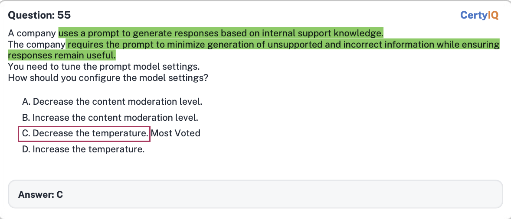

### 1. Extracted Question Summary

* **Scenario:** A company uses a prompt to generate responses based on internal support knowledge.

* **Requirement:** Minimize generation of unsupported and incorrect information (hallucinations) while ensuring responses remain useful.

* **Question:** You need to tune the prompt model settings. How should you configure the model settings?

* **Options:**
* **A.** Decrease the content moderation level.

* **B.** Increase the content moderation level.

* **C.** Decrease the temperature *(Highlighted inside red box, labeled "Most Voted", and marked "Answer: C")*.

* **D.** Increase the temperature.

* **Visible Answer Key:** `Answer: C`

---

### 2. Correct Answer

* **C: Decrease the temperature.**

---

### 3. Verification of Visible Selection / Community Key

* The visible selection (**Answer: C**, boxed in red and labeled "Most Voted") is **Correct**. In AI Builder and Microsoft Copilot Studio prompt settings, lowering the **Temperature** parameter constrains the language model to select higher-probability tokens grounded closely in the provided context, making responses more deterministic, factual, and consistent while minimizing unsupported extrapolations.

---

### 4. Official Microsoft Justification

* Under Microsoft Learn documentation for **Prompt model settings** (*AI Builder / Copilot Studio Prompt Builder — Temperature*):
* **Temperature (0 to 1 scale):** Controls the creativity and randomness of the model's output. Lower values (closer to `0`) produce deterministic, focused responses strictly anchored to the supplied grounding knowledge, reducing unsupported fabrications while keeping answers accurate and useful for support scenarios. Higher values (closer to `1`) encourage diverse, creative phrasing at the cost of increased hallucination risk.

---

### 5. Distractor Analysis (Why Others Are Wrong)

* **A. Decrease the content moderation level:** Content moderation filters harmful or inappropriate categories (hate, self-harm, sexual content, violence); lowering moderation permits *more* potentially unsafe content and does not reduce factual hallucinations against internal support knowledge.

* **B. Increase the content moderation level:** Raising content moderation applies stricter Responsible AI safety blocking (Low, Medium, High) against harmful topics, which can overly block legitimate support queries without improving factual grounding or reducing unsupported answers.

* **D. Increase the temperature:** Increasing temperature raises sampling randomness and creativity, which *increases* the likelihood of generating unsupported or inaccurate information.

---

### 6. Exam Keyword / Trap Alert

* **Trigger Phrases:** *"based on internal support knowledge"* + *"minimize generation of unsupported and incorrect information while ensuring responses remain useful"* + *"tune the prompt model settings"* $\rightarrow$ **Decrease the temperature**.

* **Exam Trap:** Do not confuse **Content Moderation** (safety filtering for harmful/inappropriate content) with **Temperature** (determinism vs. creativity/hallucination control)—factual grounding and minimizing unsupported claims always map to **decreasing temperature**.

## Q56

### 1. Extracted Question Summary

* **Scenario:** A company processes transaction records by using a Power Automate cloud flow.

* **Requirements:**
* Continue processing records until a status field changes to `Complete`, even if new records are added during execution.

* Process a fixed list of records retrieved at the start of the flow, ensuring each record is processed exactly once.

* **Question:** Drag and drop the appropriate flow controls (`Scope`, `Do until`, `Apply to each`, `Set concurrency`) to the correct requirements in the Flow control configuration answer area.

---

### 2. Correct Answer

| Requirement | Correct Control |
| --- | --- |
| **Continue processing until status becomes Complete.**

 | **Do until**

 |
| **Process a fixed list of records retrieved at the start of the flow.**

 | **Apply to each**

 |

---

### 3. Verification of Visible Selection / Community Key

* The answer area in the screenshot is blank (no drag-and-drop selections or visible community answer key are shown). Both selections directly match the core iteration semantics of Power Automate's built-in **Control** connector actions.

---

### 4. Official Microsoft Justification

* **Do until (Requirement 1 — Continue processing until status becomes Complete):** Under Microsoft Learn documentation for **Use the "Do until" action in Power Automate** (*Control connector*), a **Do until** loop repeats a block of actions until a specified Boolean exit condition evaluates to `true` (e.g., `Status is equal to Complete`). Because it re-evaluates the condition after each iteration rather than iterating over a fixed snapshot, it continues running across newly added records until the exit condition (or configured Count/Timeout limit) is met.

* **Apply to each (Requirement 2 — Process a fixed list of records retrieved at the start of the flow):** Under Microsoft Learn documentation for **Use the "Apply to each" action in Power Automate**, an **Apply to each** loop accepts an input array (such as the `value` collection returned by a *List rows* action at the start of the flow) and iterates over that exact fixed set of items—executing the loop body once per element.

---

### 5. Distractor Analysis (Why Others Are Wrong)

* **Scope:** Groups multiple actions into a single logical block for shared error handling (`Configure run after` for `try/catch/finally` patterns) or visual organization; it does not loop or iterate over records.

* **Set concurrency:** A performance setting inside *Apply to each* or trigger settings that controls how many iterations or runs execute in parallel (from `1` up to `50`); it is not a loop control structure for conditional exit or array iteration.

---

### 6. Exam Keyword / Trap Alert

* **Trigger Phrases:**
* *"Continue processing... until a status field changes to Complete, even if new records are added"* (condition-based termination) $\rightarrow$ **Do until**.

* *"Process a fixed list of records retrieved at the start... each record is processed exactly once"* (array-based iteration) $\rightarrow$ **Apply to each**.

* **Exam Trap:** Keep the loop distinction sharp: **Apply to each** = deterministic iteration over a *known array*; **Do until** = conditional polling/looping until a *state expression* becomes `true` (always remember **Do until** has default limits of 60 iterations / `PT1H` timeout unless adjusted under *Change limits*).

## Q57

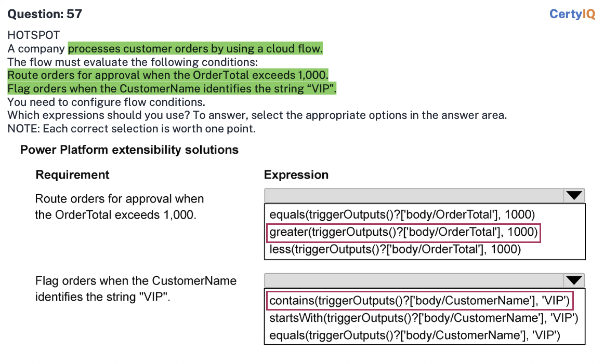

### 1. Extracted Question Summary

* **Scenario:** A company processes customer orders using a Power Automate cloud flow.

* **Requirements:**
* Route orders for approval when the `OrderTotal` exceeds 1,000.

* Flag orders when the `CustomerName` identifies the string `"VIP"`.

* **Question:** Select the appropriate Workflow Definition Language (WDL) expressions in the answer area.

* **Dropdown Options:**
* **Requirement 1:** *Route orders for approval when the OrderTotal exceeds 1,000.*

* `equals(triggerOutputs()?['body/OrderTotal'], 1000)`

* `greater(triggerOutputs()?['body/OrderTotal'], 1000)` *(Highlighted inside red box)*

* `less(triggerOutputs()?['body/OrderTotal'], 1000)`

* **Requirement 2:** *Flag orders when the CustomerName identifies the string "VIP".*

* `contains(triggerOutputs()?['body/CustomerName'], 'VIP')` *(Highlighted inside red box)*

* `startsWith(triggerOutputs()?['body/CustomerName'], 'VIP')`

* `equals(triggerOutputs()?['body/CustomerName'], 'VIP')`

---

### 2. Correct Answer

| Requirement | Correct Expression |
| --- | --- |
| **Route orders for approval when the OrderTotal exceeds 1,000.**

 | `greater(triggerOutputs()?['body/OrderTotal'], 1000)`

 |
| **Flag orders when the CustomerName identifies the string "VIP".**

 | `contains(triggerOutputs()?['body/CustomerName'], 'VIP')`

 |

---

### 3. Verification of Visible Selection / Community Key

* Both visible selections highlighted inside the red boxes—`greater(triggerOutputs()?['body/OrderTotal'], 1000)` for the first requirement and `contains(triggerOutputs()?['body/CustomerName'], 'VIP')` for the second requirement—are **Correct**.

---

### 4. Official Microsoft Justification

* **`greater(triggerOutputs()?['body/OrderTotal'], 1000)` (Requirement 1):** Under Microsoft Learn documentation for **Reference guide to workflow expression functions in Azure Logic Apps and Power Automate** (*Logical comparison functions*), the `greater(value, compareTo)` function returns `true` strictly when the first argument is larger than the second (`OrderTotal > 1000`), matching *"exceeds 1,000"*.

* **`contains(triggerOutputs()?['body/CustomerName'], 'VIP')` (Requirement 2):** Under Microsoft Learn documentation for **String / Collection functions** (`contains(collection, value)`), `contains()` checks whether a substring appears *anywhere* inside a string (prefix, middle, or suffix—such as `"Acme Corp - VIP"` or `"VIP - Contoso"`), fulfilling the requirement to identify the string `"VIP"` within `CustomerName`.

---

### 5. Distractor Analysis (Why Others Are Wrong)

* **Requirement 1 Distractors:**
* `equals(triggerOutputs()?['body/OrderTotal'], 1000)`: Evaluates `OrderTotal == 1000`, triggering only when the total is *exactly* 1,000 rather than *exceeding* 1,000.

* `less(triggerOutputs()?['body/OrderTotal'], 1000)`: Evaluates `OrderTotal < 1000`, which is the exact opposite of *"exceeds 1,000"*.

* **Requirement 2 Distractors:**
* `startsWith(triggerOutputs()?['body/CustomerName'], 'VIP')`: Only returns `true` if `"VIP"` is at the very beginning of `CustomerName`, missing customer names where `"VIP"` appears at the end or middle.

* `equals(triggerOutputs()?['body/CustomerName'], 'VIP')`: Only returns `true` if the entire `CustomerName` string is literally `"VIP"` with no actual customer name included.

---

### 6. Exam Keyword / Trap Alert

* **Trigger Phrases:**
* *"exceeds 1,000"* (strictly greater than) $\rightarrow$ **`greater(..., 1000)`** (note: *"at least 1,000"* or *"1,000 or more"* would be `greaterOrEquals(..., 1000)`).

* *"identifies the string 'VIP'"* (substring anywhere in the field) $\rightarrow$ **`contains(..., 'VIP')`**.

* **Exam Trap:** Watch the subtle wording distinction in Power Automate WDL expression questions: *"exceeds"* maps to **`greater()`** (not `greaterOrEquals()`), and *"identifies the string"* maps to **`contains()`** (not `startsWith()` or `equals()`).

## Q58

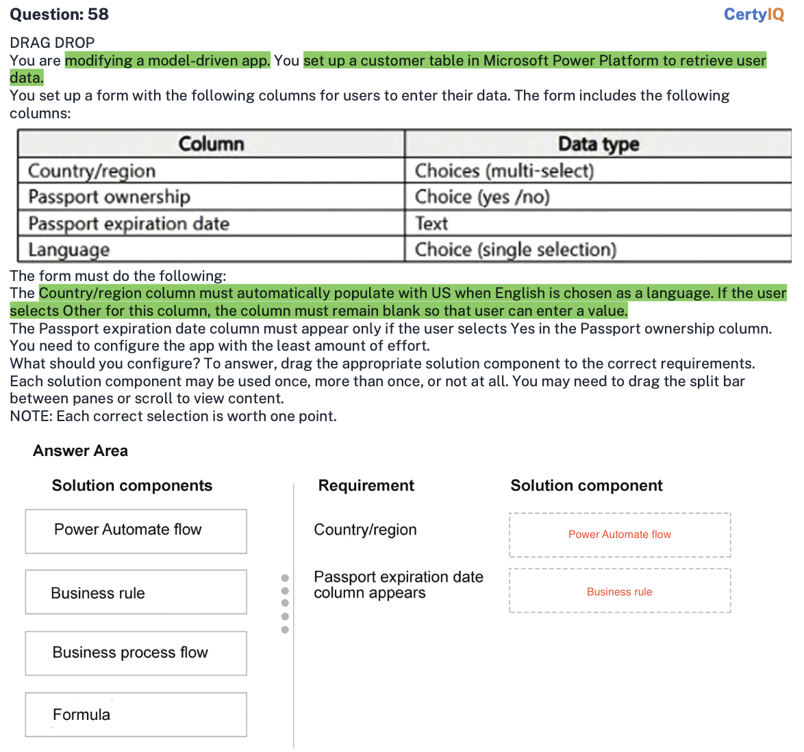

### 1. Extracted Question Summary

* **Scenario:** You are modifying a model-driven app and have configured a customer table and form with four columns:

* `Country/region` — **Choices (multi-select)**

* `Passport ownership` — **Choice (yes/no)**

* `Passport expiration date` — **Text**

* `Language` — **Choice (single selection)**

* **Requirements (with the least amount of effort):**
1. **Country/region:** Must automatically populate with `US` when `English` is chosen as a language. If the user selects `Other` for this column, the column must remain blank so the user can enter a value.

2. **Passport expiration date column appears:** Must appear only if the user selects `Yes` in the `Passport ownership` column.

* **Available Solution Components:** `Power Automate flow`, `Business rule`, `Business process flow`, `Formula`.

---

### 2. Correct Answer

| Requirement | Correct Solution Component |
| --- | --- |
| **Country/region**

 | **Power Automate flow**

 |
| **Passport expiration date column appears**

 | **Business rule**

 |

---

### 3. Verification of Visible Selection / Community Key

* The answer area in the screenshot is blank (no drag-and-drop selections or community answer key are visible). This question hinges on a critical Dataverse **Business Rule data-type limitation**: Business Rules do **not** support `Choices` (multi-select) columns.

---

### 4. Official Microsoft Justification

* **Power Automate flow (Requirement 1 — `Country/region`):** Under Microsoft Learn documentation for **Create a business rule in Microsoft Dataverse** (*Supported column types / Limitations*), Dataverse **Business Rules** do not support multi-select **Choices** columns (`Country/region` is explicitly defined in the table as `Choices (multi-select)`). Similarly, Dataverse **Formula** columns cannot write to multi-select `Choices` columns or leave an editable field blank for user entry. Therefore, among the available low-code options, a **Power Automate flow** triggered when the customer record is created or `Language` is updated is required to set the multi-select `Country/region` column to `US` when `Language` equals `English`.

* **Business rule (Requirement 2 — `Passport expiration date column appears`):** Under Microsoft Learn documentation for **Create a business rule in Microsoft Dataverse**, showing or hiding columns dynamically on a model-driven app form (`Set visibility` action) based on a single-select `Choice (yes/no)` field (`Passport ownership`) is a core native capability of a client-side **Business rule**, requiring zero code and the least effort.

---

### 5. Distractor Analysis (Why Others Are Wrong)

* **Business rule for `Country/region`:** Although setting a default field value based on another field normally screams "Business rule," the table explicitly specifies `Country/region` as **Choices (multi-select)**—which is completely unsupported in the Dataverse Business Rule designer.

* **Formula:** Formula columns are read-only computed columns using Power Fx; they cannot control form column visibility (`Set visibility`), cannot remain editable for manual user entry when `Other` is selected, and do not support writing to multi-select `Choices` columns.

* **Business process flow:** Guides users sequentially across business stages at the top of a form; it is not designed to dynamically show/hide individual fields on a form or conditionally populate multi-select choice values.

---

### 6. Exam Keyword / Trap Alert

* **Trigger Phrases:**
* `Country/region` $\rightarrow$ **`Choices (multi-select)`** in the schema table $\rightarrow$ **Power Automate flow** (because Business Rules cannot target multi-select *Choices* columns).

* *"column must appear only if the user selects Yes"* $\rightarrow$ **Business rule** (`Set visibility` action).

* **Exam Trap:** Look closely at the **Data type** column in the prompt's schema table! Microsoft includes that table specifically to test whether you catch **`Choices (multi-select)`** on `Country/region`. Whenever a Dataverse question asks to conditionally populate a **multi-select Choices** column without custom JavaScript, **Business rule** is disqualified and **Power Automate flow** becomes the right low-code answer.

## Q59

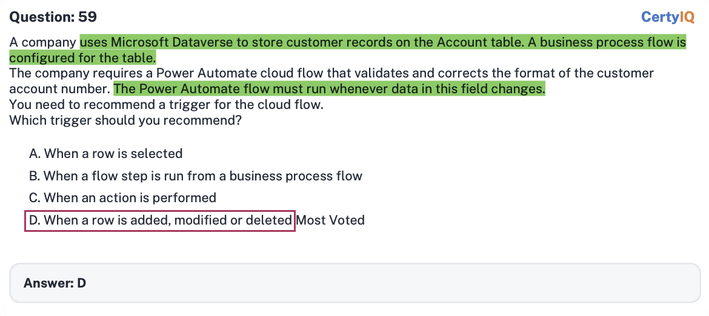

### 1. Extracted Question Summary

* **Scenario:** A company uses Microsoft Dataverse to store customer records on the `Account` table, and a business process flow is configured for the table.

* **Requirement:** A Power Automate cloud flow must validate and correct the format of the customer account number, running **whenever data in this field changes**.

* **Question:** You need to recommend a trigger for the cloud flow. Which trigger should you recommend?

* **Options:**
* **A.** When a row is selected

* **B.** When a flow step is run from a business process flow

* **C.** When an action is performed

* **D.** When a row is added, modified or deleted *(Highlighted inside red box, labeled "Most Voted", and marked "Answer: D")*

* **Visible Answer Key:** `Answer: D`

---

### 2. Correct Answer

* **D: When a row is added, modified or deleted**

---

### 3. Verification of Visible Selection / Community Key

* The visible selection (**Answer: D**, boxed in red and labeled "Most Voted") is **Correct**. In the Microsoft Dataverse connector for Power Automate, the **When a row is added, modified or deleted** trigger supports column-level filtering via the **Select columns** parameter—ensuring the flow executes automatically whenever the customer account number column is created or modified.

---

### 4. Official Microsoft Justification

* Under Microsoft Learn documentation for **Trigger flows when a row is added, modified, or deleted** (*Microsoft Dataverse connector*):
* **Change Type & Column Filtering:** Setting **Change type** to *Added or Modified* (or *Modified*) on the `Accounts` table and specifying the customer account number column logical name inside **Select columns** causes the cloud flow to fire automatically whenever that specific column's data changes—whether edited via a model-driven form, canvas app, import, or API.

---

### 5. Distractor Analysis (Why Others Are Wrong)

* **A. When a row is selected:** An instant/manual trigger (legacy Dataverse connector) that requires a user to explicitly highlight a record in a view and click **Flow** in the command bar; it does not run automatically when field data changes.

* **B. When a flow step is run from a business process flow:** A red herring based on the first sentence mentioning a BPF. BPF flow steps only fire on explicit BPF stage entry/exit or when a user manually clicks **Run Flow** inside a stage—they do *not* automatically trigger whenever a field's value changes across the table.

* **C. When an action is performed:** Fires when a custom Dataverse Action or Custom API message is invoked, not when a standard table column is edited.

---

### 6. Exam Keyword / Trap Alert

* **Trigger Phrases:** *"whenever data in this field changes"* $\rightarrow$ **When a row is added, modified or deleted** (configured with **Select columns** set to the target field).

* **Exam Trap:** Notice the deliberate red herring in sentence 1 (*"A business process flow is configured for the table"*) designed to lure you into picking Option **B**. Always anchor on the trigger requirement (*"whenever data in this field changes"*), which requires a Dataverse data-event trigger rather than a manual BPF stage trigger. (In production, remember to also filter or guard against infinite self-trigger loops when the flow updates the same column it triggers on!)

## Q60

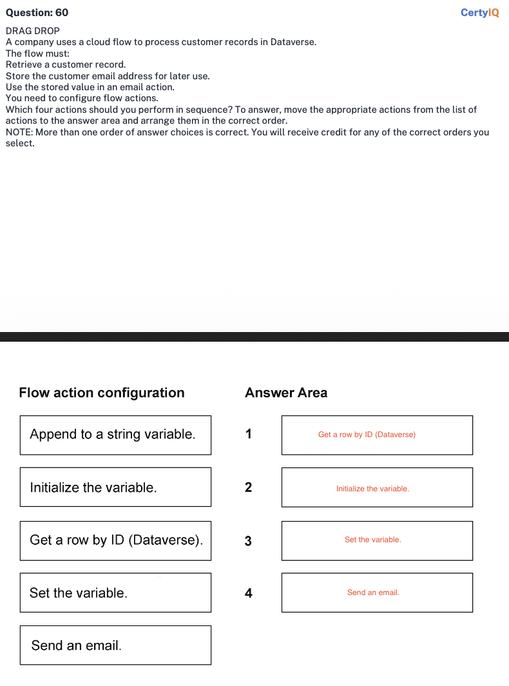

### 1. Extracted Question Summary

* **Scenario:** A company uses a Power Automate cloud flow to process customer records in Dataverse.

* **Requirements:**
* Retrieve a customer record.

* Store the customer email address for later use.

* Use the stored value in an email action.

* **Question:** Which four actions should you perform in sequence? Move the appropriate actions to the answer area in the correct order (Note: More than one order of answer choices is correct).

* **Available Actions:**
* `Append to a string variable.`

* `Initialize the variable.`

* `Get a row by ID (Dataverse).`

* `Set the variable.`

* `Send an email.`

---

### 2. Correct Answer

Either of the following two valid sequences satisfies the Power Automate runtime rules and the question's prompt note (*"More than one order of answer choices is correct"*):

**Option A (Initialize first — Standard Power Automate Best Practice):**

1. **Initialize the variable.**

2. **Get a row by ID (Dataverse).**

3. **Set the variable.**

4. **Send an email.**

**Option B (Retrieve record first, then initialize and populate):**

1. **Get a row by ID (Dataverse).**

2. **Initialize the variable.**

3. **Set the variable.**

4. **Send an email.**

---

### 3. Verification of Visible Selection / Community Key

* The answer area in the screenshot is blank (no drag-and-drop selections or community answer key are visible). Both sequences above satisfy every dependency constraint—specifically why the exam question explicitly includes the note: *"More than one order of answer choices is correct. You will receive credit for any of the correct orders you select."*

---

### 4. Official Microsoft Justification

* Under Microsoft Learn documentation for **Store and manage values in variables in Power Automate**:
* **Initialize the variable:** In Power Automate, every variable must be explicitly declared at the top level (outside loops or conditional branches) using **Initialize variable** before any action can read from or write to it. It can be placed either before or after **Get a row by ID (Dataverse)** as long as it precedes **Set the variable**.

* **Get a row by ID (Dataverse):** Retrieves the single target customer record from Dataverse and exposes its columns (including the customer's email address) as dynamic content.

* **Set the variable:** Assigns (overwrites) the retrieved customer email address into the initialized String variable so it is stored cleanly for downstream reuse.

* **Send an email:** References the stored variable in the **To** field to dispatch the email.

---

### 5. Distractor Analysis (Why Others Are Wrong)

* **Append to a string variable:** Concatenates additional text onto the *end* of an existing string value (used for building comma-separated lists or multi-line logs inside loops) rather than storing a single customer's email address.

---

### 6. Exam Keyword / Trap Alert

* **Trigger Phrases:** *"Retrieve a customer record"*, *"Store the customer email address"*, and *"Use the stored value in an email action"* $\rightarrow$ **Initialize variable** + **Get a row by ID** + **Set variable** + **Send an email**.

* **Exam Trap:** Notice the explicit exam note (*"More than one order of answer choices is correct"*)—this appears whenever two independent top-level actions (`Initialize variable` and `Get a row by ID`) can swap positions 1 and 2, provided both occur *before* `Set the variable` (position 3) and `Send an email` (position 4).

## Q61

### 1. Extracted Question Summary

* **Scenario:** A company uses a cloud flow to analyze incoming order form PDFs attached to emails.

* **Requirements:**
* The cloud flow must use an AI model to extract information from each order.

* The extracted information must then be added to the enterprise resource planning (ERP) system.

* **Question:** You need to configure the flow. Which two actions should you perform? (Each correct answer presents part of the solution.)

* **Options:**
* **A.** Add the Extract standard entities action.

* **B.** Specify the language and text.

* **C.** Specify the model, document type, and document *(Highlighted inside red box)*.

* **D.** Add the Classify into standard categories action.

* **E.** Add the Process documents action *(Highlighted inside red box)*.

* **Visible Answer Key:** `Answer: CE`

---

### 2. Correct Answer

* **C: Specify the model, document type, and document.**

* **E: Add the Process documents action.**

---

### 3. Verification of Visible Selection / Community Key

* The visible selection (**Answer: CE**, boxed in red) is **Correct**. Extracting key-value pairs and table line items from structured or semi-structured **order form PDFs** uses the AI Builder **Document processing** model, which is invoked in Power Automate via the **Process documents** action and configured by supplying the trained **AI model**, **Document type** (e.g., `application/pdf`), and binary **Document** content.

---

### 4. Official Microsoft Justification

* Under Microsoft Learn documentation for **Use the document processing model in Power Automate** (*AI Builder connector — Process documents*):
* **Add the Process documents action (E):** In Power Automate, the AI Builder connector exposes the **Process documents** action (formerly *Extract information from forms*) specifically to extract structured fields, checkboxes, and tables from PDF or image files.

* **Specify the model, document type, and document (C):** When configuring the **Process documents** action card in a cloud flow, the three required input parameters are:
1. **AI model:** The published custom document processing model trained on the order forms.

2. **Document type:** The MIME type of the incoming attachment (such as `application/pdf` or `Attachments Content-Type`).

3. **Document:** The file binary content (`Attachments Content` from the email trigger).

---

### 5. Distractor Analysis (Why Others Are Wrong)

* **A. Add the Extract standard entities action:** Entity extraction is a text-only NLP model that identifies generic entities (such as dates, organizations, currencies, or URLs) from unstructured plain text strings—it cannot parse layout-based PDF order forms or extract custom order fields.

* **B. Specify the language and text:** Those are the input parameters for text-based AI Builder actions (such as *Sentiment analysis*, *Key phrase extraction*, or *Entity extraction*), not for binary PDF document processing.

* **D. Add the Classify into standard categories action:** Category classification assigns a high-level label/tag to unstructured text; it does not extract granular field values from order form PDFs to populate an ERP system.

---

### 6. Exam Keyword / Trap Alert

* **Trigger Phrases:** *"order form PDFs attached to emails"* + *"use an AI model to extract information"* $\rightarrow$ **Process documents** action + **Specify the model, document type, and document**.

* **Exam Trap:** Pair the AI Builder action directly with its exact input parameters—**Process documents** takes **(1) AI model, (2) Document type, (3) Document**, whereas text-based NLP actions (*Entity extraction*, *Sentiment*, *Category classification*) take **(1) Language, (2) Text**.

## 62

### 1. Extracted Question Summary

* **Scenario:** A company builds a canvas app that processes images submitted by users and must classify them using an existing AI Builder model.

* **Requirements:**
* Generate predictions during user interaction.

* Consume the AI model natively.

* **Question:** What should you do?

* **Options:**
* **A.** Invoke the model by using Power Fx. *(Highlighted inside red box and marked "Answer: A")*

* **B.** Replace the model with a static formula.

* **C.** Refine the model with additional images.

* **D.** Export the solution which contains the model.

* **Visible Answer Key:** `Answer: A`

---

### 2. Correct Answer

* **A: Invoke the model by using Power Fx.**

---

### 3. Verification of Visible Selection / Community Key

* The visible selection (**Answer: A**, boxed in red) is **Correct**. In Power Apps canvas apps, you can natively add an existing AI Builder model via the **Data** pane (`+ Add data` $\rightarrow$ *AI models*) and call its `.Predict()` function directly inside **Power Fx** formulas (such as a button's `OnSelect` or an image control's `OnChange`) to generate real-time predictions during user interaction.

---

### 4. Official Microsoft Justification

* Under Microsoft Learn documentation for **Use AI Builder models in Power Apps** (*Use the Predict function in Power Fx*):
* **Native Power Fx Consumption:** Makers can connect an existing, published AI Builder model directly to a canvas app as a data source and invoke it natively using the `ModelName.Predict(ImageControl.Image)` Power Fx expression.

* **Interactive Real-Time Inference:** Calling `.Predict()` directly inside Power Fx executes synchronously during user interaction without requiring an intermediate Power Automate flow or external custom API wrapper.

---

### 5. Distractor Analysis (Why Others Are Wrong)

* **B. Replace the model with a static formula:** Standard deterministic Power Fx formulas cannot perform computer-vision image classification, and the requirement explicitly specifies using the *existing AI Builder model*.

* **C. Refine the model with additional images:** Retraining or improving model accuracy does not integrate or consume the model inside the canvas app during user interaction.

* **D. Export the solution which contains the model:** Exporting a solution is an Application Lifecycle Management (ALM) packaging step for moving components across environments—it does not invoke the AI model inside the canvas app.

---

### 6. Exam Keyword / Trap Alert

* **Trigger Phrases:** *"canvas app"*, *"existing AI Builder model"*, *"generate predictions during user interaction"*, and *"consume the AI model natively"* $\rightarrow$ **Invoke the model by using Power Fx** (`.Predict()`).

* **Exam Trap:** Just like custom prompts in canvas apps, whenever a question emphasizes **native** consumption and **interactive real-time predictions** inside a canvas app, the answer is always direct **Power Fx** invocation (`ModelName.Predict(...)`) rather than Power Automate flows or ALM packaging steps.

## Q63

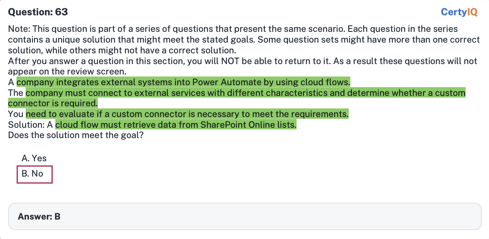

1. **Correct Answer:** B. No

2. **Core Concept & Domain:** Power Automate Cloud Flows & Connector Architecture (Standard vs. Custom Connectors) — specifically evaluating when to use prebuilt standard connectors versus building custom connectors to integrate external services.
3. **Why It Is Correct:**
* In Microsoft Power Platform architecture, **SharePoint** is supported out-of-the-box by an official, prebuilt **Standard Connector** in Power Automate.

* The native SharePoint connector provides comprehensive built-in triggers and actions (such as *Get items*, *Get item*, *Create item*, and *Update item*) specifically designed to retrieve and manipulate data from SharePoint Online lists without requiring any custom API wrappers.

* According to Microsoft Power Platform best practices, custom connectors should only be created when no prebuilt standard or premium connector exists for a REST/SOAP API, or when a specific operation is missing from an existing connector. Because retrieving data from SharePoint Online lists is natively supported, a custom connector is **not** necessary, making **B. No** the accurate evaluation.

4. **Why Other Options Are Wrong:**
* **A. Yes:** Selecting "Yes" implies that a custom connector is required to read data from SharePoint Online lists. Creating a custom connector for SharePoint is a major architectural anti-pattern—it introduces unnecessary development overhead, authentication management (Entra ID app registration), and ALM maintenance for functionality that is already natively provided as a standard connector.

5. **Exam Trap / Tip:**
* **Repeated Scenario ("Does the solution meet the goal?") Format:** Notice the boilerplate header explaining that this is part of a series sharing the same scenario. In these Yes/No exam sets, read the exact goal carefully: *"You need to evaluate if a custom connector is necessary to meet the requirements"*.

* Because the proposed requirement in this specific iteration is simply retrieving SharePoint Online list data—which uses a standard connector—the answer to *"is a custom connector necessary?"* is **No**. (In other variations of this same question series, the "Solution" line will swap in a scenario like an internal REST API without a prebuilt connector, where the answer flips to **Yes**.)

## Q64

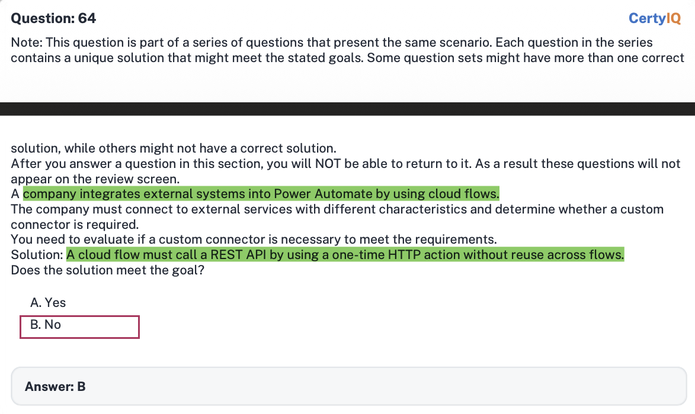

1. **Correct Answer:** B. No

2. **Core Concept & Domain:** Power Automate Cloud Flows & Connector Architecture (Built-in HTTP Action vs. Custom Connectors) — determining when a standalone HTTP request suffices versus when building and maintaining a custom connector is warranted.
3. **Why It Is Correct:**
* In Microsoft Power Platform architecture, Power Automate provides a built-in **HTTP connector** (a premium connector) that allows makers to directly send standard REST requests (`GET`, `POST`, `PUT`, `PATCH`, `DELETE`) with custom headers, query parameters, payloads, and authentication (such as Basic, API Key, OAuth 2.0, or Certificate) directly inside a cloud flow.
* Per Microsoft Learn guidance on custom connectors versus the HTTP action, a custom connector is designed to wrap a REST or SOAP API into a reusable, strongly typed set of triggers and actions with user-friendly metadata, shared connections, and governance controls across multiple flows, Power Apps, or Copilot Studio agents.
* When the requirement is explicitly a **one-time HTTP action without reuse across flows**, configuring the native HTTP action directly in the cloud flow is the recommended, lightweight architectural choice. Creating a full custom connector for a single, non-reusable call introduces unnecessary development and ALM overhead, making **B. No** (a custom connector is not necessary) the correct evaluation.

4. **Why Other Options Are Wrong:**
* **A. Yes:** Selecting "Yes" implies that a custom connector is required just to invoke an external REST API. Because the built-in HTTP action natively handles single-use REST API calls without needing an OpenAPI definition or custom connector wrapper, building a custom connector here violates Power Platform's low-code/minimal-overhead best practices.

5. **Exam Trap / Tip:**
* **Key Discriminator — "One-time" & "Without reuse across flows":** Look closely at the phrasing in the Solution line: *"by using a one-time HTTP action without reuse across flows"*. On Microsoft exams, **reusability** across multiple flows/apps, **citizen-developer usability** (exposing friendly action names/schemas), or **triggers (webhooks)** are the primary triggers that flip the answer to **Yes** (custom connector required). When a scenario explicitly emphasizes a **one-time** call with **no reuse**, the built-in HTTP action is sufficient and a custom connector is **not** necessary (**B. No**).

## Q65

1. **Correct Answer:** B. No

2. **Core Concept & Domain:** Power Automate Cloud Flows & Native Dataverse Integration (Built-in Dataverse Connector vs. Custom Connectors) — determining whether accessing Microsoft Dataverse requires a custom connector.

3. **Why It Is Correct:**
* Microsoft Dataverse is the foundational, native data platform for Microsoft Power Platform and is supported out-of-the-box by a first-party, prebuilt **Microsoft Dataverse connector** in Power Automate.
* The native Dataverse connector provides direct, high-performance triggers (such as *When a row is added, modified or deleted*) and actions (such as *List rows*, *Get a row by ID*, *Add a new row*, and *Perform an unbound/bound action*) with built-in OData filtering, FetchXML queries, and automatic Entra ID security context handling.
* According to Microsoft Learn guidance for building cloud flows with Dataverse, custom connectors are never needed to interact with Dataverse tables or APIs—even custom Dataverse APIs can be invoked directly using the native Dataverse connector's *Perform an unbound action* or *Perform a bound action* operations. Therefore, a custom connector is not necessary to retrieve data from Microsoft Dataverse, making **B. No** the correct answer.

4. **Why Other Options Are Wrong:**
* **A. Yes:** Selecting "Yes" implies that a custom connector must be built to read data from Microsoft Dataverse. Wrapping the Dataverse Web API in a custom connector is a severe architectural anti-pattern—it bypasses native Power Platform connection references, adds unnecessary Entra ID app registration and OpenAPI maintenance overhead, and duplicates functionality already built directly into the platform.

5. **Exam Trap / Tip:**
* **Don't Confuse "Premium" with "Custom":** While the **Microsoft Dataverse connector** is classified as a *Premium* connector in Power Platform licensing, *Premium* does **not** mean *Custom*. Prebuilt Microsoft connectors (whether Standard like SharePoint or Premium like Dataverse and SQL Server) are already provided out-of-the-box, so the answer to *"is a custom connector necessary?"* remains **B. No**.

## Q66

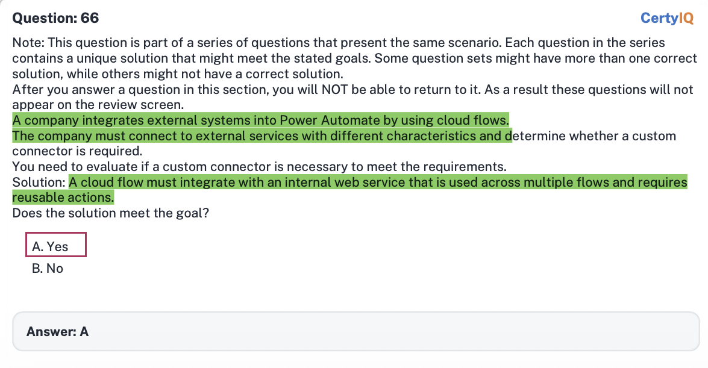

1. **Correct Answer:** A. Yes

2. **Core Concept & Domain:** Power Automate Cloud Flows & Custom Connector Architecture — evaluating when building a custom connector is warranted for internal APIs, cross-flow reusability, and standardized action definitions.

3. **Why It Is Correct:**
* In Microsoft Power Platform architecture, an **internal web service** (such as a proprietary company REST or SOAP API) does not have a prebuilt standard or premium connector available out-of-the-box.

* Per Microsoft Learn guidance on custom connectors versus the built-in HTTP action, a custom connector is the recommended architectural pattern whenever an external or internal API must be **reused across multiple flows** (or Power Apps / Copilot Studio agents) and exposed as **reusable, strongly typed actions**.

* Wrapping the internal web service in a custom connector centralizes authentication configuration, hides raw HTTP request details behind user-friendly action names and typed input/output schemas, supports Power Platform Data Loss Prevention (DLP) governance, and enables clean Application Lifecycle Management (ALM) via solutions and connection references—making **A. Yes** the correct evaluation.

4. **Why Other Options Are Wrong:**
* **B. No:** Selecting "No" implies that a custom connector is unnecessary and that makers should instead rely on raw HTTP actions or prebuilt connectors. Hardcoding raw HTTP actions repeatedly across multiple cloud flows creates a severe maintenance and governance anti-pattern—any endpoint URL change, header update, or authentication token adjustment would require manually editing every individual flow rather than updating a single custom connector definition.

5. **Exam Trap / Tip:**
* **Direct Contrast with Question 64 ("One-time" vs. "Used across multiple flows"):** Notice how this question directly flips the discriminator from Question 64. While Question 64 specified a *"one-time HTTP action without reuse across flows"* (**B. No**), Question 66 specifies an *"internal web service that is used across multiple flows and requires reusable actions"* (**A. Yes**). Whenever a Microsoft exam scenario highlights **reusability across multiple flows/apps**, **encapsulated actions/triggers**, or **citizen-developer consumption** of an internal/custom API, a custom connector is required (**Yes**).

## Q67

1. **Correct Answer:** D. Call the model from app logic.

2. **Core Concept & Domain:** Canvas Apps & AI Builder Integration (Consuming AI Builder Models Natively in Power Apps) — specifically using Power Fx expressions to invoke a published AI Builder model synchronously during user interaction.

3. **Why It Is Correct:**
* In Microsoft Power Platform architecture, an **existing** (trained and published) AI Builder model can be added directly to a canvas app as a data source via the **Data** pane (*Add data* > *AI models*).

* Once added, makers natively consume the model directly inside Power Fx **app logic** (for example, inside a button's `OnSelect` property or an image control's `OnChange` property) by calling the model's `.Predict()` method (e.g., `Set(varPrediction, 'ImageClassificationModel'.Predict(UploadedImage1.Image))`).

* Calling `.Predict()` directly from Power Fx app logic executes synchronously and returns real-time classification results immediately during user interaction without requiring an intermediate Power Automate cloud flow or custom API wrapper.

4. **Why Other Options Are Wrong:**
* **A. Retrain the model for each submission:** Retraining is an offline, asynchronous model-lifecycle operation performed in AI Builder when updating a model with new labeled training datasets. You do not retrain a model at runtime to classify an individual user submission.

* **B. Reuse a previously stored prediction:** Each user submits new, distinct images at runtime that require fresh inference. Returning a cached/previously stored prediction would fail to classify the newly submitted image.

* **C. Export the solution which contains the model:** Exporting a solution is an Application Lifecycle Management (ALM) deployment step used to move components between environments (such as Dev to Test/Prod)—it has nothing to do with executing runtime predictions inside a canvas app.

5. **Exam Trap / Tip:**
* **Key Discriminators — "existing AI Builder model", "during user interaction", and "natively":** Whenever a scenario states the model already exists (meaning it is trained and published) and must generate predictions interactively in real time inside a canvas app without extra middleware, the native Power Apps pattern is always invoking `.Predict()` directly from Power Fx app logic.

## Q68

1. **Correct Answer:** D. Create a calculated column.

2. **Core Concept & Domain:** Microsoft Dataverse Data Modeling (Calculated Columns vs. Rollup Columns, Business Rules, and Formula Columns) — specifically choosing the right no-code mechanism to compute dynamic, virtual row-level values on retrieval without persisting them to database storage.

3. **Why It Is Correct:**
* In Microsoft Dataverse architecture, a **calculated column** (or Power Fx formula column) lets makers define an expression using columns from the current row or related parent rows without writing custom code.

* Crucially, Dataverse **calculated columns** are evaluated **synchronously in real time when the record is retrieved/accessed**, and their values are **not stored in the underlying database table**.

* This satisfies every single requirement in the prompt: it evaluates numerical columns in the same row, computes dynamically when accessed, avoids persisting the result as part of the table data, and requires zero custom code.

4. **Why Other Options Are Wrong:**
* **A. Use a business rule to populate the value:** A business rule writes its output into a standard, persistent Dataverse column. That means the resulting value **is stored** in the database table, directly violating the requirement to *"Ensure the result is NOT stored as part of the table data"*. Additionally, business rules only fire on form load/change or server-side record create/update—not dynamically on every read/query access.

* **B. Create a JavaScript function:** Client-side JavaScript form scripts only run when a user opens a model-driven app form (not during API calls, views, or reports), require writing to a stored column to persist, and violate the *"minimize use of custom code"* constraint.

* **C. Configure a dataflow:** Power Platform Dataflows perform scheduled, asynchronous ETL batch loads into Dataverse tables, which physically stores the computed results in the database and does not calculate values dynamically upon access.

5. **Exam Trap / Tip:**
* **Key Discriminators — "Calculate the result dynamically when accessed" & "NOT stored as part of the table data":** Whenever a Dataverse question explicitly states that a derived value must **not** be stored in the database and must compute **dynamically when retrieved/accessed**, eliminate Business Rules, Power Automate flows, Plug-ins, and Dataflows immediately—those all write to persisted columns. **Calculated columns** (and Power Fx formula columns) are virtual, on-read computations.

## Q69

1. **Correct Answer:** C. Create a custom connector.

2. **Core Concept & Domain:** Power Platform Extensibility & Custom Connectors — integrating external/third-party AI REST APIs with Dataverse, Power Automate, and Power Apps using custom authentication, request/response schemas, and policy-based request handling.

3. **Why It Is Correct:**
* In Microsoft Power Platform architecture, integrating with a **third-party AI service** that lacks a prebuilt connector and requires **authentication and custom request handling** is the primary use case for a **custom connector**.

* A custom connector wraps an external REST or SOAP API (via OpenAPI specification, Postman collection, or from scratch), allowing you to configure supported authentication protocols (OAuth 2.0, API Key, Basic Authentication) and define strongly typed request/response schemas.

* Furthermore, custom connectors support **policy templates** (such as *Set HTTP header*, *Route request*, or *Set query string parameter*) and **C# custom code transformations** inside the connector definition to handle custom request/response formatting before exchanging data with Microsoft Dataverse (via Power Automate cloud flows, Power Apps, or Copilot Studio).

4. **Why Other Options Are Wrong:**
* **A. Configure an environment variable:** Environment variables only store configuration metadata (such as base URLs, parameter values, or Azure Key Vault secret references) across ALM environments. They cannot execute HTTP calls, manage OAuth/API key handshakes, or parse API payloads on their own.

* **B. Use an AI Builder model:** AI Builder provides native Microsoft-hosted prebuilt and custom AI models inside Power Platform. It does not connect to or wrap an external **third-party AI service** endpoint.

* **D. Use a classic workflow:** Classic Dataverse background/real-time workflows are legacy automation tools limited to native Dataverse record operations (create, update, assign, send email) and cannot natively call external REST APIs or handle custom HTTP authentication without writing custom .NET workflow activities (which Microsoft recommends replacing with Power Automate and custom connectors).

5. **Exam Trap / Tip:**
* **Key Discriminators — "third-party AI service", "authentication", and "custom request handling":** Whenever an AB-410 scenario involves connecting Power Platform/Dataverse to an external or third-party AI API that requires custom headers, payload transformation, or managed authentication, **creating a custom connector** is the standard Power Platform extensibility pattern—never a classic workflow or standalone environment variable.

## Q75

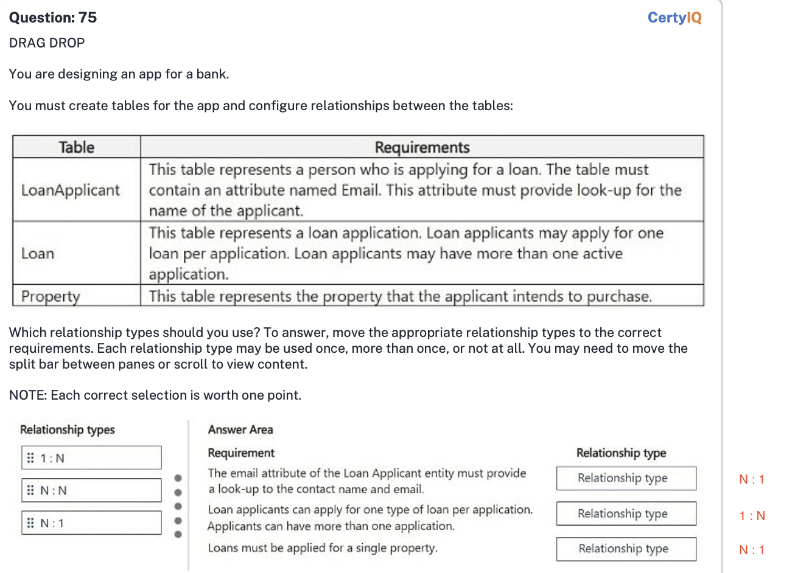

1. **Correct Answer:**
* **The email attribute of the Loan Applicant entity must provide a look-up to the contact name and email:** `N : 1`

* **Loan applicants can apply for one type of loan per application. Applicants can have more than one application:** `1 : N`

* **Loans must be applied for a single property:** `N : 1`

2. **Core Concept & Domain:** Microsoft Dataverse Data Modeling & Table Relationships (`1:N`, `N:1`, and `N:N` relationships) — specifically determining relationship cardinality and direction from the perspective of the source/primary table in each requirement statement.

3. **Why It Is Correct:**
* In Microsoft Dataverse architecture, a **Lookup column** is always created on the **Many (`N`)** side of a relationship, pointing to a single parent record on the **One (`1`)** side. Understanding relationship direction depends on which table is the subject of the requirement:
* **Requirement 1 (`LoanApplicant` $\rightarrow$ `Contact` = `N : 1`):** The requirement specifies that the `LoanApplicant` table contains a lookup attribute (`Email`) referencing the `Contact` table. Because multiple `LoanApplicant` records can reference a single `Contact` record—and the lookup resides on `LoanApplicant`—the relationship from `LoanApplicant` to `Contact` is **Many-to-One (`N : 1`)**.

* **Requirement 2 (`LoanApplicant` $\rightarrow$ `Loan` = `1 : N`):** The requirement states that a single loan applicant can have multiple active loan applications (`Loan` records), while each loan application belongs to only one loan applicant. Viewed from the `LoanApplicant` table (the subject of the sentence), one applicant has many loan applications, making this a **One-to-Many (`1 : N`)** relationship.

* **Requirement 3 (`Loan` $\rightarrow$ `Property` = `N : 1`):** The requirement states that loans must be applied for a single property. Viewed from the `Loan` table (the subject of the sentence), multiple loan applications can reference one `Property` record (meaning the Property lookup column sits on the `Loan` table), making this a **Many-to-One (`N : 1`)** relationship.

4. **Why Other Options Are Wrong:**
* **`N : N` (Many-to-Many):** None of the three requirements describe bidirectional, multi-record associations without a single parent lookup (such as multiple applicants sharing multiple loans simultaneously without an intersect entity). Every requirement explicitly enforces a single parent lookup on one side (`Contact`, `LoanApplicant`, and `Property` respectively).

* **Reversing `1 : N` and `N : 1`:** In Dataverse, `1 : N` and `N : 1` represent the exact same underlying database relationship viewed from opposite tables. Selecting `1 : N` for Requirement 1 or 3 would incorrectly place the lookup column on `Contact` or `Property` instead of `LoanApplicant` or `Loan`. Similarly, selecting `N : 1` for Requirement 2 would restrict an applicant to a single loan.

5. **Exam Trap / Tip:**
* **Read the Grammatical Subject of Each Sentence:** In Dataverse drag-and-drop relationship questions, always identify which table is named first as the subject of the requirement:
* *"The email attribute of the **Loan Applicant** entity must provide a look-up..."* $\rightarrow$ Subject is **LoanApplicant** (holds the lookup = `N` side) $\rightarrow$ **`N : 1`**.

* *"**Loan applicants** can... have more than one application."* $\rightarrow$ Subject is **LoanApplicant** (`1` side) $\rightarrow$ **`1 : N`**.

* *"**Loans** must be applied for a single property."* $\rightarrow$ Subject is **Loan** (holds the Property lookup = `N` side) $\rightarrow$ **`N : 1`**.

## Q76

1. **Correct Answer:** A. Use the OnSelect property of the Submit button to call the flow by using the Run() function.

2. **Core Concept & Domain:** Canvas Apps & Power Automate Cloud Flow Integration — specifically triggering an instant cloud flow with the **Power Apps (V2)** trigger directly from Power Fx behavioral properties using `<FlowName>.Run()`.
3. **Why It Is Correct:**
* In Microsoft Power Platform architecture, when a Power Automate cloud flow uses the **Power Apps (V2)** trigger and is added to a canvas app via the **Power Automate** pane in Power Apps Studio, Power Apps exposes the flow as an object with a `.Run()` method.
* Because the requirement specifies triggering the cloud flow **after the user selects the Submit button**, placing `<FlowName>.Run(...)` inside the **Submit button's `OnSelect` property** executes the flow directly in response to the user's button tap and passes any required input parameters.

4. **Why Other Options Are Wrong:**
* **B. Use the OnSelect property of the Submit button to call the flow by using the SubmitForm() function:** `SubmitForm(FormName)` is a Power Fx function that validates and saves an Edit Form control's data directly to its underlying data source (such as Dataverse or SharePoint); it does not invoke or trigger a Power Automate cloud flow.

* **C. Use the OnVisible property of the screen to call the flow by using the Run() function:** The screen's `OnVisible` behavioral property fires automatically every time a user navigates to or opens that screen—not when the user clicks the Submit button—which would trigger premature or blank notification emails before the user even fills out the incident form.

* **D. Use the OnSuccess property of the form control to call the flow by using Launch() and pass the necessary parameters:** While a form's `OnSuccess` property is a valid place to run post-submission logic, `Launch()` is used to open external web URLs or launch another Power Apps app—not to execute a Power Automate cloud flow (which requires `.Run()`).

5. **Exam Trap / Tip:**
* **Key Discriminator — "after the user selects the Submit button":** Pay close attention to the exact control and event specified in the prompt. Even though triggering a flow in a form's `OnSuccess` property is a real-world best practice when using `SubmitForm()`, Option D is disqualified by using `Launch()` instead of `Run()`, and the prompt explicitly anchors the action to the **Submit button** (`OnSelect` + `Run()`).

## Q77

1. **Correct Answer:**
* **Show how total opportunity revenue changes:** `Line`

* **Display the proportion of opportunities by status:** `Pie`

* **Highlight progression of opportunities:** `Funnel`

2. **Core Concept & Domain:** Model-Driven Apps & Dataverse Data Visualization (System & Personal Charts) — selecting the appropriate native Dataverse chart type (`Line`, `Pie`, `Funnel`, `Bar`, `Column`, `Area`, `Doughnut`) based on analytical intent and data dimensions.

3. **Why It Is Correct:**
* **Show how total opportunity revenue changes $\rightarrow$ `Line`:** The full requirement states *"Show how total opportunity revenue changes month over month"*. In Dataverse model-driven app charts, a **Line chart** plots continuous numerical values (such as sum of estimated/actual revenue) across chronological intervals (months/quarters/years) on the horizontal category axis, making it the standard visualization for tracking trends and rate of change over time.

* **Display the proportion of opportunities by status $\rightarrow$ `Pie`:** The full requirement states *"Display the proportion of opportunities by status for a selected view"*. In Dataverse charts, a **Pie chart** represents part-to-whole relationships by dividing a single series into proportional slices across discrete categorical values (such as Opportunity Status: *Open*, *Won*, *Lost*), directly showing each status's percentage share of the total.

* **Highlight progression of opportunities $\rightarrow$ `Funnel`:** The full requirement states *"Highlight the progression of opportunities through defined sales stages"*. In Dataverse model-driven apps, a **Funnel chart** is specifically designed to visualize sequential process stages (such as Business Process Flow sales stages: *Qualify*, *Develop*, *Propose*, *Close*) and highlight drop-off or conversion volume as records progress from one stage to the next.

4. **Why Other Options Are Wrong:**
* **Using `Pie` or `Funnel` for revenue changes month over month:** Pie charts only show static part-to-whole snapshots rather than chronological trajectory, and Funnel charts represent sequential pipeline stages rather than time-series trends.

* **Using `Line` or `Funnel` for proportion by status:** Line charts imply continuous sequential progression between points (inappropriate for unrelated status categories), while Funnel charts are reserved for ordered multi-stage pipelines rather than simple categorical proportions.

* **Using `Line` or `Pie` for progression through sales stages:** Neither Line nor Pie charts visually convey sequential stage-by-stage pipeline narrowing/conversion the way a native Dataverse Funnel chart does.

5. **Exam Trap / Tip:**
* **Cross-Reference the Bullet List with the Truncated Drag-and-Drop Prompts:** Notice that the drag-and-drop table on the bottom right shortens the three requirements (*"Show how total opportunity revenue changes"*, *"Display the proportion of opportunities by status"*, *"Highlight progression of opportunities"*), whereas the bullet points at the top contain the exact Microsoft Learn keyword triggers:

* *"month over month"* $\rightarrow$ **Line** (time-series trend)

* *"proportion"* $\rightarrow$ **Pie** (part-to-whole ratio)

* *"progression... through defined sales stages"* $\rightarrow$ **Funnel** (pipeline conversion)

## Q78

1. **Correct Answer:** A. Add a dashboard.

2. **Core Concept & Domain:** Model-Driven Apps & Dataverse Data Visualization (Dashboards, Charts, and Views) — specifically configuring multi-component visual layouts that display aggregated charts alongside tabular row lists directly inside a model-driven app.

3. **Why It Is Correct:**
* In Microsoft Power Platform architecture, a **model-driven app dashboard** (standard or interactive experience dashboard) is a dedicated layout container composed of multiple panels that render **aggregated visual representations (charts, Power BI tiles, or visual filters)** side-by-side (**in parallel**) with **lists of rows (Dataverse views)** on a single screen.

* Adding a dashboard to the model-driven app's site map/navigation allows managers to immediately view high-level KPIs and aggregated charts in parallel with underlying records, and even drill down interactively into the data without leaving the app.

4. **Why Other Options Are Wrong:**
* **B. Manage access to public system views:** Controlling security roles or permissions on public system views governs which tabular queries users can access, but it does not create or display aggregated visual representations (charts) in parallel with row lists.

* **C. Specify a default view for the table:** Setting a default view simply determines which tabular list of records loads first when a user navigates to a table in the app; a standalone view only renders rows and does not provide multi-chart aggregated visual layouts by default.

* **D. Modify app settings:** App settings control global application behavior (such as features, navigation style, offline profiles, or upcoming capabilities), not the creation or configuration of visual charts and parallel record layouts.

5. **Exam Trap / Tip:**
* **Key Discriminators — "aggregated and visual representations of data directly within the app" & "viewed in parallel with a list of rows":** Whenever a model-driven app scenario asks to display **charts/visualizations alongside lists of rows** on a single view for managers or executives, **dashboards** are the exact architectural component designed for side-by-side chart + view layouts.

## Q79

1. **Correct Answer:**
* **1:** `Add the Power Apps Notification connector.`

* **2:** `Configure the OnSelect property.`

* **3:** `Implement the SendPushNotification() function.`

2. **Core Concept & Domain:** Canvas Apps & Mobile Push Notifications (`PowerAppsNotification` / `PowerAppsNotificationV2` connector) — specifically sending native mobile device push notifications directly from Power Fx app logic without requiring intermediate middleware.

3. **Why It Is Correct:**
* **Step 1 — `Add the Power Apps Notification connector.`:** In Power Apps Studio, native mobile push notifications are exposed through the **Power Apps Notification** connector. You must first add this connector to the canvas app via the **Data** pane (providing the target mobile app's App ID) before its methods become available in Power Fx IntelliSense.

* **Step 2 — `Configure the OnSelect property.`:** The requirement specifies that the notification must be *"Called from the app when a button is selected"*. In a canvas app, user button clicks are handled by the button control's behavioral **`OnSelect`** property.

* **Step 3 — `Implement the SendPushNotification() function.`:** Inside the button's `OnSelect` formula, you invoke `PowerAppsNotification.SendPushNotification(...)` (or `SendPushNotificationV2(...)`), passing the target recipient emails, notification message, and optional deep-link parameters so the Power Apps mobile app delivers a native push notification to the field worker's device.

4. **Why Other Options Are Wrong:**
* **`Configure the Selected property.`:** Button controls do not have a behavioral `Selected` property for executing actions on click (`Selected` is a read-only output property on Gallery, Dropdown, or Listbox controls representing the chosen item).

* **`Implement the Notify() function.`:** The Power Fx `Notify()` function only displays an in-app banner message at the top of the current user's active screen—it cannot send a remote mobile push notification to another user (a field worker) on a separate mobile device.

* **`Create an automated Power Automate cloud flow.`:** The prompt explicitly states the notification must be *"Called from the app when a button is selected"*. Automated cloud flows trigger on background data events (such as a Dataverse row creation), not directly from a button click—and because the Power Apps Notification connector can be called directly in Power Fx, a cloud flow is unnecessary.

5. **Exam Trap / Tip:**
* **`Notify()` vs. `SendPushNotification()`:** This is one of the most common Power Apps exam traps. Use **`Notify()`** when alerting the *current user* inside the active app session (in-app banner), and use **`PowerAppsNotification` + `SendPushNotification()**` whenever a scenario mentions delivering a **mobile app notification** or **push notification** to *another user's mobile device*.

## Q80

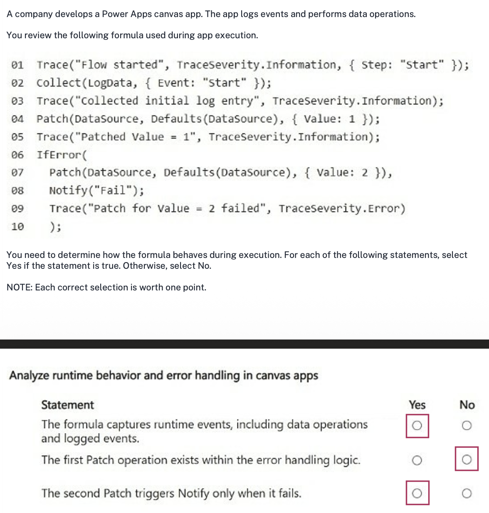

1. **Correct Answer:**
* **The formula captures runtime events, including data operations and logged events:** `Yes`

* **The first Patch operation exists within the error handling logic:** `No`

* **The second Patch triggers Notify only when it fails:** `Yes`

2. **Core Concept & Domain:** Canvas App Telemetry, Monitoring & Error Handling (`Trace()`, `IfError()`, and `Notify()` in Power Fx) — specifically evaluating execution flow, telemetry logging to Azure Application Insights / Power Apps Monitor, and structured error handling around data mutations (`Patch()`).

3. **Why It Is Correct:**
* **Statement 1 (`Yes`):** Lines `01`, `03`, `05`, and `09` invoke `Trace(...)` (which sends custom telemetry events to Power Apps Monitor and connected Azure Application Insights), while line `02` records an in-memory log entry via `Collect(LogData, ...)` and lines `04` and `07` perform data creation operations via `Patch(DataSource, Defaults(DataSource), ...)`. Together, the formula captures both runtime telemetry/logged events and data operations.

* **Statement 2 (`No`):** The first `Patch` statement appears on line `04` (`Patch(DataSource, Defaults(DataSource), { Value: 1 });`), which sits sequentially in the main formula body *before* the `IfError(` block begins on line `06`. Therefore, it is not wrapped inside error handling logic.

* **Statement 3 (`Yes`):** On lines `06`–`10`, `IfError( value1, fallback1 )` evaluates its first argument (`Patch(DataSource, Defaults(DataSource), { Value: 2 })` on line `07`). In Power Fx, `IfError()` only executes its fallback argument (`Notify("Fail"); Trace(...)` on lines `08`–`09`) when the preceding expression produces an error—if `Patch` succeeds, `Notify("Fail")` is skipped.

4. **Why Other Options Are Wrong:**
* **Selecting `No` for Statement 1:** Overlooks the explicit `Trace()` calls (`TraceSeverity.Information` and `TraceSeverity.Error`) and `Collect(LogData, ...)` statements surrounding the `Patch()` calls that log runtime execution milestones and data mutations.

* **Selecting `Yes` for Statement 2:** Confuses the second `Patch` (line `07`, which is inside `IfError()`) with the first `Patch` (line `04`, which executes outside `IfError()` without any error handler).

* **Selecting `No` for Statement 3:** Misunderstands how `IfError(Value, Replacement)` works in Power Fx; the comma `,` separates the primary expression from its error-fallback expression, whereas the semicolon `;` inside the fallback chains `Notify("Fail")` and `Trace(...)` together so both execute *only* upon failure.

5. **Exam Trap / Tip:**
* **Watch Semicolons (`;`) vs. Commas (`,`) Inside `IfError()`:** In Power Fx, commas separate `IfError()` arguments (`IfError( ExpressionToTest, FallbackAction )`), while semicolons chain multiple statements inside a single argument. On lines `07`–`09`, the comma after `Patch(...)` means *everything after the comma* (`Notify("Fail"); Trace(...)`) is the error handler for that second `Patch`. Also note that in real-world Power Apps, `IfError()` requires the *Formula-level error management* app setting to be enabled (which is on by default in modern apps).

## Q81

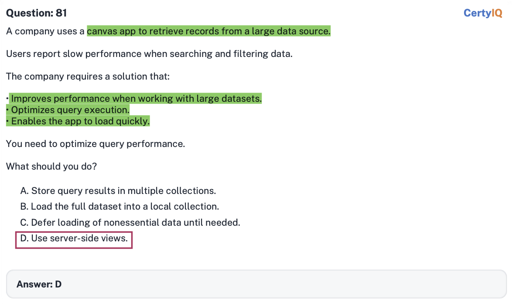

1. **Correct Answer:** D. Use server-side views.

2. **Core Concept & Domain:** Canvas App Performance Optimization & Data Delegation — specifically offloading filtering, sorting, and column projection to server-side views (such as Microsoft Dataverse views or SQL views) to minimize network payload, eliminate client-side processing bottlenecks, and ensure fast app startup and query execution on large datasets.

3. **Why It Is Correct:**
* In Microsoft Power Platform architecture, **server-side views** (such as Dataverse system/public views passed directly into `Filter(TableName, 'TableName (Views)'.'Active Records')` or SQL Server views) execute query filtering, joins, and sorting natively on the backend database server before transmitting data over the network.
* Passing a server-side view to a canvas app control (like a Gallery or Data Table) leverages **delegation** and **explicit column selection** (fetching only the columns defined in that view rather than every column on the table), which drastically reduces payload size, optimizes query execution, and enables the app to load quickly when working with large datasets.

4. **Why Other Options Are Wrong:**
* **A. Store query results in multiple collections:** Splitting data across multiple client-side collections (`Collect()` / `ClearCollect()`) still forces the canvas app to download records into device memory, does not optimize server query execution, and is subject to the 500–2,000 row non-delegable data row limit.

* **B. Load the full dataset into a local collection:** Loading an entire large dataset into memory on startup is a classic canvas app performance anti-pattern—it blocks initial screen rendering, causes severe network latency and memory exhaustion on mobile devices, and silently truncates datasets larger than the delegation row limit.

* **C. Defer loading of nonessential data until needed:** While lazy/deferred loading helps reduce initial screen load time, it does not optimize the underlying search and filter query execution against a large data source once the user actually searches or filters the data.

5. **Exam Trap / Tip:**
* **Key Discriminators — "large data source", "slow performance when searching and filtering", and "Optimizes query execution":** Whenever a canvas app question combines **large datasets** with **slow searching/filtering**, Power Platform best practices always favor **server-side execution** (delegable queries and **server-side views**) over client-side local collections.

## Q82

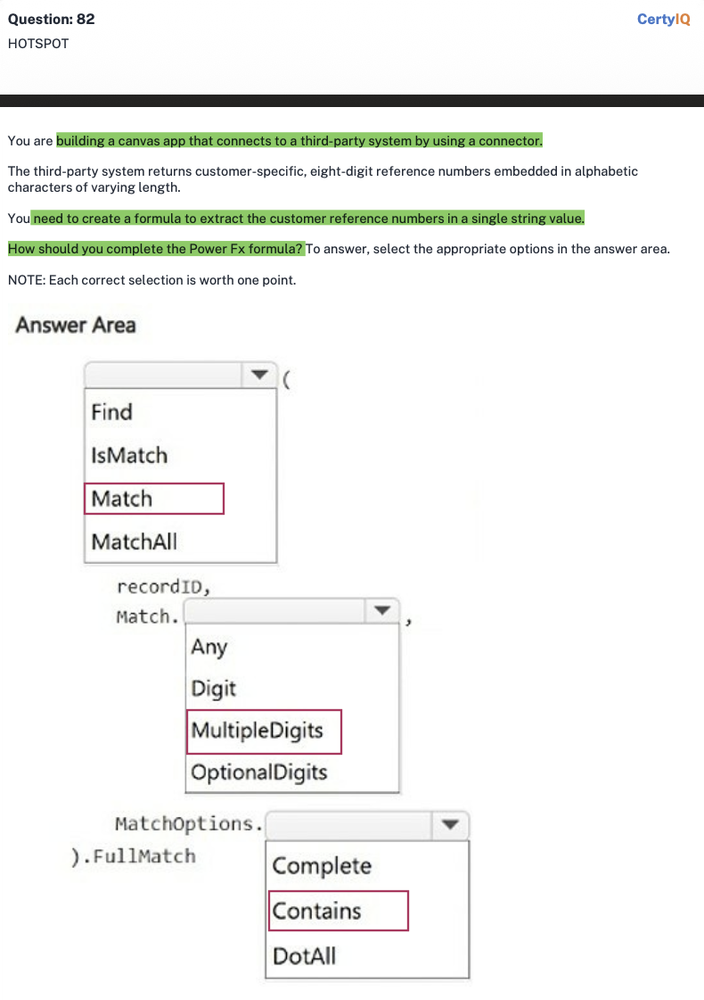

1. **Correct Answer:**
* **Dropdown 1 (Function):** `Match`

* **Dropdown 2 (`Match.` Enum):** `MultipleDigits`

* **Dropdown 3 (`MatchOptions.` Enum):** `Contains`

2. **Core Concept & Domain:** Canvas App Power Fx String Manipulation & Regular Expression Pattern Matching (`Match()`, `Match` enumeration, and `MatchOptions` enumeration) — specifically extracting a multi-digit substring embedded inside variable-length text into a single text value.

3. **Why It Is Correct:**
* **Dropdown 1 — `Match`:** In Power Fx, `Match( Text, Format, Options )` searches a string for a regular expression pattern and returns a **single record** containing the matched substring in its `.FullMatch` property. Because the formula ends with `).FullMatch` and the requirement asks to extract the reference number *"in a single string value"*, `Match` is the exact function required.

* **Dropdown 2 — `MultipleDigits`:** The scenario states the target value is an *"eight-digit reference number"*. In Power Fx's `Match` enumeration, `Match.MultipleDigits` maps to the regular expression `\d+` (one or more consecutive digits), capturing the entire 8-digit sequence rather than just a single digit.

* **Dropdown 3 — `Contains`:** Because the eight-digit reference number is *"embedded in alphabetic characters of varying length"* (e.g., `"ABC12345678XYZ"`), the pattern does not span the entire string from start to finish. `MatchOptions.Contains` instructs Power Fx to search anywhere inside `recordID` for the matching substring (which is also the default behavior for `Match`, whereas `Complete` requires the entire input string to consist solely of digits).

4. **Why Other Options Are Wrong:**
* **Dropdown 1 — `Find`, `IsMatch`, `MatchAll`:**
* `Find()` returns a numeric starting character index (not a record with a `.FullMatch` property).

* `IsMatch()` returns a Boolean (`true`/`false`) rather than extracting the matched text.

* `MatchAll()` returns a **table** of match records rather than a single record, so appending `.FullMatch` directly to `MatchAll(...)` causes a Power Fx formula syntax/type error.

* **Dropdown 2 — `Any`, `Digit`, `OptionalDigits`:**
* `Match.Any` maps to `.` (any single character), which would match the alphabetic characters instead of isolating the digits.

* `Match.Digit` maps to `\d` (a single digit), which would only extract the first digit (`"1"`) instead of the full eight-digit reference number.

* `Match.OptionalDigits` maps to `\d*` (zero or more digits), which matches an empty string `""` at the very first alphabetic character when combined with `MatchOptions.Contains`.

* **Dropdown 3 — `Complete`, `DotAll`:**
* `MatchOptions.Complete` forces the entire `recordID` string to match `MultipleDigits` from start to end (`^\d+$`), which fails whenever alphabetic characters surround the digits.

* `MatchOptions.DotAll` modifies wildcard `.` behavior to match newline characters (`\n`), which is irrelevant when matching `Match.MultipleDigits`.

5. **Exam Trap / Tip:**
* **Look at the Trailing `.FullMatch` Property & `OptionalDigits` Trap:** The trailing `).FullMatch` immediately eliminates `IsMatch` (Boolean), `Find` (Number), and `MatchAll` (Table), leaving only `Match` (Record). Second, avoid `Match.OptionalDigits` (`\d*`) with `Contains`—because zero digits is a valid match for `\d*`, Power Fx immediately returns an empty string `""` on the first letter instead of advancing to the eight digits.

## Q83

1. **Correct Answer:**
* **Edit an account:** `Dataverse table page`

* **Display an interface that has a third-party data source:** `Custom page`

2. **Core Concept & Domain:** Model-Driven App Page Architecture & Converged Apps (Dataverse Table Pages, Custom Pages, Dashboards, and Web Resources) — specifically selecting the appropriate model-driven app page type based on data source origin and low-code constraints.

3. **Why It Is Correct:**
* **Edit an account $\rightarrow$ `Dataverse table page`:** `Account` is a standard, native Microsoft Dataverse table. Adding a **Dataverse table page** to a model-driven app automatically generates the standard views and main forms needed to view, create, and edit Account records out-of-the-box with zero custom code and minimal development effort.

* **Display an interface that has a third-party data source $\rightarrow$ `Custom page`:** A **Custom page** is a specialized canvas app page type embedded natively inside a model-driven app (supporting full-page, dialog, or side-pane layouts). Because custom pages leverage Power Platform's 1,000+ standard, premium, and custom connectors alongside low-code Power Fx expressions, they allow makers to build custom UIs connected directly to third-party data sources without writing custom code.

4. **Why Other Options Are Wrong:**
* **`Dashboard page`:** Dashboards aggregate and display charts, views, and Power BI tiles for Dataverse data. They are designed for data visualization and KPI monitoring rather than providing an interactive data-entry form to edit an Account record or building a custom interface backed by a third-party connector.

* **`Web resource page`:** Web resources in model-driven apps rely on custom HTML, JavaScript, CSS, or image files uploaded by developers. Using a web resource page directly violates the prompt's explicit constraint to *"configure the app without using custom code"* and *"minimizing development effort"*.

5. **Exam Trap / Tip:**
* **Key Discriminators — "without using custom code" & "third-party data source":** Whenever a model-driven app question asks for a custom UI or integration with a **non-Dataverse / third-party data source** while prohibiting custom code, **Custom page** is the exact converged-app feature Microsoft tests—never a **Web resource page** (which implies HTML/JavaScript pro-code development). Conversely, standard CRUD operations on native Dataverse tables like Account always map to a **Dataverse table page**.

## Q84

1. **Correct Answer:**
* **Manage data submission failures:** `IfError`

* **Provide user-facing error feedback:** `Notify`

2. **Core Concept & Domain:** Canvas App Power Fx Error Handling & User Feedback (`IfError()` and `Notify()`) — specifically intercepting runtime data mutation exceptions (such as `Patch()` or `SubmitForm()` failures) and surfacing user-friendly notification banners inside a canvas app.

3. **Why It Is Correct:**
* **Manage data submission failures $\rightarrow$ `IfError`:** In Power Fx, `IfError( Value1, Replacement1, ... )` evaluates expressions sequentially and intercepts any runtime or data source submission errors before they crash or leave the app in an unhandled error state. When wrapping a data submission call like `Patch(...)`, `IfError` catches the failure, exposes error details via the `FirstError` and `AllErrors` context objects, and executes fallback recovery or notification logic.

* **Provide user-facing error feedback $\rightarrow$ `Notify`:** The `Notify( Message, NotificationType, Timeout )` function displays an immediate, dismissible banner message at the top of the user's active screen in the canvas app. Passing `NotificationType.Error` (e.g., `Notify("Submission failed: " & FirstError.Message, NotificationType.Error)`) renders a red error banner directly to the end user.

4. **Why Other Options Are Wrong:**
* **Dropdown 1 — `Concurrent`, `IsEmpty`, `With`:**
* `Concurrent` executes multiple independent formulas simultaneously in parallel to improve performance, not to catch or handle errors.

* `IsEmpty` checks whether a table contains zero records, which does not intercept runtime submission exceptions.

* `With` creates locally scoped named values to simplify complex formulas and improve readability, without providing exception handling.

* **Dropdown 2 — `IfError`, `Now`, `Trace`:**
* `IfError` detects and intercepts errors in logic, but it does not render any visual UI message to the user on its own.

* `Now` returns the current local date and time value.

* `Trace` logs diagnostic telemetry events silently in the background to Power Apps Monitor and Azure Application Insights for developers/admins—end users never see `Trace` output in the UI.

5. **Exam Trap / Tip:**
* **`Notify()` vs. `Trace()`:** A classic Power Fx exam distinction is audience visibility. Always map **"user-facing error feedback" / "display messages to users"** to **`Notify()`** (visible UI banner), and map **"administrator/developer diagnostics" / "Application Insights / Monitor telemetry"** to **`Trace()`** (invisible background logging).

