# Question Answers

## Q5

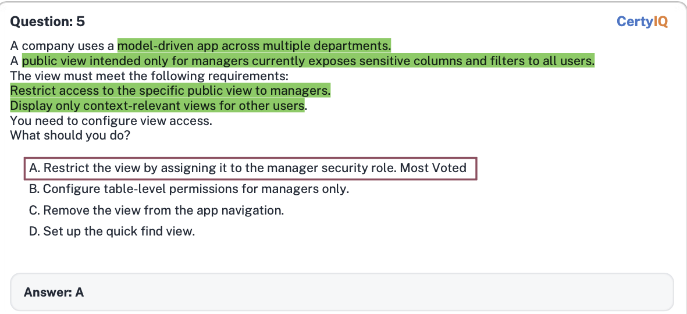

### 1. Extracted Question Summary

* **Scenario:** A company uses a model-driven app across multiple departments. A public view intended only for managers currently exposes sensitive columns and filters to all users.


* **Requirements:**
* Restrict access to the specific public view to managers.


* Display only context-relevant views for other users.


* **Question:** You need to configure view access. What should you do?


* **Options:**
* **A.** Restrict the view by assigning it to the manager security role. *(Marked "Most Voted")*


* **B.** Configure table-level permissions for managers only.


* **C.** Remove the view from the app navigation.


* **D.** Set up the quick find view.


---

### 2. Correct Answer

* **A: Restrict the view by assigning it to the manager security role.**


---

### 3. Verification of Visible Selection / Community Key

* The visible community selection (**Option A**, labeled "Most Voted") is **Correct** because Dataverse supports role-based view management, allowing administrators to restrict specific public views to designated security roles.


---

### 4. Official Microsoft Justification

* In Microsoft Dataverse and model-driven apps, **manage access to public views** (role-based views) allows makers and administrators to associate specific public views with one or more Dataverse security roles.
* By default, public views are visible to all users who have read access to the underlying table. Configuring **View Settings** to restrict access to specific security roles (such as the manager security role) ensures that only users assigned that role see the view in the view selector, decluttering the UI for other departments while keeping the view available inside the app for managers.
* *Important Architectural Caveat:* While role-based views hide the view from the UI for non-managers, they are a user-experience and view-visibility control rather than a hard data-security boundary—users with table read access could still query those columns via Advanced Find or APIs unless **Column Security Profiles (Field-Level Security)** are also applied. However, strictly within the scope of configuring *view access* and showing context-relevant views per role, assigning the view to the security role is the exact platform feature designed for this requirement.

---

### 5. Distractor Analysis (Why Others Are Wrong)

* **B. Configure table-level permissions for managers only:** Blocking table-level permissions for non-managers would prevent other departments from viewing *any* records or context-relevant views for that table, breaking the requirement to display context-relevant views for other users.


* **C. Remove the view from the app navigation:** Removing the view from the app designer's included views removes it for *everyone* using that app, including managers, failing the requirement that managers retain access to the view.


* **D. Set up the quick find view:** A Quick Find view defines the search behavior and filter columns used when a user searches a table; it does not restrict access to a specific public view by user role.


---

### 6. Exam Keyword / Trap Alert

* **Trigger Phrases:** *"Restrict access to the specific public view"* and *"Display only context-relevant views"* map directly to **Role-Based Views** (assigning security roles to a public view in Power Apps).
* **Exam Trap:** Do not confuse **view visibility** (hiding a public view via security roles) with **hard column security**—if a future question states that non-managers must be prevented from accessing sensitive field data *anywhere* in Dataverse (including exports or APIs), the answer shifts to **Column Security Profiles**.

---

### Feedback on Your Updated Gem Instructions

Your updated Gem instructions are well-structured and cleanly address multi-image handling, dump verification, and Microsoft Learn alignment. A quick refinement to consider before finalizing them:

* **Drop the hardcoded URL in Section 4:** Instead of pinning a single certification overview URL (`.../intelligent-applications-builder-associate/...`), instruct the model to cite the specific **Microsoft Learn documentation topic or feature area** (e.g., *Power Apps model-driven app views*, *Dataverse security roles*, *Copilot Studio topics*). That prevents the model from forcing a generic certification landing page link when explaining specific technical mechanisms.


---

## Q6


### 1. Extracted Question Summary

* **Scenario:** You create a parent entity (table) and a child entity (table), where the parent entity has a 1:N relationship with the child entity. When the owner changes on the parent record, all child records must be assigned to the new owner.


* **Question:** You need to configure the relationship behavior type. What should you use?


* **Options:**
* **A.** Referential, Restrict Delete


* **B.** Referential


* **C.** Restrict


* **D.** Parental *(Highlighted inside red box, labeled "Most Voted", and marked "Answer: D")*


---

### 2. Correct Answer

* **D: Parental**


---

### 3. Verification of Visible Selection / Community Key

* The visible selection (**Answer: D**, boxed in red and labeled "Most Voted") is **Correct** because the **Parental** relationship behavior preset automatically cascades record ownership changes (**Assign: Cascade All**) from a parent record to all associated child records.


---

### 4. Official Microsoft Justification

* Under Microsoft Learn documentation for **Create and edit 1:N (one-to-many) or N:1 (many-to-one) table relationships in Microsoft Dataverse** (part of the Intelligent Applications Builder Associate learning path), relationship **Type of behavior** defines how actions performed on a parent table record propagate to related child table records.
* Selecting **Parental** configures every cascading rule—**Assign**, **Share**, **Unshare**, **Reparent**, and **Delete**—to **Cascade All**. When the **Assign** action is set to *Cascade All*, changing the owner on the parent record automatically reassigns all related child records to that same new owner.
* *(Note on Terminology: The question uses the legacy Dataverse term "entity," which corresponds to **Table** in current Microsoft Power Platform documentation.)*

---

### 5. Distractor Analysis (Why Others Are Wrong)

* **A. Referential, Restrict Delete:** Sets **Assign** to *Cascade None* (changing the parent owner does not reassign child records) and blocks deleting a parent record if any child records exist.


* **B. Referential:** Sets **Assign** to *Cascade None* (child records retain their existing owners when the parent owner changes) and sets **Delete** to *Remove Link*.


* **C. Restrict:** Is not a valid standalone relationship behavior preset in Dataverse (the available presets are *Parental*, *Referential*, *Referential, Restrict Delete*, and *Custom*).


---

### 6. Exam Keyword / Trap Alert

* **Trigger Phrase:** *"when the owner changes on the parent record that all child records are assigned to the new owner"* maps directly to **Assign: Cascade All**, the signature behavior of a **Parental** relationship.


* **Exam Trap:** If a scenario asks to cascade ownership changes (*Assign*) to child records *without* cascading deletions when a parent record is deleted, **Parental** will fail—you must select **Custom** behavior instead and configure *Assign = Cascade All* while keeping *Delete = Remove Link* or *Restrict*.

---

### Thoughts on Your Updated Gem Instructions

Your updated Gem instructions are ready to save and use as-is—the 6-part schema, silent intake rules, dump-key verification, and terminology normalization work reliably across single-choice, multi-select, and annotated screenshots.

One small polish if you want to make them even cleaner before pasting into your Gem:

* **Refine Section 4's citation rule:** Instead of pinning the static certification landing page URL (`.../intelligent-applications-builder-associate/?practice-assessment-type=certification`), change that bullet to: *"Cite the specific Microsoft Learn documentation topic or architectural rule (e.g., Dataverse table relationship behaviors, Role-based views, Formula vs. Calculated columns)."* That ensures the model names the exact official documentation topic for every question rather than repeating a generic certification overview URL.


---

## Q7

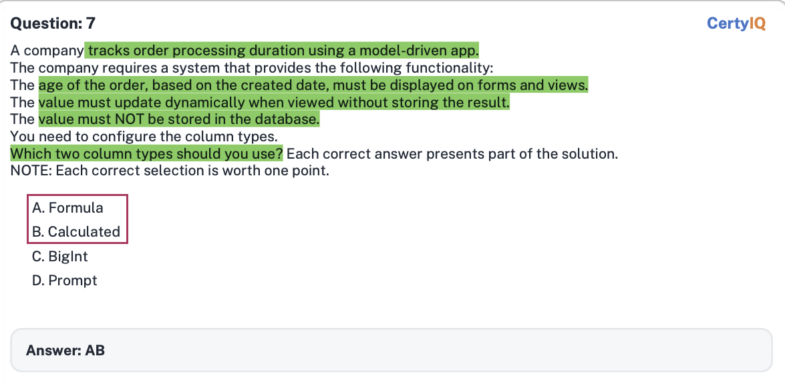


### 1. Extracted Question Summary

* **Scenario:** A company tracks order processing duration using a model-driven app.


* **Requirements:**
* The age of the order, based on the created date, must be displayed on forms and views.


* The value must update dynamically when viewed without storing the result.


* The value must NOT be stored in the database.


* **Question:** You need to configure the column types. Which two column types should you use? (Each correct answer presents part of the solution).


* **Options:**
* **A.** Formula *(Highlighted inside red box)*


* **B.** Calculated *(Highlighted inside red box)*


* **C.** BigInt


* **D.** Prompt


* **Visible Answer Key:** `Answer: AB`


---

### 2. Correct Answer

* **A: Formula** and **B: Calculated**


---

### 3. Verification of Visible Selection / Community Key

* The visible selection (**Answer: AB**, boxed in red) is **Correct**. Both **Formula** columns (using Power Fx functions like `DateDiff(CreatedOn, Now())` or `UTCNow()`) and **Calculated** columns (using traditional Dataverse calculated field actions like `DIFFINDAYS(createdon, NOW())`) compute values dynamically at read time whenever a record is retrieved on a form or view, without persisting the computed result in the underlying Dataverse database table.


---

### 4. Official Microsoft Justification

* Under Microsoft Learn documentation for **Formula columns in Microsoft Dataverse** and **Define calculated columns in Microsoft Dataverse**:
* **Formula columns (A):** Use Power Fx expressions to perform real-time, read-only calculations on Dataverse records. Because they are evaluated dynamically on retrieval (using non-deterministic date/time functions such as `Now()` or `UTCNow()` against `CreatedOn`), the resulting value is never stored physically in the database.


* **Calculated columns (B):** Use classic Dataverse calculation rules (supporting built-in functions such as `NOW()`, `DIFFINDAYS()`, and `DIFFINHOURS()`) to compute values on-the-fly when a record is queried or displayed in forms, views, charts, or reports. Like formula columns, calculated columns execute dynamically upon read and do not store the calculated output in the database.


---

### 5. Distractor Analysis (Why Others Are Wrong)

* **C. BigInt:** A standard whole-number data type (`BigInt` / 64-bit integer) that stores static, persisted integer values directly in the database; it cannot dynamically compute elapsed time on read.


* **D. Prompt:** An AI Builder / Copilot Studio prompt column type in Dataverse that executes generative AI prompts when records are created or updated and stores the generated text output in the database rather than calculating real-time date durations on read.


---

### 6. Exam Keyword / Trap Alert

* **Trigger Phrases:** *"update dynamically when viewed without storing the result"* and *"value must NOT be stored in the database"* are the classic Dataverse architectural signatures distinguishing **Formula** and **Calculated** columns (evaluated at read time, unpersisted) from **Rollup** columns (which *are* stored in the database and updated asynchronously via scheduled system jobs).


* **Exam Trap:** Do not confuse **Calculated/Formula** columns with **Rollup** columns—Rollup columns store their aggregated values in the database and refresh periodically (or via manual recalculation), whereas Formula and Calculated columns calculate live on every read and never store the result.

---

## Q8


### 1. Extracted Question Summary

* **Scenario:** You are designing a data model using only standard Microsoft Dataverse tables and must extend the existing **Accounts** and **Contacts** tables to support three business requirements.


* **Question:** Drag and drop the appropriate components to the correct requirements (components may be used once, more than once, or not at all).


* **Available Components:**
* `Alternate key`


* `Choice column`


* `Lookup column`


* `Customer column`


* **Target Requirements:**
1. Add a classification value to the Accounts table.


2. Add a customer engagement tier to the Contacts table.


3. Improve lookup performance and enforce uniqueness.


---

### 2. Correct Answer

| Requirement | Correct Component |
| --- | --- |
| **Add a classification value to the Accounts table.**

 | **Choice column**

 |
| **Add a customer engagement tier to the Contacts table.**

 | **Choice column**

 |
| **Improve lookup performance and enforce uniqueness.**

 | **Alternate key**

 |

---

### 3. Verification of Visible Selection / Community Key

* The Answer Area in the screenshot is blank (no drag-and-drop selections or community answer key are visible). Notice the prompt rule: *"You may use each component once, more than once, or not at all"*—this explicitly authorizes reusing **Choice column** for both the first and second requirements.


---

### 4. Official Microsoft Justification

* **Choice column (Requirements 1 & 2):** Under Microsoft Learn documentation for **Create and edit columns in Microsoft Dataverse**, a **Choice** (formerly Option Set) column provides a standardized dropdown list of discrete, predefined values. Both an Account *classification* (e.g., Partner, Vendor, Prospect) and a Contact *engagement tier* (e.g., Bronze, Silver, Gold) represent finite, categorical sets of values best modeled with Choice columns (either local choices or reusable global choices).
* **Alternate key (Requirement 3):** Under Microsoft Learn documentation for **Define alternate keys to reference rows in Microsoft Dataverse**, creating an **Alternate key** on one or more columns automatically creates a unique database index on those columns. This enforces uniqueness across the selected fields and improves query/lookup performance—especially when integrating external systems or upserting records via APIs/Power Automate without knowing the internal Dataverse GUID.

---

### 5. Distractor Analysis (Why Others Are Wrong)

* **Lookup column:** Creates a many-to-one (`N:1`) relationship linking a row to a single parent row in another table. Neither a classification value nor an engagement tier requires a separate relational table when the available options are fixed categorical labels, and lookup columns do not enforce uniqueness across arbitrary selected fields.


* **Customer column:** A special polymorphic lookup column in Dataverse that allows a record to reference *either* an **Account** or a **Contact** row in a single field. It is used to associate a record with a customer entity, not to store categorical classification/tier attributes or enforce column uniqueness.


---

### 6. Exam Keyword / Trap Alert

* **Trigger Phrases:**
* *"classification value"* and *"engagement tier"* $\rightarrow$ Discrete, predefined option lists $\rightarrow$ **Choice column**.


* *"improve lookup performance and ensure uniqueness across selected fields"* $\rightarrow$ Database-level unique indexing for external/business identifiers $\rightarrow$ **Alternate key**.


* **Exam Trap:** Candidates often hesitate to reuse an option in drag-and-drop questions and mistakenly pick **Lookup column** for one of the first two rows. Always check the prompt instructions: when Microsoft states *"You may use each component once, more than once, or not at all,"* reusing a component like **Choice column** is frequently the exact intended solution.


## Q9


### 1. Extracted Question Summary

* **Scenario:** A company maintains a Power Platform solution containing prompts, cloud flows, and Dataverse components, with multiple development teams responsible for different features.


* **Requirements:**
* Teams must develop and update features independently.


* Updates must not overwrite changes made by other teams.


* Production deployments must remain controlled and predictable.


* **Question:** Recommend an Application Lifecycle Management (ALM) approach that supports independent development and controlled deployment in line with Microsoft best practices.


* **Options:**
* **A.** Create and maintain separate solutions in a single development environment. Deploy independently as managed solutions.


* **B.** Make changes in a single solution. Deploy updates directly to production.


* **C.** Create and maintain separate solutions in a separate development environment. Deploy independently as managed solutions *(Labeled "Most Voted")*.


* **D.** Create unmanaged solutions in production. Merge changes during deployment.


* **Visible Answer Key:** `Answer: C`


---

### 2. Correct Answer

* C: Create and maintain separate solutions in a separate development environment. Deploy independently as managed solutions.


---

### 3. Verification of Visible Selection / Community Key

* The visible selection (**Answer: C**, labeled "Most Voted") is **Correct**. Isolating work into separate unmanaged solutions within dedicated development environments—paired with source control and deploying downstream as **managed solutions**—prevents teams from overwriting shared component definitions during active development while enabling controlled, predictable releases into test and production environments.


---

### 4. Official Microsoft Justification

* Under Microsoft Learn documentation for **Application Lifecycle Management (ALM) with Microsoft Power Platform** (*Organize solutions* and *ALM basics with Microsoft Power Platform*):
* **Environment Isolation:** Multiple development teams working on overlapping or shared Dataverse tables, flows, and AI prompts should work in **isolated development environments** (backed by source control such as Git/Azure DevOps) rather than a single shared dev environment. In a shared environment, modifying the same underlying component (such as a table form, view, or flow) causes active unmanaged layer collisions and last-writer-wins overwrites.
* **Solution Segmentation & Managed Deployments:** Segmenting features into **separate solutions** (with a shared base/core solution for common dependencies and feature-specific solutions for each team) and exporting them as **managed solutions** ensures deterministic layering, clean upgrades/patches, and controlled promotion through validation/test stages into production.


---

### 5. Distractor Analysis (Why Others Are Wrong)

* **A. Create and maintain separate solutions in a single development environment. Deploy independently as managed solutions:** In Dataverse, all unmanaged solutions inside the *same* development environment share a single **unmanaged active layer**. If two teams edit the same shared table, form, or flow inside one environment—even across separate solutions—their unmanaged changes directly overwrite one another.


* **B. Make changes in a single solution. Deploy updates directly to production:** Violates both requirements—a single monolithic solution creates merge/dependency bottlenecks across teams, and deploying directly to production bypasses testing/staging gates, making releases unpredictable.


* **D. Create unmanaged solutions in production. Merge changes during deployment:** Directly violates Microsoft ALM best practices. Production environments must never be used for active unmanaged development or manual change merging; production should only receive tested **managed solutions**.


---

### 6. Exam Keyword / Trap Alert

* **Trigger Phrases:** *"Multiple development teams"*, *"develop and update... independently"*, *"must not overwrite changes"*, and *"controlled and predictable"* $\rightarrow$ **Separate development environments + Separate solutions + Managed deployments**.


* **Exam Trap:** Option **A** is the classic distractor. Candidates often think putting two solutions in the *same* dev environment isolates changes, forgetting that Dataverse merges all unmanaged customizations in a single environment into one shared active layer. True isolation requires **separate development environments**.


## Q10


### 1. Extracted Question Summary

* **Scenario:** A company is designing a Power Platform solution that includes a model-driven app used by customer service representatives to manage support cases.


* **Requirements:**
* Users must interact with system-generated responses while working within forms and views.


* Responses must reflect the current data and context in the app.


* Users must remain within the app while interacting with the solution.


* **Question:** You need to recommend solution components for the app. Which two components should you recommend? (Each correct answer presents a complete solution).


* **Options:**
* **A.** Business rules


* **B.** Copilot Studio agent


* **C.** Smart assist


* **D.** App assistant agent


* **Visible Answer Key:** `Answer: BD`


---

### 2. Correct Answer

* **B: Copilot Studio agent** and **D: App assistant agent**


---

### 3. Verification of Visible Selection / Community Key

* The visible selection (**Answer: BD**) is **Correct**. Both a custom **Copilot Studio agent** embedded/connected inside a model-driven app and the native **App assistant agent** (Copilot in model-driven apps) operate directly inside the app's side pane, read the active form/view data context, generate conversational AI responses, and keep users inside the app without context-switching.


---

### 4. Official Microsoft Justification

* Under Microsoft Learn documentation for **Add a Copilot Studio agent to a model-driven app** and **Use Copilot (App assistant) in model-driven apps** (part of the AB-620 Intelligent Applications Builder Associate learning path):
* **Copilot Studio agent (B):** Makers can connect or embed an interactive Copilot Studio agent directly within a model-driven app's Copilot side pane. By passing app context (such as current table name, record ID, and form/view data), the agent generates context-aware responses while the user remains inside the model-driven app.


* **App assistant agent (D):** The built-in Copilot / App assistant agent in model-driven apps provides an integrated conversational experience directly alongside forms and views. It automatically understands the current record and view context in Dataverse, answers natural-language questions about the active data, and keeps representatives working entirely within the app interface.


---

### 5. Distractor Analysis (Why Others Are Wrong)

* **A. Business rules:** Execute deterministic client-side or server-side form logic (such as showing/hiding columns, setting field values, or displaying static error messages). They do not provide conversational or system-generated interactive responses across forms and views.


* **C. Smart assist:** A legacy Dynamics 365 Customer Service / Omnichannel productivity pane feature that surfaces static suggestion cards (such as similar cases or knowledge articles) during live conversations, rather than a modern Power Platform model-driven app component providing interactive, context-aware conversational responses across forms and views.


---

### 6. Exam Keyword / Trap Alert

* **Trigger Phrases:** *"system-generated responses while working within forms and views"*, *"reflect the current data and context in the app"*, and *"remain within the app"* $\rightarrow$ **Copilot Studio agent** and **App assistant agent**.


* **Exam Trap:** Notice the instruction **"Each correct answer presents a complete solution"**. In AB-620 questions, when Microsoft asks for two independent in-app conversational AI mechanisms that can read active model-driven app form/view context without leaving the app, **Copilot Studio agent** (custom conversational agent) and **App assistant agent** (built-in model-driven app Copilot) are the two standard Power Platform capabilities.

## Q11

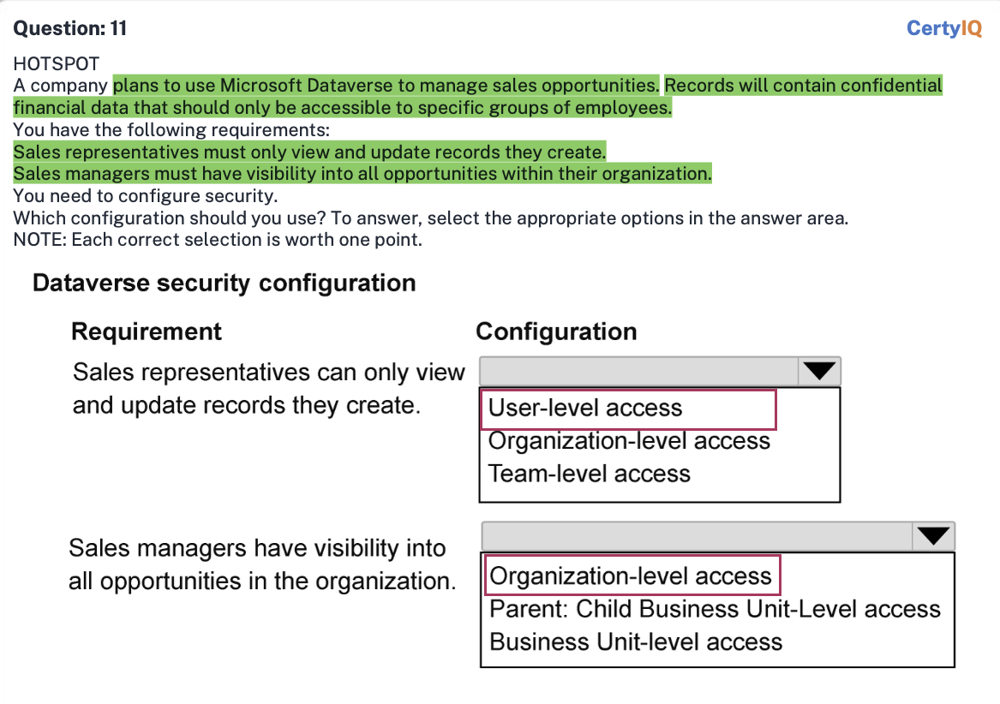

### 1. Extracted Question Summary

* **Scenario:** A company plans to use Microsoft Dataverse to manage sales opportunities containing confidential financial data accessible only to specific groups of employees.


* **Requirements:**
* Sales representatives must only view and update records they create.


* Sales managers must have visibility into all opportunities within their organization.


* **Question:** Select the appropriate Dataverse security configuration options in the answer area.


* **Dropdown Options:**
* **Requirement 1:** *Sales representatives can only view and update records they create* — Options: `User-level access`, `Organization-level access`, `Team-level access`.


* **Requirement 2:** *Sales managers have visibility into all opportunities in the organization* — Options: `Organization-level access`, `Parent: Child Business Unit-Level access`, `Business Unit-level access`.


---

### 2. Correct Answer

| Requirement | Correct Configuration |
| --- | --- |
| **Sales representatives can only view and update records they create.**

 | **User-level access**

 |
| **Sales managers have visibility into all opportunities in the organization.**

 | **Organization-level access**

 |

---

### 3. Verification of Visible Selection / Community Key

* The answer area in the screenshot shows expanded dropdown menus with no pre-selected answers or community answer key visible. Both selections map directly to Dataverse's standard record-level privilege depth tiers.


---

### 4. Official Microsoft Justification

* Under Microsoft Learn documentation for **Security roles and privileges in Microsoft Dataverse**, user-owned and team-owned tables enforce access depth across four standard privilege levels:
* **User-level access (Basic):** Grants access strictly to records that the user owns (which by default includes records they create) or records explicitly shared with them. Setting **Read** and **Write** privileges to **User** level for the Sales Representative security role ensures representatives can only view and update their own records.


* **Organization-level access (Global):** Grants access to all records across the entire Dataverse environment regardless of business unit hierarchy or individual record ownership. Setting **Read** privilege to **Organization** level for the Sales Manager security role gives managers visibility into every opportunity across the entire organization.


---

### 5. Distractor Analysis (Why Others Are Wrong)

* **Requirement 1 Distractors:**
* **Organization-level access:** Would allow sales representatives to view and update *everyone's* confidential opportunity records across the company, violating the requirement.


* **Team-level access:** Is not a standalone privilege depth tier in Dataverse security roles (team-owned records are governed by the team's assigned security role privileges, typically at *User* or *Business Unit* depth).


* **Requirement 2 Distractors:**
* **Parent: Child Business Unit-Level access (Deep):** Restricts managers to records within their own business unit and any subordinate child business units, excluding sibling or parent business units elsewhere in the organization.


* **Business Unit-level access (Local):** Restricts managers strictly to records owned by users in their immediate business unit, hiding opportunities owned by other business units in the organization.


---

### 6. Exam Keyword / Trap Alert

* **Trigger Phrases:**
* *"only view and update records they create"* $\rightarrow$ **User-level access**.


* *"visibility into all opportunities within their organization"* $\rightarrow$ **Organization-level access**.


* **Exam Trap:** Watch the boundary wording carefully—if a question states *"within their own department and regional sub-departments,"* the answer shifts to **Parent: Child Business Unit-Level access**; when it explicitly says *"within their organization"* or *"in the organization,"* always choose **Organization-level access**.


## Q12


### 1. Extracted Question Summary

* **Scenario:** A company uses Power Apps. Users must be able to view only the `address1` columns in the **Account** table.


* **Requirement:** Ensure other address columns (such as `address2` or `address3` fields) are not visible to users when creating views and filters.


* **Question:** What should you do?


* **Options:**
* **A.** Use column-level security to remove read access to all users.


* **B.** Create business rules to hide the other address columns.


* **C.** Delete the other address columns from the table.


* **D.** Disable the Search option for the columns *(Highlighted inside red box, labeled "Most Voted", and marked "Answer: D")*.


---

### 2. Correct Answer

* D: Disable the Search option for the columns.


---

### 3. Verification of Visible Selection / Community Key

* The visible selection (**Answer: D**, boxed in red and labeled "Most Voted") is **Correct**. Setting a Dataverse column's **Searchable** (`IsValidForAdvancedFind`) property to **No** (disabling the Search option) hides that column from the column picker when users build personal views, Advanced Find queries, and grid filter conditions.


---

### 4. Official Microsoft Justification

* Under Microsoft Learn documentation for **Create and edit columns in Microsoft Dataverse** (*Advanced options — Searchable*):
* Each Dataverse column includes a **Searchable** property (exposed in the Power Apps maker portal under *Advanced options* as the **Searchable** checkbox, corresponding to the metadata attribute `IsValidForAdvancedFind`).
* When **Searchable** is disabled (set to `False`), the column no longer appears in the **Edit columns** or **Edit filters** dialogs when users create or customize personal views and grid filters in a model-driven app. This directly fulfills the requirement to prevent other address columns from appearing while users create views and filters without breaking underlying platform dependencies.


---

### 5. Distractor Analysis (Why Others Are Wrong)

* **A. Use column-level security to remove read access to all users:** Even if column-level security restricts data values (masking values with `****`), the column name still remains visible in the view/filter column selector unless its **Searchable** property is disabled—and system administrators still retain full access by default.


* **B. Create business rules to hide the other address columns:** Business rules only control field visibility on **forms**; they have no effect on which columns appear in the view designer or Advanced Find filter builders.


* **C. Delete the other address columns from the table:** Standard out-of-the-box system columns on the **Account** table (such as `address2_*` fields) are managed system components and cannot be deleted from Dataverse.


---

### 6. Exam Keyword / Trap Alert

* **Trigger Phrase:** *"not visible to users when creating views and filters"* $\rightarrow$ **Disable the Search option (Searchable = No)**.


* **Exam Trap:** Do not confuse **form visibility** (Business Rules / form field properties) or **data masking** (Column-Level Security) with **view/filter picker visibility**—hiding a column from Advanced Find and view/filter builders is specifically controlled by the column's **Searchable** metadata setting.


## Q13

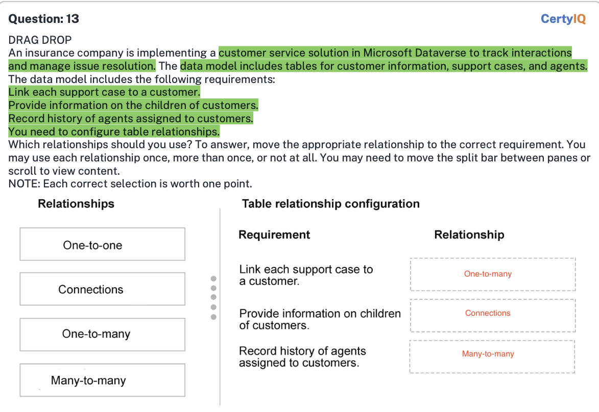

### 1. Extracted Question Summary

* **Scenario:** An insurance company is implementing a customer service solution in Microsoft Dataverse with tables for customer information, support cases, and agents.


* **Question:** Drag and drop the appropriate relationship types to the correct requirements (each relationship may be used once, more than once, or not at all).


* **Available Relationships:**
* `One-to-one`


* `Connections`


* `One-to-many`


* `Many-to-many`


* **Target Requirements:**
1. Link each support case to a customer.


2. Provide information on children of customers.


3. Record history of agents assigned to customers.


---

### 2. Correct Answer

| Requirement | Correct Relationship |
| --- | --- |
| **Link each support case to a customer.**

 | **One-to-many**

 |
| **Provide information on children of customers.**

 | **Connections**

 |
| **Record history of agents assigned to customers.**

 | **Many-to-many** *(or **Connections** — see important nuance below)*

 |

---

### 3. Verification of Visible Selection / Community Key

* The answer area in the screenshot is blank (no drag-and-drop selections or community key are visible).


* **Important Certification Note on Row 2 vs. Row 3:** In official Microsoft Power Platform exam items of this exact pattern, **Connections** is specifically tested for flexible, role-based personal/family relationships (such as *Child*, *Spouse*, or *Beneficiary* on a customer record without creating dedicated tables), while **One-to-many** links one customer to multiple support cases, and **Many-to-many** links customers to multiple assigned agents over time. (In real-world Dataverse architecture, if you need metadata such as assignment start/end dates on the history itself, you would use a custom intersect table or Connections with roles; however, within the standard 4-choice exam drag-and-drop mapping, **Many-to-many** is the standard table relationship option paired with the third slot).


---

### 4. Official Microsoft Justification

* **One-to-many (Requirement 1 — Link each support case to a customer):** Under Microsoft Learn documentation for **Create and edit 1:N (one-to-many) or N:1 (many-to-one) table relationships in Microsoft Dataverse**, a single customer can open multiple support cases, while each support case belongs to one customer. Configuring a `1:N` relationship from Customer to Support Case places a lookup column on the Support Case table.


* **Connections (Requirement 2 — Provide information on children of customers):** Under Microsoft Learn documentation for **Configure connection roles in Microsoft Dataverse**, **Connections** provide a flexible way to associate records across tables (or within the same table, such as Contact-to-Contact) using descriptive **Connection Roles** (e.g., *Parent* / *Child*, *Dependent*) and optional descriptions, without requiring rigid schema changes or dedicated child tables.


* **Many-to-many (Requirement 3 — Record history of agents assigned to customers):** Under Microsoft Learn documentation for **Create N:N (many-to-many) table relationships in Microsoft Dataverse**, multiple agents can be assigned to a customer over time, and each agent handles many customers. An `N:N` relationship (either native or manual intersect) models multi-agent-to-multi-customer associations.


---

### 5. Distractor Analysis (Why Others Are Wrong)

* **One-to-one:** Dataverse does not provide a separate native "One-to-one" relationship type in the maker portal (a 1:1 pattern is only simulated via a 1:N relationship with unique constraints), and none of the three requirements represent a strict 1:1 cardinality (a customer can have multiple cases, multiple children, and multiple assigned agents over time).


---

### 6. Exam Keyword / Trap Alert

* **Trigger Phrases:**
* *"Link each [child record] to a [parent]"* $\rightarrow$ **One-to-many** (`1:N`).


* *"children of customers"* / family or role-based associations $\rightarrow$ **Connections** (using Connection Roles).


* *"agents assigned to customers"* (multiple agents $\leftrightarrow$ multiple customers) $\rightarrow$ **Many-to-many** (`N:N`).


* **Exam Trap:** Candidates often reverse **Connections** and **Many-to-many**. Remember: Microsoft specifically uses **Connections** in exam scenarios involving personal, family, or ad-hoc role relationships (like *children*, *spouses*, or *referrers* of a customer), whereas core operational entity pairings (like *Agents* and *Customers*) map to standard **Many-to-many** (`N:N`) table relationships.


## Q14


### 1. Extracted Question Summary

* **Scenario:** A company develops and deploys AI-enabled Power Platform solutions across multiple environments where environment access is controlled through security groups. All developers require access to the same shared environment, and the environment must be subject to Application Lifecycle Management (ALM) controls.


* **Question:** Drag and drop the appropriate environment types to the correct requirements.


* **Available Environment Types:**
* `Default`


* `Sandbox`


* `Developer`


* `Production`


* **Target Requirements:**
1. Build and validate new features


2. Host stable business workloads


---

### 2. Correct Answer

| Requirement | Correct Environment Type |
| --- | --- |
| **Build and validate new features**

 | **Sandbox**

 |
| **Host stable business workloads**

 | **Production**

 |

---

### 3. Verification of Visible Selection / Community Key

* The answer area in the screenshot is blank (no drag-and-drop selections or community key are visible). Notice the explicit constraints in the prompt: *"Environment access is controlled through security groups"* and *"All developers require access to the same environment"*. These two constraints eliminate the `Developer` environment type and lock in **Sandbox** for the first requirement.


---

### 4. Official Microsoft Justification

* **Sandbox (Requirement 1 — Build and validate new features):** Under Microsoft Learn documentation for **Environments overview** and **Establish an environment strategy** (*Power Platform Well-Architected*), a **Sandbox** environment is a non-production environment designed for shared development, testing, and validation. Crucially, unlike a personal *Developer* environment (which is restricted to a single maker/owner and does not support Microsoft Entra security group access control), a **Sandbox** environment supports **Microsoft Entra security group** access assignment, allows multiple developers to collaborate in the same environment, and supports full ALM operations (backup/restore, copy, reset, and managed solution pipelines).


* **Production (Requirement 2 — Host stable business workloads):** Under Microsoft Learn documentation for **Environments overview**, a **Production** environment is intended for permanent, live organizational operations and stable, tested workloads. It is governed by strict ALM release controls (receiving only validated managed solutions) and supports security group access control and enterprise SLA/backup governance.

---

### 5. Distractor Analysis (Why Others Are Wrong)

* **Developer:** A Developer environment (created via the Power Apps Developer Plan) is strictly a **single-user personal environment** intended for one individual maker to learn and build privately. You cannot assign a Microsoft Entra security group to grant multiple developers shared access to a Developer environment, directly violating the prompt's constraints.


* **Default:** The Default environment is automatically created per tenant and automatically grants *Environment Maker* access to all licensed users in the tenant. Because you cannot restrict access to the Default environment via a Microsoft Entra security group, Microsoft best practices explicitly prohibit using it for ALM-governed development or production workloads.


---

### 6. Exam Keyword / Trap Alert

* **Trigger Phrases:**
* *"Environment access is controlled through security groups"* + *"All developers require access to the same environment"* + *"Build and validate new features"* $\rightarrow$ **Sandbox** (not *Developer*!).


* *"Host stable business workloads"* $\rightarrow$ **Production**.


* **Exam Trap:** Seeing the words *"developers"* and *"Build... new features"* is a classic bait-and-switch for the **Developer** environment type. Always check whether the scenario requires **multi-developer collaboration** or **security group access control**—the moment either appears, **Developer** environments are disqualified and **Sandbox** is the only valid choice.


## Q15


### 1. Extracted Question Summary

* **Scenario:** A company uses Microsoft Dataverse to manage prospects and currently has a business process flow named **BPFA** associated with the **Prospect** entity (table). You add a `Category` field to Prospect and create additional business process flows applied based on the selected category.


* **Requirement:** Users can switch to any of the other newly configured business process flows, but must not use **BPFA**.


* **Question:** What are two possible ways to achieve this goal? (Each correct answer presents a complete solution).


* **Options:**
* **A.** Change the display order of the business process flows to move BPFA to the bottom of the list.


* **B.** Use a business rule.


* **C.** Deactivate BPFA *(Highlighted inside red box)*.


* **D.** Remove all of the privileges for BPFA *(Highlighted inside red box)*.


* **Visible Answer Key:** `Answer: CD`


---

### 2. Correct Answer

* **C: Deactivate BPFA** and **D: Remove all of the privileges for BPFA**


---

### 3. Verification of Visible Selection / Community Key

* The visible selection (**Answer: CD**, boxed in red) is **Correct**. Both deactivating **BPFA** globally and stripping all security role privileges for **BPFA** (via **Enable Security Roles** in the Business Process Flow designer) prevent end users from seeing, triggering, or switching to **BPFA** on Prospect records.


---

### 4. Official Microsoft Justification

* Under Microsoft Learn documentation for **Business process flows overview** and **Assign security roles to a business process flow**:
* **Deactivate BPFA (C):** Only **active** business process flows can be applied to newly created records or selected in the **Switch Process** dialog on a model-driven app form. Deactivating **BPFA** turns off the process flow instance across the environment, immediately removing it from the available business process flows for all users.


* **Remove all of the privileges for BPFA (D):** Every business process flow has an underlying Dataverse table whose access is governed by security role privileges (configurable via **Edit Security Roles** inside the Business Process Flow designer). When all privileges for **BPFA** are removed from users' security roles, Dataverse hides **BPFA** from those users and prevents them from selecting or switching to it, while leaving the other newly configured business process flows accessible.


* *(Note on Terminology: The question uses the legacy Dataverse terms "entity" and "field," which correspond to **Table** and **Column** in current Microsoft Power Platform documentation.)*

---

### 5. Distractor Analysis (Why Others Are Wrong)

* **A. Change the display order of the business process flows to move BPFA to the bottom of the list:** Changing the process flow order only determines which active business process flow is applied *by default* when a user has access to multiple flows. Users can still open the **Process $\rightarrow$ Switch Process** menu on the form and manually select **BPFA**, violating the requirement that they must not use it.


* **B. Use a business rule:** Business rules operate on table columns (showing/hiding fields, setting values, locking fields, or validating data on forms). Business rules cannot disable, hide, or switch business process flows.


---

### 6. Exam Keyword / Trap Alert

* **Trigger Phrases:** *"Users can switch to any other newly configured business process flows but must not use BPFA"* + *"two possible ways... Each correct answer presents a complete solution"* $\rightarrow$ **Deactivate** the BPF or **remove security role privileges** for the BPF.


* **Exam Trap:** Option **A** (process order) is the classic distractor. Process flow ordering only controls *default assignment* upon record creation; it does **not** block users from manually switching to a lower-ranked flow via the **Switch Process** command. To completely block usage, you must either **deactivate** the flow or **remove its security role privileges**.


## Q16


### 1. Extracted Question Summary

* **Scenario:** A company is building a prompt about product specifications and plans to use the prompt in Power Automate.


* **Requirement:** The prompt must use Retrieval-Augmented Generation (RAG) to ground the model with additional business information.


* **Question:** You need to select the available knowledge source for the prompt. What should you use?


* **Options:**
* **A.** PDF document


* **B.** PNG image


* **C.** Dataverse table columns *(Highlighted inside red box, labeled "Most Voted", and marked "Answer: C")*


* **D.** Text


---

### 2. Correct Answer

* **C: Dataverse table columns**


---

### 3. Verification of Visible Selection / Community Key

* The visible selection (**Answer: C**, boxed in red and labeled "Most Voted") is **Correct**. In AI Builder / Copilot Studio **Prompt Builder**, native **Knowledge** grounding (which performs Retrieval-Augmented Generation to dynamically retrieve relevant enterprise rows at runtime) connects directly to **Microsoft Dataverse** tables and columns.


---

### 4. Official Microsoft Justification

* Under Microsoft Learn documentation for **Use your own data in a prompt (Add knowledge to a prompt)** in AI Builder and Copilot Studio:
* Prompt Builder provides a dedicated **Knowledge** (or **Data**) section designed specifically for **Retrieval-Augmented Generation (RAG)**—retrieving relevant business records from an enterprise data store to ground the LLM's response without manually passing every record into the prompt text.


* In Power Platform Prompt Builder (when invoked from Power Automate or Copilot Studio), **Dataverse** (selecting a Dataverse table and specific filter/retrieval columns) is the native built-in knowledge source for RAG grounding. When the prompt executes in Power Automate, Prompt Builder searches the configured Dataverse table columns using the prompt's input context and injects the retrieved records into the model's context window.


---

### 5. Distractor Analysis (Why Others Are Wrong)

* **A. PDF document:** In Prompt Builder, a PDF file is passed as a **Document/File input** parameter at runtime (so the model can summarize, extract, or reason over that specific uploaded file), rather than serving as a built-in RAG knowledge source.


* **B. PNG image:** In Prompt Builder, a PNG file is passed as an **Image input** parameter for multimodal visual analysis (such as OCR or image description), not as a RAG knowledge store.


* **D. Text:** **Text** is a standard runtime **Input variable** type in Prompt Builder (used to pass dynamic strings from a Power Automate flow into the prompt template), not an indexed RAG knowledge source.


---

### 6. Exam Keyword / Trap Alert

* **Trigger Phrases:** *"building a prompt"*, *"use Retrieval-Augmented Generation to ground the model"*, and *"select the available knowledge source"* $\rightarrow$ **Dataverse table columns**.


* **Exam Trap:** Distinguish clearly between Prompt Builder **Inputs** vs. **Knowledge**:
* **Inputs** = `Text`, `Image` (PNG/JPG), and `Document` (PDF) — passed explicitly per run.


* **Knowledge (RAG)** = **Dataverse** tables/columns — queried dynamically via semantic/keyword retrieval to ground the prompt with additional business data.


## Q17


### 1. Extracted Question Summary

* **Scenario:** A company uses Dataverse to manage customer accounts and related transaction records.


* **Requirements:**
* Reference a single related record without performing any aggregations.


* Store the relationship as part of the table definition, so the platform automatically maintains the link between records.


* **Question:** You need to configure a column. Which type of column should you configure?


* **Options:**
* **A.** Formula


* **B.** Calculated


* **C.** Rollup


* **D.** Lookup *(Highlighted inside red box, labeled "Most Voted", and marked "Answer: D")*


---

### 2. Correct Answer

* **D: Lookup**


---

### 3. Verification of Visible Selection / Community Key

* The visible selection (**Answer: D**, boxed in red and labeled "Most Voted") is **Correct**. A **Lookup** column in Dataverse creates a many-to-one (`N:1`) table relationship in the metadata definition, stores the foreign key reference to a single parent record, and enforces referential integrity automatically without performing aggregations.


---

### 4. Official Microsoft Justification

* Under Microsoft Learn documentation for **Create and edit columns in Microsoft Dataverse** and **Create and edit 1:N (one-to-many) or N:1 (many-to-one) table relationships in Microsoft Dataverse**:
* Creating a **Lookup** column on a child table (such as Transactions) automatically establishes an `N:1` relationship in the Dataverse table schema linking each child record to a single parent record (such as Customer Account).


* Dataverse stores this relationship directly in the table metadata definition, automatically maintaining the relational link, enforcing cascading/referential behaviors, and rendering a record selector control on model-driven forms without computing any summary or aggregate calculations.


---

### 5. Distractor Analysis (Why Others Are Wrong)

* **A. Formula:** Uses Power Fx expressions to compute dynamic, read-only values on the fly (such as text formatting or date math); it does not define a schema-level table relationship or store a foreign-key pointer to a parent record.


* **B. Calculated:** Evaluates automated calculations using classic Dataverse calculation rules (such as `DIFFINDAYS` or arithmetic across columns) at read time; it cannot create or maintain a relational link between tables.


* **C. Rollup:** Explicitly performs **aggregations** (`SUM`, `COUNT`, `MIN`, `MAX`, `AVG`) across child records over an *existing* relationship. The prompt specifically states *"without performing any aggregations"* and asks to create the relationship itself.


---

### 6. Exam Keyword / Trap Alert

* **Trigger Phrases:** *"Reference a single related record"*, *"without performing any aggregations"*, and *"Store the relationship as part of the table definition"* $\rightarrow$ **Lookup**.


* **Exam Trap:** Watch the distinction between **Lookup** and **Rollup**—a **Lookup** column *creates* the `N:1` relationship pointer to a single parent record, whereas a **Rollup** column *aggregates* data from multiple child records across an already-established `1:N` relationship.


## Q18


### 1. Extracted Question Summary

* **Scenario:** A company uses a model-driven app to process orders added to Microsoft Dataverse from two separate point-of-sale solutions. Order numbers are stored in a column named `Number` on the `Order` table, prefixed with either `POS1-` or `POS2-`.


* **Requirement:** Configure an action on a calculated text column to store the clean order number by removing the point-of-sale system prefix.


* **Question:** Which formula should you use?


* **Options:**
* **A.** `CONCAT(Number, “4”)`


* **B.** `TRIMLEFT(Number, 4)`


* **C.** `TRIMLEFT(Number, 5)` *(Highlighted inside red box, labeled "Most Voted", and marked "Answer: C")*


* **D.** `TRIMRIGHT(Number, 5)`


* **E.** `TRIMRIGHT(Number, 4)`


---

### 2. Correct Answer

* **C: `TRIMLEFT(Number, 5)**`


---

### 3. Verification of Visible Selection / Community Key

* The visible selection (**Answer: C**, boxed in red and labeled "Most Voted") is **Correct**. Counting each character of the prefix `POS1-` or `POS2-` gives **5 characters** (`P` [1], `O` [2], `S` [3], `1`/`2` [4], `-` [5]) at the beginning (left side) of the string. `TRIMLEFT(Number, 5)` removes those first 5 leading characters, leaving only the clean order number.


---

### 4. Official Microsoft Justification

* Under Microsoft Learn documentation for **Define calculated columns in Microsoft Dataverse** (*Function syntax — TRIMLEFT*):
* `TRIMLEFT(Single line of text, Whole number)` returns a string after removing the specified number of characters from the **beginning (left)** of the input string.
* Because both prefixes (`POS1-` and `POS2-`) consist of 5 characters including the trailing hyphen (`-`), passing `5` as the character count to `TRIMLEFT(Number, 5)` strips the entire prefix and outputs the clean order identifier.


---

### 5. Distractor Analysis (Why Others Are Wrong)

* **A. `CONCAT(Number, “4”)`:** Appends the literal string `"4"` to the end of `Number` rather than removing characters from the prefix.


* **B. `TRIMLEFT(Number, 4)`:** Removes only the first 4 characters (`POS1` or `POS2`), leaving a stray leading hyphen (`-12345`) on the clean order number.


* **D. `TRIMRIGHT(Number, 5)`:** Removes 5 characters from the **end (right)** of the order number, leaving the `POS1-`/`POS2-` prefix intact while truncating the actual order digits.


* **E. `TRIMRIGHT(Number, 4)`:** Removes 4 characters from the **end (right)** of the string instead of stripping the 5-character prefix from the left.


---

### 6. Exam Keyword / Trap Alert

* **Trigger Phrases:** *"prefixed with the value POS1- or POS2-"* and *"remove the point-of-sale system prefix"* $\rightarrow$ **`TRIMLEFT`** + **exact character count including punctuation (`5`)**.


* **Exam Trap:** Option **B (`TRIMLEFT(Number, 4)`)** is a classic off-by-one trap—candidates frequently count `POS1` as 4 characters and forget to include the hyphen (`-`) as the 5th character. Always count delimiters/hyphens explicitly when calculating `TRIMLEFT` or `TRIMRIGHT` lengths!


## Q19

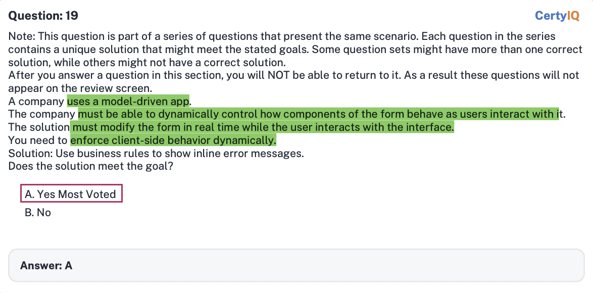

### 1. Extracted Question Summary

* **Scenario:** A company uses a model-driven app and needs to dynamically control how form components behave as users interact with the form, modifying the form in real time and enforcing client-side behavior dynamically.


* **Proposed Solution:** Use business rules to show inline error messages.


* **Question:** Does the solution meet the goal?


* **Options:**
* **A.** Yes *(Highlighted inside red box, labeled "Most Voted", and marked "Answer: A")*


* **B.** No


---

### 2. Correct Answer

* **A: Yes**


---

### 3. Verification of Visible Selection / Community Key

* The visible selection (**Answer: A**, boxed in red and labeled "Most Voted") is **Correct**. Business rules execute client-side in real time on model-driven app forms whenever column values change or the form loads, and showing inline error messages on specific columns is one of the core native actions supported by Dataverse business rules.


---

### 4. Official Microsoft Justification

* Under Microsoft Learn documentation for **Create a business rule in Microsoft Dataverse**:
* **Client-Side Real-Time Execution:** When a business rule's scope is set to a specific form or **All Forms**, Dataverse compiles the rule into client-side logic that evaluates immediately in the browser as users enter or modify data—without requiring a server round-trip or custom JavaScript.


* **Supported Form Component Actions:** Business rules natively support six real-time form actions:
1. **Show error message** (displays an inline validation error message next to a specific column and prevents saving until resolved)


2. **Set field value**
3. **Set business required**
4. **Set visibility** (show or hide columns)
5. **Lock or unlock field** (enable or disable columns)
6. **Set default value**


* Because displaying inline error messages dynamically controls form behavior and validation in real time on the client side, the proposed solution meets the stated goal.


---

### 5. Distractor Analysis (Why Others Are Wrong)

* **B. No:** Incorrect because **Show error message** is an out-of-the-box business rule action that runs dynamically on the client side as users interact with a model-driven form. *(In a "Yes/No" series of questions with this same stem, "No" would only apply if a variant proposed a server-side/asynchronous mechanism such as a Power Automate cloud flow, a synchronous/asynchronous Dataverse plug-in, or a business rule scoped strictly to `Entity` without form-level UI feedback—though note that even `Entity`-scoped rules run on forms too, whereas plug-ins and cloud flows cannot dynamically modify form UI components in real time while a user types.)*


---

### 6. Exam Keyword / Trap Alert

* **Trigger Phrases:** *"dynamically control how components of the form behave"*, *"modify the form in real time while the user interacts with the interface"*, and *"enforce client-side behavior dynamically"* $\rightarrow$ **Business rules** (or **Client-side JavaScript form scripting**).


* **Exam Trap:** Remember that this is a **repeated-scenario series** question. In upcoming variants of Question 19:


* **Business rules** (showing inline error messages, showing/hiding columns, locking columns) $\rightarrow$ **Yes**.


* **Client-side JavaScript / Form scripts** $\rightarrow$ **Yes**.
* **Power Automate cloud flows** or **Dataverse C# plug-ins** $\rightarrow$ **No** (they execute server-side upon data events rather than dynamically modifying form components in real time during user interaction).


## Q20


### 1. Extracted Question Summary

* **Scenario:** A company uses a model-driven app and must dynamically control how components of the form behave as users interact with it, modifying the form in real time and enforcing client-side behavior dynamically. *(Part of a repeated-scenario series)*.


* **Proposed Solution:** Use Power Automate cloud flows to update column values.


* **Question:** Does the solution meet the goal?


* **Options:**
* **A.** Yes


* **B.** No *(Highlighted inside red box, labeled "Most Voted", and marked "Answer: B")*


---

### 2. Correct Answer

* **B: No**


---

### 3. Verification of Visible Selection / Community Key

* The visible selection (**Answer: B**, boxed in red and labeled "Most Voted") is **Correct**. Power Automate cloud flows run **asynchronously on the server side** after a record is created, updated, or deleted in Dataverse—they do not run on the client side in real time while a user is actively interacting with a form.


---

### 4. Official Microsoft Justification

* Under Microsoft Learn documentation for **Overview of automated flows** and **Apply business logic in Microsoft Dataverse**:
* **Asynchronous Server-Side Execution:** Automated Power Automate cloud flows connected to Microsoft Dataverse execute in the background *after* a transaction commits to the server (e.g., *When a row is added, modified or deleted*).
* **No Client-Side UI Control:** Cloud flows have no access to the model-driven form's browser DOM or client-side form context (`formContext`), cannot dynamically modify form components (such as hiding/showing sections, locking fields, or displaying inline errors) in real time as a user types, and require a manual form refresh for server-updated column values to appear in the UI.


* To enforce real-time, client-side form behavior in a model-driven app, Microsoft prescribes **Business Rules** (for declarative no-code logic) or **Client-side JavaScript form scripting** (web resources bound to `OnLoad`/`OnChange` events).


---

### 5. Distractor Analysis (Why Others Are Wrong)

* **A. Yes:** Incorrect because Power Automate cloud flows operate asynchronously on the server rather than dynamically on the client side while the user interacts with the form interface.


---

### 6. Exam Keyword / Trap Alert

* **Trigger Phrases:** *"dynamically control how components of the form behave"*, *"modify the form in real time while the user interacts with the interface"*, and *"enforce client-side behavior dynamically"* $\rightarrow$ **Client-side logic only** (Business Rules or JavaScript).


* **Exam Trap:** Any proposed solution in this series that relies on **Power Automate cloud flows**, **Dataverse C# plug-ins**, or **classic background workflows** is a server-side mechanism and therefore **No** whenever the prompt requires **real-time client-side UI/form interaction**.


## Q21


### 1. Extracted Question Summary

* **Scenario:** A company uses a model-driven app and must dynamically control how components of the form behave as users interact with it, modifying the form in real time and enforcing client-side behavior dynamically. *(Part of a repeated-scenario series)*.


* **Proposed Solution:** Use Power Automate cloud flows to update column values.


* **Question:** Does the solution meet the goal?


* **Options:**
* **A.** Yes


* **B.** No *(Highlighted inside red box, labeled "Most Voted", and marked "Answer: B")*


---

### 2. Correct Answer

* **B: No**


---

### 3. Verification of Visible Selection / Community Key

* The visible selection (**Answer: B**, boxed in red and labeled "Most Voted") is **Correct**. Power Automate cloud flows run **asynchronously on the server side** after a record is created, updated, or deleted in Dataverse—they do not run on the client side in real time while a user is actively interacting with a form.


---

### 4. Official Microsoft Justification

* Under Microsoft Learn documentation for **Overview of automated flows** and **Apply business logic in Microsoft Dataverse**:
* **Asynchronous Server-Side Execution:** Automated Power Automate cloud flows connected to Microsoft Dataverse execute in the background *after* a transaction commits to the server (e.g., *When a row is added, modified or deleted*).
* **No Client-Side UI Control:** Cloud flows have no access to the model-driven form's browser DOM or client-side form context (`formContext`), cannot dynamically modify form components (such as hiding/showing sections, locking fields, or displaying inline errors) in real time as a user types, and require a manual form refresh for server-updated column values to appear in the UI.


* To enforce real-time, client-side form behavior in a model-driven app, Microsoft prescribes **Business Rules** (for declarative no-code logic) or **Client-side JavaScript form scripting** (web resources bound to `OnLoad`/`OnChange` events).


---

### 5. Distractor Analysis (Why Others Are Wrong)

* **A. Yes:** Incorrect because Power Automate cloud flows operate asynchronously on the server rather than dynamically on the client side while the user interacts with the form interface.


---

### 6. Exam Keyword / Trap Alert

* **Trigger Phrases:** *"dynamically control how components of the form behave"*, *"modify the form in real time while the user interacts with the interface"*, and *"enforce client-side behavior dynamically"* $\rightarrow$ **Client-side logic only** (Business Rules or JavaScript).


* **Exam Trap:** Any proposed solution in this series that relies on **Power Automate cloud flows**, **Dataverse C# plug-ins**, or **classic background workflows** is a server-side mechanism and therefore **No** whenever the prompt requires **real-time client-side UI/form interaction**.

## Q22


### 1. Extracted Question Summary

* **Scenario:** You administer Microsoft 365 and Microsoft Power Platform environments for Contoso, Ltd., which uses a model-driven app with standard table types to track customer interactions with employees. A user named Elisabeth Rice changes her legal name to Elisabeth Mueller after marriage. *(Part of a repeated-scenario series)*.


* **Requirement:** Update the sign-in name for the user without losing any application history.


* **Proposed Solution:** Ask the Microsoft 365 administrator to sign in to the admin portal and change the user name.


* **Question:** Does the solution meet the goal?


* **Options:**
* **A.** Yes *(Highlighted inside red box and marked "Answer: A")*


* **B.** No *(Labeled "Most Voted")*


---

### 2. Correct Answer

* **A: Yes**


---

### 3. Verification of Visible Selection / Community Key

* Notice the conflict in the screenshot: **Option A ("Yes")** is boxed in red and listed in the official key (`Answer: A`), whereas **Option B ("No")** carries the community `"Most Voted"` tag.


* **The red-boxed official key (`Answer: A — Yes`) is Correct, and the `"Most Voted"` community vote (`B. No`) is Wrong**. Changing a user's username / User Principal Name (UPN) in the **Microsoft 365 admin center** updates the existing Microsoft Entra ID account in place while preserving its immutable `Object ID` and Dataverse `SystemUser` GUID—retaining 100% of the user's record ownership, audit logs, and application history.


---

### 4. Official Microsoft Justification

* Under Microsoft Learn documentation for **Change a user name and email address** (*Microsoft 365 admin center*) and **Manage users in Dataverse** (*Power Platform admin center*):
* **Identity Linkage via Object ID:** A Dataverse user record (`systemuser`) is bound to Microsoft Entra ID via the user's immutable **Microsoft Entra Object ID** (`AzureActiveDirectoryObjectId`), not their mutable UPN or display name.
* **In-Place UPN & Display Name Update:** When a Global Administrator or User Administrator signs into the **Microsoft 365 admin center** and edits the user's **username** (primary email/UPN) and display name, Entra ID preserves the underlying user identity (`Object ID`). Dataverse automatically synchronizes the updated `DomainName` and `FullName` onto the existing `systemuser` record, preserving all created/modified metadata, record ownership, security roles, and application history.


---

### 5. Distractor Analysis (Why Others Are Wrong)

* **B. No ("Most Voted" community trap):** Community voters often confuse **editing an existing user's username** with **creating a brand-new user account** (or assume you must manually update the `systemuser` table directly inside the Power Platform admin center). Creating a *new* user account would generate a new Entra Object ID and orphan application history, whereas **changing the username** on the existing account in the Microsoft 365 admin center seamlessly preserves all history.


---

### 6. Exam Keyword / Trap Alert

* **Trigger Phrases:** *"changes her legal name"*, *"update the sign in name for the user without losing any application history"*, and *"sign in to the [Microsoft 365] admin portal and change the user name"* $\rightarrow$ **Yes**.


* **Exam Trap:** Watch the variations in this repeated-scenario series:
* **Change the user name in the Microsoft 365 admin center** $\rightarrow$ **Yes** (updates UPN in place; keeps the same Entra Object ID and Dataverse `systemuser` record).


* **Create a new user account in Microsoft 365 and delete/disable the old one** $\rightarrow$ **No** (creates a new `systemuser` GUID and breaks continuity of application history).


* **Ask the Power Platform administrator to edit the username directly in Dataverse / Power Platform admin center** $\rightarrow$ **No** (sign-in names/UPNs are mastered in Microsoft 365 / Entra ID, not directly editable as independent sign-in credentials in Dataverse).


## Q23

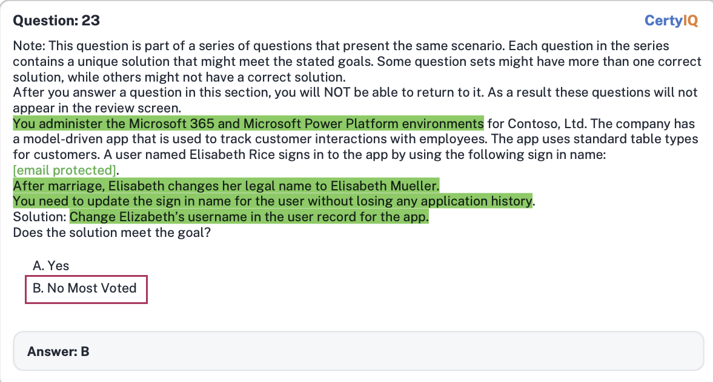

### 1. Extracted Question Summary

* **Scenario:** You administer Microsoft 365 and Microsoft Power Platform environments for Contoso, Ltd., which uses a model-driven app with standard table types to track customer interactions with employees. A user named Elisabeth Rice changes her legal name to Elisabeth Mueller after marriage. *(Part of a repeated-scenario series)*.


* **Requirement:** Update the sign-in name for the user without losing any application history.


* **Proposed Solution:** Change Elisabeth’s username in the user record for the app.


* **Question:** Does the solution meet the goal?


* **Options:**
* **A.** Yes


* **B.** No *(Highlighted inside red box, labeled "Most Voted", and marked "Answer: B")*


---

### 2. Correct Answer

* **B: No**


---

### 3. Verification of Visible Selection / Community Key

* The visible selection (**Answer: B**, boxed in red and labeled "Most Voted") is **Correct**. In Microsoft Dataverse, a user's sign-in name (`DomainName` / User Principal Name) is read-only and mastered by Microsoft Entra ID (Microsoft 365)—it cannot be changed directly inside the Dataverse `User` (`systemuser`) record for the app.


---

### 4. Official Microsoft Justification

* Under Microsoft Learn documentation for **Manage users in Dataverse** (*Power Platform admin center*) and **Change a user name and email address** (*Microsoft 365 admin center*):
* **Microsoft Entra ID as the Source of Authority:** Dataverse synchronizes user identity attributes (such as `DomainName`, `FullName`, and `InternalEmailAddress`) one-way from Microsoft Entra ID into the Dataverse `User` (`systemuser`) table.
* **Read-Only Sign-In Credentials in Dataverse:** Inside a model-driven app or the Power Platform admin center, the **User Name** (sign-in UPN) field on the Dataverse user record is locked/read-only and cannot be edited directly. Even if an administrator edits display attributes locally, sign-in authentication is governed exclusively by Microsoft Entra ID. To change a user's sign-in name while preserving their Dataverse `systemuser` record and application history, the username must be updated in the **Microsoft 365 admin center** (or **Microsoft Entra admin center**).


---

### 5. Distractor Analysis (Why Others Are Wrong)

* **A. Yes:** Incorrect because the Dataverse `User` record within the app is merely a synchronized projection of the Microsoft Entra ID user account—you cannot modify a user's sign-in name (UPN) from inside the model-driven app's user record.


---

### 6. Exam Keyword / Trap Alert

* **Trigger Phrases:** *"update the sign in name for the user"* + *"Change Elisabeth’s username in the user record for the app"* $\rightarrow$ **No**.


* **Series Recap (Compare Question 22 vs. Question 23):**
* **Question 22:** *"Ask the Microsoft 365 administrator to sign in to the admin portal and change the user name"* $\rightarrow$ **Yes** (updates the UPN at the identity source in Entra ID while preserving the immutable `Object ID` and Dataverse history).


* **Question 23:** *"Change Elisabeth’s username in the user record for the app"* $\rightarrow$ **No** (the sign-in UPN is mastered in Microsoft 365 / Entra ID and cannot be edited from the Dataverse user record).


## Q24

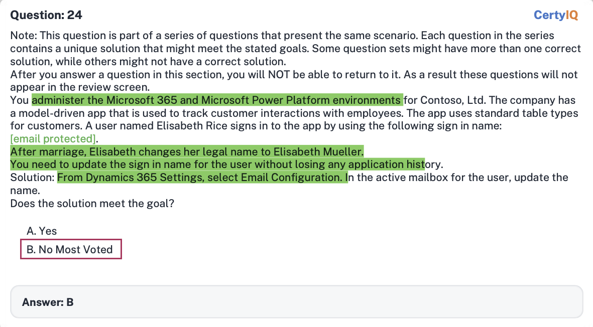


### 1. Extracted Question Summary

* **Scenario:** You administer the Microsoft 365 and Microsoft Power Platform environments for Contoso, Ltd., which uses a model-driven app with standard table types to track customer interactions with employees. A user named Elisabeth Rice changes her legal name to Elisabeth Mueller after marriage. *(Part of a repeated-scenario series)*.


* **Requirement:** Update the sign-in name for the user without losing any application history.


* **Proposed Solution:** From Dynamics 365 Settings, select Email Configuration. In the active mailbox for the user, update the name.


* **Question:** Does the solution meet the goal?


* **Options:**
* **A.** Yes


* **B.** No *(Highlighted inside red box, labeled "Most Voted", and marked "Answer: B")*


---

### 2. Correct Answer

* **B: No**


---

### 3. Verification of Visible Selection / Community Key

* The visible selection (**Answer: B**, boxed in red and labeled "Most Voted") is **Correct**. Updating a user's **Mailbox** record under Dynamics 365 Email Configuration only affects server-side email synchronization settings—it does not modify the user's Microsoft Entra ID sign-in credential (User Principal Name) or Dataverse `User` (`systemuser`) sign-in identity.


---

### 4. Official Microsoft Justification

* Under Microsoft Learn documentation for **Connect to Exchange Online (Email Configuration / Mailboxes)** in Power Platform and **Change a user name and email address** (*Microsoft 365 admin center*):
* **Mailbox Record Scope:** A Dataverse **Mailbox** record (`mailbox`) manages incoming/outgoing email routing, appointments, contacts, and tasks synchronization between Dataverse and Exchange Online. Changing the display name on a mailbox record neither updates the user's authentication identity nor changes the sign-in name used to access model-driven apps.


* **Identity Authority in Entra ID:** Authentication for Power Platform and model-driven apps is governed by **Microsoft Entra ID** (administered via the Microsoft 365 admin center or Microsoft Entra admin center). Only updating the user's username / User Principal Name (UPN) in Microsoft 365 updates their sign-in name while preserving their immutable Entra `Object ID` and Dataverse `systemuser` history.


---

### 6. Distractor Analysis (Why Others Are Wrong)

* **A. Yes:** Incorrect because Email Configuration mailboxes control email synchronization rather than user authentication or sign-in usernames.


---

### 6. Exam Keyword / Trap Alert

* **Trigger Phrases:** *"update the sign in name for the user"* + *"select Email Configuration. In the active mailbox for the user, update the name"* $\rightarrow$ **No**.


* **Complete Series Wrap-Up (Questions 22–24):**
* **Question 22:** Update the username in the **Microsoft 365 admin portal** $\rightarrow$ **Yes** (modifies the UPN at the identity source while keeping the same Entra `Object ID` and Dataverse history).


* **Question 23:** Update the username in the **Dataverse user record** for the app $\rightarrow$ **No** (sign-in UPN is read-only in Dataverse and synced one-way from Entra ID).


* **Question 24:** Update the name in the **Email Configuration mailbox** $\rightarrow$ **No** (mailboxes handle email sync only, not sign-in credentials).


## Q30


### 1. Extracted Question Summary

* **Scenario:** A company maintains an AI-enabled Power Platform solution containing prompts, cloud flows, and Dataverse components deployed to a production environment.


* **Requirements:**
* New features must be released regularly.


* Updates must be validated before release.


* Deployed updates must be able to be removed from production if necessary.


* **Question:** You need to update the solution while maintaining release control and following Microsoft best practices. What should you do?


* **Options:**
* **A.** Update the development environment. Deploy the solution as managed. *(Highlighted inside red box, labeled "Most Voted", and marked "Answer: A")*


* **B.** Update the development environment. Run solution checker.


* **C.** Update the development environment. Deploy the solution as unmanaged.


* **D.** Modify the development customizations file. Deploy to production.


---

### 2. Correct Answer

* **A: Update the development environment. Deploy the solution as managed.**


---

### 3. Verification of Visible Selection / Community Key

* The visible selection (**Answer: A**, boxed in red and labeled "Most Voted") is **Correct**. Developing changes in an isolated development environment and deploying them downstream as a **managed solution** enforces release control, supports pre-release validation in staging/test environments, and allows updates or solutions to be cleanly uninstalled (rolled back/removed) from production if necessary.


---

### 4. Official Microsoft Justification

* Under Microsoft Learn documentation for **Application Lifecycle Management (ALM) with Microsoft Power Platform** (*Solution concepts — Managed and unmanaged solutions*):
* **Rollback / Removal Capability:** Only **managed solutions** can be cleanly uninstalled to remove all components introduced by that solution or update from a target environment. Unmanaged solutions merge their components directly into the target environment's default unmanaged layer, meaning deleting the unmanaged solution container leaves all underlying components behind in production.
* **Controlled Release & Validation:** Following Microsoft ALM best practices, makers modify components inside an unmanaged solution in a dedicated **development** environment, export it as a **managed** solution, validate it in a downstream test/staging environment (and via Power Platform Pipelines / Solution Checker), and deploy the managed artifact into **production**.


---

### 5. Distractor Analysis (Why Others Are Wrong)

* **B. Update the development environment. Run solution checker:** Running Solution Checker performs static analysis on solution components, but it is incomplete because it never deploys the updated solution to test/production or establishes a removable managed release artifact.


* **C. Update the development environment. Deploy the solution as unmanaged:** Violates Microsoft ALM best practices and directly fails the requirement that *"deployed updates must be able to be removed from production if necessary"*. Components imported via an unmanaged solution cannot be removed simply by uninstalling the solution.


* **D. Modify the development customizations file. Deploy to production:** Manually editing exported `customizations.xml` files is unsupported for standard ALM workflows and does not guarantee a controlled, removable managed deployment.


---

### 6. Exam Keyword / Trap Alert

* **Trigger Phrases:** *"Deployed updates must be able to be removed from production if necessary"* and *"maintaining release control and following Microsoft best practices"* $\rightarrow$ **Deploy the solution as managed**.


* **Exam Trap:** Whenever a Power Platform ALM question mentions **uninstalling, rolling back, or removing** deployed updates from a test or production environment, the answer is always **Managed Solution**—never *Unmanaged Solution*.


## Q31


### 1. Extracted Question Summary

* **Scenario:** A company is designing a model-driven app for customer service representatives.


* **Requirements:**
* Organize navigation into logical groupings based on business processes.


* Ensure only required data is included in the app navigation.


* **Question:** You need to configure navigation and table availability. Drag and drop the appropriate actions to the correct requirements.


* **Available Actions:**
* `Configure app settings.`


* `Customize the site map.`


* `Configure app properties.`


* `Add tables to app designer.`


* **Target Requirements:**
1. Organize navigation into logical groupings.


2. Include only the required tables in the navigation.


---

### 2. Correct Answer

| Requirement | Correct Action |
| --- | --- |
| **Organize navigation into logical groupings.**

 | **Customize the site map.**

 |
| **Include only the required tables in the navigation.**

 | **Add tables to app designer.**

 |

---

### 3. Verification of Visible Selection / Community Key

* The answer area in the screenshot is blank (no drag-and-drop selections or community key are visible). Both actions map directly to the core navigation and component-scoping mechanics of the Power Apps model-driven app designer.


---

### 4. Official Microsoft Justification

* **Customize the site map (Requirement 1 — Organize navigation into logical groupings):** Under Microsoft Learn documentation for **Create a model-driven app site map** (*Power Apps*), the **site map** defines the navigation hierarchy of a model-driven app. Makers organize navigation into logical business-process groupings using three structural tiers: **Areas** (top-level functional modules), **Groups** (logical headings inside an area), and **Subareas** (individual tables, dashboards, or custom pages).
* **Add tables to app designer (Requirement 2 — Include only the required tables in the navigation):** Under Microsoft Learn documentation for **Add or edit model-driven app components in the Power Apps app designer**, adding specific **tables** (pages) in the app designer controls which Dataverse tables are scoped to the app and exposed in its navigation pane, ensuring representatives only see the data tables required for their role.

---

### 5. Distractor Analysis (Why Others Are Wrong)

* **Configure app settings:** Controls global app-level behavior toggles and features (such as enabling offline mode, upcoming/preview features, or Copilot chat integration), not navigation grouping or table scoping.


* **Configure app properties:** Defines descriptive metadata for the app (such as Name, Unique Name, Description, Icon, and Welcome Page), rather than structural navigation hierarchy or included tables.


---

### 6. Exam Keyword / Trap Alert

* **Trigger Phrases:**
* *"Organize navigation into logical groupings"* $\rightarrow$ **Customize the site map** (Areas $\rightarrow$ Groups $\rightarrow$ Subareas).


* *"Include only the required tables in the navigation"* $\rightarrow$ **Add tables to app designer**.


* **Exam Trap:** Do not confuse **App Settings** or **App Properties** with **Site Map**—any requirement involving left-hand navigation structure, areas, groups, or subareas always points to **Site Map** customization.


## Q32

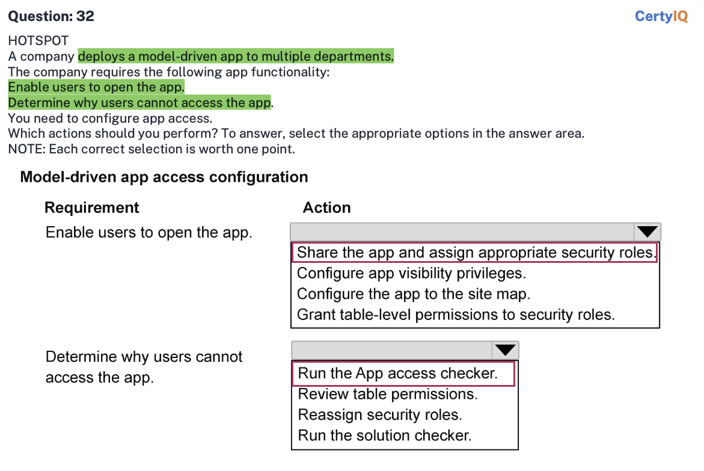

### 1. Extracted Question Summary

* **Scenario:** A company deploys a model-driven app to multiple departments.


* **Requirements:**
* Enable users to open the app.


* Determine why users cannot access the app.


* **Question:** Select the appropriate actions in the model-driven app access configuration answer area.


* **Dropdown Options:**
* **Requirement 1:** *Enable users to open the app* — Options: `Share the app and assign appropriate security roles.` *(boxed in red)*, `Configure app visibility privileges.`, `Configure the app to the site map.`, `Grant table-level permissions to security roles.`


* **Requirement 2:** *Determine why users cannot access the app* — Options: `Run the App access checker.` *(boxed in red)*, `Review table permissions.`, `Reassign security roles.`, `Run the solution checker.`


---

### 2. Correct Answer

| Requirement | Correct Action |
| --- | --- |
| **Enable users to open the app.**

 | **Share the app and assign appropriate security roles.**

 |
| **Determine why users cannot access the app.**

 | **Run the App access checker.**

 |

---

### 3. Verification of Visible Selection / Community Key

* Both visible selections highlighted inside the red boxes—**Share the app and assign appropriate security roles.** for the first requirement and **Run the App access checker.** for the second requirement—are **Correct**.


---

### 4. Official Microsoft Justification

* **Share the app and assign appropriate security roles (Requirement 1 — Enable users to open the app):** Under Microsoft Learn documentation for **Share a model-driven app using Power Apps**, a model-driven app cannot be opened by end users until it is published, explicitly **shared** with the users or Microsoft Entra security groups, and associated with one or more **Dataverse security roles** that grant access to the app module and its underlying tables.


* **Run the App access checker (Requirement 2 — Determine why users cannot access the app):** Under Microsoft Learn documentation for **Troubleshoot model-driven app access issues (App access checker)**, the built-in **App access checker** diagnostic tool (accessible in the Power Platform admin center or via direct environment URL `/apps/appaccesschecker`) evaluates a specific user against a target app and reports exact blockers—such as missing security roles, missing environment membership, unshared app status, or missing Power Apps license assignments.


---

### 5. Distractor Analysis (Why Others Are Wrong)

* **Requirement 1 Distractors:**
* **Configure app visibility privileges:** Not a standalone action; app visibility is controlled specifically through sharing the app and assigning security roles.


* **Configure the app to the site map:** Backwards—a site map is configured *inside* a model-driven app to organize navigation, not to grant users permission to open the app.


* **Grant table-level permissions to security roles:** Incomplete on its own; even if users have table privileges, they still cannot launch or see the model-driven app unless the app itself is shared with their security role.


* **Requirement 2 Distractors:**
* **Review table permissions:** Only inspects Dataverse table privileges and misses other common access blockers such as missing Power Apps licenses, missing security group membership, or the app not being shared.


* **Reassign security roles:** Blindly alters user permissions rather than diagnosing the root cause of why access is failing.


* **Run the solution checker:** Performs static code and configuration analysis on solution components (such as plug-ins, web resources, and flows) for performance and reliability issues; it does not diagnose individual user access or licensing failures.


---

### 6. Exam Keyword / Trap Alert

* **Trigger Phrases:**
* *"Enable users to open the app"* $\rightarrow$ **Share the app and assign appropriate security roles**.


* *"Determine why users cannot access the app"* $\rightarrow$ **Run the App access checker**.


* **Exam Trap:** Do not confuse **App access checker** (diagnoses *user runtime access, licensing, and security role* blockers for a specific app) with **Solution checker** (performs *static build/design validation* on solution components).


## Q33
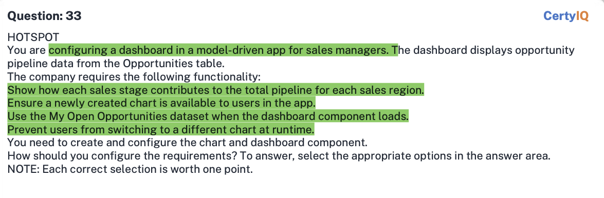


### 1. Extracted Question Summary

* **Scenario:** You are configuring a dashboard in a model-driven app for sales managers displaying opportunity pipeline data from the `Opportunities` table.


* **Requirements:**
* Show how each sales stage contributes to the total pipeline for each sales region (show each sales stage as a percentage of the regional total).


* Ensure a newly created chart is available to users in the app.


* Use the `My Open Opportunities` dataset when the dashboard component loads.


* Prevent users from switching to a different chart at runtime.


* **Question:** Select the appropriate configuration settings in the answer area.


* **Dropdown Options:**
* **Requirement 1:** *Show each sales stage as a percentage of the regional total.* — `Configure a pie chart.`, `Configure a column chart.`, `Configure a stacked column chart.`


* **Requirement 2:** *Make the new chart available in the app.* — `Set the Default Chart.`, `Enable Display Chart Selection.`, `Select the chart for the table in the app designer.`


* **Requirement 3:** *Use the My Open Opportunities dataset when the dashboard loads.* — `Set the Default View.`, `Set the Default Chart.`, `Enable the View Selector.`


* **Requirement 4:** *Prevent users from switching charts.* — `Set the Default Chart.`, `Clear Show Chart Only.`, `Clear Display Chart Selection.`


---

### 2. Correct Answer

| Requirement | Correct Setting |
| --- | --- |
| **Show each sales stage as a percentage of the regional total.**

 | **Configure a stacked column chart.**

 |
| **Make the new chart available in the app.**

 | **Select the chart for the table in the app designer.**

 |
| **Use the My Open Opportunities dataset when the dashboard loads.**

 | **Set the Default View.**

 |
| **Prevent users from switching charts.**

 | **Clear Display Chart Selection.**

 |

---

### 3. Verification of Visible Selection / Community Key

* The answer area shows open dropdown lists with no pre-selected values or visible community answer key. Each selection maps directly to standard Dataverse chart visualization and classic model-driven dashboard component properties.


---

### 4. Official Microsoft Justification

* **Configure a stacked column chart (Requirement 1):** Under Microsoft Learn documentation for **Create or edit a system chart in Dataverse**, a **stacked column chart** (specifically a 100% stacked column chart, which is a configuration option under stacked column charts) compares part-to-whole percentage contributions across multiple categories—showing how each sales stage contributes to the total pipeline within each sales region.


* **Select the chart for the table in the app designer (Requirement 2):** Under Microsoft Learn documentation for **Add or edit model-driven app components in the Power Apps app designer**, when an app explicitly scopes specific artifacts for a table rather than including *All* components, a newly created system chart must be selected under that table's **Charts** subcomponent list in the app designer before it becomes available inside the app.


* **Set the Default View (Requirement 3):** Under Microsoft Learn documentation for **Create or edit model-driven app dashboards**, a dashboard chart component renders data from an underlying Dataverse table view. Setting **Default View** to `My Open Opportunities` defines the exact dataset queried when the dashboard component initially loads.


* **Clear Display Chart Selection (Requirement 4):** In the dashboard component's **Set Properties** dialog, the **Display Chart Selection** checkbox controls whether the chart switcher dropdown is shown at runtime. Clearing **Display Chart Selection** locks the visual to the configured default chart and prevents users from switching to other charts.


---

### 5. Distractor Analysis (Why Others Are Wrong)

* **Requirement 1 Distractors:**
* **Configure a pie chart:** Displays a single series as slices of one whole; it cannot simultaneously break down part-to-whole percentages across multiple sales regions.


* **Configure a column chart:** A standard clustered column chart displays raw values side by side rather than stacking stage contributions into a regional total.


* **Requirement 2 Distractors:**
* **Set the Default Chart:** Only specifies which chart loads first on a specific dashboard component; if the chart is not included in the app designer's table metadata, users in that app will not have access to it.


* **Enable Display Chart Selection:** Displays the chart dropdown selector on a dashboard component, which violates Requirement 4 and does not add a chart to the app definition.


* **Requirement 3 Distractors:**
* **Set the Default Chart:** Chooses the visual chart layout, not the underlying `My Open Opportunities` record filter/dataset.


* **Enable the View Selector:** Allows users to manually switch between different views at runtime rather than specifying which dataset loads initially.


* **Requirement 4 Distractors:**
* **Set the Default Chart:** Controls the initial chart loaded, but if *Display Chart Selection* remains enabled, users can still switch charts at runtime.


* **Clear Show Chart Only:** Controls whether the underlying data grid (list) is displayed alongside the chart on the dashboard, not whether users can switch between charts.


---

### 6. Exam Keyword / Trap Alert

* **Trigger Phrases:**
* *"percentage of the regional total"* (two dimensions: sales stage + sales region) $\rightarrow$ **Stacked column chart** (not *pie chart*).


* *"available in the app"* $\rightarrow$ **App designer** table component selection.


* *"dataset when the dashboard loads"* $\rightarrow$ **Default View**.


* *"Prevent users from switching charts"* $\rightarrow$ **Clear Display Chart Selection**.


* **Exam Trap:** Do not pick **Pie chart** when a question mentions both a breakdown series (*sales stage*) and a grouping axis (*each sales region*)—pie charts only handle one dimension, whereas **stacked column charts** handle two-dimensional part-to-whole comparisons.


## Q34

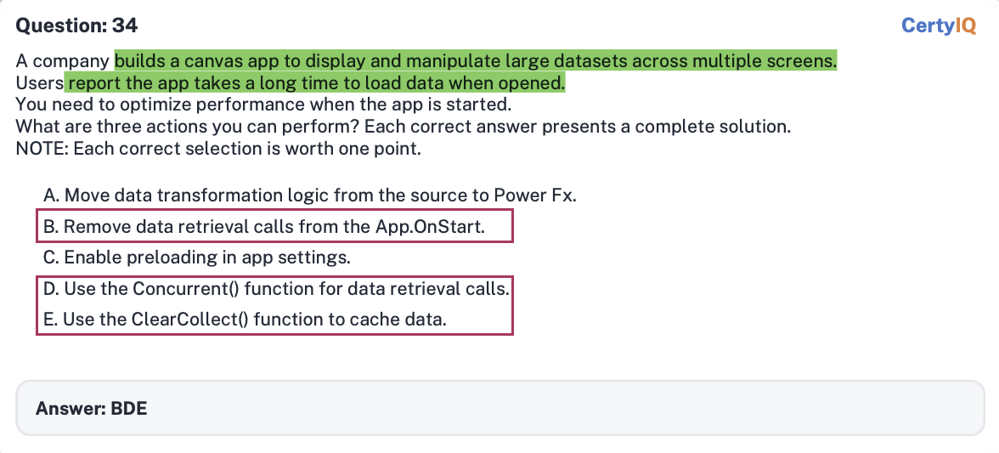

### 1. Extracted Question Summary

* **Scenario:** A company builds a canvas app to display and manipulate large datasets across multiple screens, and users report that the app takes a long time to load data when opened.


* **Requirement:** Optimize performance when the app is started.


* **Question:** What are three actions you can perform? (Each correct answer presents a complete solution).


* **Options:**
* **A.** Move data transformation logic from the source to Power Fx.


* **B.** Remove data retrieval calls from the `App.OnStart` *(Highlighted inside red box)*.


* **C.** Enable preloading in app settings.


* **D.** Use the `Concurrent()` function for data retrieval calls *(Highlighted inside red box)*.


* **E.** Use the `ClearCollect()` function to cache data *(Highlighted inside red box)*.


* **Visible Answer Key:** `Answer: BDE`


---

### 2. Correct Answer

* **B: Remove data retrieval calls from the `App.OnStart**`


* **D: Use the `Concurrent()` function for data retrieval calls**


* **E: Use the `ClearCollect()` function to cache data**


---

### 3. Verification of Visible Selection / Community Key

* The visible selection (**Answer: BDE**, boxed in red) is **Correct**. All three techniques are foundational Microsoft Power Apps canvas performance optimizations for reducing startup latency and avoiding redundant network round-trips across screens.


---

### 4. Official Microsoft Justification

* Under Microsoft Learn documentation for **Optimize canvas app performance** (*Tips and best practices to improve performance of canvas apps*):
* **Remove data retrieval calls from `App.OnStart` (B):** Heavy blocking data queries in `App.OnStart` delay rendering the first screen until every formula completes. Moving non-essential calls out of `App.OnStart` (and leveraging declarative `App.Formulas` / named formulas or screen-level `OnVisible` deferred loading) lets the initial screen render immediately.


* **Use the `Concurrent()` function for data retrieval calls (D):** By default, sequential statements separated by semicolons (`;`) in `App.OnStart` or `OnVisible` execute one after another. Wrapping independent connector/Dataverse queries inside `Concurrent(...)` executes them in parallel, cutting total wait time from the *sum* of all calls down to the duration of the *single slowest* call.


* **Use the `ClearCollect()` function to cache data (E):** Caching frequently referenced lookup or static datasets in an in-memory collection via `ClearCollect()` eliminates repeated network queries as users navigate across multiple screens.


---

### 5. Distractor Analysis (Why Others Are Wrong)

* **A. Move data transformation logic from the source to Power Fx:** Doing heavy transformations client-side in Power Fx (rather than pushing views, computed columns, or query shaping down to the server/data source) increases client memory/CPU overhead and risks non-delegable queries, *degrading* startup and runtime performance.


* **C. Enable preloading in app settings:** Power Apps canvas apps do not have a general "enable preloading" setting that speeds up large dataset loading at app startup (preloading is a feature associated with embedded Power BI tiles/reports or specific caching behaviors, not a canvas app startup toggle).


---

### 6. Exam Keyword / Trap Alert

* **Trigger Phrases:** *"canvas app"*, *"large datasets across multiple screens"*, and *"optimize performance when the app is started"* $\rightarrow$ **Minimize `App.OnStart` blocking calls + `Concurrent()` parallelization + `ClearCollect()` local caching**.


* **Exam Trap:** Watch the nuance between **B** and **E** in real-world vs. exam questions—in modern Power Apps architecture, Microsoft prefers declarative **Named Formulas (`App.Formulas`)** over imperatively loading large collections in `App.OnStart`, because `ClearCollect()` in `App.OnStart` blocks initial load; however, in multiple-choice exam items asking for *three* standard performance patterns across multi-screen apps, **B**, **D**, and **E** are the three canonical Microsoft Learn best practices tested together.


## Q35

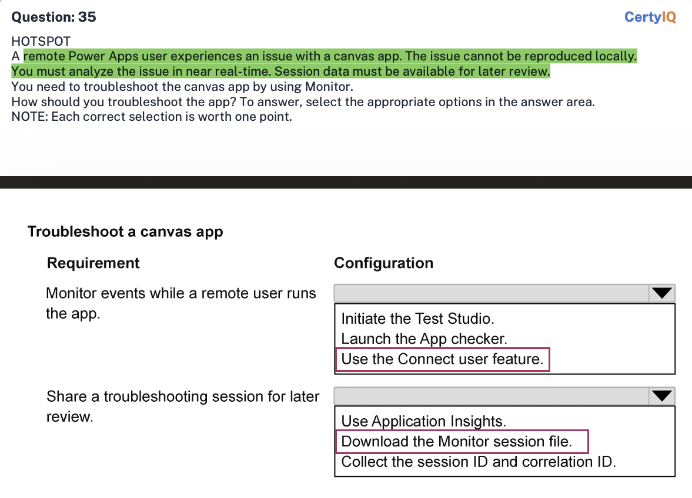

### 1. Extracted Question Summary

* **Scenario:** A remote Power Apps user experiences an issue with a canvas app that cannot be reproduced locally. You must analyze the issue in near real-time using Power Apps Monitor, and session data must be available for later review.


* **Question:** Select the appropriate configuration options in the answer area to troubleshoot the canvas app.


* **Dropdown Options:**
* **Requirement 1:** *Monitor events while a remote user runs the app.* — `Initiate the Test Studio.`, `Launch the App checker.`, `Use the Connect user feature.` *(boxed in red)*


* **Requirement 2:** *Share a troubleshooting session for later review.* — `Use Application Insights.`, `Download the Monitor session file.` *(boxed in red)*, `Collect the session ID and correlation ID.`


---

### 2. Correct Answer

| Requirement | Correct Configuration |
| --- | --- |
| **Monitor events while a remote user runs the app.**

 | **Use the Connect user feature.**

 |
| **Share a troubleshooting session for later review.**

 | **Download the Monitor session file.**

 |

---

### 3. Verification of Visible Selection / Community Key

* Both visible selections highlighted inside the red boxes—**Use the Connect user feature.** for the first requirement and **Download the Monitor session file.** for the second requirement—are **Correct**.


---

### 4. Official Microsoft Justification

* **Use the Connect user feature (Requirement 1 — Monitor events while a remote user runs the app):** Under Microsoft Learn documentation for **Collaborative debugging with Monitor** (*Power Apps Monitor*), launching Monitor for a published canvas app and selecting **Connect user** generates a direct session link that you share with the remote user. When the remote user opens that link and runs the app in their browser, every network call, control event, and formula evaluation streams in near real-time into your Monitor session.


* **Download the Monitor session file (Requirement 2 — Share a troubleshooting session for later review):** Under Microsoft Learn documentation for **Monitor overview** (*Save and open Monitor logs*), clicking **Download** in the Monitor command bar exports the entire captured event trace as a `.json` session file. Another maker or support engineer can later open Monitor and click **Upload** to reload and inspect the full trace offline or asynchronously.


---

### 5. Distractor Analysis (Why Others Are Wrong)

* **Requirement 1 Distractors:**
* **Initiate the Test Studio:** Test Studio is used for authoring and running automated UI regression tests on a canvas app; it does not attach a live telemetry session to a remote user's runtime instance.


* **Launch the App checker:** App checker performs static design-time checks inside Power Apps Studio (such as formula syntax errors, delegation warnings, and accessibility issues); it cannot observe live remote user traffic.


* **Requirement 2 Distractors:**
* **Use Application Insights:** Application Insights provides long-term aggregate Azure telemetry across all users over time, rather than exporting and sharing a specific point-in-time Monitor debugging session.


* **Collect the session ID and correlation ID:** Session and correlation IDs are diagnostic identifiers used when opening a Microsoft Support ticket for backend platform investigation; they do not export or share the local Monitor event trace for later review.


---

### 6. Exam Keyword / Trap Alert

* **Trigger Phrases:**
* *"remote Power Apps user"* + *"analyze the issue in near real-time"* + *"Monitor"* $\rightarrow$ **Connect user**.


* *"Session data must be available for later review"* / *"Share a troubleshooting session"* $\rightarrow$ **Download the Monitor session file** (`.json`).


* **Exam Trap:** Do not confuse **Monitor (`Connect user` / `Download`)** with **Application Insights** or **App checker**—whenever a question specifically mentions **Power Apps Monitor** and debugging a **remote user** in near real-time, **Connect user** and downloading/uploading the `.json` session file are the exact platform capabilities tested.


## Q36

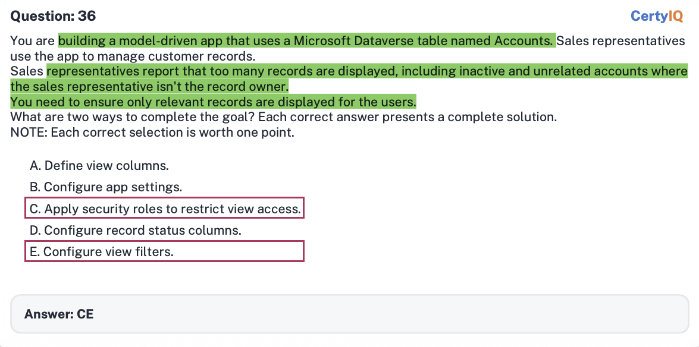

### 1. Extracted Question Summary

* **Scenario:** A remote Power Apps user experiences an issue with a canvas app that cannot be reproduced locally. You must analyze the issue in near real-time using Power Apps Monitor, and session data must be available for later review.


* **Question:** Select the appropriate configuration options in the answer area to troubleshoot the canvas app.


* **Dropdown Options:**
* **Requirement 1:** *Monitor events while a remote user runs the app.* — `Initiate the Test Studio.`, `Launch the App checker.`, `Use the Connect user feature.` *(boxed in red)*


* **Requirement 2:** *Share a troubleshooting session for later review.* — `Use Application Insights.`, `Download the Monitor session file.` *(boxed in red)*, `Collect the session ID and correlation ID.`


---

### 2. Correct Answer

| Requirement | Correct Configuration |
| --- | --- |
| **Monitor events while a remote user runs the app.**

 | **Use the Connect user feature.**

 |
| **Share a troubleshooting session for later review.**

 | **Download the Monitor session file.**

 |

---

### 3. Verification of Visible Selection / Community Key

* Both visible selections highlighted inside the red boxes—**Use the Connect user feature.** for the first requirement and **Download the Monitor session file.** for the second requirement—are **Correct**.


---

### 4. Official Microsoft Justification

* **Use the Connect user feature (Requirement 1 — Monitor events while a remote user runs the app):** Under Microsoft Learn documentation for **Collaborative debugging with Monitor** (*Power Apps Monitor*), launching Monitor for a published canvas app and selecting **Connect user** generates a direct session link that you share with the remote user. When the remote user opens that link and runs the app in their browser, every network call, control event, and formula evaluation streams in near real-time into your Monitor session.


* **Download the Monitor session file (Requirement 2 — Share a troubleshooting session for later review):** Under Microsoft Learn documentation for **Monitor overview** (*Save and open Monitor logs*), clicking **Download** in the Monitor command bar exports the entire captured event trace as a `.json` session file. Another maker or support engineer can later open Monitor and click **Upload** to reload and inspect the full trace offline or asynchronously.


---

### 5. Distractor Analysis (Why Others Are Wrong)

* **Requirement 1 Distractors:**
* **Initiate the Test Studio:** Test Studio is used for authoring and running automated UI regression tests on a canvas app; it does not attach a live telemetry session to a remote user's runtime instance.


* **Launch the App checker:** App checker performs static design-time checks inside Power Apps Studio (such as formula syntax errors, delegation warnings, and accessibility issues); it cannot observe live remote user traffic.


* **Requirement 2 Distractors:**
* **Use Application Insights:** Application Insights provides long-term aggregate Azure telemetry across all users over time, rather than exporting and sharing a specific point-in-time Monitor debugging session.


* **Collect the session ID and correlation ID:** Session and correlation IDs are diagnostic identifiers used when opening a Microsoft Support ticket for backend platform investigation; they do not export or share the local Monitor event trace for later review.


---

### 6. Exam Keyword / Trap Alert

* **Trigger Phrases:**
* *"remote Power Apps user"* + *"analyze the issue in near real-time"* + *"Monitor"* $\rightarrow$ **Connect user**.


* *"Session data must be available for later review"* / *"Share a troubleshooting session"* $\rightarrow$ **Download the Monitor session file** (`.json`).


* **Exam Trap:** Do not confuse **Monitor (`Connect user` / `Download`)** with **Application Insights** or **App checker**—whenever a question specifically mentions **Power Apps Monitor** and debugging a **remote user** in near real-time, **Connect user** and downloading/uploading the `.json` session file are the exact platform capabilities tested.


## Q37


### 1. Extracted Question Summary

* **Scenario:** A company is building a canvas app that spans multiple screens.


* **Requirement:** The app must store selected values across screens and hold tabular data during a session.


* **Question:** You need to manage application state. Which two components should you use? (Each correct answer presents part of the solution).


* **Options:**
* **A.** collections *(Highlighted inside red box)*


* **B.** context variables


* **C.** data sources


* **D.** global variables *(Highlighted inside red box)*


* **Visible Answer Key:** `Answer: AD`


---

### 2. Correct Answer

* **A: collections** and **D: global variables**


---

### 3. Verification of Visible Selection / Community Key

* The visible selection (**Answer: AD**, boxed in red) is **Correct**. In Power Apps canvas apps, **global variables** (`Set()`) store scalar values, records, or single selected items accessible across *all* screens during a session, while **collections** (`Collect()` / `ClearCollect()`) hold in-memory **tabular data** (multi-row tables) across all screens for the duration of the user session.


---

### 4. Official Microsoft Justification

* Under Microsoft Learn documentation for **Understand variables in canvas apps** (*Global variables*, *Context variables*, and *Collections*):
* **Collections (A — Hold tabular data during a session):** Collections are special variables that store tables of rows and columns in device memory for the active app session. Created and updated with `Collect()` or `ClearCollect()`, collections are globally accessible across every screen in the app and persist only until the app is closed or refreshed (unless explicitly saved offline via `SaveData()`).


* **Global variables (D — Store selected values across screens):** Created with the `Set()` function (e.g., `Set(gblSelectedOrder, Gallery1.Selected)`), global variables hold single values, numbers, text strings, or individual records in memory and can be read or updated from *any* screen throughout the active session.


---

### 5. Distractor Analysis (Why Others Are Wrong)

* **B. context variables:** Created via `UpdateContext()` or passed via `Navigate()`, context variables are strictly scoped to a **single screen**—other screens cannot directly read or reference a context variable defined on another screen, failing the requirement to store selected values *across screens*.


* **C. data sources:** External persistent storage connections (such as Dataverse tables, SharePoint lists, or SQL Server) persist records permanently on the backend rather than managing transient, in-memory application state during a user session.


---

### 6. Exam Keyword / Trap Alert

* **Trigger Phrases:**
* *"store selected values across screens"* $\rightarrow$ **Global variables** (`Set()`).


* *"hold tabular data during a session"* $\rightarrow$ **Collections** (`Collect()` / `ClearCollect()`).


* **Exam Trap:** Memorize the three-tier Power Apps canvas state matrix:
* **Context variable (`UpdateContext`)** = Single screen only.


* **Global variable (`Set`)** = App-wide across all screens (single values/records).


* **Collection (`Collect` / `ClearCollect`)** = App-wide across all screens (**tabular/multi-row data** in memory for the session).


## Q38


### 1. Extracted Question Summary

* **Scenario:** An accounting team is assigned to a model-driven app to manage financial data. The app is currently visible in the app launcher, but it is inaccessible to the accounting team.


* **Requirements:**
* Open the app.


* Access and record financial data.


* **Question:** You need to resolve the access issues. What should you do?


* **Options:**
* **A.** Configure app visibility privileges for the users.


* **B.** Set the app as the default app for the users.


* **C.** Assign users the appropriate security roles *(Highlighted inside red box, labeled "Most Voted", and marked "Answer: C")*.


* **D.** Grant the users table-level permissions to the required tables.


---

### 2. Correct Answer

* **C: Assign users the appropriate security roles.**


---

### 3. Verification of Visible Selection / Community Key

* The visible selection (**Answer: C**, boxed in red and labeled "Most Voted") is **Correct**. In Microsoft Dataverse and Power Apps, access to both a model-driven app module and its underlying Dataverse tables is governed exclusively through **Dataverse security roles** assigned directly to users (or via group teams).


---

### 4. Official Microsoft Justification

* Under Microsoft Learn documentation for **Share a model-driven app using Power Apps** and **Security roles and privileges in Microsoft Dataverse**:
* **Dual Role Requirement:** For a user to open a model-driven app and interact with its records, two conditions must be met: the app must be shared with the user (or their Microsoft Entra security group), and the user must be assigned one or more **Dataverse security roles** that both (1) are associated with the model-driven app and (2) grant Read/Create/Write privileges to the underlying financial tables.


* **Why the App Appears in the Launcher Yet Fails to Open:** When an app has been shared with a user or group (making its tile appear in the app launcher) but the user lacks an assigned security role granting app module and table privileges, attempting to launch the app fails with a permissions error. Assigning the appropriate security role resolves both opening the app and recording financial data.


---

### 5. Distractor Analysis (Why Others Are Wrong)

* **A. Configure app visibility privileges for the users:** There is no standalone "app visibility privilege" setting in Power Apps—app visibility and launch access are controlled through app sharing and **security role** associations.


* **B. Set the app as the default app for the users:** Power Apps does not have a per-user "default app" configuration that bypasses missing security roles; without the required security roles, users still cannot open the app or access financial records.


* **D. Grant the users table-level permissions to the required tables:** In Dataverse, table-level privileges are *never* granted directly to individual users outside of a security role—privileges exist only inside **security roles**, and granting table privileges alone without assigning the app-associated security role would still fail to grant app-level access.


---

### 6. Exam Keyword / Trap Alert

* **Trigger Phrases:** *"visible in the app launcher but inaccessible"*, *"Open the app"*, and *"Access and record financial data"* $\rightarrow$ **Assign users the appropriate security roles**.


* **Exam Trap:** Option **D ("Grant the users table-level permissions...")** is a classic Power Platform trap. Remember that Dataverse uses strict **Role-Based Access Control (RBAC)**—you never assign table permissions directly to users; you always assign **security roles** that bundle both app access and table privileges together.


## Q39

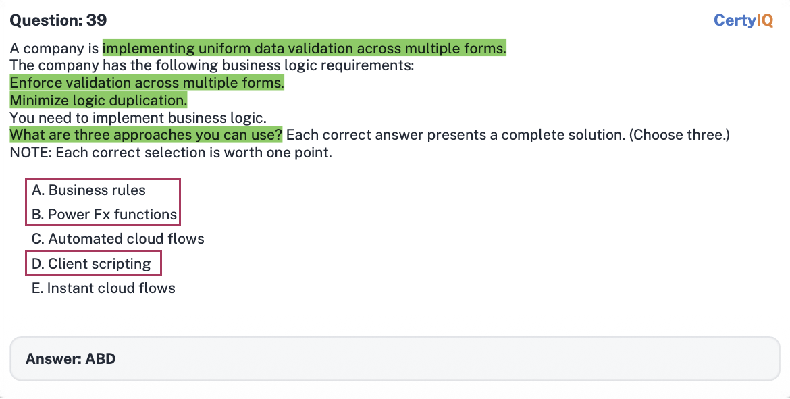


### 1. Extracted Question Summary

* **Scenario:** An accounting team is assigned to a model-driven app to manage financial data. The app is currently visible in the app launcher, but it is inaccessible to the accounting team.


* **Requirements:**
* Open the app.


* Access and record financial data.


* **Question:** You need to resolve the access issues. What should you do?


* **Options:**
* **A.** Configure app visibility privileges for the users.


* **B.** Set the app as the default app for the users.


* **C.** Assign users the appropriate security roles *(Highlighted inside red box, labeled "Most Voted", and marked "Answer: C")*.


* **D.** Grant the users table-level permissions to the required tables.


---

### 2. Correct Answer

* **C: Assign users the appropriate security roles.**


---

### 3. Verification of Visible Selection / Community Key

* The visible selection (**Answer: C**, boxed in red and labeled "Most Voted") is **Correct**. In Microsoft Dataverse and Power Apps, access to both a model-driven app module and its underlying Dataverse tables is governed exclusively through **Dataverse security roles** assigned directly to users (or via group teams).


---

### 4. Official Microsoft Justification

* Under Microsoft Learn documentation for **Share a model-driven app using Power Apps** and **Security roles and privileges in Microsoft Dataverse**:
* **Dual Role Requirement:** For a user to open a model-driven app and interact with its records, two conditions must be met: the app must be shared with the user (or their Microsoft Entra security group), and the user must be assigned one or more **Dataverse security roles** that both (1) are associated with the model-driven app and (2) grant Read/Create/Write privileges to the underlying financial tables.


* **Why the App Appears in the Launcher Yet Fails to Open:** When an app has been shared with a user or group (making its tile appear in the app launcher) but the user lacks an assigned security role granting app module and table privileges, attempting to launch the app fails with a permissions error. Assigning the appropriate security role resolves both opening the app and recording financial data.


---

### 5. Distractor Analysis (Why Others Are Wrong)

* **A. Configure app visibility privileges for the users:** There is no standalone "app visibility privilege" setting in Power Apps—app visibility and launch access are controlled through app sharing and **security role** associations.


* **B. Set the app as the default app for the users:** Power Apps does not have a per-user "default app" configuration that bypasses missing security roles; without the required security roles, users still cannot open the app or access financial records.


* **D. Grant the users table-level permissions to the required tables:** In Dataverse, table-level privileges are *never* granted directly to individual users outside of a security role—privileges exist only inside **security roles**, and granting table privileges alone without assigning the app-associated security role would still fail to grant app-level access.


---

### 6. Exam Keyword / Trap Alert

* **Trigger Phrases:** *"visible in the app launcher but inaccessible"*, *"Open the app"*, and *"Access and record financial data"* $\rightarrow$ **Assign users the appropriate security roles**.


* **Exam Trap:** Option **D ("Grant the users table-level permissions...")** is a classic Power Platform trap. Remember that Dataverse uses strict **Role-Based Access Control (RBAC)**—you never assign table permissions directly to users; you always assign **security roles** that bundle both app access and table privileges together.


## Q40


### 1. Question Summary

* **Scenario:** A company is building both a canvas app and a model-driven app to manage customer accounts.
* **Requirements:**
* **Rule 1 (Canvas App):** Automatically set the Business Type column to large when customer size exceeds a defined currency threshold.
* **Rule 2 (Model-Driven App):** Display a recommendation to re-evaluate the account rating when an account is placed on credit hold, restricted strictly to that specific model-driven app.


* **Task:** Assign the appropriate Dataverse business rule scope (`All forms`, `Specific form`, or `Table`) to each business rule.

---

### 2. Correct Answer

| Business Rule | Correct Scope |
| --- | --- |
| **Business Type column setting for customer size** (Canvas app) | **Table** |
| **Account rating re-evaluation** (Model-driven app only) | **Specific form** |

---

### 3. Verification of Visible Selection / Community Key

* The red text pre-filled in the answer area—**Table** for the first rule and **Specific Form** for the second rule—is **Correct**.

---

### 4. Official Microsoft Justification

* **Table Scope (Canvas App Rule):** Under Microsoft Learn documentation for **Create a business rule in Microsoft Dataverse**, business rules scoped to **All forms** or a **Specific form** execute only as client-side logic within model-driven app forms and never trigger from canvas apps, Power Automate flows, or API calls. To make a Dataverse business rule execute server-side whenever a canvas app creates or updates a record, its scope must be set to **Table** (formerly *Entity*).
* **Specific Form Scope (Model-Driven App Only Rule):** When a recommendation or UI action should appear exclusively inside a single model-driven app without affecting other apps built on the same table, scoping the rule to the **Specific form** used by that app isolates the behavior to that form's client-side context. (Note also that *Show recommendation* is a form-level UI action that is unsupported at the server-side *Table* scope anyway.)

---

### 5. Distractor Analysis (Why Others Are Wrong)

* **All forms:** Applies the business rule across every model-driven form on the table, which violates the requirement to restrict the credit-hold recommendation to the single model-driven app and fails to trigger for canvas app updates.

---

### 6. Exam Keyword / Trap Alert

* **Trigger Phrases:**
* *"canvas app requires a business rule"* $\rightarrow$ **Table** scope (the only scope that enforces business rules server-side across canvas apps and APIs).
* *"for this app only"* + *"recommend"* $\rightarrow$ **Specific form** scope (isolates UI recommendations to the form used by that app).


* **Exam Trap:** Always check which app type triggers the rule—**Canvas app** always demands **Table** scope, whereas **model-driven app-specific** UI recommendations demand **Specific form** scope.


## 43

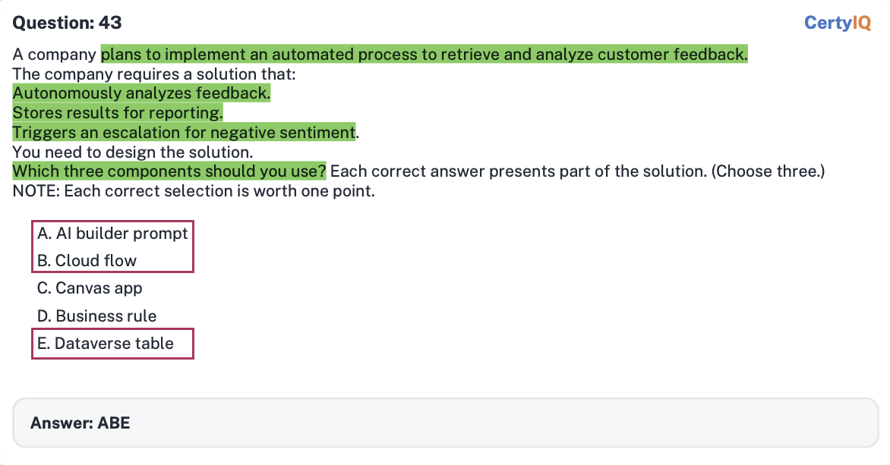

### 1. Extracted Question Summary

* **Scenario:** A company plans to implement an automated process to retrieve and analyze customer feedback.


* **Requirements:**
* Autonomously analyzes feedback.


* Stores results for reporting.


* Triggers an escalation for negative sentiment.


* **Question:** You need to design the solution. Which three components should you use? (Each correct answer presents part of the solution.)


* **Options:**
* **A.** AI builder prompt *(Highlighted inside red box)*


* **B.** Cloud flow *(Highlighted inside red box)*


* **C.** Canvas app


* **D.** Business rule


* **E.** Dataverse table *(Highlighted inside red box)*


* **Visible Answer Key:** `Answer: ABE`


---

### 2. Correct Answer

* **A: AI builder prompt**


* **B: Cloud flow**


* **E: Dataverse table**


---

### 3. Verification of Visible Selection / Community Key

* The visible selection (**Answer: ABE**, boxed in red) is **Correct**. Each of the three selected components maps one-to-one to the three functional requirements in the end-to-end automated architecture.


---

### 4. Official Microsoft Justification

* **AI builder prompt (A — Autonomously analyzes feedback):** Under Microsoft Learn documentation for **Use a custom prompt in Power Automate** (*AI Builder / Prompt Builder*), custom generative AI prompts analyze unstructured customer feedback text to classify sentiment, extract key themes, and return structured outputs (such as JSON sentiment scores/labels) without manual human review.


* **Cloud flow (B — Automated retrieval & triggers an escalation for negative sentiment):** Under Microsoft Learn documentation for **Overview of cloud flows** (*Power Automate*), an automated or scheduled cloud flow orchestrates the end-to-end workflow—retrieving incoming feedback, invoking the AI Builder prompt action, writing the parsed results to Dataverse, and evaluating a conditional branch (`If sentiment == "Negative"`) to trigger an escalation (such as sending an adaptive card in Teams, creating a high-priority case, or emailing a manager).


* **Dataverse table (E — Stores results for reporting):** Under Microsoft Learn documentation for **Tables in Microsoft Dataverse**, Dataverse provides structured relational storage where the analyzed feedback and sentiment classifications are persisted as records for downstream Power BI reporting, views, and dashboards.


---

### 5. Distractor Analysis (Why Others Are Wrong)

* **C. Canvas app:** A canvas app is an interactive front-end user interface for manual human data entry or browsing; the scenario explicitly requires an **automated, autonomous** background process rather than a user-facing app.


* **D. Business rule:** Business rules execute simple declarative field logic (such as setting field values, showing error messages, or locking columns) on Dataverse tables/forms; they cannot retrieve external feedback, perform generative AI sentiment analysis, or orchestrate multi-step escalation notifications.


---

### 6. Exam Keyword / Trap Alert

* **Trigger Phrases:**
* *"Autonomously analyzes feedback"* $\rightarrow$ **AI builder prompt**.


* *"Stores results for reporting"* $\rightarrow$ **Dataverse table**.


* *"automated process to retrieve... Triggers an escalation"* $\rightarrow$ **Cloud flow**.


* **Exam Trap:** Look at how cleanly each requirement maps to one component in the Power Platform architecture—whenever a question combines **unstructured text analysis + structured persistence + conditional workflow orchestration**, the canonical trio is **AI Builder prompt + Dataverse table + Power Automate cloud flow**.


## Q44

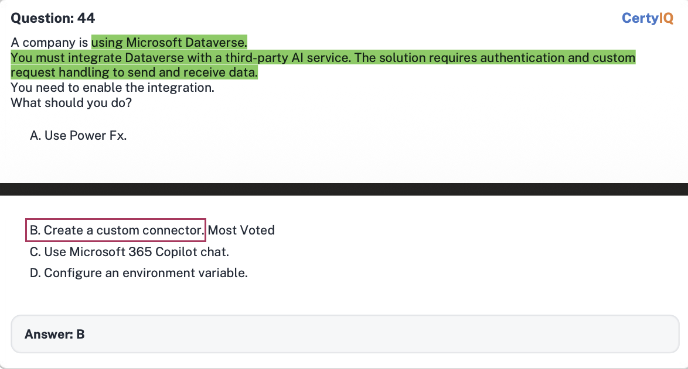

### 1. Extracted Question Summary

* **Scenario:** A company is using Microsoft Dataverse and must integrate Dataverse with a third-party AI service.


* **Requirements:** The integration requires authentication and custom request handling to send and receive data.


* **Question:** You need to enable the integration. What should you do?


* **Options:**
* **A.** Use Power Fx.


* **B.** Create a custom connector *(Highlighted inside red box, labeled "Most Voted", and marked "Answer: B")*.


* **C.** Use Microsoft 365 Copilot chat.


* **D.** Configure an environment variable.


---

### 2. Correct Answer

* **B: Create a custom connector.**


---

### 3. Verification of Visible Selection / Community Key

* The visible selection (**Answer: B**, boxed in red and labeled "Most Voted") is **Correct**. When integrating Power Platform / Dataverse with an external third-party REST API or AI service that has no prebuilt standard connector—especially when custom authentication schemes and custom request/response payload handling are required—building a **custom connector** is the standard Microsoft Power Platform extensibility mechanism.


---

### 4. Official Microsoft Justification

* Under Microsoft Learn documentation for **Custom connectors overview** (*Microsoft Power Platform*):
* **Wrapping External REST APIs:** A custom connector acts as a wrapper around a REST API (defined via OpenAPI/Swagger specification, Postman collection, or from scratch) that enables Power Automate, Power Apps, and Copilot Studio to communicate cleanly with external services.


* **Authentication & Custom Request Handling:** Custom connectors natively support configurable authentication methods (No authentication, Basic authentication, API Key, and OAuth 2.0) along with custom actions, triggers, request headers/parameters, and **policy templates** (or custom C# code transformations) to shape outbound requests and parse inbound responses.


---

### 5. Distractor Analysis (Why Others Are Wrong)

* **A. Use Power Fx:** Power Fx is the low-code formula language used inside canvas apps, custom pages, and Dataverse formula columns; it cannot directly authenticate with arbitrary external REST APIs or encapsulate custom HTTP request/response handling without an underlying connector.


* **C. Use Microsoft 365 Copilot chat:** Microsoft 365 Copilot chat is an end-user conversational AI assistant for Microsoft 365 productivity data; it is not an API integration bridge between Dataverse and a third-party AI service.


* **D. Configure an environment variable:** Environment variables store configuration keys, endpoints, or secrets across ALM environments (Dev/Test/Prod); while they can *parameterize* a connector or flow, an environment variable alone cannot handle API authentication or send/receive HTTP requests.


---

### 6. Exam Keyword / Trap Alert

* **Trigger Phrases:** *"integrate Dataverse with a third-party AI service"* + *"requires authentication and custom request handling to send and receive data"* $\rightarrow$ **Create a custom connector**.


* **Exam Trap:** Whenever a scenario mentions integrating Power Platform with an external/third-party REST service requiring custom authentication (API Key, OAuth 2.0, Basic) and custom request/response schemas, immediately look for **Custom connector**.


## Q45

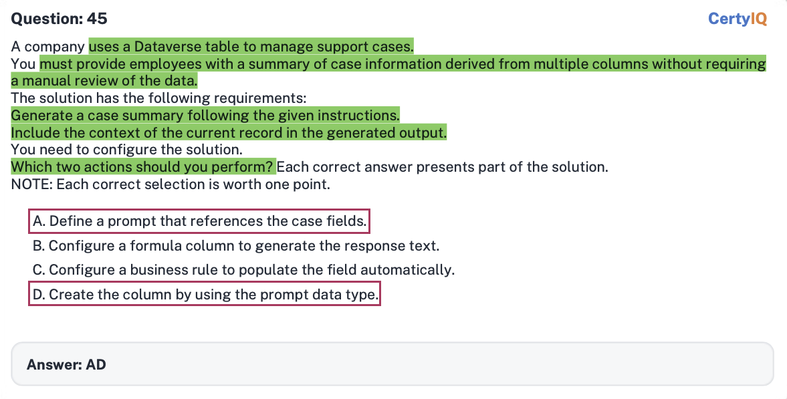

### 1. Extracted Question Summary

* **Scenario:** A company uses a Dataverse table to manage support cases. Employees need an automated summary of case information derived from multiple columns without requiring manual review of the data.


* **Requirements:**
* Generate a case summary following the given instructions.


* Include the context of the current record in the generated output.


* **Question:** You need to configure the solution. Which two actions should you perform? (Each correct answer presents part of the solution.)


* **Options:**
* **A.** Define a prompt that references the case fields *(Highlighted inside red box)*.


* **B.** Configure a formula column to generate the response text.


* **C.** Configure a business rule to populate the field automatically.


* **D.** Create the column by using the prompt data type *(Highlighted inside red box)*.


* **Visible Answer Key:** `Answer: AD`


---

### 2. Correct Answer

* **A: Define a prompt that references the case fields.**


* **D: Create the column by using the prompt data type.**


---

### 3. Verification of Visible Selection / Community Key

* The visible selection (**Answer: AD**, boxed in red) is **Correct**. Dataverse natively supports **Prompt columns** (creating a table column with the **Prompt** data type backed by an AI Builder / Copilot Studio generative AI prompt that dynamically references columns from the current Dataverse record).


---

### 4. Official Microsoft Justification

* Under Microsoft Learn documentation for **Create a prompt column in Microsoft Dataverse** (*Use AI prompts directly inside a Dataverse table*):
* **Create the column by using the prompt data type (D):** Makers can add a column directly to a Dataverse table and select **Prompt** as its data type. Whenever a row is created or the referenced input columns change, Dataverse automatically executes the linked prompt and stores the generated AI response directly in that column.


* **Define a prompt that references the case fields (A):** Inside the prompt designer launched from the Prompt column configuration, you write natural-language summarization instructions and bind **Dataverse table columns** (the current record's fields) as dynamic context inputs so the generative model produces a tailored case summary for each row.


---

### 5. Distractor Analysis (Why Others Are Wrong)

* **B. Configure a formula column to generate the response text:** Formula columns evaluate deterministic **Power Fx** expressions (such as string concatenation, math, or date calculations); they cannot execute generative AI instructions or natural-language summarization prompts.


* **C. Configure a business rule to populate the field automatically:** Business rules only support simple conditional logic (`If/Then`) and deterministic field assignments; they cannot invoke generative AI models to summarize unstructured multi-column context.


---

### 6. Exam Keyword / Trap Alert

* **Trigger Phrases:** *"summary of case information derived from multiple columns"*, *"following the given instructions"*, and *"context of the current record"* $\rightarrow$ **Prompt data type column** + **Prompt referencing the record's fields**.


* **Exam Trap:** Do not confuse **Formula columns** (deterministic Power Fx expressions) with **Prompt columns** (generative AI instructions bound to current-row Dataverse fields)—whenever an exam question asks for AI-generated summaries or text stored natively in a Dataverse column based on current record fields, the exact feature is the **Prompt data type** column.


## Q46


### 1. Extracted Question Summary

* **Scenario:** A company is designing an AI-enabled solution to help employees review and evaluate customer requests.


* **Requirements:**
* Generate an AI summary at runtime using company-provided instructions covering tone, structure, and required data fields.


* The **Prompt control** will use these instructions on Power Apps forms across **multiple tables**.


* **Question:** You need to store the instructions. Which component should you use?


* **Options:**
* **A.** AI Builder custom prompt *(Highlighted inside red box, labeled "Most Voted", and marked "Answer: A")*


* **B.** Power Platform AI model


* **C.** Dataverse prompt column


* **D.** Dataverse business rule


* **Visible Answer Key:** `Answer: A`


---

### 2. Correct Answer

* **A: AI Builder custom prompt**


---

### 3. Verification of Visible Selection / Community Key

* The visible selection (**Answer: A**, boxed in red and labeled "Most Voted") is **Correct**. Storing the natural-language prompt template—including tone, formatting structure, and input placeholders—as an **AI Builder custom prompt** creates a standalone, reusable generative AI component that can be bound to the **Prompt control** across forms on multiple tables.


---

### 4. Official Microsoft Justification

* Under Microsoft Learn documentation for **Use a custom prompt in Power Apps** (*AI Builder / Prompt Builder*) and **Add the Prompt control to a model-driven app form**:
* **Reusable Custom Prompt Definition:** An **AI Builder custom prompt** encapsulates natural-language instructions (specifying persona/tone, output structure, and dynamic input variables) as an independent, solution-aware Power Platform component.


* **Cross-Table Form Binding via the Prompt Control:** Because the custom prompt is decoupled from any single Dataverse table schema, makers can add the **Prompt control** onto forms across **multiple tables** and bind each form's relevant columns to the custom prompt's input parameters at runtime.


---

### 5. Distractor Analysis (Why Others Are Wrong)

* **B. Power Platform AI model:** Refers broadly to traditional prebuilt or custom-trained machine learning models (such as Object Detection, Form Processing/Document Processing, or Prediction models) rather than generative natural-language prompt instructions consumed by the form **Prompt control**.


* **C. Dataverse prompt column:** A Dataverse prompt column is tightly bound to a **single table** and persists generated output into a specific column on that table; it is not a reusable prompt component shared across forms on *multiple tables* via the UI **Prompt control**.


* **D. Dataverse business rule:** Business rules execute deterministic conditional field logic on a single table and cannot store generative AI prompt instructions or control AI tone and summarization structure.


---

### 6. Exam Keyword / Trap Alert

* **Trigger Phrases:** *"instructions provided by the company, including tone, structure, and required data fields"*, *"Prompt control... across multiple tables"*, and *"store the instructions"* $\rightarrow$ **AI Builder custom prompt**.


* **Exam Trap:** Compare **Question 45** vs. **Question 46** carefully:


* **Question 45** asks how to store an AI-generated summary inside a *single Dataverse table's column* $\rightarrow$ **Dataverse prompt column** (`Prompt` data type).


* **Question 46** asks how to store reusable prompt instructions used by the **Prompt control** on forms *across multiple tables* $\rightarrow$ **AI Builder custom prompt**.


## Q47


### 1. Extracted Question Summary

* **Scenario:** A company has a product report in PDF format that must be rewritten with formal vocabulary and cadence. They require a prompt used within a canvas app to rewrite the report as a Word document, referencing a business glossary stored in a SharePoint site.


* **Requirement:** Make a suggestion for the **expectations** portion of the prompt to generate a report summary correctly.


* **Question:** What should you suggest?


* **Options:**
* **A.** The summary should highlight key themes, product features, and recurring feedback. *(Highlighted inside red box, labeled "Most Voted", and marked "Answer: A")*


* **B.** Use the PDF and the business glossary stored in the SharePoint site.


* **C.** Format the summary as a list of bullet points, which should be clear and use short sentences.


* **D.** Create a Microsoft Word document summary.


* **Visible Answer Key:** `Answer: A`


---

### 2. Correct Answer

* **A: The summary should highlight key themes, product features, and recurring feedback.**


---

### 3. Verification of Visible Selection / Community Key

* The visible selection (**Answer: A**, boxed in red and labeled "Most Voted") is **Correct**. Under Microsoft's **Prompt Engineering framework** for Copilot and AI Builder prompts (**Goal, Context, Source, Expectations**), each of the four options represents one distinct pillar of a well-structured prompt—and **Option A** specifically defines the **Expectations** (what content/substance the AI must prioritize and include in the generated output).


---

### 4. Official Microsoft Justification

* Under Microsoft Learn documentation for **Prompt engineering guide** (*Learn about prompts — The four ingredients of a prompt: Goal, Context, Source, Expectations*):
1. **Goal:** What you want the AI to do (*"Create a Microsoft Word document summary"* — Option D).


2. **Context:** Why you need it, who it is for, or stylistic/structural constraints on how the response should be written (*"Format the summary as a list of bullet points, which should be clear and use short sentences"* / formal vocabulary and cadence — Option C).


3. **Source:** Which information sources or knowledge data the AI should use (*"Use the PDF and the business glossary stored in the SharePoint site"* — Option B).


4. **Expectations:** Specific instructions on how the AI should meet your requirements—specifically the substantive elements, themes, or criteria the response must cover to be accurate and useful (*"The summary should highlight key themes, product features, and recurring feedback"* — Option A).


---

### 5. Distractor Analysis (Why Others Are Wrong)

* **B. Use the PDF and the business glossary stored in the SharePoint site:** Represents the **Source** ingredient of a prompt (specifying which grounding documents and SharePoint knowledge files the model must reference), not the **Expectations**.


* **C. Format the summary as a list of bullet points, which should be clear and use short sentences:** Represents formatting/stylistic constraints (typically categorized under output formatting/context instructions rather than substantive content **Expectations**—and note that the prompt scenario asks to rewrite the report as a formal Word document, not short bullet points).


* **D. Create a Microsoft Word document summary:** Represents the **Goal** ingredient of a prompt (stating the primary deliverable/objective at the start of the prompt), rather than the **Expectations**.


---

### 6. Exam Keyword / Trap Alert

* **Trigger Phrases:** *"expectations portion of the prompt"* $\rightarrow$ Look for the statement defining **what substantive points, themes, or criteria the output must highlight**.


* **Exam Trap:** Memorize Microsoft's 4-part prompt anatomy (**Goal, Context, Source, Expectations**):
* **Goal** = Action/deliverable (*"Create a... summary"*)


* **Source** = Grounding files/data (*"Use the PDF and the business glossary..."*)


* **Context / Format** = Audience, tone, and layout (*"Format... as a list of bullet points..."*)


* **Expectations** = Substantive content requirements (*"...highlight key themes, product features, and recurring feedback"*)


## Q48


### 1. Extracted Question Summary

* **Scenario:** A company is building prompts in Microsoft Copilot Studio to support multiple customer service scenarios.


* **Requirements:**
* Follow a consistent structure across use cases.


* Be reusable across multiple topics.


* Allow customization for different types of customer requests.


* **Question:** You need to build the prompts. What should you do?


* **Options:**
* **A.** Configure prompt model settings to standardize response behavior across scenarios.


* **B.** Store prompt text in variables and reuse the variables across topics.


* **C.** Create prompts directly within each topic by using custom instructions for each scenario.


* **D.** Create prompts by selecting templates from the prompt library and customizing them for each scenario *(Highlighted inside red box, labeled "Most Voted", and marked "Answer: D")*.


* **Visible Answer Key:** `Answer: D`


---

### 2. Correct Answer

* **D: Create prompts by selecting templates from the prompt library and customizing them for each scenario.**


---

### 3. Verification of Visible Selection / Community Key

* The visible selection (**Answer: D**, boxed in red and labeled "Most Voted") is **Correct**. Starting from built-in templates in the Copilot Studio / AI Builder **prompt library** enforces a standardized prompt structure, creates modular prompt tools that can be called across multiple Copilot Studio topics, and lets makers tailor instructions, input variables, and grounding data for each specific customer service scenario.


---

### 4. Official Microsoft Justification

* Under Microsoft Learn documentation for **Prompt library** and **Add a prompt tool to a topic** in Microsoft Copilot Studio:
* **Consistent Structure via Prompt Library Templates:** Microsoft provides a curated **Prompt library** containing pre-engineered, structured prompt templates (e.g., for summarization, sentiment analysis, classification, and response drafting). Starting from prompt library templates guarantees a uniform, best-practice prompt layout across all customer service use cases.


* **Cross-Topic Reusability & Customization:** Prompts created in Copilot Studio / Prompt Builder are standalone, solution-aware assets with parameterized inputs. Once customized for a scenario, a prompt can be invoked as a reusable tool across any number of Copilot Studio topics while accepting dynamic topic variables for different customer request types.


---

### 5. Distractor Analysis (Why Others Are Wrong)

* **A. Configure prompt model settings to standardize response behavior across scenarios:** Adjusting model parameters (such as model version or temperature) only governs randomness/creativity at inference time; it does not enforce a structural prompt template or make prompts reusable across topics.


* **B. Store prompt text in variables and reuse the variables across topics:** Storing raw prompt strings inside Power Fx / topic variables creates brittle, unmanageable text blocks without Prompt Builder's native input parameterization, structured JSON output schemas, Dataverse/SharePoint knowledge grounding, or content moderation guardrails.


* **C. Create prompts directly within each topic by using custom instructions for each scenario:** Embedding one-off custom instructions directly inside individual topics sacrifices structural consistency across use cases and prevents the prompt from being centrally maintained and reused across multiple topics.


---

### 6. Exam Keyword / Trap Alert

* **Trigger Phrases:** *"consistent structure across use cases"*, *"reusable across multiple topics"*, and *"allow customization for different types"* $\rightarrow$ **Select templates from the prompt library and customize them**.


* **Exam Trap:** Option **C** (authoring ad-hoc instructions inline inside every individual topic) is the classic anti-pattern in Copilot Studio—whenever a question emphasizes **consistency + reusability across multiple topics**, always choose standalone parameterized prompts built from the **prompt library**.


## Q49


### 1. Extracted Question Summary

* **Scenario:** A company uses a business process flow (BPF) to manage case resolution.


* **Requirements:**
* Users must complete required data before progressing to the next stage.


* Before exiting a stage, a background process must create an approval, assign it to the record owner, and send the approval by using Microsoft Teams.


* Mandatory data entry enforcement must be part of **only the business process flow itself**.


* **Question:** Drag and drop the appropriate configurations to the correct requirements in the answer area.


* **Available Configurations:**
* `Add a classic workflow step.`


* `Set the data step as Required.`


* `Set columns as business required.`


* `Add a Power Automate cloud flow.`


* **Target Requirements:**
1. Require data completion before progressing.


2. Send an approval.


---

### 2. Correct Answer

| Requirement | Correct Configuration |
| --- | --- |
| **Require data completion before progressing.**

 | **Set the data step as Required.**

 |
| **Send an approval.**

 | **Add a Power Automate cloud flow.**

 |

---

### 3. Verification of Visible Selection / Community Key

* The answer area in the screenshot is blank (no drag-and-drop selections or community key are visible). Both configurations map directly to native Dataverse Business Process Flow designer capabilities: **Required Data Steps** for stage-gating and **Flow Steps** (Power Automate cloud flows) for stage-entry/exit automation.


---

### 4. Official Microsoft Justification

* **Set the data step as Required (Requirement 1 — Require data completion before progressing):** Under Microsoft Learn documentation for **Create a business process flow in Power Automate / Dataverse**, selecting a **Data Step** inside a BPF stage and enabling its **Required** checkbox blocks users from advancing (`Next Stage`) out of that stage until the field is populated—while keeping the mandatory enforcement scoped *strictly* to the BPF stage rather than forcing the underlying table column to be required across every form, view, or API call.


* **Add a Power Automate cloud flow (Requirement 2 — Send an approval):** Under Microsoft Learn documentation for **Add a flow step to a business process flow**, makers can add a **Flow Step** inside a BPF stage triggered on **Stage Entry** or **Stage Exit** (or run on demand). A **Power Automate cloud flow** natively integrates with the **Approvals** connector and **Microsoft Teams** connector to create an approval request, assign it to the record owner, and deliver an actionable adaptive card in Teams before exiting the stage.


---

### 5. Distractor Analysis (Why Others Are Wrong)

* **Set columns as business required:** Changing the column requirement level to *Business Required* in the Dataverse table schema enforces mandatory entry globally across *all* forms, canvas apps, and data imports—directly violating the requirement that *"mandatory data entry enforcement must be part of only the business process flow itself"*.


* **Add a classic workflow step:** Classic Dataverse background workflows cannot natively generate Power Automate Approvals or post interactive Microsoft Teams approval cards without custom code extensions, and Microsoft recommends Power Automate cloud flows for modern approval and Teams integrations.


---

### 6. Exam Keyword / Trap Alert

* **Trigger Phrases:**
* *"complete required data before progressing"* + *"part of only the business process flow itself"* $\rightarrow$ **Set the data step as Required** (never *Set columns as business required*).


* *"Before exiting a stage... create an approval... send the approval by using Microsoft Teams"* $\rightarrow$ **Add a Power Automate cloud flow** (BPF Flow Step on Stage Exit).


* **Exam Trap:** Watch the distinction between **BPF Data Step Required** (enforced *only* when advancing through that BPF stage) vs. **Column Business Required** (enforced globally at the Dataverse table/form level).


## Q50

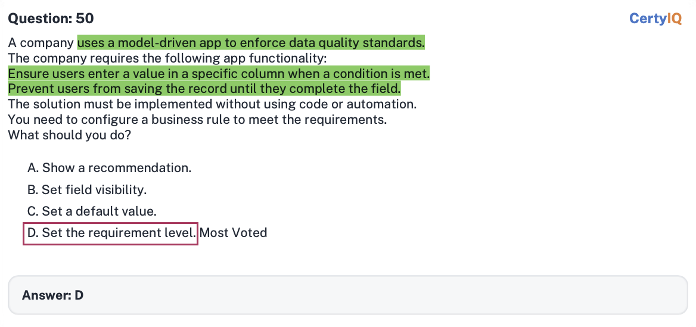

### 1. Extracted Question Summary

* **Scenario:** A company uses a business process flow (BPF) to manage case resolution.


* **Requirements:**
* Users must complete required data before progressing to the next stage.


* Before exiting a stage, a background process must create an approval, assign it to the record owner, and send the approval by using Microsoft Teams.


* Mandatory data entry enforcement must be part of **only the business process flow itself**.


* **Question:** Drag and drop the appropriate configurations to the correct requirements in the answer area.


* **Available Configurations:**
* `Add a classic workflow step.`


* `Set the data step as Required.`


* `Set columns as business required.`


* `Add a Power Automate cloud flow.`


* **Target Requirements:**
1. Require data completion before progressing.


2. Send an approval.


---

### 2. Correct Answer

| Requirement | Correct Configuration |
| --- | --- |
| **Require data completion before progressing.**

 | **Set the data step as Required.**

 |
| **Send an approval.**

 | **Add a Power Automate cloud flow.**

 |

---

### 3. Verification of Visible Selection / Community Key

* The answer area in the screenshot is blank (no drag-and-drop selections or community key are visible). Both configurations map directly to native Dataverse Business Process Flow designer capabilities: **Required Data Steps** for stage-gating and **Flow Steps** (Power Automate cloud flows) for stage-entry/exit automation.


---

### 4. Official Microsoft Justification

* **Set the data step as Required (Requirement 1 — Require data completion before progressing):** Under Microsoft Learn documentation for **Create a business process flow in Power Automate / Dataverse**, selecting a **Data Step** inside a BPF stage and enabling its **Required** checkbox blocks users from advancing (`Next Stage`) out of that stage until the field is populated—while keeping the mandatory enforcement scoped *strictly* to the BPF stage rather than forcing the underlying table column to be required across every form, view, or API call.


* **Add a Power Automate cloud flow (Requirement 2 — Send an approval):** Under Microsoft Learn documentation for **Add a flow step to a business process flow**, makers can add a **Flow Step** inside a BPF stage triggered on **Stage Entry** or **Stage Exit** (or run on demand). A **Power Automate cloud flow** natively integrates with the **Approvals** connector and **Microsoft Teams** connector to create an approval request, assign it to the record owner, and deliver an actionable adaptive card in Teams before exiting the stage.


---

### 5. Distractor Analysis (Why Others Are Wrong)

* **Set columns as business required:** Changing the column requirement level to *Business Required* in the Dataverse table schema enforces mandatory entry globally across *all* forms, canvas apps, and data imports—directly violating the requirement that *"mandatory data entry enforcement must be part of only the business process flow itself"*.


* **Add a classic workflow step:** Classic Dataverse background workflows cannot natively generate Power Automate Approvals or post interactive Microsoft Teams approval cards without custom code extensions, and Microsoft recommends Power Automate cloud flows for modern approval and Teams integrations.


---

### 6. Exam Keyword / Trap Alert

* **Trigger Phrases:**
* *"complete required data before progressing"* + *"part of only the business process flow itself"* $\rightarrow$ **Set the data step as Required** (never *Set columns as business required*).


* *"Before exiting a stage... create an approval... send the approval by using Microsoft Teams"* $\rightarrow$ **Add a Power Automate cloud flow** (BPF Flow Step on Stage Exit).


* **Exam Trap:** Watch the distinction between **BPF Data Step Required** (enforced *only* when advancing through that BPF stage) vs. **Column Business Required** (enforced globally at the Dataverse table/form level).

## Q51


### 1. Extracted Question Summary

* **Scenario:** A company uses Dataverse to configure derived values for sales records.


* **Requirements:**
* Evaluate an expression by using numerical columns in the same row.


* Calculate the result dynamically when accessed.


* Ensure the result is **NOT** stored as part of the table data.


* Minimize use of custom code.


* **Question:** You need to configure the app. What should you do?


* **Options:**
* **A.** Create a formula column *(Highlighted inside red box and marked "Answer: A")*


* **B.** Use a real-time workflow to update the value


* **C.** Use a business rule to populate the value


* **D.** Use a plugin to calculate


* **Visible Answer Key:** `Answer: A`


---

### 2. Correct Answer

* **A: Create a formula column.**


---

### 3. Verification of Visible Selection / Community Key

* The visible selection (**Answer: A**, boxed in red) is **Correct**. A Dataverse **Formula** column uses Power Fx expressions to compute read-only values dynamically at read/query time from columns in the same row (or related `N:1` lookup rows) without persisting the computed result in underlying database storage or requiring custom C# code.


---

### 4. Official Microsoft Justification

* Under Microsoft Learn documentation for **Work with formula columns (preview/GA) in Microsoft Dataverse**:
* **Real-Time Evaluation on Read (Not Persisted):** Formula columns (like classic Calculated columns) are computed dynamically at the moment a record is retrieved or displayed—meaning the calculated value is **not stored** as static physical data in the Dataverse database table.


* **Same-Row Numerical Power Fx Expressions:** Formula columns use low-code **Power Fx** syntax to perform arithmetic, logical, string, and date calculations across numerical columns within the same row, fulfilling the requirement to minimize custom code.


---

### 5. Distractor Analysis (Why Others Are Wrong)

* **B. Use a real-time workflow to update the value:** A real-time (synchronous) workflow writes the computed value into a standard database column upon record create/update—which **stores** the result as part of the table data and calculates on *write* rather than dynamically on *read*.


* **C. Use a business rule to populate the value:** A business rule sets the value of a physical column on the record, meaning the result **is stored** in the database table and only updates when the rule triggers on form interaction or record save rather than dynamically on every read.


* **D. Use a plugin to calculate:** Writing a C# Dataverse plug-in violates the requirement to **minimize custom code**, and plug-ins typically persist values on write events (or require complex `Retrieve`/`RetrieveMultiple` intercepts).


---

### 6. Exam Keyword / Trap Alert

* **Trigger Phrases:** *"Evaluate an expression by using numerical columns in the same row"*, *"Calculate the result dynamically when accessed"*, *"NOT stored as part of the table data"*, and *"minimize use of custom code"* $\rightarrow$ **Formula column** (or **Calculated column** if offered).


* **Exam Trap:** Whenever a Dataverse question explicitly states that a derived value must be **calculated on read / when accessed** and **NOT stored in the database**, immediately eliminate workflows, business rules, Power Automate flows, and standard columns—only **Formula** and **Calculated** columns compute on read without persisting the result in table storage.


## Q52


### 1. Extracted Question Summary

* **Scenario:** A company builds a canvas app for support agents to enter customer notes and generate a summarized response by using a custom prompt.


* **Requirements:**
* Generate the summary immediately when the agent selects a button in the app.


* Supply current user-entered data to the prompt.


* **Question:** You need to execute the prompt. Which two actions should you perform? (Each correct answer presents part of the solution.)


* **Options:**
* **A.** Run the prompt through a cloud flow from the button.


* **B.** Pass user input as parameters to the prompt *(Highlighted inside red box)*.


* **C.** Invoke the prompt directly from app logic *(Highlighted inside red box)*.


* **D.** Publish the prompt for reuse in the environment.


* **E.** Update the app settings.


* **Visible Answer Key:** `Answer: BC`


---

### 2. Correct Answer

* **B: Pass user input as parameters to the prompt.**


* **C: Invoke the prompt directly from app logic.**


---

### 3. Verification of Visible Selection / Community Key

* The visible selection (**Answer: BC**, boxed in red) is **Correct**. In Power Apps canvas apps, you can add an AI Builder / Copilot Studio custom prompt directly as a data source in Power Apps Studio and call its `.Predict()` method directly inside a button's `OnSelect` Power Fx formula—passing the agent's live text input controls as arguments into the prompt's defined input parameters for immediate synchronous execution.


---

### 4. Official Microsoft Justification

* Under Microsoft Learn documentation for **Use a custom prompt in Power Apps** (*AI Builder / Prompt Builder in Canvas Apps*):
* **Invoke the prompt directly from app logic (C):** Once a custom prompt is added to a canvas app via the **Data** pane (`+ Add data` $\rightarrow$ *AI models* / *Prompts*), makers can invoke it directly in Power Fx on a button's `OnSelect` property (e.g., `Set(gblSummary, 'Summarize Customer Notes'.Predict(txtCustomerNotes.Text).Text)`). Direct Power Fx invocation executes synchronously and returns the generated response immediately to the UI without needing an intermediate Power Automate flow.


* **Pass user input as parameters to the prompt (B):** Custom prompts expose named **input variables** defined during prompt creation. When calling `.Predict(...)` from the canvas app button, you pass the current control values (such as `TextInput.Text`) into those prompt parameters so the generative model summarizes the live user-entered notes.


---

### 5. Distractor Analysis (Why Others Are Wrong)

* **A. Run the prompt through a cloud flow from the button:** Wrapping a prompt inside a Power Automate cloud flow adds unnecessary orchestration overhead and latency when all you need is to immediately pass text from a canvas app control to a prompt and render the returned string in the UI.


* **D. Publish the prompt for reuse in the environment:** Saving/testing a custom prompt in Prompt Builder automatically makes it available to apps in the environment; "publishing for reuse" does not execute the prompt when the agent clicks the button or supply user-entered data to it.


* **E. Update the app settings:** No special canvas app setting toggle is required to invoke an AI Builder custom prompt via Power Fx, nor does changing app settings execute the prompt at runtime.


---

### 6. Exam Keyword / Trap Alert

* **Trigger Phrases:** *"canvas app"*, *"immediately when the agent selects a button"*, and *"Supply current user-entered data to the prompt"* $\rightarrow$ **Invoke directly from app logic (`.Predict()`)** + **Pass user input as parameters**.


* **Exam Trap:** Do not fall for Option **A** (*Run the prompt through a cloud flow*)—you only need a Power Automate flow when performing multi-step background automation (e.g., approvals, scheduled batch jobs, or writing to multiple systems). For immediate, interactive UI responses in a canvas app, always invoke the prompt **directly in Power Fx** using `.Predict()`.


## Q53

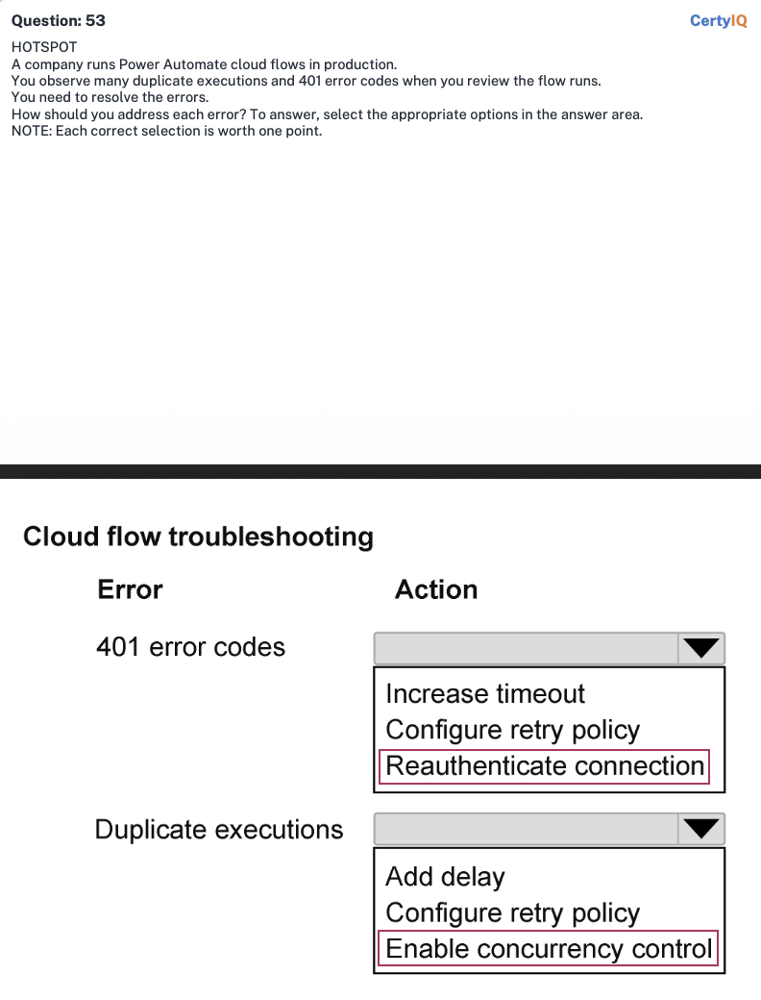

### 1. Extracted Question Summary

* **Scenario:** A company runs Power Automate cloud flows in production, and you observe many duplicate executions and `401` error codes when reviewing the flow runs.


* **Requirement:** Resolve each error by selecting the appropriate action in the Cloud flow troubleshooting answer area.


* **Dropdown Options:**
* **Error 1:** `401 error codes` — `Increase timeout`, `Configure retry policy`, `Reauthenticate connection`


* **Error 2:** `Duplicate executions` — `Add delay`, `Configure retry policy`, `Enable concurrency control`


---

### 2. Correct Answer

| Error | Correct Action |
| --- | --- |
| **401 error codes**

 | **Reauthenticate connection**

 |
| **Duplicate executions**

 | **Enable concurrency control**

 |

---

### 3. Verification of Visible Selection / Community Key

* The answer area shows open dropdown lists with no pre-selected values or visible community answer key. Both selections correspond directly to official Power Automate troubleshooting remediation steps for authentication failures and parallel trigger race conditions.


---

### 4. Official Microsoft Justification

* **Reauthenticate connection (401 error codes):** Under Microsoft Learn documentation for **Troubleshoot a cloud flow** (*Fix authentication failures / HTTP 401 Unauthorized*), an HTTP `401` status code indicates that a connector's OAuth token has expired, user credentials/password changed, or conditional access policies invalidated the existing session. Fixing `401` errors requires navigating to **Data > Connections** (or the flow's connection references) and selecting **Fix connection / Reauthenticate** to refresh the credentials.
* **Enable concurrency control (Duplicate executions):** Under Microsoft Learn documentation for **Troubleshoot a cloud flow** (*Handle duplicate flow runs / Concurrency control*), when multiple trigger events arrive simultaneously or when a polling trigger processes overlapping batches before an earlier run finishes updating state, parallel flow instances can race and execute duplicate work. Enabling **Concurrency Control** on the trigger settings (and setting **Degree of Parallelism = 1**) forces runs to execute sequentially in a queue rather than concurrently, eliminating race-condition duplicate executions.

---

### 5. Distractor Analysis (Why Others Are Wrong)

* **401 error codes Distractors:**
* **Increase timeout:** Addresses HTTP `408` / `504` gateway timeout failures on slow backend responses, not `401 Unauthorized` authentication errors.


* **Configure retry policy:** Retries transient network errors (`408`, `429`, `5xx`); by default, Power Automate does not retry `401` errors because retrying with an expired or invalid token will continue failing until reauthenticated.


* **Duplicate executions Distractors:**
* **Add delay:** Pausing inside a flow run with a *Delay* action does not prevent the trigger from spawning multiple overlapping instances simultaneously.


* **Configure retry policy:** Controls how many times an individual failed HTTP action retries within a single run—it does not throttle or serialize concurrent trigger executions.


---

### 6. Exam Keyword / Trap Alert

* **Trigger Phrases:**
* *"401 error codes"* $\rightarrow$ **Reauthenticate connection** (HTTP `401` = Unauthorized / expired token).


* *"duplicate executions"* $\rightarrow$ **Enable concurrency control** (Trigger settings $\rightarrow$ Degree of Parallelism = 1).


* **Exam Trap:** Memorize the classic Power Automate HTTP status code mapping: **`401`** = Reauthenticate connection; **`429`** (Too Many Requests / Throttling) or **`5xx`** = Configure retry policy / Concurrency control; **`504`** = Increase action timeout.


## Q54 

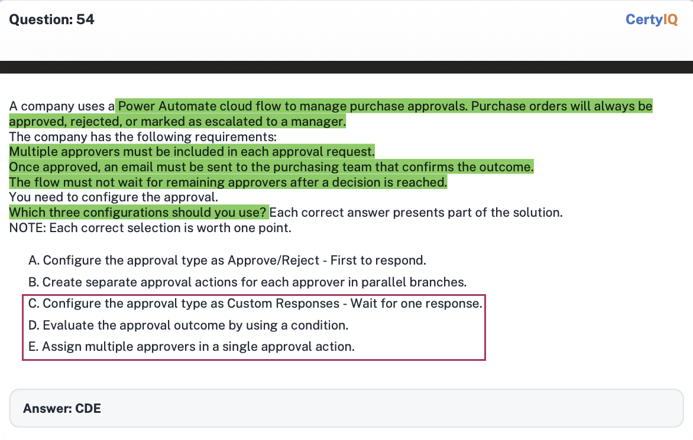

### 1. Extracted Question Summary

* **Scenario:** A company uses a Power Automate cloud flow to manage purchase approvals, where purchase orders will always be **approved**, **rejected**, or **marked as escalated to a manager**.


* **Requirements:**
* Multiple approvers must be included in each approval request.


* Once approved, an email must be sent to the purchasing team confirming the outcome.


* The flow must **not** wait for remaining approvers after a decision is reached.


* **Question:** You need to configure the approval. Which three configurations should you use? (Each correct answer presents part of the solution.)


* **Options:**
* **A.** Configure the approval type as Approve/Reject - First to respond.


* **B.** Create separate approval actions for each approver in parallel branches.


* **C.** Configure the approval type as Custom Responses - Wait for one response *(Highlighted inside red box)*.


* **D.** Evaluate the approval outcome by using a condition *(Highlighted inside red box)*.


* **E.** Assign multiple approvers in a single approval action *(Highlighted inside red box)*.


* **Visible Answer Key:** `Answer: CDE`


---

### 2. Correct Answer

* **C: Configure the approval type as Custom Responses - Wait for one response.**


* **D: Evaluate the approval outcome by using a condition.**


* **E: Assign multiple approvers in a single approval action.**


---

### 3. Verification of Visible Selection / Community Key

* The visible selection (**Answer: CDE**, boxed in red) is **Correct**. Because there are **three** distinct response choices (*Approve*, *Reject*, and *Escalate to a manager*) rather than just the binary *Approve/Reject*, you must use **Custom Responses - Wait for one response** inside a single approval action assigned to all approvers, followed by a **Condition** (or Switch) checking the `Outcome` property before emailing the purchasing team.


---

### 4. Official Microsoft Justification

* **Configure the approval type as Custom Responses - Wait for one response (C):** Under Microsoft Learn documentation for **Create custom response approvals in Power Automate**, standard *Approve/Reject* approval types only present two buttons (`Approve` and `Reject`). Supporting a third custom outcome (*"marked as escalated to a manager"*) requires **Custom Responses**, and choosing **Wait for one response** ensures that as soon as any single approver submits a response, the approval completes immediately without waiting for the remaining approvers.


* **Assign multiple approvers in a single approval action (E):** Under Microsoft Learn documentation for **Manage sequential and parallel approvals**, entering multiple semicolon-separated email addresses in the **Assigned to** field of a single *Start and wait for an approval* action dispatches the request to all approvers simultaneously and tracks the collective *Wait for one response* completion state natively.


* **Evaluate the approval outcome by using a condition (D):** Because the requirement specifies *"Once approved, an email must be sent to the purchasing team that confirms the outcome"*, the flow must inspect the approval action's `Outcome` dynamic content via a **Condition** (`Outcome is equal to Approve`) so the confirmation email is sent only when approved—and not when rejected or escalated.


---

### 5. Distractor Analysis (Why Others Are Wrong)

* **A. Configure the approval type as Approve/Reject - First to respond:** While *First to respond* satisfies the requirement not to wait for remaining approvers, the built-in *Approve/Reject* type only provides two fixed responses (`Approve` and `Reject`) and cannot support the third required option (*"marked as escalated to a manager"*).


* **B. Create separate approval actions for each approver in parallel branches:** By default, a Power Automate flow waits for *all* parallel branches to finish before continuing past the parallel join—violating the requirement that *"the flow must not wait for remaining approvers after a decision is reached"*—and creates unnecessary duplication.


---

### 6. Exam Keyword / Trap Alert

* **Trigger Phrases:**
* *"approved, rejected, or marked as escalated to a manager"* (3+ choices) + *"must not wait for remaining approvers"* $\rightarrow$ **Custom Responses - Wait for one response**.


* *"Once approved, an email must be sent"* $\rightarrow$ **Evaluate the approval outcome by using a condition**.


* **Exam Trap:** Option **A** (*Approve/Reject - First to respond*) is a deliberate trap—candidates often latch onto *"First to respond"* for *"must not wait for remaining approvers"* and overlook the first sentence requiring a **third** response option (*"marked as escalated to a manager"*), which forces **Custom Responses - Wait for one response**.


## Q55


### 1. Extracted Question Summary

* **Scenario:** A company uses a prompt to generate responses based on internal support knowledge.


* **Requirement:** Minimize generation of unsupported and incorrect information (hallucinations) while ensuring responses remain useful.


* **Question:** You need to tune the prompt model settings. How should you configure the model settings?


* **Options:**
* **A.** Decrease the content moderation level.


* **B.** Increase the content moderation level.


* **C.** Decrease the temperature *(Highlighted inside red box, labeled "Most Voted", and marked "Answer: C")*.


* **D.** Increase the temperature.


* **Visible Answer Key:** `Answer: C`


---

### 2. Correct Answer

* **C: Decrease the temperature.**


---

### 3. Verification of Visible Selection / Community Key

* The visible selection (**Answer: C**, boxed in red and labeled "Most Voted") is **Correct**. In AI Builder and Microsoft Copilot Studio prompt settings, lowering the **Temperature** parameter constrains the language model to select higher-probability tokens grounded closely in the provided context, making responses more deterministic, factual, and consistent while minimizing unsupported extrapolations.


---

### 4. Official Microsoft Justification

* Under Microsoft Learn documentation for **Prompt model settings** (*AI Builder / Copilot Studio Prompt Builder — Temperature*):
* **Temperature (0 to 1 scale):** Controls the creativity and randomness of the model's output. Lower values (closer to `0`) produce deterministic, focused responses strictly anchored to the supplied grounding knowledge, reducing unsupported fabrications while keeping answers accurate and useful for support scenarios. Higher values (closer to `1`) encourage diverse, creative phrasing at the cost of increased hallucination risk.


---

### 5. Distractor Analysis (Why Others Are Wrong)

* **A. Decrease the content moderation level:** Content moderation filters harmful or inappropriate categories (hate, self-harm, sexual content, violence); lowering moderation permits *more* potentially unsafe content and does not reduce factual hallucinations against internal support knowledge.


* **B. Increase the content moderation level:** Raising content moderation applies stricter Responsible AI safety blocking (Low, Medium, High) against harmful topics, which can overly block legitimate support queries without improving factual grounding or reducing unsupported answers.


* **D. Increase the temperature:** Increasing temperature raises sampling randomness and creativity, which *increases* the likelihood of generating unsupported or inaccurate information.


---

### 6. Exam Keyword / Trap Alert

* **Trigger Phrases:** *"based on internal support knowledge"* + *"minimize generation of unsupported and incorrect information while ensuring responses remain useful"* + *"tune the prompt model settings"* $\rightarrow$ **Decrease the temperature**.


* **Exam Trap:** Do not confuse **Content Moderation** (safety filtering for harmful/inappropriate content) with **Temperature** (determinism vs. creativity/hallucination control)—factual grounding and minimizing unsupported claims always map to **decreasing temperature**.


## Q56

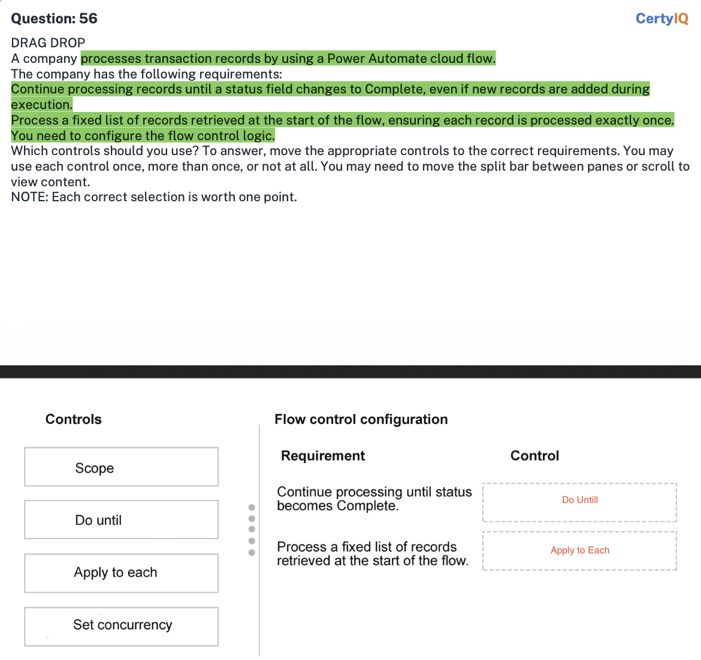


### 1. Extracted Question Summary

* **Scenario:** A company processes transaction records by using a Power Automate cloud flow.


* **Requirements:**
* Continue processing records until a status field changes to `Complete`, even if new records are added during execution.


* Process a fixed list of records retrieved at the start of the flow, ensuring each record is processed exactly once.


* **Question:** Drag and drop the appropriate flow controls (`Scope`, `Do until`, `Apply to each`, `Set concurrency`) to the correct requirements in the Flow control configuration answer area.


---

### 2. Correct Answer

| Requirement | Correct Control |
| --- | --- |
| **Continue processing until status becomes Complete.**

 | **Do until**

 |
| **Process a fixed list of records retrieved at the start of the flow.**

 | **Apply to each**

 |

---

### 3. Verification of Visible Selection / Community Key

* The answer area in the screenshot is blank (no drag-and-drop selections or visible community answer key are shown). Both selections directly match the core iteration semantics of Power Automate's built-in **Control** connector actions.


---

### 4. Official Microsoft Justification

* **Do until (Requirement 1 — Continue processing until status becomes Complete):** Under Microsoft Learn documentation for **Use the "Do until" action in Power Automate** (*Control connector*), a **Do until** loop repeats a block of actions until a specified Boolean exit condition evaluates to `true` (e.g., `Status is equal to Complete`). Because it re-evaluates the condition after each iteration rather than iterating over a fixed snapshot, it continues running across newly added records until the exit condition (or configured Count/Timeout limit) is met.


* **Apply to each (Requirement 2 — Process a fixed list of records retrieved at the start of the flow):** Under Microsoft Learn documentation for **Use the "Apply to each" action in Power Automate**, an **Apply to each** loop accepts an input array (such as the `value` collection returned by a *List rows* action at the start of the flow) and iterates over that exact fixed set of items—executing the loop body once per element.


---

### 5. Distractor Analysis (Why Others Are Wrong)

* **Scope:** Groups multiple actions into a single logical block for shared error handling (`Configure run after` for `try/catch/finally` patterns) or visual organization; it does not loop or iterate over records.


* **Set concurrency:** A performance setting inside *Apply to each* or trigger settings that controls how many iterations or runs execute in parallel (from `1` up to `50`); it is not a loop control structure for conditional exit or array iteration.


---

### 6. Exam Keyword / Trap Alert

* **Trigger Phrases:**
* *"Continue processing... until a status field changes to Complete, even if new records are added"* (condition-based termination) $\rightarrow$ **Do until**.


* *"Process a fixed list of records retrieved at the start... each record is processed exactly once"* (array-based iteration) $\rightarrow$ **Apply to each**.


* **Exam Trap:** Keep the loop distinction sharp: **Apply to each** = deterministic iteration over a *known array*; **Do until** = conditional polling/looping until a *state expression* becomes `true` (always remember **Do until** has default limits of 60 iterations / `PT1H` timeout unless adjusted under *Change limits*).


## Q57


### 1. Extracted Question Summary

* **Scenario:** A company processes customer orders using a Power Automate cloud flow.


* **Requirements:**
* Route orders for approval when the `OrderTotal` exceeds 1,000.


* Flag orders when the `CustomerName` identifies the string `"VIP"`.


* **Question:** Select the appropriate Workflow Definition Language (WDL) expressions in the answer area.


* **Dropdown Options:**
* **Requirement 1:** *Route orders for approval when the OrderTotal exceeds 1,000.*


* `equals(triggerOutputs()?['body/OrderTotal'], 1000)`


* `greater(triggerOutputs()?['body/OrderTotal'], 1000)` *(Highlighted inside red box)*


* `less(triggerOutputs()?['body/OrderTotal'], 1000)`


* **Requirement 2:** *Flag orders when the CustomerName identifies the string "VIP".*


* `contains(triggerOutputs()?['body/CustomerName'], 'VIP')` *(Highlighted inside red box)*


* `startsWith(triggerOutputs()?['body/CustomerName'], 'VIP')`


* `equals(triggerOutputs()?['body/CustomerName'], 'VIP')`


---

### 2. Correct Answer

| Requirement | Correct Expression |
| --- | --- |
| **Route orders for approval when the OrderTotal exceeds 1,000.**

 | `greater(triggerOutputs()?['body/OrderTotal'], 1000)`

 |
| **Flag orders when the CustomerName identifies the string "VIP".**

 | `contains(triggerOutputs()?['body/CustomerName'], 'VIP')`

 |

---

### 3. Verification of Visible Selection / Community Key

* Both visible selections highlighted inside the red boxes—`greater(triggerOutputs()?['body/OrderTotal'], 1000)` for the first requirement and `contains(triggerOutputs()?['body/CustomerName'], 'VIP')` for the second requirement—are **Correct**.


---

### 4. Official Microsoft Justification

* **`greater(triggerOutputs()?['body/OrderTotal'], 1000)` (Requirement 1):** Under Microsoft Learn documentation for **Reference guide to workflow expression functions in Azure Logic Apps and Power Automate** (*Logical comparison functions*), the `greater(value, compareTo)` function returns `true` strictly when the first argument is larger than the second (`OrderTotal > 1000`), matching *"exceeds 1,000"*.


* **`contains(triggerOutputs()?['body/CustomerName'], 'VIP')` (Requirement 2):** Under Microsoft Learn documentation for **String / Collection functions** (`contains(collection, value)`), `contains()` checks whether a substring appears *anywhere* inside a string (prefix, middle, or suffix—such as `"Acme Corp - VIP"` or `"VIP - Contoso"`), fulfilling the requirement to identify the string `"VIP"` within `CustomerName`.


---

### 5. Distractor Analysis (Why Others Are Wrong)

* **Requirement 1 Distractors:**
* `equals(triggerOutputs()?['body/OrderTotal'], 1000)`: Evaluates `OrderTotal == 1000`, triggering only when the total is *exactly* 1,000 rather than *exceeding* 1,000.


* `less(triggerOutputs()?['body/OrderTotal'], 1000)`: Evaluates `OrderTotal < 1000`, which is the exact opposite of *"exceeds 1,000"*.


* **Requirement 2 Distractors:**
* `startsWith(triggerOutputs()?['body/CustomerName'], 'VIP')`: Only returns `true` if `"VIP"` is at the very beginning of `CustomerName`, missing customer names where `"VIP"` appears at the end or middle.


* `equals(triggerOutputs()?['body/CustomerName'], 'VIP')`: Only returns `true` if the entire `CustomerName` string is literally `"VIP"` with no actual customer name included.


---

### 6. Exam Keyword / Trap Alert

* **Trigger Phrases:**
* *"exceeds 1,000"* (strictly greater than) $\rightarrow$ **`greater(..., 1000)`** (note: *"at least 1,000"* or *"1,000 or more"* would be `greaterOrEquals(..., 1000)`).


* *"identifies the string 'VIP'"* (substring anywhere in the field) $\rightarrow$ **`contains(..., 'VIP')`**.


* **Exam Trap:** Watch the subtle wording distinction in Power Automate WDL expression questions: *"exceeds"* maps to **`greater()`** (not `greaterOrEquals()`), and *"identifies the string"* maps to **`contains()`** (not `startsWith()` or `equals()`).


## Q58


### 1. Extracted Question Summary

* **Scenario:** You are modifying a model-driven app and have configured a customer table and form with four columns:


* `Country/region` — **Choices (multi-select)**


* `Passport ownership` — **Choice (yes/no)**


* `Passport expiration date` — **Text**


* `Language` — **Choice (single selection)**


* **Requirements (with the least amount of effort):**
1. **Country/region:** Must automatically populate with `US` when `English` is chosen as a language. If the user selects `Other` for this column, the column must remain blank so the user can enter a value.


2. **Passport expiration date column appears:** Must appear only if the user selects `Yes` in the `Passport ownership` column.


* **Available Solution Components:** `Power Automate flow`, `Business rule`, `Business process flow`, `Formula`.


---

### 2. Correct Answer

| Requirement | Correct Solution Component |
| --- | --- |
| **Country/region**

 | **Power Automate flow**

 |
| **Passport expiration date column appears**

 | **Business rule**

 |

---

### 3. Verification of Visible Selection / Community Key

* The answer area in the screenshot is blank (no drag-and-drop selections or community answer key are visible). This question hinges on a critical Dataverse **Business Rule data-type limitation**: Business Rules do **not** support `Choices` (multi-select) columns.


---

### 4. Official Microsoft Justification

* **Power Automate flow (Requirement 1 — `Country/region`):** Under Microsoft Learn documentation for **Create a business rule in Microsoft Dataverse** (*Supported column types / Limitations*), Dataverse **Business Rules** do not support multi-select **Choices** columns (`Country/region` is explicitly defined in the table as `Choices (multi-select)`). Similarly, Dataverse **Formula** columns cannot write to multi-select `Choices` columns or leave an editable field blank for user entry. Therefore, among the available low-code options, a **Power Automate flow** triggered when the customer record is created or `Language` is updated is required to set the multi-select `Country/region` column to `US` when `Language` equals `English`.


* **Business rule (Requirement 2 — `Passport expiration date column appears`):** Under Microsoft Learn documentation for **Create a business rule in Microsoft Dataverse**, showing or hiding columns dynamically on a model-driven app form (`Set visibility` action) based on a single-select `Choice (yes/no)` field (`Passport ownership`) is a core native capability of a client-side **Business rule**, requiring zero code and the least effort.


---

### 5. Distractor Analysis (Why Others Are Wrong)

* **Business rule for `Country/region`:** Although setting a default field value based on another field normally screams "Business rule," the table explicitly specifies `Country/region` as **Choices (multi-select)**—which is completely unsupported in the Dataverse Business Rule designer.


* **Formula:** Formula columns are read-only computed columns using Power Fx; they cannot control form column visibility (`Set visibility`), cannot remain editable for manual user entry when `Other` is selected, and do not support writing to multi-select `Choices` columns.


* **Business process flow:** Guides users sequentially across business stages at the top of a form; it is not designed to dynamically show/hide individual fields on a form or conditionally populate multi-select choice values.


---

### 6. Exam Keyword / Trap Alert

* **Trigger Phrases:**
* `Country/region` $\rightarrow$ **`Choices (multi-select)`** in the schema table $\rightarrow$ **Power Automate flow** (because Business Rules cannot target multi-select *Choices* columns).


* *"column must appear only if the user selects Yes"* $\rightarrow$ **Business rule** (`Set visibility` action).


* **Exam Trap:** Look closely at the **Data type** column in the prompt's schema table! Microsoft includes that table specifically to test whether you catch **`Choices (multi-select)`** on `Country/region`. Whenever a Dataverse question asks to conditionally populate a **multi-select Choices** column without custom JavaScript, **Business rule** is disqualified and **Power Automate flow** becomes the right low-code answer.


## Q59


### 1. Extracted Question Summary

* **Scenario:** A company uses Microsoft Dataverse to store customer records on the `Account` table, and a business process flow is configured for the table.


* **Requirement:** A Power Automate cloud flow must validate and correct the format of the customer account number, running **whenever data in this field changes**.


* **Question:** You need to recommend a trigger for the cloud flow. Which trigger should you recommend?


* **Options:**
* **A.** When a row is selected


* **B.** When a flow step is run from a business process flow


* **C.** When an action is performed


* **D.** When a row is added, modified or deleted *(Highlighted inside red box, labeled "Most Voted", and marked "Answer: D")*


* **Visible Answer Key:** `Answer: D`


---

### 2. Correct Answer

* **D: When a row is added, modified or deleted**


---

### 3. Verification of Visible Selection / Community Key

* The visible selection (**Answer: D**, boxed in red and labeled "Most Voted") is **Correct**. In the Microsoft Dataverse connector for Power Automate, the **When a row is added, modified or deleted** trigger supports column-level filtering via the **Select columns** parameter—ensuring the flow executes automatically whenever the customer account number column is created or modified.


---

### 4. Official Microsoft Justification

* Under Microsoft Learn documentation for **Trigger flows when a row is added, modified, or deleted** (*Microsoft Dataverse connector*):
* **Change Type & Column Filtering:** Setting **Change type** to *Added or Modified* (or *Modified*) on the `Accounts` table and specifying the customer account number column logical name inside **Select columns** causes the cloud flow to fire automatically whenever that specific column's data changes—whether edited via a model-driven form, canvas app, import, or API.


---

### 5. Distractor Analysis (Why Others Are Wrong)

* **A. When a row is selected:** An instant/manual trigger (legacy Dataverse connector) that requires a user to explicitly highlight a record in a view and click **Flow** in the command bar; it does not run automatically when field data changes.


* **B. When a flow step is run from a business process flow:** A red herring based on the first sentence mentioning a BPF. BPF flow steps only fire on explicit BPF stage entry/exit or when a user manually clicks **Run Flow** inside a stage—they do *not* automatically trigger whenever a field's value changes across the table.


* **C. When an action is performed:** Fires when a custom Dataverse Action or Custom API message is invoked, not when a standard table column is edited.


---

### 6. Exam Keyword / Trap Alert

* **Trigger Phrases:** *"whenever data in this field changes"* $\rightarrow$ **When a row is added, modified or deleted** (configured with **Select columns** set to the target field).


* **Exam Trap:** Notice the deliberate red herring in sentence 1 (*"A business process flow is configured for the table"*) designed to lure you into picking Option **B**. Always anchor on the trigger requirement (*"whenever data in this field changes"*), which requires a Dataverse data-event trigger rather than a manual BPF stage trigger. (In production, remember to also filter or guard against infinite self-trigger loops when the flow updates the same column it triggers on!)


## Q60


### 1. Extracted Question Summary

* **Scenario:** A company uses a Power Automate cloud flow to process customer records in Dataverse.


* **Requirements:**
* Retrieve a customer record.


* Store the customer email address for later use.


* Use the stored value in an email action.


* **Question:** Which four actions should you perform in sequence? Move the appropriate actions to the answer area in the correct order (Note: More than one order of answer choices is correct).


* **Available Actions:**
* `Append to a string variable.`


* `Initialize the variable.`


* `Get a row by ID (Dataverse).`


* `Set the variable.`


* `Send an email.`


---

### 2. Correct Answer

Either of the following two valid sequences satisfies the Power Automate runtime rules and the question's prompt note (*"More than one order of answer choices is correct"*):

**Option A (Initialize first — Standard Power Automate Best Practice):**

1. **Initialize the variable.**


2. **Get a row by ID (Dataverse).**


3. **Set the variable.**


4. **Send an email.**


**Option B (Retrieve record first, then initialize and populate):**

1. **Get a row by ID (Dataverse).**


2. **Initialize the variable.**


3. **Set the variable.**


4. **Send an email.**


---

### 3. Verification of Visible Selection / Community Key

* The answer area in the screenshot is blank (no drag-and-drop selections or community answer key are visible). Both sequences above satisfy every dependency constraint—specifically why the exam question explicitly includes the note: *"More than one order of answer choices is correct. You will receive credit for any of the correct orders you select."*


---

### 4. Official Microsoft Justification

* Under Microsoft Learn documentation for **Store and manage values in variables in Power Automate**:
* **Initialize the variable:** In Power Automate, every variable must be explicitly declared at the top level (outside loops or conditional branches) using **Initialize variable** before any action can read from or write to it. It can be placed either before or after **Get a row by ID (Dataverse)** as long as it precedes **Set the variable**.


* **Get a row by ID (Dataverse):** Retrieves the single target customer record from Dataverse and exposes its columns (including the customer's email address) as dynamic content.


* **Set the variable:** Assigns (overwrites) the retrieved customer email address into the initialized String variable so it is stored cleanly for downstream reuse.


* **Send an email:** References the stored variable in the **To** field to dispatch the email.


---

### 5. Distractor Analysis (Why Others Are Wrong)

* **Append to a string variable:** Concatenates additional text onto the *end* of an existing string value (used for building comma-separated lists or multi-line logs inside loops) rather than storing a single customer's email address.


---

### 6. Exam Keyword / Trap Alert

* **Trigger Phrases:** *"Retrieve a customer record"*, *"Store the customer email address"*, and *"Use the stored value in an email action"* $\rightarrow$ **Initialize variable** + **Get a row by ID** + **Set variable** + **Send an email**.


* **Exam Trap:** Notice the explicit exam note (*"More than one order of answer choices is correct"*)—this appears whenever two independent top-level actions (`Initialize variable` and `Get a row by ID`) can swap positions 1 and 2, provided both occur *before* `Set the variable` (position 3) and `Send an email` (position 4).


## Q61

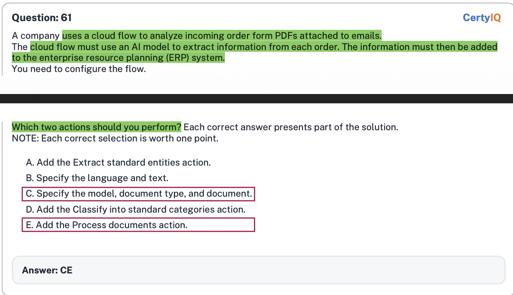


### 1. Extracted Question Summary

* **Scenario:** A company uses a cloud flow to analyze incoming order form PDFs attached to emails.


* **Requirements:**
* The cloud flow must use an AI model to extract information from each order.


* The extracted information must then be added to the enterprise resource planning (ERP) system.


* **Question:** You need to configure the flow. Which two actions should you perform? (Each correct answer presents part of the solution.)


* **Options:**
* **A.** Add the Extract standard entities action.


* **B.** Specify the language and text.


* **C.** Specify the model, document type, and document *(Highlighted inside red box)*.


* **D.** Add the Classify into standard categories action.


* **E.** Add the Process documents action *(Highlighted inside red box)*.


* **Visible Answer Key:** `Answer: CE`


---

### 2. Correct Answer

* **C: Specify the model, document type, and document.**


* **E: Add the Process documents action.**


---

### 3. Verification of Visible Selection / Community Key

* The visible selection (**Answer: CE**, boxed in red) is **Correct**. Extracting key-value pairs and table line items from structured or semi-structured **order form PDFs** uses the AI Builder **Document processing** model, which is invoked in Power Automate via the **Process documents** action and configured by supplying the trained **AI model**, **Document type** (e.g., `application/pdf`), and binary **Document** content.


---

### 4. Official Microsoft Justification

* Under Microsoft Learn documentation for **Use the document processing model in Power Automate** (*AI Builder connector — Process documents*):
* **Add the Process documents action (E):** In Power Automate, the AI Builder connector exposes the **Process documents** action (formerly *Extract information from forms*) specifically to extract structured fields, checkboxes, and tables from PDF or image files.


* **Specify the model, document type, and document (C):** When configuring the **Process documents** action card in a cloud flow, the three required input parameters are:
1. **AI model:** The published custom document processing model trained on the order forms.


2. **Document type:** The MIME type of the incoming attachment (such as `application/pdf` or `Attachments Content-Type`).


3. **Document:** The file binary content (`Attachments Content` from the email trigger).


---

### 5. Distractor Analysis (Why Others Are Wrong)

* **A. Add the Extract standard entities action:** Entity extraction is a text-only NLP model that identifies generic entities (such as dates, organizations, currencies, or URLs) from unstructured plain text strings—it cannot parse layout-based PDF order forms or extract custom order fields.


* **B. Specify the language and text:** Those are the input parameters for text-based AI Builder actions (such as *Sentiment analysis*, *Key phrase extraction*, or *Entity extraction*), not for binary PDF document processing.


* **D. Add the Classify into standard categories action:** Category classification assigns a high-level label/tag to unstructured text; it does not extract granular field values from order form PDFs to populate an ERP system.


---

### 6. Exam Keyword / Trap Alert

* **Trigger Phrases:** *"order form PDFs attached to emails"* + *"use an AI model to extract information"* $\rightarrow$ **Process documents** action + **Specify the model, document type, and document**.


* **Exam Trap:** Pair the AI Builder action directly with its exact input parameters—**Process documents** takes **(1) AI model, (2) Document type, (3) Document**, whereas text-based NLP actions (*Entity extraction*, *Sentiment*, *Category classification*) take **(1) Language, (2) Text**.


## 62

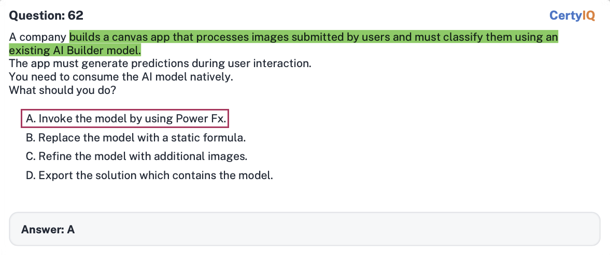


### 1. Extracted Question Summary

* **Scenario:** A company builds a canvas app that processes images submitted by users and must classify them using an existing AI Builder model.


* **Requirements:**
* Generate predictions during user interaction.


* Consume the AI model natively.


* **Question:** What should you do?


* **Options:**
* **A.** Invoke the model by using Power Fx. *(Highlighted inside red box and marked "Answer: A")*


* **B.** Replace the model with a static formula.


* **C.** Refine the model with additional images.


* **D.** Export the solution which contains the model.


* **Visible Answer Key:** `Answer: A`


---

### 2. Correct Answer

* **A: Invoke the model by using Power Fx.**


---

### 3. Verification of Visible Selection / Community Key

* The visible selection (**Answer: A**, boxed in red) is **Correct**. In Power Apps canvas apps, you can natively add an existing AI Builder model via the **Data** pane (`+ Add data` $\rightarrow$ *AI models*) and call its `.Predict()` function directly inside **Power Fx** formulas (such as a button's `OnSelect` or an image control's `OnChange`) to generate real-time predictions during user interaction.


---

### 4. Official Microsoft Justification

* Under Microsoft Learn documentation for **Use AI Builder models in Power Apps** (*Use the Predict function in Power Fx*):
* **Native Power Fx Consumption:** Makers can connect an existing, published AI Builder model directly to a canvas app as a data source and invoke it natively using the `ModelName.Predict(ImageControl.Image)` Power Fx expression.


* **Interactive Real-Time Inference:** Calling `.Predict()` directly inside Power Fx executes synchronously during user interaction without requiring an intermediate Power Automate flow or external custom API wrapper.


---

### 5. Distractor Analysis (Why Others Are Wrong)

* **B. Replace the model with a static formula:** Standard deterministic Power Fx formulas cannot perform computer-vision image classification, and the requirement explicitly specifies using the *existing AI Builder model*.


* **C. Refine the model with additional images:** Retraining or improving model accuracy does not integrate or consume the model inside the canvas app during user interaction.


* **D. Export the solution which contains the model:** Exporting a solution is an Application Lifecycle Management (ALM) packaging step for moving components across environments—it does not invoke the AI model inside the canvas app.


---

### 6. Exam Keyword / Trap Alert

* **Trigger Phrases:** *"canvas app"*, *"existing AI Builder model"*, *"generate predictions during user interaction"*, and *"consume the AI model natively"* $\rightarrow$ **Invoke the model by using Power Fx** (`.Predict()`).


* **Exam Trap:** Just like custom prompts in canvas apps, whenever a question emphasizes **native** consumption and **interactive real-time predictions** inside a canvas app, the answer is always direct **Power Fx** invocation (`ModelName.Predict(...)`) rather than Power Automate flows or ALM packaging steps.

## Q63


1. **Correct Answer:** B. No


2. **Core Concept & Domain:** Power Automate Cloud Flows & Connector Architecture (Standard vs. Custom Connectors) — specifically evaluating when to use prebuilt standard connectors versus building custom connectors to integrate external services.
3. **Why It Is Correct:**
* In Microsoft Power Platform architecture, **SharePoint** is supported out-of-the-box by an official, prebuilt **Standard Connector** in Power Automate.


* The native SharePoint connector provides comprehensive built-in triggers and actions (such as *Get items*, *Get item*, *Create item*, and *Update item*) specifically designed to retrieve and manipulate data from SharePoint Online lists without requiring any custom API wrappers.


* According to Microsoft Power Platform best practices, custom connectors should only be created when no prebuilt standard or premium connector exists for a REST/SOAP API, or when a specific operation is missing from an existing connector. Because retrieving data from SharePoint Online lists is natively supported, a custom connector is **not** necessary, making **B. No** the accurate evaluation.


4. **Why Other Options Are Wrong:**
* **A. Yes:** Selecting "Yes" implies that a custom connector is required to read data from SharePoint Online lists. Creating a custom connector for SharePoint is a major architectural anti-pattern—it introduces unnecessary development overhead, authentication management (Entra ID app registration), and ALM maintenance for functionality that is already natively provided as a standard connector.


5. **Exam Trap / Tip:**
* **Repeated Scenario ("Does the solution meet the goal?") Format:** Notice the boilerplate header explaining that this is part of a series sharing the same scenario. In these Yes/No exam sets, read the exact goal carefully: *"You need to evaluate if a custom connector is necessary to meet the requirements"*.


* Because the proposed requirement in this specific iteration is simply retrieving SharePoint Online list data—which uses a standard connector—the answer to *"is a custom connector necessary?"* is **No**. (In other variations of this same question series, the "Solution" line will swap in a scenario like an internal REST API without a prebuilt connector, where the answer flips to **Yes**.)


## Q64


1. **Correct Answer:** B. No


2. **Core Concept & Domain:** Power Automate Cloud Flows & Connector Architecture (Built-in HTTP Action vs. Custom Connectors) — determining when a standalone HTTP request suffices versus when building and maintaining a custom connector is warranted.
3. **Why It Is Correct:**
* In Microsoft Power Platform architecture, Power Automate provides a built-in **HTTP connector** (a premium connector) that allows makers to directly send standard REST requests (`GET`, `POST`, `PUT`, `PATCH`, `DELETE`) with custom headers, query parameters, payloads, and authentication (such as Basic, API Key, OAuth 2.0, or Certificate) directly inside a cloud flow.
* Per Microsoft Learn guidance on custom connectors versus the HTTP action, a custom connector is designed to wrap a REST or SOAP API into a reusable, strongly typed set of triggers and actions with user-friendly metadata, shared connections, and governance controls across multiple flows, Power Apps, or Copilot Studio agents.
* When the requirement is explicitly a **one-time HTTP action without reuse across flows**, configuring the native HTTP action directly in the cloud flow is the recommended, lightweight architectural choice. Creating a full custom connector for a single, non-reusable call introduces unnecessary development and ALM overhead, making **B. No** (a custom connector is not necessary) the correct evaluation.


4. **Why Other Options Are Wrong:**
* **A. Yes:** Selecting "Yes" implies that a custom connector is required just to invoke an external REST API. Because the built-in HTTP action natively handles single-use REST API calls without needing an OpenAPI definition or custom connector wrapper, building a custom connector here violates Power Platform's low-code/minimal-overhead best practices.


5. **Exam Trap / Tip:**
* **Key Discriminator — "One-time" & "Without reuse across flows":** Look closely at the phrasing in the Solution line: *"by using a one-time HTTP action without reuse across flows"*. On Microsoft exams, **reusability** across multiple flows/apps, **citizen-developer usability** (exposing friendly action names/schemas), or **triggers (webhooks)** are the primary triggers that flip the answer to **Yes** (custom connector required). When a scenario explicitly emphasizes a **one-time** call with **no reuse**, the built-in HTTP action is sufficient and a custom connector is **not** necessary (**B. No**).


## Q65

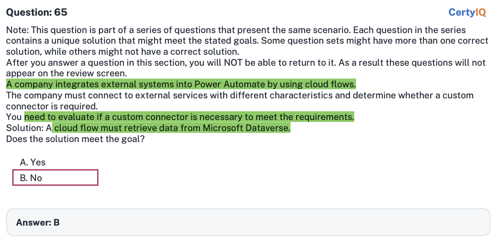


1. **Correct Answer:** B. No


2. **Core Concept & Domain:** Power Automate Cloud Flows & Native Dataverse Integration (Built-in Dataverse Connector vs. Custom Connectors) — determining whether accessing Microsoft Dataverse requires a custom connector.


3. **Why It Is Correct:**
* Microsoft Dataverse is the foundational, native data platform for Microsoft Power Platform and is supported out-of-the-box by a first-party, prebuilt **Microsoft Dataverse connector** in Power Automate.
* The native Dataverse connector provides direct, high-performance triggers (such as *When a row is added, modified or deleted*) and actions (such as *List rows*, *Get a row by ID*, *Add a new row*, and *Perform an unbound/bound action*) with built-in OData filtering, FetchXML queries, and automatic Entra ID security context handling.
* According to Microsoft Learn guidance for building cloud flows with Dataverse, custom connectors are never needed to interact with Dataverse tables or APIs—even custom Dataverse APIs can be invoked directly using the native Dataverse connector's *Perform an unbound action* or *Perform a bound action* operations. Therefore, a custom connector is not necessary to retrieve data from Microsoft Dataverse, making **B. No** the correct answer.


4. **Why Other Options Are Wrong:**
* **A. Yes:** Selecting "Yes" implies that a custom connector must be built to read data from Microsoft Dataverse. Wrapping the Dataverse Web API in a custom connector is a severe architectural anti-pattern—it bypasses native Power Platform connection references, adds unnecessary Entra ID app registration and OpenAPI maintenance overhead, and duplicates functionality already built directly into the platform.


5. **Exam Trap / Tip:**
* **Don't Confuse "Premium" with "Custom":** While the **Microsoft Dataverse connector** is classified as a *Premium* connector in Power Platform licensing, *Premium* does **not** mean *Custom*. Prebuilt Microsoft connectors (whether Standard like SharePoint or Premium like Dataverse and SQL Server) are already provided out-of-the-box, so the answer to *"is a custom connector necessary?"* remains **B. No**.


## Q66


1. **Correct Answer:** A. Yes


2. **Core Concept & Domain:** Power Automate Cloud Flows & Custom Connector Architecture — evaluating when building a custom connector is warranted for internal APIs, cross-flow reusability, and standardized action definitions.


3. **Why It Is Correct:**
* In Microsoft Power Platform architecture, an **internal web service** (such as a proprietary company REST or SOAP API) does not have a prebuilt standard or premium connector available out-of-the-box.


* Per Microsoft Learn guidance on custom connectors versus the built-in HTTP action, a custom connector is the recommended architectural pattern whenever an external or internal API must be **reused across multiple flows** (or Power Apps / Copilot Studio agents) and exposed as **reusable, strongly typed actions**.


* Wrapping the internal web service in a custom connector centralizes authentication configuration, hides raw HTTP request details behind user-friendly action names and typed input/output schemas, supports Power Platform Data Loss Prevention (DLP) governance, and enables clean Application Lifecycle Management (ALM) via solutions and connection references—making **A. Yes** the correct evaluation.


4. **Why Other Options Are Wrong:**
* **B. No:** Selecting "No" implies that a custom connector is unnecessary and that makers should instead rely on raw HTTP actions or prebuilt connectors. Hardcoding raw HTTP actions repeatedly across multiple cloud flows creates a severe maintenance and governance anti-pattern—any endpoint URL change, header update, or authentication token adjustment would require manually editing every individual flow rather than updating a single custom connector definition.


5. **Exam Trap / Tip:**
* **Direct Contrast with Question 64 ("One-time" vs. "Used across multiple flows"):** Notice how this question directly flips the discriminator from Question 64. While Question 64 specified a *"one-time HTTP action without reuse across flows"* (**B. No**), Question 66 specifies an *"internal web service that is used across multiple flows and requires reusable actions"* (**A. Yes**). Whenever a Microsoft exam scenario highlights **reusability across multiple flows/apps**, **encapsulated actions/triggers**, or **citizen-developer consumption** of an internal/custom API, a custom connector is required (**Yes**).


## Q67

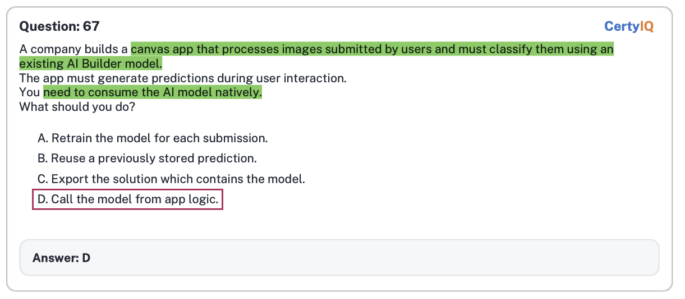

1. **Correct Answer:** D. Call the model from app logic.


2. **Core Concept & Domain:** Canvas Apps & AI Builder Integration (Consuming AI Builder Models Natively in Power Apps) — specifically using Power Fx expressions to invoke a published AI Builder model synchronously during user interaction.


3. **Why It Is Correct:**
* In Microsoft Power Platform architecture, an **existing** (trained and published) AI Builder model can be added directly to a canvas app as a data source via the **Data** pane (*Add data* > *AI models*).


* Once added, makers natively consume the model directly inside Power Fx **app logic** (for example, inside a button's `OnSelect` property or an image control's `OnChange` property) by calling the model's `.Predict()` method (e.g., `Set(varPrediction, 'ImageClassificationModel'.Predict(UploadedImage1.Image))`).


* Calling `.Predict()` directly from Power Fx app logic executes synchronously and returns real-time classification results immediately during user interaction without requiring an intermediate Power Automate cloud flow or custom API wrapper.


4. **Why Other Options Are Wrong:**
* **A. Retrain the model for each submission:** Retraining is an offline, asynchronous model-lifecycle operation performed in AI Builder when updating a model with new labeled training datasets. You do not retrain a model at runtime to classify an individual user submission.


* **B. Reuse a previously stored prediction:** Each user submits new, distinct images at runtime that require fresh inference. Returning a cached/previously stored prediction would fail to classify the newly submitted image.


* **C. Export the solution which contains the model:** Exporting a solution is an Application Lifecycle Management (ALM) deployment step used to move components between environments (such as Dev to Test/Prod)—it has nothing to do with executing runtime predictions inside a canvas app.


5. **Exam Trap / Tip:**
* **Key Discriminators — "existing AI Builder model", "during user interaction", and "natively":** Whenever a scenario states the model already exists (meaning it is trained and published) and must generate predictions interactively in real time inside a canvas app without extra middleware, the native Power Apps pattern is always invoking `.Predict()` directly from Power Fx app logic.


## Q68

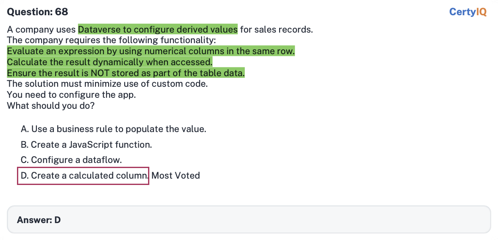

1. **Correct Answer:** D. Create a calculated column.


2. **Core Concept & Domain:** Microsoft Dataverse Data Modeling (Calculated Columns vs. Rollup Columns, Business Rules, and Formula Columns) — specifically choosing the right no-code mechanism to compute dynamic, virtual row-level values on retrieval without persisting them to database storage.


3. **Why It Is Correct:**
* In Microsoft Dataverse architecture, a **calculated column** (or Power Fx formula column) lets makers define an expression using columns from the current row or related parent rows without writing custom code.


* Crucially, Dataverse **calculated columns** are evaluated **synchronously in real time when the record is retrieved/accessed**, and their values are **not stored in the underlying database table**.


* This satisfies every single requirement in the prompt: it evaluates numerical columns in the same row, computes dynamically when accessed, avoids persisting the result as part of the table data, and requires zero custom code.


4. **Why Other Options Are Wrong:**
* **A. Use a business rule to populate the value:** A business rule writes its output into a standard, persistent Dataverse column. That means the resulting value **is stored** in the database table, directly violating the requirement to *"Ensure the result is NOT stored as part of the table data"*. Additionally, business rules only fire on form load/change or server-side record create/update—not dynamically on every read/query access.


* **B. Create a JavaScript function:** Client-side JavaScript form scripts only run when a user opens a model-driven app form (not during API calls, views, or reports), require writing to a stored column to persist, and violate the *"minimize use of custom code"* constraint.


* **C. Configure a dataflow:** Power Platform Dataflows perform scheduled, asynchronous ETL batch loads into Dataverse tables, which physically stores the computed results in the database and does not calculate values dynamically upon access.


5. **Exam Trap / Tip:**
* **Key Discriminators — "Calculate the result dynamically when accessed" & "NOT stored as part of the table data":** Whenever a Dataverse question explicitly states that a derived value must **not** be stored in the database and must compute **dynamically when retrieved/accessed**, eliminate Business Rules, Power Automate flows, Plug-ins, and Dataflows immediately—those all write to persisted columns. **Calculated columns** (and Power Fx formula columns) are virtual, on-read computations.


## Q69

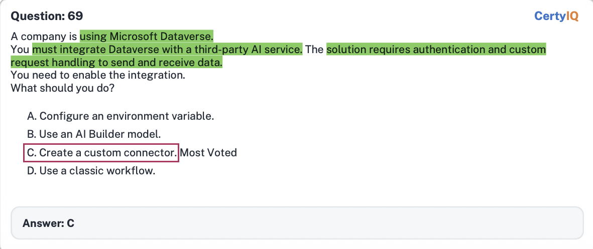

1. **Correct Answer:** C. Create a custom connector.


2. **Core Concept & Domain:** Power Platform Extensibility & Custom Connectors — integrating external/third-party AI REST APIs with Dataverse, Power Automate, and Power Apps using custom authentication, request/response schemas, and policy-based request handling.


3. **Why It Is Correct:**
* In Microsoft Power Platform architecture, integrating with a **third-party AI service** that lacks a prebuilt connector and requires **authentication and custom request handling** is the primary use case for a **custom connector**.


* A custom connector wraps an external REST or SOAP API (via OpenAPI specification, Postman collection, or from scratch), allowing you to configure supported authentication protocols (OAuth 2.0, API Key, Basic Authentication) and define strongly typed request/response schemas.


* Furthermore, custom connectors support **policy templates** (such as *Set HTTP header*, *Route request*, or *Set query string parameter*) and **C# custom code transformations** inside the connector definition to handle custom request/response formatting before exchanging data with Microsoft Dataverse (via Power Automate cloud flows, Power Apps, or Copilot Studio).


4. **Why Other Options Are Wrong:**
* **A. Configure an environment variable:** Environment variables only store configuration metadata (such as base URLs, parameter values, or Azure Key Vault secret references) across ALM environments. They cannot execute HTTP calls, manage OAuth/API key handshakes, or parse API payloads on their own.


* **B. Use an AI Builder model:** AI Builder provides native Microsoft-hosted prebuilt and custom AI models inside Power Platform. It does not connect to or wrap an external **third-party AI service** endpoint.


* **D. Use a classic workflow:** Classic Dataverse background/real-time workflows are legacy automation tools limited to native Dataverse record operations (create, update, assign, send email) and cannot natively call external REST APIs or handle custom HTTP authentication without writing custom .NET workflow activities (which Microsoft recommends replacing with Power Automate and custom connectors).


5. **Exam Trap / Tip:**
* **Key Discriminators — "third-party AI service", "authentication", and "custom request handling":** Whenever an AB-410 scenario involves connecting Power Platform/Dataverse to an external or third-party AI API that requires custom headers, payload transformation, or managed authentication, **creating a custom connector** is the standard Power Platform extensibility pattern—never a classic workflow or standalone environment variable.


## Q75


1. **Correct Answer:**
* **The email attribute of the Loan Applicant entity must provide a look-up to the contact name and email:** `N : 1`


* **Loan applicants can apply for one type of loan per application. Applicants can have more than one application:** `1 : N`


* **Loans must be applied for a single property:** `N : 1`


2. **Core Concept & Domain:** Microsoft Dataverse Data Modeling & Table Relationships (`1:N`, `N:1`, and `N:N` relationships) — specifically determining relationship cardinality and direction from the perspective of the source/primary table in each requirement statement.


3. **Why It Is Correct:**
* In Microsoft Dataverse architecture, a **Lookup column** is always created on the **Many (`N`)** side of a relationship, pointing to a single parent record on the **One (`1`)** side. Understanding relationship direction depends on which table is the subject of the requirement:
* **Requirement 1 (`LoanApplicant` $\rightarrow$ `Contact` = `N : 1`):** The requirement specifies that the `LoanApplicant` table contains a lookup attribute (`Email`) referencing the `Contact` table. Because multiple `LoanApplicant` records can reference a single `Contact` record—and the lookup resides on `LoanApplicant`—the relationship from `LoanApplicant` to `Contact` is **Many-to-One (`N : 1`)**.


* **Requirement 2 (`LoanApplicant` $\rightarrow$ `Loan` = `1 : N`):** The requirement states that a single loan applicant can have multiple active loan applications (`Loan` records), while each loan application belongs to only one loan applicant. Viewed from the `LoanApplicant` table (the subject of the sentence), one applicant has many loan applications, making this a **One-to-Many (`1 : N`)** relationship.


* **Requirement 3 (`Loan` $\rightarrow$ `Property` = `N : 1`):** The requirement states that loans must be applied for a single property. Viewed from the `Loan` table (the subject of the sentence), multiple loan applications can reference one `Property` record (meaning the Property lookup column sits on the `Loan` table), making this a **Many-to-One (`N : 1`)** relationship.


4. **Why Other Options Are Wrong:**
* **`N : N` (Many-to-Many):** None of the three requirements describe bidirectional, multi-record associations without a single parent lookup (such as multiple applicants sharing multiple loans simultaneously without an intersect entity). Every requirement explicitly enforces a single parent lookup on one side (`Contact`, `LoanApplicant`, and `Property` respectively).


* **Reversing `1 : N` and `N : 1`:** In Dataverse, `1 : N` and `N : 1` represent the exact same underlying database relationship viewed from opposite tables. Selecting `1 : N` for Requirement 1 or 3 would incorrectly place the lookup column on `Contact` or `Property` instead of `LoanApplicant` or `Loan`. Similarly, selecting `N : 1` for Requirement 2 would restrict an applicant to a single loan.


5. **Exam Trap / Tip:**
* **Read the Grammatical Subject of Each Sentence:** In Dataverse drag-and-drop relationship questions, always identify which table is named first as the subject of the requirement:
* *"The email attribute of the **Loan Applicant** entity must provide a look-up..."* $\rightarrow$ Subject is **LoanApplicant** (holds the lookup = `N` side) $\rightarrow$ **`N : 1`**.


* *"**Loan applicants** can... have more than one application."* $\rightarrow$ Subject is **LoanApplicant** (`1` side) $\rightarrow$ **`1 : N`**.


* *"**Loans** must be applied for a single property."* $\rightarrow$ Subject is **Loan** (holds the Property lookup = `N` side) $\rightarrow$ **`N : 1`**.


## Q76

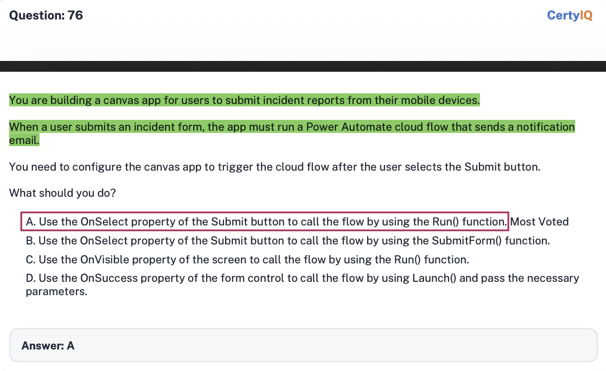

1. **Correct Answer:** A. Use the OnSelect property of the Submit button to call the flow by using the Run() function.


2. **Core Concept & Domain:** Canvas Apps & Power Automate Cloud Flow Integration — specifically triggering an instant cloud flow with the **Power Apps (V2)** trigger directly from Power Fx behavioral properties using `<FlowName>.Run()`.
3. **Why It Is Correct:**
* In Microsoft Power Platform architecture, when a Power Automate cloud flow uses the **Power Apps (V2)** trigger and is added to a canvas app via the **Power Automate** pane in Power Apps Studio, Power Apps exposes the flow as an object with a `.Run()` method.
* Because the requirement specifies triggering the cloud flow **after the user selects the Submit button**, placing `<FlowName>.Run(...)` inside the **Submit button's `OnSelect` property** executes the flow directly in response to the user's button tap and passes any required input parameters.


4. **Why Other Options Are Wrong:**
* **B. Use the OnSelect property of the Submit button to call the flow by using the SubmitForm() function:** `SubmitForm(FormName)` is a Power Fx function that validates and saves an Edit Form control's data directly to its underlying data source (such as Dataverse or SharePoint); it does not invoke or trigger a Power Automate cloud flow.


* **C. Use the OnVisible property of the screen to call the flow by using the Run() function:** The screen's `OnVisible` behavioral property fires automatically every time a user navigates to or opens that screen—not when the user clicks the Submit button—which would trigger premature or blank notification emails before the user even fills out the incident form.


* **D. Use the OnSuccess property of the form control to call the flow by using Launch() and pass the necessary parameters:** While a form's `OnSuccess` property is a valid place to run post-submission logic, `Launch()` is used to open external web URLs or launch another Power Apps app—not to execute a Power Automate cloud flow (which requires `.Run()`).


5. **Exam Trap / Tip:**
* **Key Discriminator — "after the user selects the Submit button":** Pay close attention to the exact control and event specified in the prompt. Even though triggering a flow in a form's `OnSuccess` property is a real-world best practice when using `SubmitForm()`, Option D is disqualified by using `Launch()` instead of `Run()`, and the prompt explicitly anchors the action to the **Submit button** (`OnSelect` + `Run()`).


## Q77

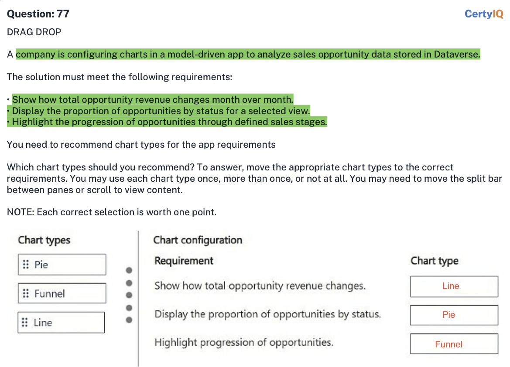

1. **Correct Answer:**
* **Show how total opportunity revenue changes:** `Line`


* **Display the proportion of opportunities by status:** `Pie`


* **Highlight progression of opportunities:** `Funnel`


2. **Core Concept & Domain:** Model-Driven Apps & Dataverse Data Visualization (System & Personal Charts) — selecting the appropriate native Dataverse chart type (`Line`, `Pie`, `Funnel`, `Bar`, `Column`, `Area`, `Doughnut`) based on analytical intent and data dimensions.


3. **Why It Is Correct:**
* **Show how total opportunity revenue changes $\rightarrow$ `Line`:** The full requirement states *"Show how total opportunity revenue changes month over month"*. In Dataverse model-driven app charts, a **Line chart** plots continuous numerical values (such as sum of estimated/actual revenue) across chronological intervals (months/quarters/years) on the horizontal category axis, making it the standard visualization for tracking trends and rate of change over time.


* **Display the proportion of opportunities by status $\rightarrow$ `Pie`:** The full requirement states *"Display the proportion of opportunities by status for a selected view"*. In Dataverse charts, a **Pie chart** represents part-to-whole relationships by dividing a single series into proportional slices across discrete categorical values (such as Opportunity Status: *Open*, *Won*, *Lost*), directly showing each status's percentage share of the total.


* **Highlight progression of opportunities $\rightarrow$ `Funnel`:** The full requirement states *"Highlight the progression of opportunities through defined sales stages"*. In Dataverse model-driven apps, a **Funnel chart** is specifically designed to visualize sequential process stages (such as Business Process Flow sales stages: *Qualify*, *Develop*, *Propose*, *Close*) and highlight drop-off or conversion volume as records progress from one stage to the next.


4. **Why Other Options Are Wrong:**
* **Using `Pie` or `Funnel` for revenue changes month over month:** Pie charts only show static part-to-whole snapshots rather than chronological trajectory, and Funnel charts represent sequential pipeline stages rather than time-series trends.


* **Using `Line` or `Funnel` for proportion by status:** Line charts imply continuous sequential progression between points (inappropriate for unrelated status categories), while Funnel charts are reserved for ordered multi-stage pipelines rather than simple categorical proportions.


* **Using `Line` or `Pie` for progression through sales stages:** Neither Line nor Pie charts visually convey sequential stage-by-stage pipeline narrowing/conversion the way a native Dataverse Funnel chart does.


5. **Exam Trap / Tip:**
* **Cross-Reference the Bullet List with the Truncated Drag-and-Drop Prompts:** Notice that the drag-and-drop table on the bottom right shortens the three requirements (*"Show how total opportunity revenue changes"*, *"Display the proportion of opportunities by status"*, *"Highlight progression of opportunities"*), whereas the bullet points at the top contain the exact Microsoft Learn keyword triggers:


* *"month over month"* $\rightarrow$ **Line** (time-series trend)


* *"proportion"* $\rightarrow$ **Pie** (part-to-whole ratio)


* *"progression... through defined sales stages"* $\rightarrow$ **Funnel** (pipeline conversion)


## Q78

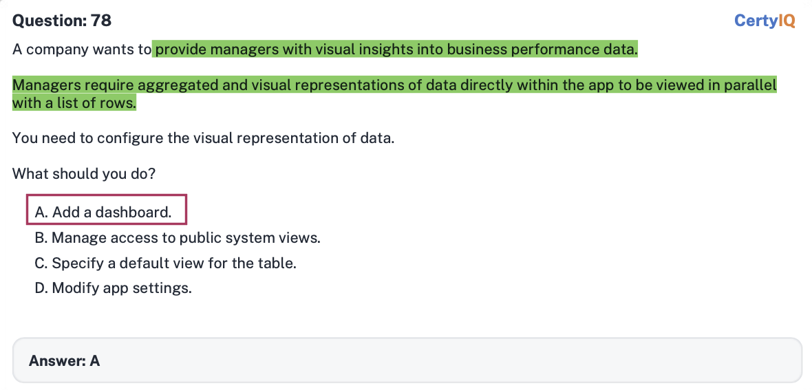

1. **Correct Answer:** A. Add a dashboard.


2. **Core Concept & Domain:** Model-Driven Apps & Dataverse Data Visualization (Dashboards, Charts, and Views) — specifically configuring multi-component visual layouts that display aggregated charts alongside tabular row lists directly inside a model-driven app.


3. **Why It Is Correct:**
* In Microsoft Power Platform architecture, a **model-driven app dashboard** (standard or interactive experience dashboard) is a dedicated layout container composed of multiple panels that render **aggregated visual representations (charts, Power BI tiles, or visual filters)** side-by-side (**in parallel**) with **lists of rows (Dataverse views)** on a single screen.


* Adding a dashboard to the model-driven app's site map/navigation allows managers to immediately view high-level KPIs and aggregated charts in parallel with underlying records, and even drill down interactively into the data without leaving the app.


4. **Why Other Options Are Wrong:**
* **B. Manage access to public system views:** Controlling security roles or permissions on public system views governs which tabular queries users can access, but it does not create or display aggregated visual representations (charts) in parallel with row lists.


* **C. Specify a default view for the table:** Setting a default view simply determines which tabular list of records loads first when a user navigates to a table in the app; a standalone view only renders rows and does not provide multi-chart aggregated visual layouts by default.


* **D. Modify app settings:** App settings control global application behavior (such as features, navigation style, offline profiles, or upcoming capabilities), not the creation or configuration of visual charts and parallel record layouts.


5. **Exam Trap / Tip:**
* **Key Discriminators — "aggregated and visual representations of data directly within the app" & "viewed in parallel with a list of rows":** Whenever a model-driven app scenario asks to display **charts/visualizations alongside lists of rows** on a single view for managers or executives, **dashboards** are the exact architectural component designed for side-by-side chart + view layouts.


## Q79

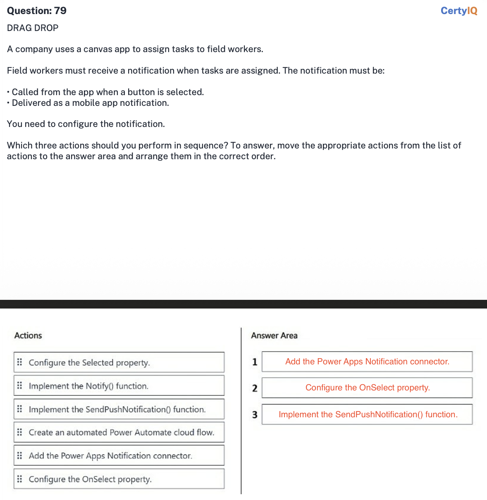

1. **Correct Answer:**
* **1:** `Add the Power Apps Notification connector.`


* **2:** `Configure the OnSelect property.`


* **3:** `Implement the SendPushNotification() function.`


2. **Core Concept & Domain:** Canvas Apps & Mobile Push Notifications (`PowerAppsNotification` / `PowerAppsNotificationV2` connector) — specifically sending native mobile device push notifications directly from Power Fx app logic without requiring intermediate middleware.


3. **Why It Is Correct:**
* **Step 1 — `Add the Power Apps Notification connector.`:** In Power Apps Studio, native mobile push notifications are exposed through the **Power Apps Notification** connector. You must first add this connector to the canvas app via the **Data** pane (providing the target mobile app's App ID) before its methods become available in Power Fx IntelliSense.


* **Step 2 — `Configure the OnSelect property.`:** The requirement specifies that the notification must be *"Called from the app when a button is selected"*. In a canvas app, user button clicks are handled by the button control's behavioral **`OnSelect`** property.


* **Step 3 — `Implement the SendPushNotification() function.`:** Inside the button's `OnSelect` formula, you invoke `PowerAppsNotification.SendPushNotification(...)` (or `SendPushNotificationV2(...)`), passing the target recipient emails, notification message, and optional deep-link parameters so the Power Apps mobile app delivers a native push notification to the field worker's device.


4. **Why Other Options Are Wrong:**
* **`Configure the Selected property.`:** Button controls do not have a behavioral `Selected` property for executing actions on click (`Selected` is a read-only output property on Gallery, Dropdown, or Listbox controls representing the chosen item).


* **`Implement the Notify() function.`:** The Power Fx `Notify()` function only displays an in-app banner message at the top of the current user's active screen—it cannot send a remote mobile push notification to another user (a field worker) on a separate mobile device.


* **`Create an automated Power Automate cloud flow.`:** The prompt explicitly states the notification must be *"Called from the app when a button is selected"*. Automated cloud flows trigger on background data events (such as a Dataverse row creation), not directly from a button click—and because the Power Apps Notification connector can be called directly in Power Fx, a cloud flow is unnecessary.


5. **Exam Trap / Tip:**
* **`Notify()` vs. `SendPushNotification()`:** This is one of the most common Power Apps exam traps. Use **`Notify()`** when alerting the *current user* inside the active app session (in-app banner), and use **`PowerAppsNotification` + `SendPushNotification()**` whenever a scenario mentions delivering a **mobile app notification** or **push notification** to *another user's mobile device*.


## Q80


1. **Correct Answer:**
* **The formula captures runtime events, including data operations and logged events:** `Yes`


* **The first Patch operation exists within the error handling logic:** `No`


* **The second Patch triggers Notify only when it fails:** `Yes`


2. **Core Concept & Domain:** Canvas App Telemetry, Monitoring & Error Handling (`Trace()`, `IfError()`, and `Notify()` in Power Fx) — specifically evaluating execution flow, telemetry logging to Azure Application Insights / Power Apps Monitor, and structured error handling around data mutations (`Patch()`).


3. **Why It Is Correct:**
* **Statement 1 (`Yes`):** Lines `01`, `03`, `05`, and `09` invoke `Trace(...)` (which sends custom telemetry events to Power Apps Monitor and connected Azure Application Insights), while line `02` records an in-memory log entry via `Collect(LogData, ...)` and lines `04` and `07` perform data creation operations via `Patch(DataSource, Defaults(DataSource), ...)`. Together, the formula captures both runtime telemetry/logged events and data operations.


* **Statement 2 (`No`):** The first `Patch` statement appears on line `04` (`Patch(DataSource, Defaults(DataSource), { Value: 1 });`), which sits sequentially in the main formula body *before* the `IfError(` block begins on line `06`. Therefore, it is not wrapped inside error handling logic.


* **Statement 3 (`Yes`):** On lines `06`–`10`, `IfError( value1, fallback1 )` evaluates its first argument (`Patch(DataSource, Defaults(DataSource), { Value: 2 })` on line `07`). In Power Fx, `IfError()` only executes its fallback argument (`Notify("Fail"); Trace(...)` on lines `08`–`09`) when the preceding expression produces an error—if `Patch` succeeds, `Notify("Fail")` is skipped.


4. **Why Other Options Are Wrong:**
* **Selecting `No` for Statement 1:** Overlooks the explicit `Trace()` calls (`TraceSeverity.Information` and `TraceSeverity.Error`) and `Collect(LogData, ...)` statements surrounding the `Patch()` calls that log runtime execution milestones and data mutations.


* **Selecting `Yes` for Statement 2:** Confuses the second `Patch` (line `07`, which is inside `IfError()`) with the first `Patch` (line `04`, which executes outside `IfError()` without any error handler).


* **Selecting `No` for Statement 3:** Misunderstands how `IfError(Value, Replacement)` works in Power Fx; the comma `,` separates the primary expression from its error-fallback expression, whereas the semicolon `;` inside the fallback chains `Notify("Fail")` and `Trace(...)` together so both execute *only* upon failure.


5. **Exam Trap / Tip:**
* **Watch Semicolons (`;`) vs. Commas (`,`) Inside `IfError()`:** In Power Fx, commas separate `IfError()` arguments (`IfError( ExpressionToTest, FallbackAction )`), while semicolons chain multiple statements inside a single argument. On lines `07`–`09`, the comma after `Patch(...)` means *everything after the comma* (`Notify("Fail"); Trace(...)`) is the error handler for that second `Patch`. Also note that in real-world Power Apps, `IfError()` requires the *Formula-level error management* app setting to be enabled (which is on by default in modern apps).


## Q81


1. **Correct Answer:** D. Use server-side views.


2. **Core Concept & Domain:** Canvas App Performance Optimization & Data Delegation — specifically offloading filtering, sorting, and column projection to server-side views (such as Microsoft Dataverse views or SQL views) to minimize network payload, eliminate client-side processing bottlenecks, and ensure fast app startup and query execution on large datasets.


3. **Why It Is Correct:**
* In Microsoft Power Platform architecture, **server-side views** (such as Dataverse system/public views passed directly into `Filter(TableName, 'TableName (Views)'.'Active Records')` or SQL Server views) execute query filtering, joins, and sorting natively on the backend database server before transmitting data over the network.
* Passing a server-side view to a canvas app control (like a Gallery or Data Table) leverages **delegation** and **explicit column selection** (fetching only the columns defined in that view rather than every column on the table), which drastically reduces payload size, optimizes query execution, and enables the app to load quickly when working with large datasets.


4. **Why Other Options Are Wrong:**
* **A. Store query results in multiple collections:** Splitting data across multiple client-side collections (`Collect()` / `ClearCollect()`) still forces the canvas app to download records into device memory, does not optimize server query execution, and is subject to the 500–2,000 row non-delegable data row limit.


* **B. Load the full dataset into a local collection:** Loading an entire large dataset into memory on startup is a classic canvas app performance anti-pattern—it blocks initial screen rendering, causes severe network latency and memory exhaustion on mobile devices, and silently truncates datasets larger than the delegation row limit.


* **C. Defer loading of nonessential data until needed:** While lazy/deferred loading helps reduce initial screen load time, it does not optimize the underlying search and filter query execution against a large data source once the user actually searches or filters the data.


5. **Exam Trap / Tip:**
* **Key Discriminators — "large data source", "slow performance when searching and filtering", and "Optimizes query execution":** Whenever a canvas app question combines **large datasets** with **slow searching/filtering**, Power Platform best practices always favor **server-side execution** (delegable queries and **server-side views**) over client-side local collections.


## Q82


1. **Correct Answer:**
* **Dropdown 1 (Function):** `Match`


* **Dropdown 2 (`Match.` Enum):** `MultipleDigits`


* **Dropdown 3 (`MatchOptions.` Enum):** `Contains`


2. **Core Concept & Domain:** Canvas App Power Fx String Manipulation & Regular Expression Pattern Matching (`Match()`, `Match` enumeration, and `MatchOptions` enumeration) — specifically extracting a multi-digit substring embedded inside variable-length text into a single text value.


3. **Why It Is Correct:**
* **Dropdown 1 — `Match`:** In Power Fx, `Match( Text, Format, Options )` searches a string for a regular expression pattern and returns a **single record** containing the matched substring in its `.FullMatch` property. Because the formula ends with `).FullMatch` and the requirement asks to extract the reference number *"in a single string value"*, `Match` is the exact function required.


* **Dropdown 2 — `MultipleDigits`:** The scenario states the target value is an *"eight-digit reference number"*. In Power Fx's `Match` enumeration, `Match.MultipleDigits` maps to the regular expression `\d+` (one or more consecutive digits), capturing the entire 8-digit sequence rather than just a single digit.


* **Dropdown 3 — `Contains`:** Because the eight-digit reference number is *"embedded in alphabetic characters of varying length"* (e.g., `"ABC12345678XYZ"`), the pattern does not span the entire string from start to finish. `MatchOptions.Contains` instructs Power Fx to search anywhere inside `recordID` for the matching substring (which is also the default behavior for `Match`, whereas `Complete` requires the entire input string to consist solely of digits).


4. **Why Other Options Are Wrong:**
* **Dropdown 1 — `Find`, `IsMatch`, `MatchAll`:**
* `Find()` returns a numeric starting character index (not a record with a `.FullMatch` property).


* `IsMatch()` returns a Boolean (`true`/`false`) rather than extracting the matched text.


* `MatchAll()` returns a **table** of match records rather than a single record, so appending `.FullMatch` directly to `MatchAll(...)` causes a Power Fx formula syntax/type error.


* **Dropdown 2 — `Any`, `Digit`, `OptionalDigits`:**
* `Match.Any` maps to `.` (any single character), which would match the alphabetic characters instead of isolating the digits.


* `Match.Digit` maps to `\d` (a single digit), which would only extract the first digit (`"1"`) instead of the full eight-digit reference number.


* `Match.OptionalDigits` maps to `\d*` (zero or more digits), which matches an empty string `""` at the very first alphabetic character when combined with `MatchOptions.Contains`.


* **Dropdown 3 — `Complete`, `DotAll`:**
* `MatchOptions.Complete` forces the entire `recordID` string to match `MultipleDigits` from start to end (`^\d+$`), which fails whenever alphabetic characters surround the digits.


* `MatchOptions.DotAll` modifies wildcard `.` behavior to match newline characters (`\n`), which is irrelevant when matching `Match.MultipleDigits`.


5. **Exam Trap / Tip:**
* **Look at the Trailing `.FullMatch` Property & `OptionalDigits` Trap:** The trailing `).FullMatch` immediately eliminates `IsMatch` (Boolean), `Find` (Number), and `MatchAll` (Table), leaving only `Match` (Record). Second, avoid `Match.OptionalDigits` (`\d*`) with `Contains`—because zero digits is a valid match for `\d*`, Power Fx immediately returns an empty string `""` on the first letter instead of advancing to the eight digits.


## Q83

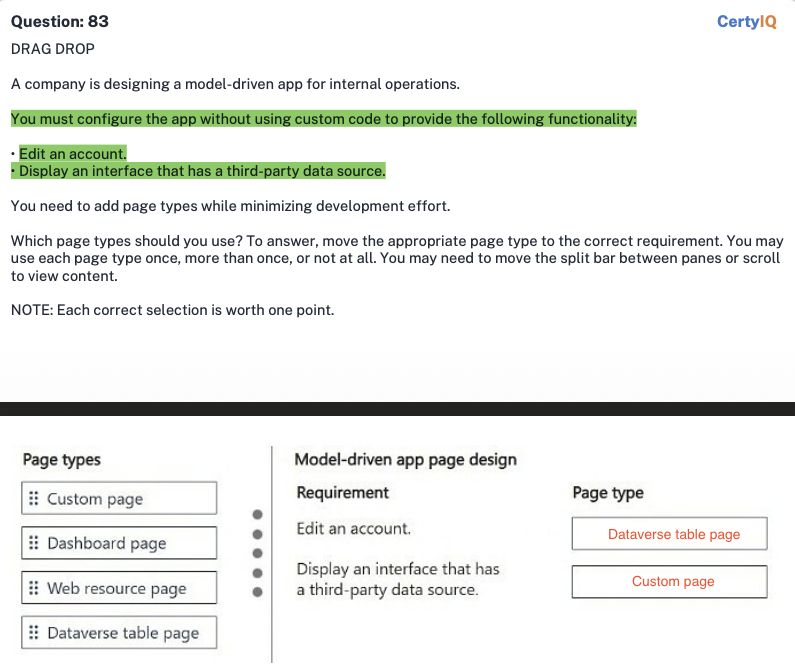

1. **Correct Answer:**
* **Edit an account:** `Dataverse table page`


* **Display an interface that has a third-party data source:** `Custom page`


2. **Core Concept & Domain:** Model-Driven App Page Architecture & Converged Apps (Dataverse Table Pages, Custom Pages, Dashboards, and Web Resources) — specifically selecting the appropriate model-driven app page type based on data source origin and low-code constraints.


3. **Why It Is Correct:**
* **Edit an account $\rightarrow$ `Dataverse table page`:** `Account` is a standard, native Microsoft Dataverse table. Adding a **Dataverse table page** to a model-driven app automatically generates the standard views and main forms needed to view, create, and edit Account records out-of-the-box with zero custom code and minimal development effort.


* **Display an interface that has a third-party data source $\rightarrow$ `Custom page`:** A **Custom page** is a specialized canvas app page type embedded natively inside a model-driven app (supporting full-page, dialog, or side-pane layouts). Because custom pages leverage Power Platform's 1,000+ standard, premium, and custom connectors alongside low-code Power Fx expressions, they allow makers to build custom UIs connected directly to third-party data sources without writing custom code.


4. **Why Other Options Are Wrong:**
* **`Dashboard page`:** Dashboards aggregate and display charts, views, and Power BI tiles for Dataverse data. They are designed for data visualization and KPI monitoring rather than providing an interactive data-entry form to edit an Account record or building a custom interface backed by a third-party connector.


* **`Web resource page`:** Web resources in model-driven apps rely on custom HTML, JavaScript, CSS, or image files uploaded by developers. Using a web resource page directly violates the prompt's explicit constraint to *"configure the app without using custom code"* and *"minimizing development effort"*.


5. **Exam Trap / Tip:**
* **Key Discriminators — "without using custom code" & "third-party data source":** Whenever a model-driven app question asks for a custom UI or integration with a **non-Dataverse / third-party data source** while prohibiting custom code, **Custom page** is the exact converged-app feature Microsoft tests—never a **Web resource page** (which implies HTML/JavaScript pro-code development). Conversely, standard CRUD operations on native Dataverse tables like Account always map to a **Dataverse table page**.

## Q84

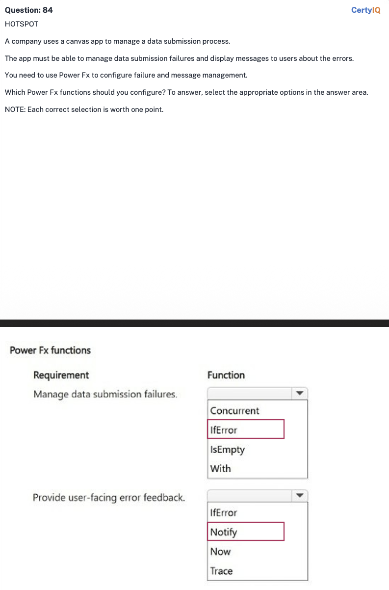

1. **Correct Answer:**
* **Manage data submission failures:** `IfError`


* **Provide user-facing error feedback:** `Notify`


2. **Core Concept & Domain:** Canvas App Power Fx Error Handling & User Feedback (`IfError()` and `Notify()`) — specifically intercepting runtime data mutation exceptions (such as `Patch()` or `SubmitForm()` failures) and surfacing user-friendly notification banners inside a canvas app.


3. **Why It Is Correct:**
* **Manage data submission failures $\rightarrow$ `IfError`:** In Power Fx, `IfError( Value1, Replacement1, ... )` evaluates expressions sequentially and intercepts any runtime or data source submission errors before they crash or leave the app in an unhandled error state. When wrapping a data submission call like `Patch(...)`, `IfError` catches the failure, exposes error details via the `FirstError` and `AllErrors` context objects, and executes fallback recovery or notification logic.


* **Provide user-facing error feedback $\rightarrow$ `Notify`:** The `Notify( Message, NotificationType, Timeout )` function displays an immediate, dismissible banner message at the top of the user's active screen in the canvas app. Passing `NotificationType.Error` (e.g., `Notify("Submission failed: " & FirstError.Message, NotificationType.Error)`) renders a red error banner directly to the end user.


4. **Why Other Options Are Wrong:**
* **Dropdown 1 — `Concurrent`, `IsEmpty`, `With`:**
* `Concurrent` executes multiple independent formulas simultaneously in parallel to improve performance, not to catch or handle errors.


* `IsEmpty` checks whether a table contains zero records, which does not intercept runtime submission exceptions.


* `With` creates locally scoped named values to simplify complex formulas and improve readability, without providing exception handling.


* **Dropdown 2 — `IfError`, `Now`, `Trace`:**
* `IfError` detects and intercepts errors in logic, but it does not render any visual UI message to the user on its own.


* `Now` returns the current local date and time value.


* `Trace` logs diagnostic telemetry events silently in the background to Power Apps Monitor and Azure Application Insights for developers/admins—end users never see `Trace` output in the UI.


5. **Exam Trap / Tip:**
* **`Notify()` vs. `Trace()`:** A classic Power Fx exam distinction is audience visibility. Always map **"user-facing error feedback" / "display messages to users"** to **`Notify()`** (visible UI banner), and map **"administrator/developer diagnostics" / "Application Insights / Monitor telemetry"** to **`Trace()`** (invisible background logging).


## Q85

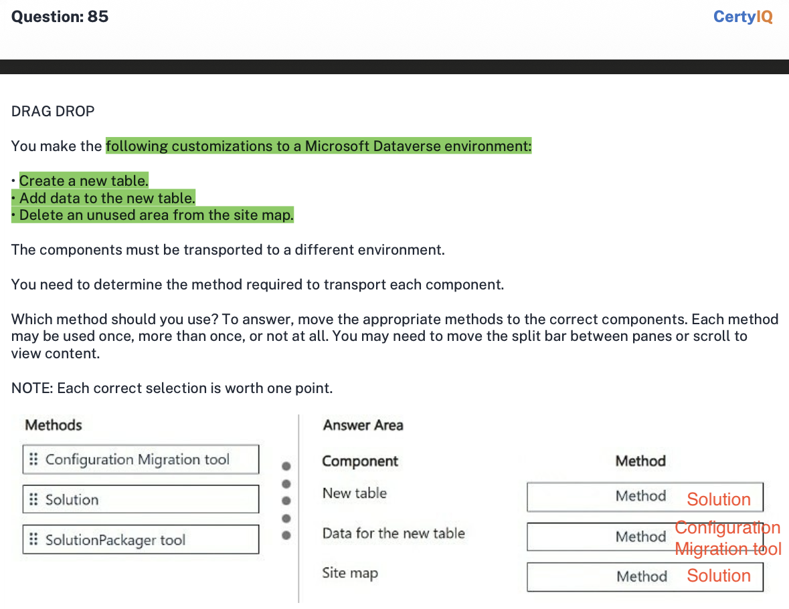


### 1. Extracted Question Summary

* **Scenario:** You make three customizations to a Microsoft Dataverse environment:
1. Create a new table.
2. Add data to the new table.
3. Delete an unused area from the site map.


* **Task:** Match each component to the required transportation method to move it to a different environment (methods may be used once, more than once, or not at all).
* **Available Methods:**
* `Configuration Migration tool`
* `Solution`
* `SolutionPackager tool`


* **Answer Area Targets:**
* `New table`
* `Data for the new table`
* `Site map`


### 2. Correct Answer

* **New table:** **Solution**
* **Data for the new table:** **Configuration Migration tool**
* **Site map:** **Solution**

### 4. Official Microsoft Justification

* **Schema and Metadata via Solutions:** Per Microsoft Power Platform Application Lifecycle Management (ALM) documentation, Dataverse solutions are the standard mechanism for transporting schema, metadata, and UI navigation customizations across environments. Both custom **tables** (definitions/columns/relationships) and **site maps** are solution-aware metadata components.
* **Deletion Behavior in Managed Solutions:** When you delete an unused area from a site map in a development environment and export that updated site map inside a **managed solution**, importing it into a target environment overwrites/merges the active solution layer appropriately, removing the unused area from the rendered navigation.
* **Reference Data via Configuration Migration Tool:** Solutions only transport metadata/schema, never table records (data). To move configuration or reference data across environments while preserving record GUIDs and relationships, Microsoft provides the **Configuration Migration tool** (`DataMigrationUtility.exe` / PAC CLI `pac data`).

### 5. Distractor Analysis (Why Others Are Wrong)

* **SolutionPackager tool:** This command-line tool unpacks a compressed solution `.zip` file into individual XML/JSON source files for source control (Git/Azure DevOps) and repacks them back into a `.zip` file. It manages source-control decomposition, not environment-to-environment transport of individual components or table records.
* **Using Solution for "Data for the new table":** Solutions are strictly metadata containers; adding a table to a solution includes its schema, forms, and views, but zero rows of data.
* **Using Configuration Migration tool for "New table" or "Site map":** The Configuration Migration tool strictly exports and imports record data based on an existing schema; it cannot create new tables or modify site map XML definitions in the target environment.

### 6. Exam Keyword / Trap Alert

* **Trigger Phrase:** Whenever a question asks how to transport **data / records** (such as lookup values, configuration records, or rows added to a table) alongside schema changes, immediately pair **Configuration Migration tool** with the data requirement and **Solution** with all metadata/UI components (tables, forms, views, site maps).
* **Common Trap:** Candidates often hesitate to select **Solution** when the prompt mentions *"Delete an unused area from the site map,"* confusing component deletion (which requires Upgrade/Stage for Upgrade when deleting an *entire* component from a managed solution) with editing the internal XML of a site map component (removing an area inside the site map designer simply updates the site map definition transported by a standard solution).


## Q86

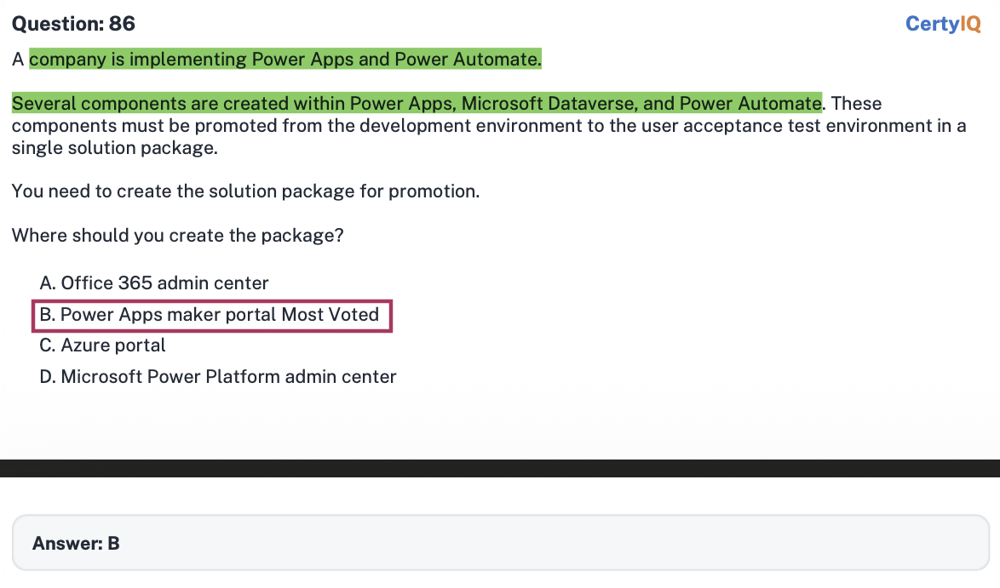

### 1. Extracted Question Summary

* **Scenario:** A company is implementing Power Apps and Power Automate. Several components are created within Power Apps, Microsoft Dataverse, and Power Automate, and they must be promoted from the development environment to the user acceptance test (UAT) environment in a single solution package.
* **Question:** Where should you create the package?
* **Options:**
* A. Office 365 admin center
* B. Power Apps maker portal
* C. Azure portal
* D. Microsoft Power Platform admin center


### 2. Correct Answer

* **B. Power Apps maker portal**


### 3. Verification of Visible Selection / Community Key

* **Correct:** The visible selection (**B. Power Apps maker portal**, marked `Most Voted` and `Answer: B`) is accurate because Dataverse solutions for bundling Power Apps, Dataverse, and Power Automate components are created, managed, and exported directly within the Power Apps maker portal (`make.powerapps.com`).


### 4. Official Microsoft Justification

* **Unified Solution Management in the Maker Portal:** According to Microsoft Power Platform Application Lifecycle Management (ALM) documentation, solutions are the primary mechanism for packaging and transporting related customizations—including apps, cloud flows, tables, security roles, and environment variables—across environments.
* **Where Solutions Are Built:** Makers create, edit, add existing components to, and export solutions (as managed or unmanaged `.zip` packages) in the **Power Apps maker portal** (`make.powerapps.com`) under the **Solutions** navigation pane (the same unified Dataverse solution interface is also surfaced inside `make.powerautomate.com`, though `make.powerapps.com` is the primary authoring hub).

### 5. Distractor Analysis (Why Others Are Wrong)

* **A. Office 365 admin center (now Microsoft 365 admin center):** Used for tenant-level user licensing, billing, domain management, and Microsoft 365 service settings, not for building or exporting Power Platform solution packages.
* **C. Azure portal:** Used for managing Microsoft Azure infrastructure, Microsoft Entra ID, Azure Key Vault, and cloud resources, not Power Platform Dataverse solutions.
* **D. Microsoft Power Platform admin center:** Used by administrators for environment lifecycle operations (creating/copying/backing up environments), Data Loss Prevention (DLP) policies, capacity monitoring, and tenant governance—not for authoring or packaging developer solutions.

### 6. Exam Keyword / Trap Alert

* **Trigger Phrase:** Look for **"promote components... in a single solution package"** or **"create/export a solution"**—solution authoring and packaging always happen in the **Power Apps maker portal** (`make.powerapps.com`), whereas environment provisioning and DLP governance belong to the **Microsoft Power Platform admin center** (`admin.powerplatform.microsoft.com`).
* **Common Trap:** Candidates frequently confuse the **Power Apps maker portal** with the **Microsoft Power Platform admin center** (Option D) because "promoting environments" sounds like an administrative task; remember that makers package solutions in the maker portal, while admins manage environments in the admin center.


## Q87

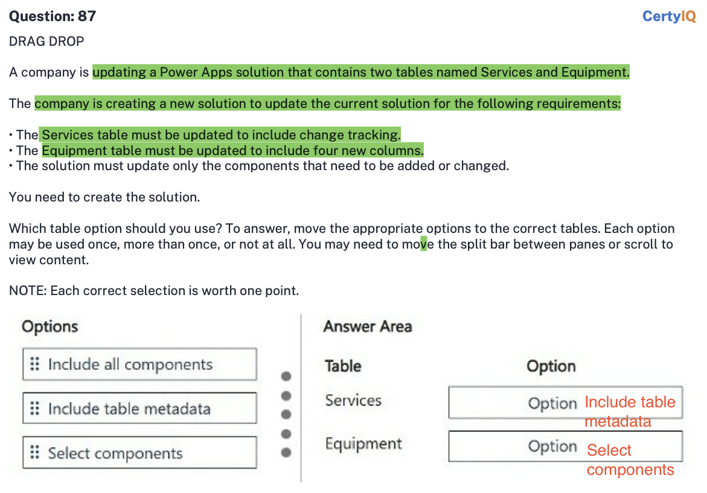


### 1. Extracted Question Summary

* **Scenario:** A company is updating a Power Apps solution that contains two tables named **Services** and **Equipment**. They are creating a new solution to update the current solution with the following requirements:
* The **Services** table must be updated to include **change tracking**.
* The **Equipment** table must be updated to include **four new columns**.
* The solution must update **only the components that need to be added or changed** (table segmentation).


* **Task:** Match each table to the appropriate table inclusion option when adding existing tables to the solution (options may be used once, more than once, or not at all).
* **Available Options:**
* `Include all components`
* `Include table metadata`
* `Select components`


* **Answer Area Targets:**
* `Services`
* `Equipment`


### 2. Correct Answer

* **Services:** **Include table metadata**
* **Equipment:** **Select components**

### 4. Official Microsoft Justification

* **Table Segmentation in Power Apps Solutions:** Per Microsoft Power Platform ALM documentation (*Organize solutions* / *Add existing tables to a solution*), when adding an existing Dataverse table to a solution, you can segment what gets packaged to avoid unnecessary dependencies and keep solution patches/updates minimal:
* **Include table metadata:** Packages only the table-level properties and settings (such as **change tracking**, auditing, offline capability, and primary name settings) without pulling in any subcomponents (columns, forms, views, relationships, business rules). Because the **Services** table only requires enabling **change tracking** (a table-level property), **Include table metadata** satisfies the requirement with zero extra subcomponents.
* **Select components:** Opens the subcomponent picker so you can explicitly choose only the specific columns, forms, views, or relationships to include. Because the **Equipment** table requires adding **four new columns** while updating *only* the changed/added components, **Select components** lets you pick strictly those four columns without pulling in the entire table definition or unrelated forms/views.


### 5. Distractor Analysis (Why Others Are Wrong)

* **Include all components:** Pulls the entire table—all metadata, every existing column, form, view, relationship, chart, and business rule—into the solution. This directly violates the explicit requirement that *"the solution must update only the components that need to be added or changed."*
* **Using `Select components` for `Services`:** The subcomponent picker (`Select components`) lets you select child objects (columns, views, forms, relationships), whereas table-level settings like **change tracking** are governed by the **Include table metadata** checkbox.
* **Using `Include table metadata` for `Equipment`:** Including only table metadata omits all columns, meaning the four new columns on the **Equipment** table would not be packaged in the solution.

### 6. Exam Keyword / Trap Alert

* **Trigger Phrases:**
* **"Change tracking" / "Auditing" / "Table properties"** + *"update only changed components"* $\rightarrow$ **Include table metadata**.
* **"New columns" / "Specific view or form"** + *"update only changed components"* $\rightarrow$ **Select components**.


* **Common Trap:** Candidates often overlook **Include table metadata** and pick **Select components** for both tables, forgetting that table-level toggles like **change tracking** live in table metadata rather than as selectable child components.


## Q88

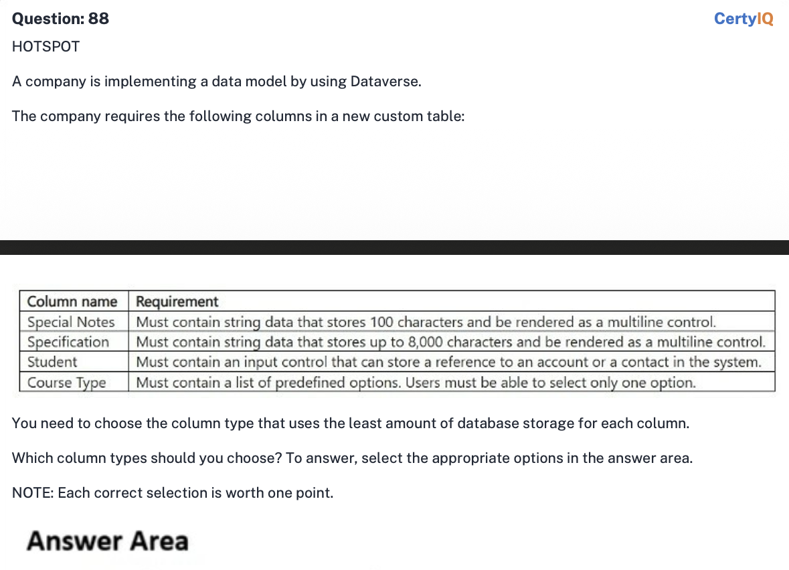

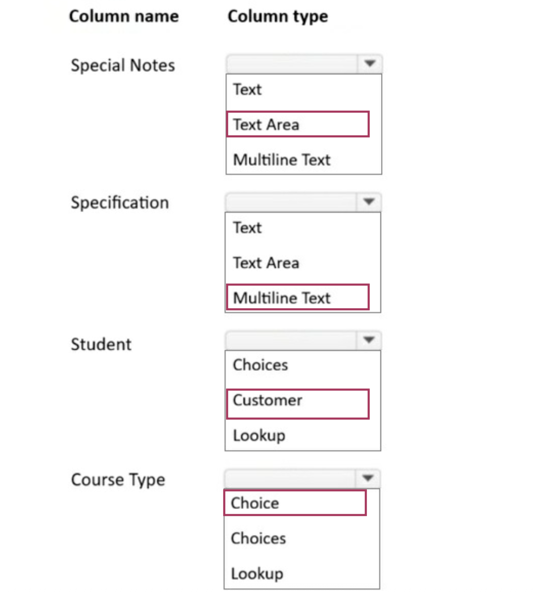


### 1. Extracted Question Summary

* **Scenario:** A company is implementing a data model in Microsoft Dataverse and requires four columns in a new custom table, using the column type that consumes the **least amount of database storage** for each requirement:
1. **Special Notes:** Must contain string data that stores **100 characters** and be rendered as a **multiline control**.
2. **Specification:** Must contain string data that stores **up to 8,000 characters** and be rendered as a **multiline control**.
3. **Student:** Must contain an input control that can store a reference to an **account or a contact** in the system.
4. **Course Type:** Must contain a list of predefined options where users can select **only one option**.


* **Dropdown Options per Column:**
* **Special Notes:** `Text`, `Text Area`, `Multiline Text`
* **Specification:** `Text`, `Text Area`, `Multiline Text`
* **Student:** `Choices`, `Customer`, `Lookup`
* **Course Type:** `Choice`, `Choices`, `Lookup`


### 2. Correct Answer

* **Special Notes:** **Text Area**
* **Specification:** **Multiline Text**
* **Student:** **Customer**
* **Course Type:** **Choice**

### 4. Official Microsoft Justification

* **Dataverse String Column Types & Storage Optimization:** Per Microsoft Dataverse column data type documentation (*Types of columns*):
* **Text Area** (`Single line of text` with format `Text Area`, up to 4,000 characters) renders as a multiline text box on forms while remaining a standard `nvarchar(n)` column in SQL storage—using far less storage overhead than a `Multiline Text` (`ntext`/`nvarchar(max)`) column. For 100 characters rendered as a multiline control, **Text Area** is the most storage-efficient valid option.
* **Multiline Text** (`Multiple lines of text`, up to 1,048,576 characters) is required whenever a string exceeds the 4,000-character limit of `Text` and `Text Area`. Since **Specification** must store up to **8,000 characters**, **Multiline Text** is the only capable option.


* **Polymorphic Account/Contact Reference (`Customer`):** Dataverse provides a specialized **Customer** lookup data type that creates a polymorphic relationship allowing a single column to reference either an **Account** or a **Contact** record.
* **Single-Select Option Set (`Choice`):** A **Choice** column stores a single integer value representing one selected item from a predefined list of options, whereas **Choices** stores multiple comma-separated integer values for multi-select scenarios.

### 5. Distractor Analysis (Why Others Are Wrong)

* **Special Notes — `Text` vs. `Multiline Text`:** `Text` (Single line of text with `Text` format) renders as a single-line input box rather than a multiline control. `Multiline Text` supports multiline rendering, but allocates `nvarchar(max)` storage, violating the requirement to use the *least amount of database storage* when 100 characters fits easily inside `Text Area` (max 4,000).
* **Specification — `Text` and `Text Area`:** Both `Text` and `Text Area` have a hard maximum length of **4,000 characters** in Dataverse and cannot store 8,000 characters.
* **Student — `Lookup` and `Choices`:** A standard **Lookup** column targets only *one* specific table (either Account *or* Contact, not both). **Choices** stores predefined option-set values, not references to table records.
* **Course Type — `Choices` and `Lookup`:** **Choices** allows users to select *multiple* options simultaneously, violating the single-selection requirement. **Lookup** references records in another Dataverse table rather than a lightweight predefined option list, consuming significantly more database storage and relational overhead.

### 6. Exam Keyword / Trap Alert

* **Trigger Phrases:**
* **"100 characters" + "multiline control" + "least amount of database storage"** $\rightarrow$ Always pick **Text Area** (max 4,000 chars), NOT `Multiline Text`. Anything over **4,000 characters** (e.g., 8,000 characters) forces **Multiline Text**.
* **"Reference to an account or a contact"** $\rightarrow$ Always **Customer** (polymorphic lookup).
* **"Select only one option"** $\rightarrow$ **Choice** (singular) vs. **Choices** (plural, multi-select).


## Q89

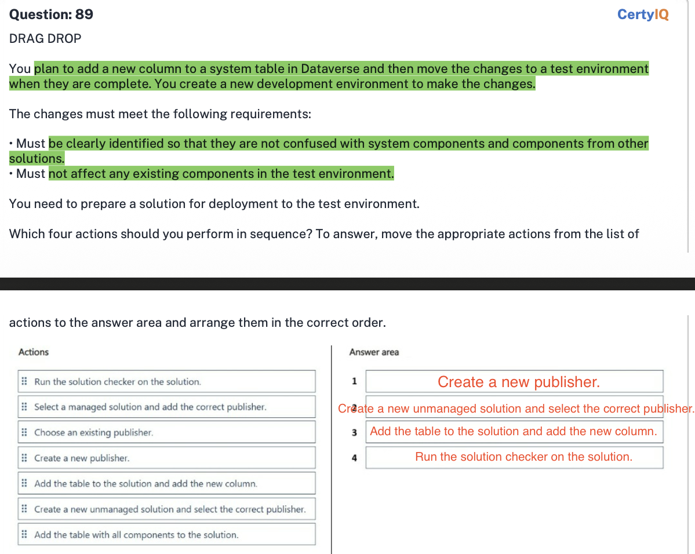

### 1. Extracted Question Summary

* **Scenario:** You plan to add a new column to a system table in Dataverse and move the changes to a test environment when complete. You create a new development environment to make the changes.
* **Requirements:**
* Must be clearly identified so that they are not confused with system components and components from other solutions.
* Must not affect any existing components in the test environment.


* **Task:** Select and arrange four actions in the correct sequence to prepare a solution for deployment to the test environment.
* **Available Actions:**
* `Run the solution checker on the solution.`
* `Select a managed solution and add the correct publisher.`
* `Choose an existing publisher.`
* `Create a new publisher.`
* `Add the table to the solution and add the new column.`
* `Create a new unmanaged solution and select the correct publisher.`
* `Add the table with all components to the solution.`


### 2. Correct Answer

1. **Create a new publisher.**
2. **Create a new unmanaged solution and select the correct publisher.**
3. **Add the table to the solution and add the new column.**
4. **Run the solution checker on the solution.**

### 4. Official Microsoft Justification

* **Publisher Prefix Isolation (`Create a new publisher`):** Per Microsoft Power Platform ALM documentation (*Solution publisher* and *Create a solution*), every solution requires a publisher that defines a unique customization prefix (e.g., `contoso_`) and option value prefix. Because you just created a **new development environment** and must ensure components are clearly identified and not confused with system components or other solutions, creating a dedicated custom publisher first ensures your new column receives a distinct schema prefix.
* **Unmanaged Authoring (`Create a new unmanaged solution and select the correct publisher`):** All active development and customization in a development environment must occur inside an **unmanaged solution** linked to your custom publisher (solutions are only exported as *managed* when deploying downstream to Test/Production).
* **Table Segmentation (`Add the table to the solution and add the new column`):** When customizing a system table, you add the existing table without selecting *all components* (table segmentation) and create/include only the new column so you do not overwrite or affect existing components in the target test environment.
* **Pre-Deployment Validation (`Run the solution checker on the solution`):** Before exporting and deploying a solution to a test environment, Microsoft recommends running the **Solution Checker** to perform static analysis against best-practice rules and catch performance, security, or dependency issues early.

### 5. Distractor Analysis (Why Others Are Wrong)

* **Select a managed solution and add the correct publisher:** You cannot create or directly author new columns inside a *managed* solution in a development environment; you always author in an **unmanaged** solution and choose *Managed* during the export step.
* **Choose an existing publisher:** Because you created a brand-new development environment, only default publishers (such as the Default Publisher with the generic `new_` prefix or `crXXX_`) exist; using them risks prefix collisions and confusion with other solutions.
* **Add the table with all components to the solution:** Including *all* subcomponents of a system table pulls in unmodified forms, views, and columns, risking unintended overwrites and violating the requirement that changes *"must not affect any existing components in the test environment."*

### 6. Exam Keyword / Trap Alert

* **Trigger Phrases:**
* **"New development environment"** + **"clearly identified / not confused with system components"** $\rightarrow$ Always start with **Create a new publisher** (to establish a custom schema prefix) before creating the **unmanaged solution**.
* **"Must not affect any existing components"** $\rightarrow$ Avoid *"with all components"* and pick **Add the table to the solution and add the new column** (segmented table inclusion).


## Q90

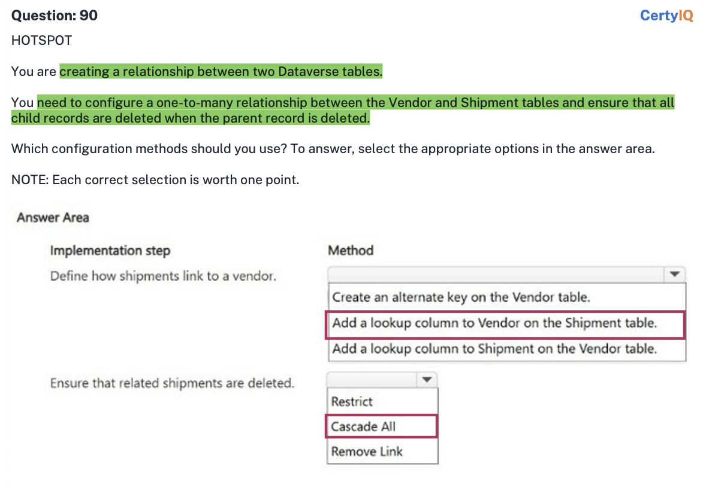

### 1. Extracted Question Summary

* **Scenario:** You are creating a one-to-many ($1:N$) relationship between the **Vendor** (parent) and **Shipment** (child) Dataverse tables, and you must ensure that all child records (`Shipment`) are deleted when the parent record (`Vendor`) is deleted.
* **Answer Area Targets & Dropdown Options:**
* **Define how shipments link to a vendor:**
* `Create an alternate key on the Vendor table.`
* `Add a lookup column to Vendor on the Shipment table.`
* `Add a lookup column to Shipment on the Vendor table.`


* **Ensure that related shipments are deleted:**
* `Restrict`
* `Cascade All`
* `Remove Link`


### 2. Correct Answer

* **Define how shipments link to a vendor:** **Add a lookup column to Vendor on the Shipment table.**
* **Ensure that related shipments are deleted:** **Cascade All**

### 4. Official Microsoft Justification

* **One-to-Many ($1:N$) Relationship Modeling:** Per Microsoft Dataverse documentation (*Create and edit 1:N (one-to-many) or N:1 (many-to-one) table relationships*), in a $1:N$ relationship between a parent table (**Vendor**) and a child table (**Shipment**), the foreign key reference is always stored as a **Lookup column on the child ("many") table** pointing to the parent ("one") table—meaning you add a lookup column to **Vendor** on the **Shipment** table.
* **Cascading Delete Behavior (`Cascade All`):** Under Dataverse relationship behaviors (specifically the **Delete** action within *Parental* or *Custom* relationship behavior), setting Delete to **Cascade All** ensures that when a parent **Vendor** record is deleted, all related child **Shipment** records are automatically deleted as well.

### 5. Distractor Analysis (Why Others Are Wrong)

* **Create an alternate key on the Vendor table:** Alternate keys uniquely identify records using non-GUID columns (commonly used for external data integration/upsert operations), not for establishing a $1:N$ parent-child table relationship.
* **Add a lookup column to Shipment on the Vendor table:** This reverses the relationship direction, making **Shipment** the parent ("one") and **Vendor** the child ("many"), allowing each vendor to link to only one shipment rather than one vendor having many shipments.
* **Restrict:** Prevents the parent **Vendor** record from being deleted as long as any related child **Shipment** records still exist.
* **Remove Link:** Deletes the parent **Vendor** record and clears (nulls out) the lookup column on all related **Shipment** records, leaving the child shipment records intact rather than deleting them.

### 6. Exam Keyword / Trap Alert

* **Trigger Phrases:**
* **"One-to-many relationship between [Parent] and [Child]"** $\rightarrow$ Always place the **Lookup column to [Parent] on the [Child] table** (the lookup always lives on the "Many" side).
* **"All child records are deleted when the parent record is deleted"** $\rightarrow$ **Cascade All** (also the default Delete behavior when choosing the **Parental** relationship type).


## Q91

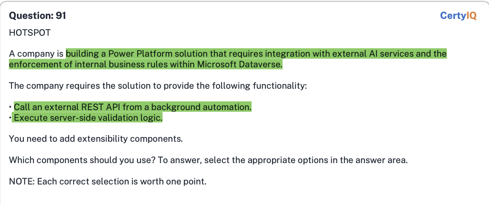

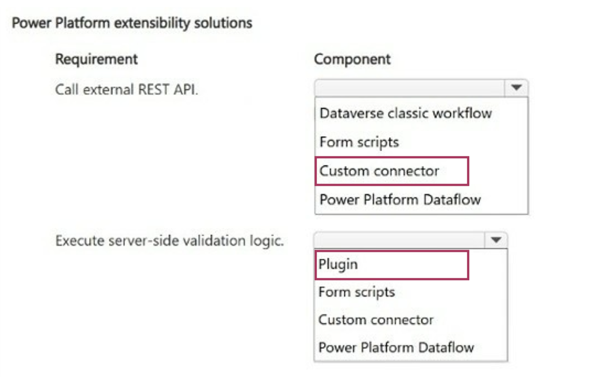


### 1. Extracted Question Summary

* **Scenario:** A company is building a Power Platform solution that integrates with external AI services and enforces internal business rules within Microsoft Dataverse.
* **Requirements & Dropdown Options:**
* **Call external REST API** (from a background automation):
* `Dataverse classic workflow`
* `Form scripts`
* `Custom connector`
* `Power Platform Dataflow`


* **Execute server-side validation logic:**
* `Plugin`
* `Form scripts`
* `Custom connector`
* `Power Platform Dataflow`


### 2. Correct Answer

* **Call external REST API:** **Custom connector**
* **Execute server-side validation logic:** **Plugin**

### 4. Official Microsoft Justification

* **REST API Integration (`Custom connector`):** Per Microsoft Power Platform extensibility documentation (*Use custom connectors in Power Automate and Power Apps*), a **Custom connector** wraps an external REST API (via an OpenAPI/Swagger definition, Postman collection, or from scratch) so background automations like Power Automate cloud flows and Copilot Studio agents can invoke external HTTP endpoints securely with authentication and strongly typed schemas.
* **Server-Side Validation (`Plugin`):** Per Microsoft Dataverse developer documentation (*Use plug-ins to extend business processes*), a **Plug-in** is custom .NET code registered on specific Dataverse Event Execution Pipeline stages (such as `PreValidation` or `PreOperation`). Because plug-ins execute synchronously on the server inside the Dataverse database transaction, they enforce data integrity and validation rules regardless of how records are created or updated (UI, API, or background flow).

### 5. Distractor Analysis (Why Others Are Wrong)

* **Dataverse classic workflow:** Legacy no-code automation engine that cannot natively invoke arbitrary external REST APIs without writing custom .NET workflow activities—and Microsoft officially recommends Power Automate + Custom Connectors instead.
* **Form scripts:** Client-side JavaScript web resources that run strictly inside a user's browser on model-driven app forms (`OnLoad`, `OnChange`, `OnSave`). They cannot run in background automations and do not enforce server-side validation when data is modified via APIs or flows.
* **Power Platform Dataflow:** Used for scheduled self-service ETL (extract, transform, load) data ingestion into Dataverse or Azure Data Lake using Power Query, not for transactional REST API calls in background workflows or synchronous server-side validation.

### 6. Exam Keyword / Trap Alert

* **Trigger Phrases:**
* **"Call an external REST API"** $\rightarrow$ **Custom connector**.
* **"Server-side validation logic"** $\rightarrow$ **Plugin** (always contrast server-side **Plugin** against client-side **Form scripts**).


## Q92
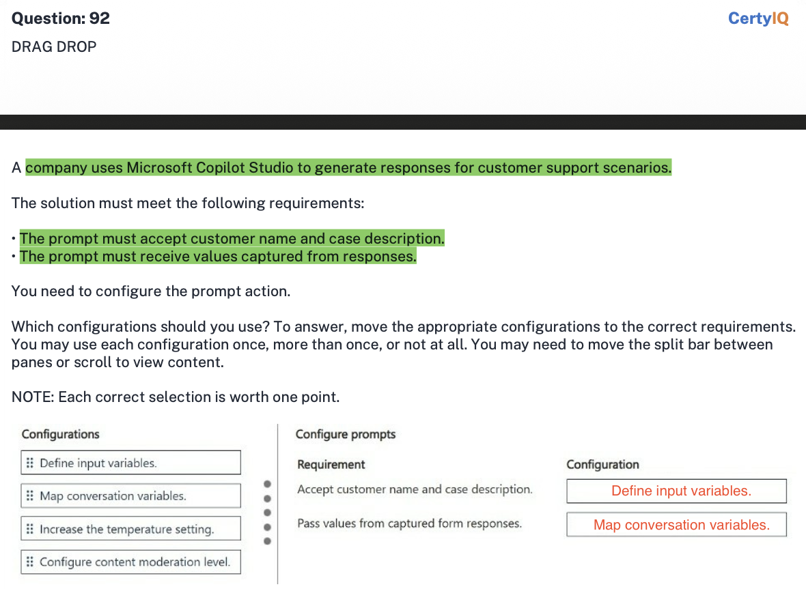

### 1. Extracted Question Summary

* **Scenario:** A company uses Microsoft Copilot Studio to generate responses for customer support scenarios. You need to configure a prompt action to meet two requirements:
1. Accept customer name and case description.
2. Pass values from captured form responses (captured from responses in the conversation).


* **Available Configurations:**
* `Define input variables.`
* `Map conversation variables.`
* `Increase the temperature setting.`
* `Configure content moderation level.`


* **Answer Area Targets:**
* `Accept customer name and case description.`
* `Pass values from captured form responses.`


### 2. Correct Answer

* **Accept customer name and case description:** **Define input variables.**
* **Pass values from captured form responses:** **Map conversation variables.**

### 4. Official Microsoft Justification

* **Defining Prompt Parameters (`Define input variables`):** Per Microsoft Copilot Studio and AI Builder prompt documentation (*Add inputs to a prompt* / *Use a prompt action in Copilot Studio*), to allow a custom prompt to dynamically accept runtime values such as a customer's name and case description, you first declare **input variables** inside the prompt builder and insert them into the prompt instructions.
* **Binding Runtime Topic/Form Data (`Map conversation variables`):** When a prompt is added as a tool/action inside a Copilot Studio topic (for example, after an Adaptive Card form or Question node captures user responses into topic/conversation variables), you wire those captured runtime values into the prompt's inputs by **mapping conversation variables** (or Power Fx expressions referencing those variables) in the prompt node's **Inputs** configuration pane.

### 5. Distractor Analysis (Why Others Are Wrong)

* **Increase the temperature setting:** Controls the randomness/creativity of the generative model's output (higher values produce more varied phrasing, while lower values produce more deterministic responses). It does not define input parameters or pass runtime data into the prompt.
* **Configure content moderation level:** Adjusts the safety filtering threshold (Low, Medium, High) for harmful or inappropriate content in generative responses; it has nothing to do with accepting dynamic fields or binding captured form variables.

### 6. Exam Keyword / Trap Alert

* **Trigger Phrases:**
* **"Prompt must accept [field 1] and [field 2]"** $\rightarrow$ **Define input variables** (schema definition inside the prompt).
* **"Pass values from captured form responses"** $\rightarrow$ **Map conversation variables** (runtime binding inside the Copilot Studio topic/action).


## Q93
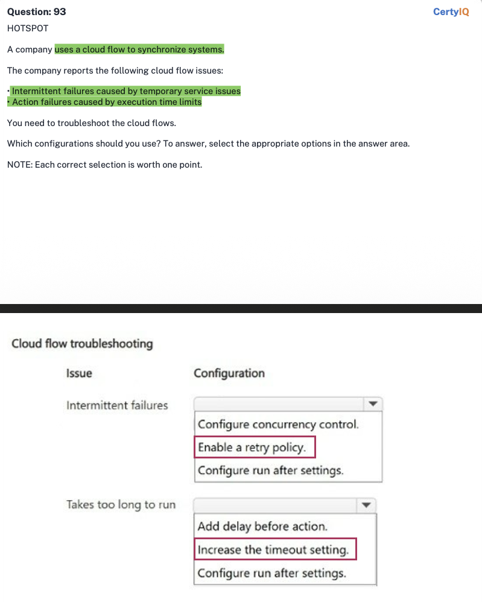

### 1. Extracted Question Summary

* **Scenario:** A company uses a Power Automate cloud flow to synchronize systems and reports two issues:
1. Intermittent failures caused by temporary service issues (`Intermittent failures`).
2. Action failures caused by execution time limits (`Takes too long to run`).


* **Answer Area Targets & Dropdown Options:**
* **Intermittent failures:**
* `Configure concurrency control.`
* `Enable a retry policy.`
* `Configure run after settings.`


* **Takes too long to run:**
* `Add delay before action.`
* `Increase the timeout setting.`
* `Configure run after settings.`


### 2. Correct Answer

* **Intermittent failures:** **Enable a retry policy.**
* **Takes too long to run:** **Increase the timeout setting.**

### 4. Official Microsoft Justification

* **Handling Transient Failures (`Enable a retry policy`):** Per Microsoft Power Automate documentation (*Handle errors in cloud flows* / *Retry policy*), transient network glitches, HTTP `429` throttling, or temporary `5xx` service outages are mitigated by configuring an action's **Retry Policy** (such as *Exponential Interval* or *Fixed Interval* with a specified retry count and interval) in the action's **Settings** pane.
* **Extending Action Duration (`Increase the timeout setting`):** Per Power Automate action settings documentation (*Timeout*), individual actions (especially long-running HTTP calls, custom connectors, or approval/webhook actions) can fail if they exceed their default execution duration limit. Configuring the **Timeout** setting using ISO 8601 duration format (e.g., `PT30M` or `P1D`) extends how long Power Automate waits for the action to complete before timing out.

### 5. Distractor Analysis (Why Others Are Wrong)

* **Configure concurrency control:** Controls the degree of parallelism (how many instances of a trigger or `Apply to each` loop execute simultaneously). Turning it down can help avoid API throttling, but it does not automatically retry an action when a temporary service failure occurs.
* **Configure run after settings:** Defines downstream branching logic *after* an action completes, fails, is skipped, or times out (for example, sending a failure notification or executing a `try/catch` cleanup scope). It handles the aftermath of a failure rather than preventing intermittent failures or extending an action's execution time limit.
* **Add delay before action:** Pauses the flow for a fixed duration before starting the action; it does not increase the maximum allowed execution time limit once the action actually begins running.

### 6. Exam Keyword / Trap Alert

* **Trigger Phrases:**
* **"Intermittent failures / temporary service issues / transient errors"** $\rightarrow$ **Enable a retry policy**.
* **"Execution time limits / takes too long to run"** $\rightarrow$ **Increase the timeout setting** (remember ISO 8601 duration syntax like `PT10M` or `P2D` if tested on format).


## Q94

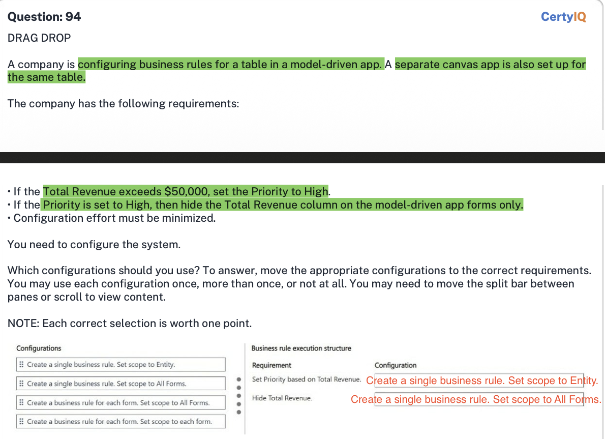

### 1. Extracted Question Summary

* **Scenario:** A company is configuring Dataverse business rules for a table used in both a model-driven app and a separate canvas app.
* **Requirements:**
1. If **Total Revenue** exceeds **$50,000**, set **Priority** to **High**.
2. If **Priority** is set to **High**, hide the **Total Revenue** column on the **model-driven app forms only**.
3. **Configuration effort must be minimized.**


* **Available Configurations:**
* `Create a single business rule. Set scope to Entity.`
* `Create a single business rule. Set scope to All Forms.`
* `Create a business rule for each form. Set scope to All Forms.`
* `Create a business rule for each form. Set scope to each form.`


* **Answer Area Targets (`Business rule execution structure`):**
* `Set Priority based on Total Revenue.`
* `Hide Total Revenue.`


### 2. Correct Answer

* **Set Priority based on Total Revenue:** **Create a single business rule. Set scope to Entity.**
* **Hide Total Revenue:** **Create a single business rule. Set scope to All Forms.**

### 4. Official Microsoft Justification

* **Server-Side Execution across All Apps (`Entity` scope):** Per Microsoft Dataverse documentation (*Create a business rule for a table* / *Business rule scope*), setting a business rule's scope to **Entity** runs the rule on the server whenever data is created or updated—including from **canvas apps**, model-driven apps, and APIs. However, `Entity`-scoped rules only support data-manipulation actions (such as *Set field value*, *Set default value*, *Clear field value*, and *Show error message*) and **cannot** execute UI-only actions like hiding/showing columns. Therefore, setting **Priority** to **High** across both the model-driven app and canvas app requires a single rule with scope set to **Entity**.
* **Client-Side Form UI Execution (`All Forms` scope):** UI actions such as **Set visibility** (hiding the **Total Revenue** column) only execute client-side on model-driven app forms. Setting the scope of a single business rule to **All Forms** applies the rule automatically to every main and quick-create form in the model-driven app while minimizing configuration effort (requiring only one rule instead of duplicating rules per form).

### 5. Distractor Analysis (Why Others Are Wrong)

* **Create a business rule for each form. Set scope to All Forms:** Contradicts itself and violates the requirement to **minimize configuration effort**—setting scope to *All Forms* already applies one rule across every form.
* **Create a business rule for each form. Set scope to each form:** Duplicates the exact same rule across individual forms unnecessarily, failing the requirement that *"configuration effort must be minimized."*
* **Using `All Forms` for "Set Priority based on Total Revenue":** Business rules scoped to `All Forms` run exclusively client-side in model-driven app forms and do **not** trigger when records are created or modified through the **separate canvas app**.
* **Using `Entity` for "Hide Total Revenue":** `Entity`-scoped business rules run on the server and do not support UI visibility actions (*Hide/Show column*).

### 6. Exam Keyword / Trap Alert

* **Trigger Phrases:**
* **"Separate canvas app is also set up"** + **Data action (`Set Priority`)** $\rightarrow$ **Set scope to Entity** (only `Entity` scope runs server-side for canvas apps).
* **"Hide [column] on the model-driven app forms only"** + **"Configuration effort must be minimized"** $\rightarrow$ **Create a single business rule. Set scope to All Forms**.


## Q95

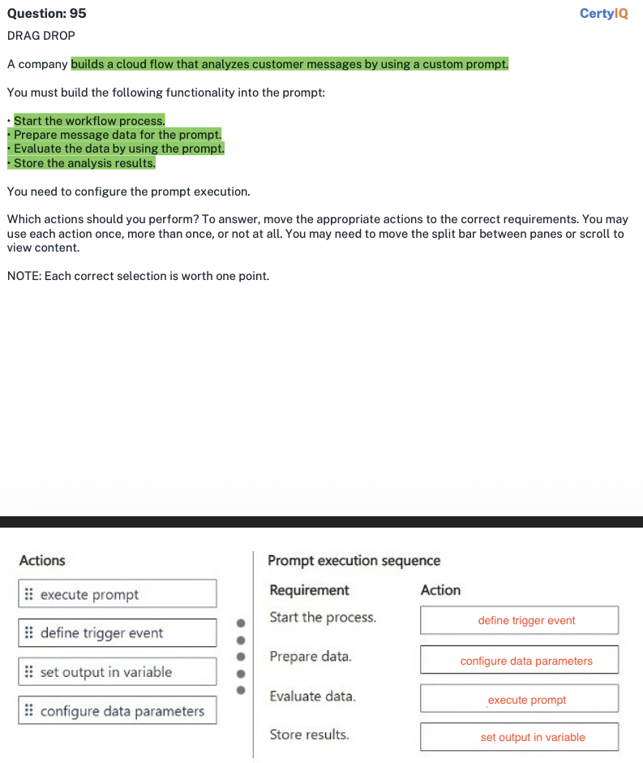

### 1. Extracted Question Summary

* **Scenario:** A company builds a Power Automate cloud flow that analyzes customer messages using a custom AI Builder / Power Platform prompt.
* **Requirements (`Prompt execution sequence`):**
1. `Start the process.` (Start the workflow process.)
2. `Prepare data.` (Prepare message data for the prompt.)
3. `Evaluate data.` (Evaluate the data by using the prompt.)
4. `Store results.` (Store the analysis results.)


* **Available Actions:**
* `execute prompt`
* `define trigger event`
* `set output in variable`
* `configure data parameters`


### 2. Correct Answer

* **Start the process:** **define trigger event**
* **Prepare data:** **configure data parameters**
* **Evaluate data:** **execute prompt**
* **Store results:** **set output in variable**

### 4. Official Microsoft Justification

* **End-to-End Prompt Execution Lifecycle in Power Automate:** Per Microsoft Power Platform / AI Builder documentation (*Use your prompt in Power Automate* / *Create text with GPT using a prompt*), integrating a custom prompt into a cloud flow follows a four-stage orchestration pipeline:
1. **Initiation (`define trigger event`):** Every cloud flow begins with a trigger event (e.g., *When a new email arrives* or *When a row is added in Dataverse*) that initiates the workflow when a customer message arrives.
2. **Input Preparation (`configure data parameters`):** Before invoking the model, you format/prepare and map the incoming message payload into the prompt's defined input parameters.
3. **Model Inference (`execute prompt`):** The **Run a prompt** action executes the custom prompt against the prepared input data to generate the analysis.
4. **Output Persistence (`set output in variable`):** Downstream actions capture the prompt's structured/text response (`Text` or JSON properties) into a flow variable or target column so the analysis results can be persisted or reused in subsequent workflow steps.


### 5. Distractor Analysis (Why Others Are Wrong)

* Because all four draggable actions map one-to-one in chronological execution order (`define trigger event` $\rightarrow$ `configure data parameters` $\rightarrow$ `execute prompt` $\rightarrow$ `set output in variable`), any swap between stages violates the execution lifecycle of a Power Automate flow—for instance, you cannot execute a prompt before configuring its input data parameters, nor can you store output variables before the prompt executes.

### 6. Exam Keyword / Trap Alert

* **Trigger Phrases:** Match the four lifecycle verbs directly to their architectural equivalents: **Start** $\rightarrow$ `define trigger event`, **Prepare** $\rightarrow$ `configure data parameters`, **Evaluate** $\rightarrow$ `execute prompt`, and **Store** $\rightarrow$ `set output in variable`.


## Q96

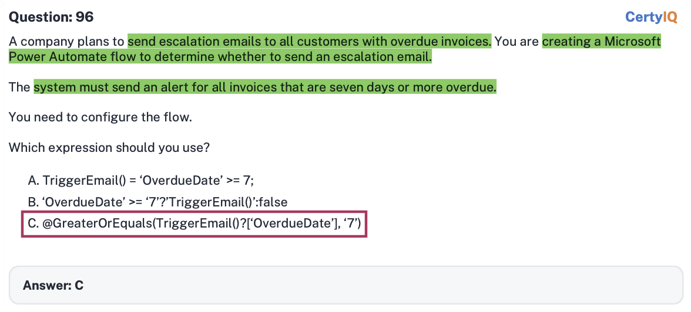

### 1. Extracted Question Summary

* **Scenario:** A company plans to send escalation emails to customers with overdue invoices. You are creating a Microsoft Power Automate cloud flow to determine whether to send an escalation email, and the system must send an alert for all invoices that are **seven days or more overdue**.
* **Question:** Which expression should you use?
* **Options:**
* A. `TriggerEmail() = ‘OverdueDate’ >= 7;`
* B. `‘OverdueDate’ >= ‘7’?’TriggerEmail()’:false`
* C. `@GreaterOrEquals(TriggerEmail()?[‘OverdueDate’], ‘7’)`


### 2. Correct Answer

* **C. `@GreaterOrEquals(TriggerEmail()?[‘OverdueDate’], ‘7’)**`


### 3. Verification of Visible Selection / Community Key

* **Correct:** The visible key (`Answer: C`) is **Correct** because Power Automate Workflow Definition Language expressions—including trigger conditions—must begin with `@` and use prefix comparison functions (`greaterOrEquals(...)`) rather than infix operators (`>=`) or ternary syntax.


### 4. Official Microsoft Justification

* **Azure Logic Apps / Power Automate Workflow Definition Language (WDL):** Per Microsoft Power Automate documentation (*Use expressions in conditions to check multiple values* and *Trigger conditions*), expressions evaluated at runtime (such as trigger conditions or Condition action expressions) follow WDL syntax:
* **Leading `@` Symbol:** Trigger conditions and raw JSON expression definitions begin with `@` to instruct the workflow engine to evaluate the expression rather than treat it as a literal string.
* **Prefix Logical Functions (`greaterOrEquals`):** WDL does not use C#/JavaScript infix operators (`>=`, `==`, `?:`). Instead, comparisons are expressed as prefix functions taking two arguments: `greaterOrEquals(value1, value2)`, which returns `true` when the first value is greater than or equal to the second.
* **Safe Property Access (`?['PropertyName']`):** Properties inside a trigger or action JSON payload are accessed using bracket notation with the null-conditional operator (`?['OverdueDate']`) so the expression safely evaluates to `null` rather than throwing a runtime error if the key is absent.


### 5. Distractor Analysis (Why Others Are Wrong)

* **A. `TriggerEmail() = ‘OverdueDate’ >= 7;`:** Uses invalid assignment (`=`), infix comparison (`>=`), and a trailing semicolon (`;`)—none of which are valid in Power Automate Workflow Definition Language.
* **B. `‘OverdueDate’ >= ‘7’?’TriggerEmail()’:false`:** Uses JavaScript/C-style ternary syntax (`? :`) and infix operators (`>=`) without a leading `@`, and compares the literal string `'OverdueDate'` rather than extracting a property from the trigger payload.

### 6. Exam Keyword / Trap Alert

* **Trigger Phrase:** Whenever you see **"seven days or more"** or **"greater than or equal to"** inside a Power Automate expression question, immediately look for `@greaterOrEquals(...)` (or `greaterOrEquals(...)`) paired with safe bracket property syntax (`?['FieldName']`).
* **Common Trap:** Dump questions occasionally capitalize function names (`GreaterOrEquals`) or use curly quotes (`‘’`) due to formatting conversion; ignore the casing/quote style and eliminate any option using infix symbols (`>=`, `==`, `&&`, `?:`).


## Q97

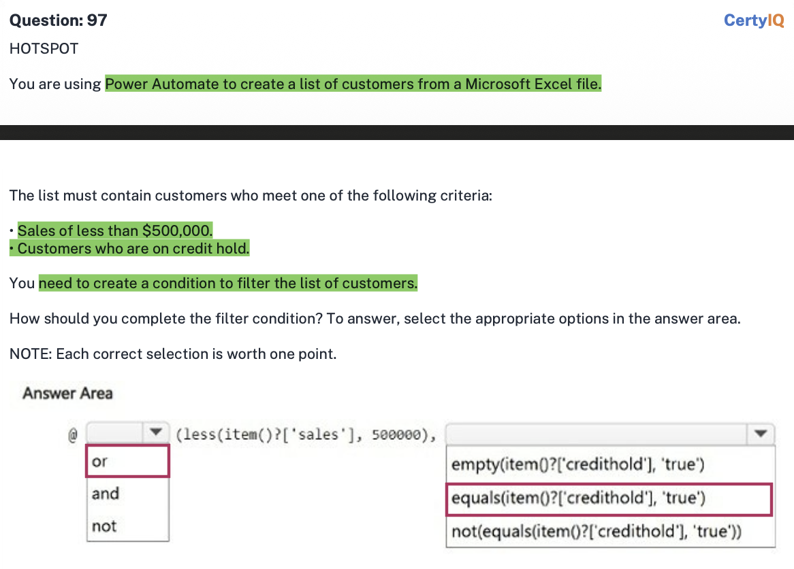

### 1. Extracted Question Summary

* **Scenario:** You are using Power Automate to create a list of customers from a Microsoft Excel file. The filtered list must include customers who meet **one** of the following criteria:
1. Sales of less than $500,000.
2. Customers who are on credit hold.


* **Answer Area Expression:** `@ [Dropdown 1] (less(item()?['sales'], 500000), [Dropdown 2] )`
* **Dropdown Options:**
* **Dropdown 1 (Logical Operator):** `or`, `and`, `not`
* **Dropdown 2 (Second Condition):**
* `empty(item()?['credithold'], 'true')`
* `equals(item()?['credithold'], 'true')`
* `not(equals(item()?['credithold'], 'true'))`


### 2. Correct Answer

* **Dropdown 1:** **or**
* **Dropdown 2:** **equals(item()?['credithold'], 'true')**


### 3. Verification of Visible Selection / Community Key

* **Correct:** The boxed selections in the screenshot (**`or`** and **`equals(item()?['credithold'], 'true')`**) accurately construct `@or(less(item()?['sales'], 500000), equals(item()?['credithold'], 'true'))`, matching both the inclusive "one of the following criteria" requirement and the credit hold condition.


### 4. Official Microsoft Justification

* **Filter Array Action & Workflow Definition Language (WDL):** Per Microsoft Power Automate documentation (*Use the Filter array action* and *Reference guide to workflow expression functions*):
* **`or(...)` Function:** Takes two or more boolean expressions and returns `true` if **at least one** expression evaluates to `true`. Because the scenario specifies customers who meet *"one of the following criteria,"* `or` is the required logical operator.
* **`equals(item()?['credithold'], 'true')`:** Inside a **Filter array** action, `item()` references the current JSON object being evaluated in the array (each Excel row). Excel connectors return cell values as strings in JSON payloads, so checking whether the `credithold` column equals `'true'` requires `equals(item()?['credithold'], 'true')`.


### 5. Distractor Analysis (Why Others Are Wrong)

* **Dropdown 1 — `and`:** Returns `true` only when *both* conditions are simultaneously satisfied (sales under $500,000 **and** on credit hold), which violates the requirement to match customers meeting *one* of the criteria.
* **Dropdown 1 — `not`:** Is a unary logical negation function accepting only *one* boolean argument (`not(expression)`), so passing two comma-separated conditions throws a syntax/argument-count error.
* **Dropdown 2 — `empty(item()?['credithold'], 'true')`:** Invalid syntax—the `empty(...)` function accepts only a single parameter (`empty(collectionOrString)`) to check whether a value is null or empty.
* **Dropdown 2 — `not(equals(item()?['credithold'], 'true'))`:** Inverts the boolean result, filtering for customers who are **not** on credit hold rather than customers who *are* on credit hold.

### 6. Exam Keyword / Trap Alert

* **Trigger Phrases:** Watch for **"meet one of the following criteria"** (or *"either... or"*) versus **"meet all of the following criteria"**—that single phrase directly determines whether Dropdown 1 is **`or`** vs. **`and`**.
* **Common Trap:** In Power Automate **Filter array** expressions, Excel Online (Business) rows expose column values as strings (e.g., `'true'`), which is why `equals(item()?['credithold'], 'true')` compares against the string `'true'` rather than a boolean `true`.


## Q98

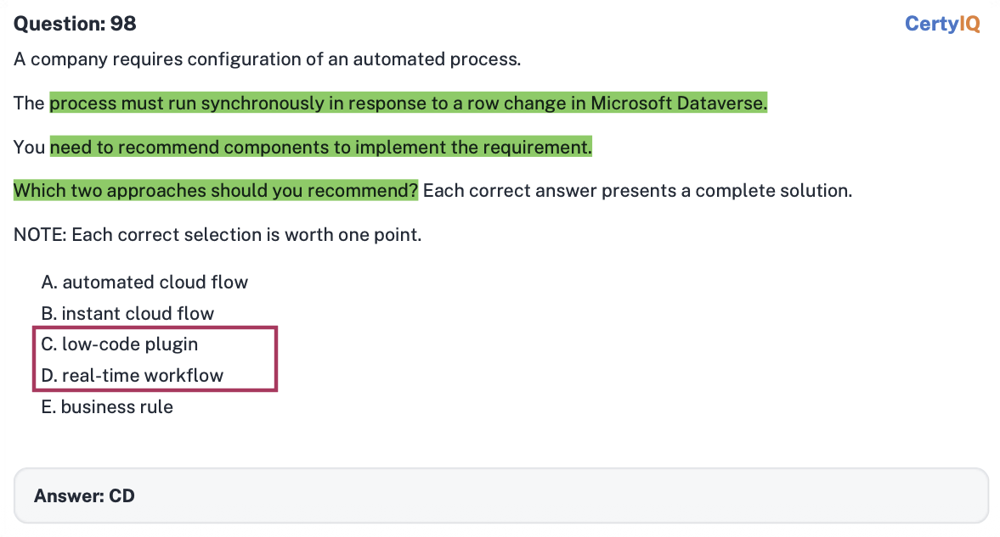

### 1. Extracted Question Summary

* **Scenario:** A company requires configuration of an automated process that must run **synchronously** in response to a row change in Microsoft Dataverse.
* **Question:** Which two approaches should you recommend? (Each correct answer presents a complete solution.)
* **Options:**
* A. automated cloud flow
* B. instant cloud flow
* C. low-code plugin
* D. real-time workflow
* E. business rule


### 2. Correct Answer

* **C. low-code plugin**
* **D. real-time workflow**


### 3. Verification of Visible Selection / Community Key

* **Correct:** The boxed selection and visible key (`Answer: CD`) are **Correct**, because both Dataverse automated low-code plug-ins and classic real-time (synchronous) workflows execute synchronously within the Dataverse event execution pipeline in response to row events.


### 4. Official Microsoft Justification

* **Synchronous Execution in Dataverse:** Per Microsoft Dataverse documentation (*Use low-code plug-ins in Dataverse* / *Overview of real-time workflows*), synchronous processes run immediately within the database transaction (before or after the core operation completes) and can cancel/roll back the operation if an error occurs:
* **Low-code plug-ins (Automated):** Built with Power Fx via the Dataverse Accelerator app, automated low-code plug-ins register directly on Dataverse table events (Create, Update, Delete) in the `PreOperation` or `PostOperation` synchronous stages of the event execution pipeline.
* **Real-time workflows:** Classic Dataverse workflows configured to run synchronously (by clearing *Run this workflow in the background*) execute immediately in response to record creation, status/field updates, assignment, or deletion within the same transaction pipeline.


### 5. Distractor Analysis (Why Others Are Wrong)

* **A. automated cloud flow:** All Power Automate cloud flows execute **asynchronously** outside the Dataverse database transaction pipeline after the record change has already committed.
* **B. instant cloud flow:** Triggered manually on demand (e.g., via a button press or Power Apps call) rather than automatically in response to a Dataverse row change, and executes asynchronously.
* **E. business rule:** While business rules run synchronously on forms or at the entity level, they are strictly declarative field-validation/visibility/calculation rules on a single record—they are not general-purpose automated workflow processes capable of cross-table operations or complex process automation.

### 6. Exam Keyword / Trap Alert

* **Trigger Phrases:** **"Run synchronously in response to a row change in Microsoft Dataverse"** is the classic AB-410/PL-400 discriminator eliminating all Power Automate cloud flows (which are strictly asynchronous).
* **Common Trap:** Candidates often dismiss **real-time workflow** because classic workflows are legacy, or dismiss **low-code plugin** thinking only C# plug-ins are synchronous—remember that in Power Platform architecture exams, both **low-code plug-ins** and **real-time workflows** are valid synchronous Dataverse automation mechanisms.


## Q99

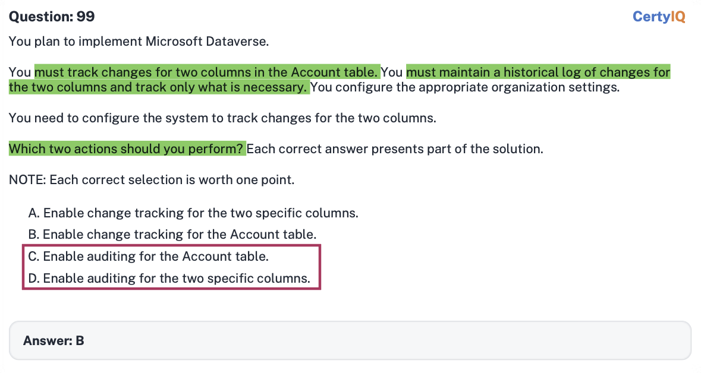

### 1. Extracted Question Summary

* **Scenario:** You plan to implement Microsoft Dataverse. You must track changes for two columns in the **Account** table, maintain a **historical log of changes** for those two columns, and track **only what is necessary** (after already configuring the appropriate organization settings).
* **Question:** Which two actions should you perform? (Each correct answer presents part of the solution.)
* **Options:**
* A. Enable change tracking for the two specific columns.
* B. Enable change tracking for the Account table.
* C. Enable auditing for the Account table.
* D. Enable auditing for the two specific columns.


### 2. Correct Answer

* **C. Enable auditing for the Account table.**
* **D. Enable auditing for the two specific columns.**

### 3. Verification of Visible Selection / Community Key

* **Incorrect:** The boxed selection in the screenshot (**B. Enable change tracking for the Account table**) is **Incorrect** (and only marks one choice for a two-answer question) because **Change tracking** only identifies delta changes for external data synchronization rather than maintaining a historical log of column value changes, which requires **Auditing** at both the table and column levels.

### 4. Official Microsoft Justification

* **Dataverse Auditing Architecture (Historical Change Log):** Per Microsoft Dataverse documentation (*Manage Dataverse auditing*), **Auditing** is the feature designed to maintain a **historical log of changes** (who changed a value, when, the old value, and the new value).
* **Three-Tier Hierarchical Enablement:** To audit specific columns while minimizing storage overhead (*"track only what is necessary"*), auditing must be enabled across three levels:
1. **Environment / Organization level** (*Start Auditing* — already completed in the scenario).
2. **Table level** (**Enable auditing for the Account table** — required before individual columns on that table can be audited).
3. **Column level** (**Enable auditing for the two specific columns** — when you enable auditing on a table, all columns default to audited unless you disable auditing on the remaining columns so only the two required columns are tracked).


### 5. Distractor Analysis (Why Others Are Wrong)

* **A. Enable change tracking for the two specific columns:** Invalid capability—Dataverse **Change tracking** is strictly a table-level property and cannot be configured per individual column.
* **B. Enable change tracking for the Account table:** **Change tracking** (`RetrieveEntityChanges`) is used solely to detect which rows were created, updated, or deleted since a specific sync token for incremental ETL/synchronization—it does **not** store a historical log of old vs. new column values or who made the change.

### 6. Exam Keyword / Trap Alert

* **Trigger Phrases:**
* **"Historical log of changes"** + **"track only what is necessary"** $\rightarrow$ Always **Auditing** (enabled at both **table** and **specific column** levels).
* **"Incremental synchronization / delta export"** $\rightarrow$ **Change tracking** (table-level only).


* **Common Trap:** Dump screenshots frequently highlight **B (Change tracking)** because the prompt begins with *"You must track changes..."*; always read the next sentence for **"maintain a historical log of changes,"** which immediately rules out Change tracking and confirms **Auditing**.


## Q107

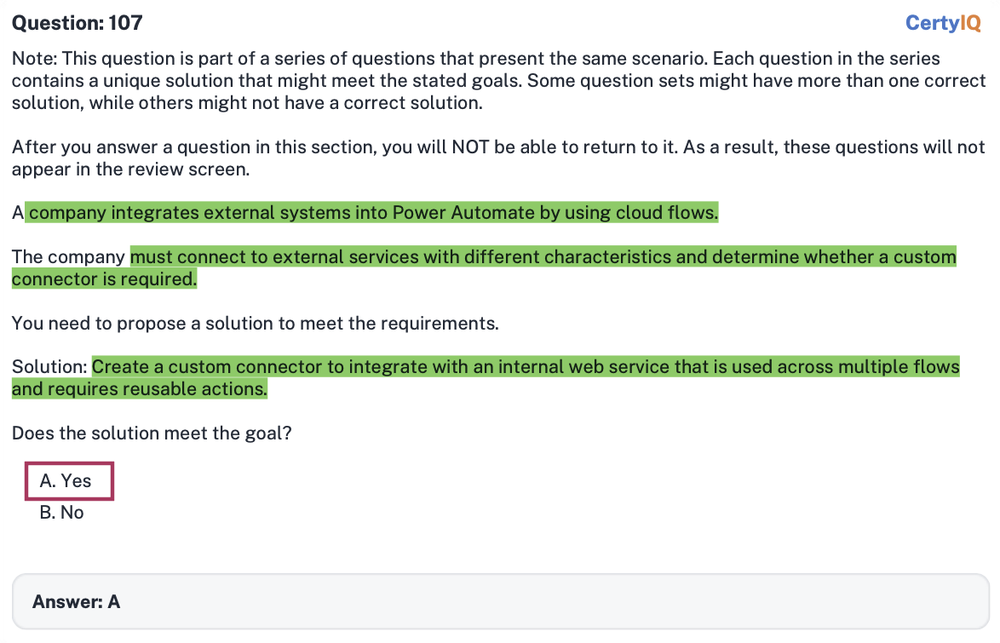

### 1. Extracted Question Summary

* **Scenario:** A company integrates external systems into Power Automate by using cloud flows. They must connect to external services with different characteristics and determine whether a custom connector is required.
* **Proposed Solution:** Create a custom connector to integrate with an **internal web service** that is **used across multiple flows** and **requires reusable actions**.
* **Question:** Does the solution meet the goal?
* **Options:**
* A. Yes
* B. No


### 2. Correct Answer

* **A. Yes**


### 3. Verification of Visible Selection / Community Key

* **Correct:** The boxed selection and visible key (**A. Yes**) are **Correct** because Microsoft recommends creating a custom connector whenever a proprietary or internal REST/SOAP API lacks a prebuilt connector, needs to be shared across multiple flows/apps, and benefits from strongly typed reusable actions and triggers.


### 4. Official Microsoft Justification

* **When to Build a Custom Connector:** Per Microsoft Power Platform documentation (*Custom connectors overview* and *Choose between the HTTP action and a custom connector*), while the built-in **HTTP** action works well for quick, one-off REST calls inside a single flow, creating a **Custom connector** is the recommended architectural pattern when:
* **No prebuilt connector exists** (such as an organization's own internal line-of-business web service, which can also be reached securely via the On-premises Data Gateway if hosted on-premises).
* **Reusability across multiple flows/apps is needed:** Custom connectors encapsulate authentication, base URLs, and OpenAPI schemas into named, strongly typed **reusable actions and triggers** with dynamic schema outputs, eliminating repeated raw HTTP configuration and manual JSON parsing across multiple flows.
* **Governance and ALM:** Custom connectors are solution-aware components that can be packaged in Dataverse solutions, governed via Data Loss Prevention (DLP) policies, and shared across makers.


### 5. Distractor Analysis (Why Others Are Wrong)

* **B. No:** Incorrect because the proposed solution directly aligns with Microsoft's primary decision criteria for choosing a custom connector over a raw HTTP action—specifically wrapping a custom/internal service into reusable, strongly typed actions consumed across multiple cloud flows. (By contrast, if a sibling question in this series proposes using a custom connector for a *single, one-off webhook call* or for a service that already has a *standard prebuilt connector*, the answer would be **B. No**.)

### 6. Exam Keyword / Trap Alert

* **Trigger Phrases:** Look for **"used across multiple flows"** + **"requires reusable actions"** (or *"internal/custom REST API"*); these are Microsoft's textbook criteria for **Yes** on custom connectors.
* **Series Trap:** Because this is a **Yes/No repeated-scenario question set** (notice the header warning that you cannot return to previous questions), watch closely for subtle twists in neighboring variants—such as *"used in a single flow once"* (where the standard **HTTP** action suffices $\rightarrow$ **No**) or *"integrating with Salesforce/SharePoint"* (where a **prebuilt connector** already exists $\rightarrow$ **No**).


## Q108


### 1. Extracted Question Summary

* **Scenario:** A company integrates external systems into Power Automate by using cloud flows. They must connect to external services with different characteristics and determine whether a custom connector is required.
* **Proposed Solution:** Create a custom connector to call a REST API by using a **one-time HTTP action without reuse across flows**.
* **Question:** Does the solution meet the goal?
* **Options:**
* A. Yes
* B. No


### 2. Correct Answer

* **B. No**


### 3. Verification of Visible Selection / Community Key

* **Correct:** The boxed selection and visible key (**B. No**) are **Correct** because a simple, one-time REST API call without reuse across multiple flows or apps should use the built-in **HTTP** action rather than building and maintaining a custom connector.


### 4. Official Microsoft Justification

* **HTTP Action vs. Custom Connector Decision Criteria:** Per Microsoft Power Platform documentation (*Choose between the HTTP action and a custom connector* and *Custom connectors overview*), a custom connector is **not** required when making a single, ad-hoc REST call inside a single flow:
* **Built-in HTTP Action:** Designed for quick, one-off REST requests (`GET`, `POST`, `PUT`, `PATCH`, `DELETE`) within an individual cloud flow where defining an OpenAPI schema, managing connector lifecycle, and sharing reusable actions across makers/flows adds unnecessary development and maintenance overhead.
* **When a Custom Connector *Is* Justified:** Only when an API lacks a prebuilt connector *and* requires reusable, strongly typed actions/triggers shared across multiple flows, Power Apps, or Copilot Studio agents, or requires On-premises Data Gateway support / Data Loss Prevention (DLP) governance.


### 5. Distractor Analysis (Why Others Are Wrong)

* **A. Yes:** Incorrect because creating a custom connector specifically *"for a one-time HTTP action without reuse across flows"* introduces unnecessary architectural overhead and directly violates Microsoft's guidance on when to use the built-in **HTTP** action instead.

### 6. Exam Keyword / Trap Alert

* **Trigger Phrases:** **"One-time HTTP action"** + **"without reuse across flows"** $\rightarrow$ Immediately answer **B. No** (this is the exact inverse sibling to Question 107, which tested *"used across multiple flows and requires reusable actions"* $\rightarrow$ **A. Yes**).


## Q109


## Q116


## Q117


### 1. Extracted Question Summary

* **Scenario:** You must create a form for team members to use that provides three capabilities using Microsoft Dataverse **business rule components**:
1. Lock a field on a form (`Lock a form field.`).
2. Trigger business logic based on a field value (`Trigger business logic based on a field value.`).
3. Use existing business information to enhance data entry (`Leverage existing business information to enhance data entry.`).


* **Available Components:**
* `Actions`
* `Conditions`
* `Recommendation`


* **Visible Annotations in Screenshot:** Red text annotations next to each requirement map `Actions` $\rightarrow$ `Lock a form field.`, `Conditions` $\rightarrow$ `Trigger business logic based on a field value.`, and `Recomendation` [sic] $\rightarrow$ `Leverage existing business information to enhance data entry.`


### 2. Correct Answer

* **Lock a form field:** **Actions**
* **Trigger business logic based on a field value:** **Conditions**
* **Leverage existing business information to enhance data entry:** **Recommendation**

### 3. Verification of Visible Selection / Community Key

* **Correct:** The red text annotations in the screenshot (**Actions**, **Conditions**, **Recommendation**) are **Correct** because they accurately map each Dataverse business rule designer component to its exact architectural role.


### 4. Official Microsoft Justification

* **Dataverse Business Rule Designer Components:** Per Microsoft Dataverse documentation (*Create a business rule for a table* / *Business rule components*):
* **Actions:** Executed once a condition evaluates to true (or false on the else branch). Supported form actions include **Lock/Unlock** (setting a column as read-only or editable), *Set visibility* (show/hide), *Set field value*, *Set default value*, *Clear field value*, *Set business required*, and *Show error message*.
* **Conditions:** Act as the `If / Else If` branching triggers in the business rule designer, evaluating column values, operators, and business logic rules to determine whether downstream actions or recommendations fire.
* **Recommendation:** A specialized action that displays an informational lightbulb icon next to a form column along with a custom message and an **Apply** button. Rather than forcing a value overwrite, it leverages existing business logic/information to suggest a value that the user can accept with one click or ignore to enhance data entry.


### 5. Distractor Analysis (Why Others Are Wrong)

* Because all three draggable components map one-to-one with the three requirements (`Actions` $\rightarrow$ locking a field, `Conditions` $\rightarrow$ evaluating field values to trigger logic, and `Recommendation` $\rightarrow$ assisting data entry with suggested values), any alternative permutation assigns a component to a behavior it cannot perform (for example, `Conditions` can only evaluate values and cannot lock fields, while `Recommendation` suggests values rather than locking a field).

### 6. Exam Keyword / Trap Alert

* **Trigger Phrases:**
* **"Lock a field"** / **"Hide a field"** / **"Show error message"** $\rightarrow$ **Actions**.
* **"Trigger business logic based on a field value"** $\rightarrow$ **Conditions**.
* **"Enhance data entry"** / **"Suggest a value without forcing it"** $\rightarrow$ **Recommendation** (often overlooked because candidates think of Recommendations as sub-types of Actions rather than a standalone component in the Business Rule designer).


## Q118


### 1. Extracted Question Summary

* **Scenario:** You are troubleshooting multiple production Power Automate cloud flows that connect to Microsoft Dataverse using Microsoft Entra ID authentication.
* **Issues to Resolve (`Troubleshoot cloud flow failures`):**
1. A flow that has not executed for more than **90 days** fails when performing actions that rely on an existing connection configuration (`Flow fails with an existing connection.`).
2. A flow fails for records containing **incomplete data** (`Flow fails due to incomplete data.`).


* **Available Actions:**
* `Configure retry policy.`
* `Reauthenticate the connection.`
* `Limit concurrency in trigger settings.`
* `Add input validation or condition checks.`


* **Visible Annotations in Screenshot:** Red text annotations in the Answer Area match `Reauthenticate the connection` to `Flow fails with an existing connection.` and `Add input validation or condition checks` to `Flow fails due to incomplete data.`


### 2. Correct Answer

* **Flow fails with an existing connection:** **Reauthenticate the connection.**
* **Flow fails due to incomplete data:** **Add input validation or condition checks.**

### 3. Verification of Visible Selection / Community Key

* **Correct:** The red text annotations in the screenshot (**Reauthenticate the connection** and **Add input validation or condition checks**) are **Correct** because Microsoft Entra ID OAuth refresh tokens expire after 90 days of inactivity (requiring connection reauthentication), and missing/null record fields require defensive validation or condition checks before downstream actions execute.


### 4. Official Microsoft Justification

* **90-Day Inactivity OAuth Token Expiration (`Reauthenticate the connection`):** Per Microsoft Entra ID and Power Automate connector authentication documentation (*Manage connections in Power Automate* / *Configurable token lifetimes in Microsoft Entra ID*), default Microsoft Entra ID refresh tokens have an inactive sliding expiration window of **90 days**. When a cloud flow goes unexecuted for more than 90 days, the stored connection's OAuth token expires and cannot be silently refreshed, causing connector actions to fail with authentication/authorization errors until the connection is manually **reauthenticated** (via the *Fix connection* prompt in the Connections blade or flow details page).
* **Defensive Handling of Missing/Null Values (`Add input validation or condition checks`):** Per Power Automate error-handling and expression best practices, actions fail at runtime when required inputs are `null`, empty, or malformed (for example, passing an empty string to an integer/date parameter or dereferencing a missing lookup property). Adding **input validation or condition checks** (such as `empty(...)` checks in a Condition control or `coalesce(...)` fallback expressions) ensures incomplete records are caught and handled gracefully before failing downstream actions.

### 5. Distractor Analysis (Why Others Are Wrong)

* **Configure retry policy:** Retries transient HTTP errors (such as `408`, `429`, or `5xx` service timeouts). Retrying an expired 90-day OAuth token or deterministic incomplete record data will simply fail repeatedly with the exact same authentication or bad-request error.
* **Limit concurrency in trigger settings:** Throttles how many flow runs execute in parallel to prevent API rate-limiting (`429 Too Many Requests`), which neither refreshes an expired Microsoft Entra ID connection token nor validates incomplete record fields.

### 6. Exam Keyword / Trap Alert

* **Trigger Phrases:**
* **"Has not executed for more than 90 days"** + **"existing connection"** $\rightarrow$ Immediately select **Reauthenticate the connection** (the 90-day Microsoft Entra ID refresh token inactivity window is a classic Microsoft certification test point).
* **"Records containing incomplete data"** $\rightarrow$ **Add input validation or condition checks** (never use a retry policy for bad/incomplete input data).


## Q119


### 1. Extracted Question Summary

* **Scenario:** A company builds a canvas app that processes images submitted by users and must classify them using an existing AI Builder model. The app must generate predictions **during user interaction**, and you need to **consume the AI model natively**.
* **Question:** What should you do?
* **Options:**
* A. Refine the model with additional images.
* B. Invoke the model by using Power Fx.
* C. Export the solution which contains the model.
* D. Retrain the model for each submission.


### 2. Correct Answer

* **B. Invoke the model by using Power Fx.**


### 3. Verification of Visible Selection / Community Key

* **Correct:** The boxed selection and visible key (**B. Invoke the model by using Power Fx**, marked `Most Voted` and `Answer: B`) are **Correct** because Power Apps canvas apps natively connect to published AI Builder models as data sources and invoke their `.Predict(...)` method directly via Power Fx formulas during interactive user sessions.


### 4. Official Microsoft Justification

* **Native AI Builder Consumption via Power Fx:** Per Microsoft Power Apps and AI Builder documentation (*Use AI Builder models in Power Apps* / *Use Power Fx in AI Builder models*), published AI Builder models (including custom Image Classification / Object Detection models and prebuilt models) can be added directly into a canvas app via the **Data** pane (`Add data` $\rightarrow$ `AI models`).
* **Real-Time Inference (`ModelName.Predict(...)`):** Once added as a native data source, makers call the model directly inside interactive control properties (such as a button's `OnSelect` or an image control's `OnChange`) using a Power Fx expression (e.g., `'MyImageClassifier'.Predict(UploadedImage1.Image)`), returning classification predictions (`Prediction`, `Confidence`, `TagName`) synchronously during user interaction without requiring an intermediate Power Automate flow.

### 5. Distractor Analysis (Why Others Are Wrong)

* **A. Refine the model with additional images:** Improves training accuracy prior to publishing, rather than consuming an already-existing model natively inside the canvas app at runtime.
* **C. Export the solution which contains the model:** Packages the AI model for Application Lifecycle Management (ALM) transport to another environment; exporting a solution does not invoke the model during user interaction in a canvas app.
* **D. Retrain the model for each submission:** Submitting an image at runtime is **inference** (prediction), not model training—retraining on every user submission is architecturally invalid, slow, and unnecessary.

### 6. Exam Keyword / Trap Alert

* **Trigger Phrases:** **"Canvas app"** + **"predictions during user interaction"** + **"consume the AI model natively"** $\rightarrow$ Always select **Invoke the model by using Power Fx** (via the `.Predict()` method).
* **Common Trap:** Candidates sometimes look for a Power Automate flow option or legacy AI Builder component controls; remember that in modern Power Apps canvas apps, calling `AIModel.Predict(...)` in **Power Fx** is Microsoft's primary native consumption pattern.


## Q120


### 1. Extracted Question Summary

* **Scenario:** You are configuring the **Accounts** table in Microsoft Dataverse. When users create a new account, the **category** column must automatically be set to **Standard** **when the form loads**.
* **Task:** Select and arrange three actions in the correct sequence to implement the configuration.
* **Available Actions:**
* `Create a Power Automate cloud flow.`
* `Activate the process.`
* `Create a classic workflow.`
* `Add a Set Default value action.`
* `Create a business rule.`
* `Add a Set Field Value action.`


### 2. Correct Answer

1. **Create a business rule.**
2. **Add a Set Default value action.**
3. **Activate the process.**

### 4. Official Microsoft Justification

* **Client-Side Form Load Initialization via Business Rules:** Per Microsoft Dataverse documentation (*Create a business rule for a table* / *Business rule actions*), Dataverse business rules run synchronously client-side when a model-driven app form loads (`OnLoad`) and whenever referenced column values change (`OnChange`).
* **`Set Default value` vs. `Set Field Value`:**
* **Set Default value:** Specifically initializes a column's value **only when the column currently contains no data (is empty/null)**—making it the exact action designed to populate a default value (such as setting *Category* to *Standard*) upon creating a new record when the form loads, without overwriting an existing value if a user later opens or edits the record.
* **Activation Requirement:** Newly created business rules remain in a *Draft* state and do not execute on forms until you validate and **Activate** the business rule process.


### 5. Distractor Analysis (Why Others Are Wrong)

* **Create a Power Automate cloud flow:** Cloud flows execute asynchronously on the server *after* a record is already created or updated; they cannot pre-populate fields interactively on screen *"when the form loads"* before the user saves.
* **Create a classic workflow:** Classic Dataverse workflows run on the server upon record lifecycle events (Create, Update, Assign, Delete), not client-side when a blank creation form first loads in the UI.
* **Add a Set Field Value action:** Unconditionally overwrites the target column every time the condition evaluates to true, rather than selectively applying a default value only when the field is initially blank on a new record.

### 6. Exam Keyword / Trap Alert

* **Trigger Phrases:**
* **"When users create a new account... when the form loads"** $\rightarrow$ Immediately choose **Create a business rule** (eliminating server-side flows and workflows).
* **"Default value on a new record"** $\rightarrow$ Pair **Add a Set Default value action** (which only sets empty fields) rather than **Add a Set Field Value action** (which overwrites existing values).


## Q121


### 1. Extracted Question Summary

* **Scenario:** A company uses a Business Process Flow (BPF) to manage sales opportunities with two branching requirements:
1. Follow one path when estimated revenue is below a threshold and a different path when estimated revenue meets or exceeds that threshold (`Define the rule that determines which branch is used.`).
2. If estimated revenue is above a threshold, allow users to enter data into additional columns and trigger a Power Automate cloud flow before moving forward (`Enter data and trigger a Power Automate cloud flow.`).


* **Available Configurations:**
* `Stage`
* `Data step`
* `Condition step`
* `Power Automate cloud flow step`


* **Visible Annotations in Screenshot:** Red text annotations in the Answer Area match `Condition Step` to `Define the rule that determines which branch is used.` and `Power Automate Cloud Flow Step` to `Enter data and trigger a Power Automate cloud flow.`


### 2. Correct Answer

* **Define the rule that determines which branch is used:** **Condition step**
* **Enter data and trigger a Power Automate cloud flow:** **Stage** *(Note: see verification below regarding the visible dump key)*

### 3. Verification of Visible Selection / Community Key

* **Incorrect / Disputed:** While the first red annotation (**Condition step**) is **Correct**, the second red annotation (**Power Automate Cloud Flow Step**) is **Incorrect/Incomplete** because a **Power Automate cloud flow step** only triggers an instant flow—it cannot hold data entry columns on its own, whereas a **Stage** is the container in a Business Process Flow branch that holds both **Data steps** (for entering data into additional columns) and **Flow steps** (for triggering a Power Automate cloud flow) before advancing.

### 4. Official Microsoft Justification

* **Conditional Branching (`Condition step`):** Per Microsoft Power Automate / Dataverse documentation (*Enhance business process flows with branching*), a **Condition step** (`If / Else`) evaluates column values on the current stage (such as `Estimated Revenue >= Threshold`) to dynamically determine which subsequent branch of stages is rendered in the Business Process Flow.
* **Branch Target Container (`Stage`):** In the Business Process Flow designer, a **Condition step** cannot branch directly to a standalone step—every branch (`Yes` / `No`) must lead into a **Stage**. Inside that target **Stage**, you add **Data steps** (so users can enter data into additional columns) alongside a **Power Automate cloud flow step** (to invoke an instant flow on demand) before progressing to the next stage.

### 5. Distractor Analysis (Why Others Are Wrong)

* **Data step:** Renders a single column input field inside a stage; it cannot branch the process flow or trigger a Power Automate cloud flow.
* **Power Automate cloud flow step:** Allows users to click a button inside a stage to run an on-demand instant cloud flow, but it cannot display or capture input fields for *"enter data into additional columns"*—nor can a Condition branch point directly to a Flow step without an enclosing **Stage**.

### 6. Exam Keyword / Trap Alert

* **Trigger Phrases:**
* **"Determines which branch is used"** $\rightarrow$ **Condition step**.
* **"Enter data into additional columns AND trigger a Power Automate cloud flow before moving forward"** $\rightarrow$ Look for the enclosing container (**Stage**), because only a **Stage** can contain *both* Data steps and a Flow step in a conditional branch.


* **Common Trap:** Dump keys frequently pick **Power Automate cloud flow step** for the second slot by latching onto the words *"trigger a Power Automate cloud flow"* while ignoring *"enter data into additional columns"* and the BPF structural rule that branches always point to a **Stage**.


## Q122


### 1. Extracted Question Summary

* **Scenario:** A company builds a canvas app that users use to enter customer feedback and plans to use a preexisting custom prompt to summarize the feedback within the app.
* **Requirements & Dropdown Options (`Use a custom prompt in a canvas app`):**
* **Add the prompt to the app:**
* `Data`
* `Control`
* `Variable`
* `Media`


* **Use a function to access prompt results:**
* `ClearCollect()`
* `Find()`
* `Predict()`
* `Patch()`


### 2. Correct Answer

* **Add the prompt to the app:** **Data**
* **Use a function to access prompt results:** **Predict()**

### 4. Official Microsoft Justification

* **Adding Custom Prompts via the Data Pane (`Data`):** Per Microsoft Power Apps and AI Builder documentation (*Use your prompt in Power Apps* / *Use Power Fx in AI Builder models*), preexisting AI Builder / Power Platform custom prompts are exposed as data sources in Power Apps Studio. To consume a prompt inside a canvas app, you open the **Data** tab on the left authoring pane, select **Add data**, expand **AI models**, and select the custom prompt.
* **Invoking the Prompt and Reading Results (`Predict()`):** Once added as a data source, you execute the custom prompt in Power Fx by calling its `.Predict(...)` method (for example, `Set(varSummary, 'Summarize Feedback'.Predict(TextInput1.Text).Text)`), which passes the required input parameters to the prompt and returns the generated response object.

### 5. Distractor Analysis (Why Others Are Wrong)

* **Dropdown 1 — `Control`:** Adds visual UI elements (buttons, text inputs, galleries, labels) onto the canvas screen, not backend AI Builder custom prompts.
* **Dropdown 1 — `Variable`:** Displays and inspects global (`Set`) and context (`UpdateContext`) variables defined in the app, rather than importing external data sources or AI models.
* **Dropdown 1 — `Media`:** Used for uploading static images, audio, and video assets into the app package, not connecting to AI models.
* **Dropdown 2 — `ClearCollect()`:** Creates or replaces records in an in-memory local Power Apps collection; while it can store the output returned by `Predict()`, it does not invoke or retrieve results from an AI prompt on its own.
* **Dropdown 2 — `Find()`:** A Power Fx string function that returns the starting character position of one text string inside another.
* **Dropdown 2 — `Patch()`:** Modifies or creates records in a tabular data source (such as Dataverse or SharePoint), rather than executing an AI Builder custom prompt.

### 6. Exam Keyword / Trap Alert

* **Trigger Phrases:**
* **"Preexisting custom prompt"** + **"Add the prompt to the app"** $\rightarrow$ **Data** (all AI Builder models and custom prompts are added through the **Data** pane).
* **"Access the result of the prompt by using Power Fx"** $\rightarrow$ Always **`Predict()`** (every AI Builder model and custom prompt exposes `.Predict()` in Power Fx).


## Q123


### 1. Extracted Question Summary

* **Scenario:** A company is deploying multiple AI-enabled Power Platform solutions across teams with three administrative requirements:
* Administrators require **centralized insights and governance**.
* Solutions must follow **automated lifecycle practices without reliance on external tooling**.
* Existing and new environments must **enforce governance policies**.


* **Question:** What environment type should you recommend?
* **Options:**
* A. Sandbox
* B. Developer
* C. Managed
* D. Production


### 2. Correct Answer

* **C. Managed**


### 3. Verification of Visible Selection / Community Key

* **Correct:** The boxed selection and visible key (**C. Managed**, marked `Most Voted` and `Answer: C`) are **Correct** because **Managed Environments** unlock native Power Platform Pipelines (automated ALM without external CI/CD tools), weekly admin digest insights, sharing limits, and environment-group governance policies across existing and new environments.


### 4. Official Microsoft Justification

* **Managed Environments Capabilities:** Per Microsoft Power Platform administration and governance documentation (*Managed Environments overview*), enabling **Managed Environments** overlays enterprise-grade governance, visibility, and built-in ALM onto standard environment types (Production, Sandbox, Developer):
* **Centralized Insights and Governance:** Provides out-of-the-box weekly admin email digests, active usage/licensing telemetry in the Power Platform admin center, maker welcome content, solution checker enforcement, and granular sharing limits on canvas apps and solution flows.
* **Built-In Automated ALM (`Pipelines in Power Platform`):** Enables native **Pipelines in Power Platform** so makers and admins can automate solution deployments across Dev, Test, and Production environments directly inside Power Platform without configuring external Azure DevOps or GitHub Actions tooling.
* **Environment Groups & Policy Enforcement:** Allows administrators to group existing and newly provisioned environments under unified governance rules and tenant-level environment routing policies.


### 5. Distractor Analysis (Why Others Are Wrong)

* **A. Sandbox:** A non-production environment type used for development, testing, and staging (supporting copy and reset operations), which does not by itself enable native Power Platform Pipelines, admin insights, or governance policy enforcement unless designated as a **Managed** environment.
* **B. Developer:** A free, single-user environment tied to the Power Apps Developer Plan for individual maker learning and experimentation; it cannot be shared for team-wide production deployments or provide centralized tenant governance.
* **D. Production:** The standard environment type intended for live business workloads; without enabling **Managed Environment** capabilities on it, a standard Production environment lacks native Power Platform Pipelines, sharing restrictions, and automated admin governance insights.

### 6. Exam Keyword / Trap Alert

* **Trigger Phrases:** **"Centralized insights and governance"** + **"automated lifecycle practices without reliance on external tooling"** (referring to native **Power Platform Pipelines**) $\rightarrow$ Always select **Managed** (Managed Environments).
* **Common Trap:** Candidates sometimes hesitate to pick **Managed** because technically Managed Environments is a *governance designation/suite* applied on top of Sandbox, Production, or Developer environments rather than a standalone base tier—on Microsoft exams, **Managed** is routinely listed alongside Sandbox, Developer, and Production whenever governance, sharing limits, or native Pipelines are tested.


## Q124


### 1. Extracted Question Summary

* **Scenario:** An organization wants to enhance a model-driven app with Copilot capabilities to improve user productivity, provide contextual guidance, and automate selected business processes.
* **Requirements (`AI component selection`):**
1. Provide contextual assistance to users that is aware of the current record and page they are working with (`Provide record-aware assistance inside the app`).
2. Automatically execute business processes when predefined trigger conditions are met (`Run automated business steps when defined trigger conditions are met`).


* **Available Capabilities:**
* `Agent flow`
* `AI Builder model`
* `App assistant agent`
* `Microsoft 365 Copilot chat experience`


### 2. Correct Answer

* **Provide record-aware assistance inside the app:** **App assistant agent**
* **Run automated business steps when defined trigger conditions are met:** **Agent flow**

### 4. Official Microsoft Justification

* **Record- and Page-Aware Model-Driven App Copilot (`App assistant agent`):** Per Microsoft Power Apps and Copilot Studio documentation (*Customize Copilot chat in model-driven apps* / *Extend model-driven app Copilot with Copilot Studio*), customizing the built-in Copilot side pane in a model-driven app creates an **app assistant agent** in Copilot Studio. This embedded agent automatically receives runtime app context—specifically the current page/view and active record (`PageContext` / record GUID and table)—allowing users to ask contextual questions, summarize records, and execute record-aware topics directly inside the app.
* **Event-Driven Process Automation (`Agent flow`):** Per Microsoft Copilot Studio documentation (*Use agent flows in Copilot Studio*), an **agent flow** (powered by Power Automate cloud flow orchestration within Copilot Studio) is designed to execute deterministic, multi-step automated business processes when specific **trigger conditions** (such as Dataverse row changes, schedules, or event triggers) or agent invocations occur.

### 5. Distractor Analysis (Why Others Are Wrong)

* **AI Builder model:** Performs discrete cognitive tasks (such as document processing, prediction, sentiment analysis, or custom prompts) on supplied inputs; it does not provide an interactive, record- and page-aware conversational assistant inside a model-driven app nor orchestrate trigger-driven multi-step business workflows on its own.
* **Microsoft 365 Copilot chat experience:** Operates as the tenant-wide Microsoft 365 productivity assistant (across Teams, Outlook, Word, and web/work grounding) rather than an embedded, record- and page-aware agent tailored to a specific model-driven app's active Dataverse form or view.

### 6. Exam Keyword / Trap Alert

* **Trigger Phrases:**
* **"Model-driven app"** + **"aware of the current record and page"** $\rightarrow$ Always select **App assistant agent** (not the general *Microsoft 365 Copilot chat experience*).
* **"Automatically execute business processes when predefined trigger conditions are met"** $\rightarrow$ **Agent flow**.


## Q124


### 1. Extracted Question Summary

* **Scenario:** A company is building an AI-enabled solution that includes prompts, cloud flows, and Dataverse components. The solution must be released to production through a controlled process that meets four requirements:
* Validate changes before production release.
* Ensure production stability.
* Ensure that release steps are repeatable and governed.
* Ensure that the production environment reflects only controlled and traceable changes.


* **Question:** What should you do?
* **Options:**
* A. Export an unmanaged solution from development to test. After validating, apply required fixes in test and deploy a managed solution to production.
* B. Export a managed solution from development to test. After validating, deploy the solution to production.
* C. Export an unmanaged solution from development. Import the solution into production after testing.
* D. Export an unmanaged solution from development to test. After validating, deploy a managed solution to production.


### 2. Correct Answer

* **B. Export a managed solution from development to test. After validating, deploy the solution to production.**


### 3. Verification of Visible Selection / Community Key

* **Correct:** The boxed selection and visible key (**B**, marked `Most Voted` and `Answer: B`) are **Correct** because Microsoft Power Platform ALM best practices mandate exporting a **managed** solution from development and promoting that exact same immutable managed artifact sequentially through downstream test/UAT and production environments.


### 4. Official Microsoft Justification

* **Managed Solutions Across All Downstream Environments:** Per Microsoft Power Platform Application Lifecycle Management (ALM) documentation (*ALM basics with Microsoft Power Platform* and *Managed and unmanaged solutions*), **unmanaged** solutions belong strictly in development environments (and unpacked in source control). Every environment downstream of development—including **Test/UAT** and **Production**—must receive **managed** solutions.
* **Artifact Immutability & Repeatability ("Build Once, Deploy Many"):** Exporting a single **managed** solution artifact from development, validating it in **Test**, and then deploying that exact same validated `.zip` package to **Production** guarantees that:
1. Test mirrors Production behavior (managed layering, dependency checks, and security boundaries match Production).
2. No unmanaged active-layer edits are introduced in Test or Production, keeping releases repeatable, governed, and fully traceable back to source/development.


### 5. Distractor Analysis (Why Others Are Wrong)

* **A. Export an unmanaged solution from development to test. After validating, apply required fixes in test and deploy a managed solution to production:** Violates core ALM governance in two ways—importing an unmanaged solution into Test creates unmanaged active layers, and applying fixes directly inside Test breaks environment parity and traceability (all fixes must be made in Development and re-exported).
* **C. Export an unmanaged solution from development. Import the solution into production after testing:** Importing an unmanaged solution into Production is a critical ALM anti-pattern because unmanaged components cannot be cleanly uninstalled or rolled back and leave Production open to untracked direct edits.
* **D. Export an unmanaged solution from development to test. After validating, deploy a managed solution to production:** Deploying unmanaged to Test means you are not testing the actual managed package that will go to Production, risking missing dependency errors or managed-layer conflicts during the final Production release.

### 6. Exam Keyword / Trap Alert

* **Trigger Phrases:** **"Repeatable and governed"**, **"controlled and traceable changes"**, and **"production stability"** $\rightarrow$ Always follow the rule: **Unmanaged in Dev ONLY; Managed in Test AND Production** (never deploy unmanaged to Test or apply fixes in Test).


## Q126


### 1. Extracted Question Summary

* **Scenario:** A company that manufactures medical devices uses Power Apps to manage sales and device maintenance. A Dataverse table named **Devices** has a column named **Status**, and a new choice value (**Review**) must be added to the existing values (**Active** and **Inactive**). Once made, the table must be added to a solution so that **only this change** is promoted to the test environment, and the changes cannot be edited once promoted.
* **Available Options:**
* `Add column`
* `Add existing`
* `Add required components`
* `Add object`


* **Answer Area Targets (`Action`):**
* `Add the Devices table to the solution.`
* `Add the status column changes only to the solution.`


### 2. Correct Answer

* **Add the Devices table to the solution:** **Add existing**
* **Add the status column changes only to the solution:** **Add column**

### 4. Official Microsoft Justification

* **Adding an Existing Dataverse Table (`Add existing`):** Per Microsoft Power Platform ALM documentation (*Add an existing component to a solution* / *Organize solutions*), because the **Devices** table already exists in the Dataverse environment, you bring it into your new unmanaged solution from the solution toolbar via **Add existing** $\rightarrow$ **Table**.
* **Segmented Subcomponent Inclusion (`Add column`):** When adding an existing table to a solution, Power Apps presents the *Select objects* / *Select components* table segmentation experience rather than forcing you to include the entire table definition. By choosing **Add column** (selecting solely the modified **Status** column from the table's subcomponents), only that specific column's metadata and updated choice definition are packaged into the solution—fulfilling the requirement that *"only this change must be promoted to the test environment."* (Exporting the resulting solution as **Managed** subsequently prevents direct edits in the target test environment.)

### 5. Distractor Analysis (Why Others Are Wrong)

* **Add required components:** Automatically pulls in *all* upstream dependencies (such as related tables, global choices, forms, views, or business rules referenced by the component). Using it violates the strict requirement that *"only this change must be promoted to the test environment."*
* **Add object:** Is the generic subcomponent action used across non-table assets or legacy dialogs rather than the specific **Add column** subcomponent selector for isolating a single modified column on an existing Dataverse table.

### 6. Exam Keyword / Trap Alert

* **Trigger Phrases:**
* **"Table named [X] in Microsoft Dataverse... must be added to a solution"** $\rightarrow$ **Add existing** (because the table already exists in the environment).
* **"Only this change [the Status column] must be promoted"** $\rightarrow$ **Add column** (segmented subcomponent selection, never **Add required components**).


## Q127


### 1. Extracted Question Summary

* **Scenario:** Employees have difficulty distinguishing custom tables used in a model-driven app. You are updating the app to improve usability and user experience with three requirements:
* Display a distinct icon for each custom table.
* Ensure icons appear consistently for the related tables.
* Apply the configuration **without causing missing resource references**.


* **Task:** Move all five actions from the list to the answer area and arrange them in the correct order.
* **Available Actions:**
* `Choose an image under a table image property.`
* `Save changes to a table configuration.`
* `Add images resources to a solution.`
* `Publish all customizations.`
* `Open a table definition in a solution.`


### 2. Correct Answer

1. **Add images resources to a solution.**
2. **Open a table definition in a solution.**
3. **Choose an image under a table image property.**
4. **Save changes to a table configuration.**
5. **Publish all customizations.**

### 4. Official Microsoft Justification

* **Preventing Missing Resource References (`Add images resources to a solution` first):** Per Microsoft Dataverse documentation (*Change custom table icons* / *Create and edit web resources*), custom table icons in model-driven apps are stored as **Image web resources** (typically SVG or PNG files). To ensure the icon web resources exist inside the solution boundary and do **not** cause missing dependency/resource references when transported or configured, you first upload/add the image web resources into the unmanaged solution (note: you can also upload an image directly from the table's *Choose image* dialog, which automatically registers the web resource in the active solution, which is why the prompt notes that more than one order can be valid—though adding web resources to the solution first is the canonical ALM-safe sequence).
* **Configuring Table Properties (`Open` $\rightarrow$ `Choose` $\rightarrow$ `Save`):** Next, you open the custom table's properties inside the solution (`Open a table definition in a solution`), expand **Advanced options** and select the uploaded web resource under **Choose table image** (`Choose an image under a table image property`), and commit the metadata change (`Save changes to a table configuration`).
* **Applying UI Changes (`Publish all customizations` last):** Finally, table icon metadata changes remain unpublished in the active solution layer until you run **Publish all customizations** (or publish the specific table and web resources) so the updated icons render consistently across the model-driven app's site map, grids, and lookups.

### 5. Distractor Analysis (Why Others Are Wrong)

* Because this is an **all-items ordering** question (all five actions must be placed into slots 1–5), there are no unused distractors; however, placing **Publish all customizations** before **Save changes to a table configuration**, or selecting the table image before opening the table definition, breaks the mandatory Dataverse customization lifecycle.

### 6. Exam Keyword / Trap Alert

* **Trigger Phrases:** **"Without causing missing resource references"** $\rightarrow$ Always place **Add images resources to a solution** at Step 1 before assigning the image to the table definition, and always end with **Publish all customizations**.


## Q128


### 1. Extracted Question Summary

* **Scenario:** A company plans to improve the efficiency and consistency of reviewing internal requests by using AI to evaluate submissions before they enter the approval process.
* **Requirements (`Component selection for AI scenario`):**
1. Capture user input by using business logic (`Capture user input by using business logic.`).
2. Autonomously evaluate input (`Evaluate input autonomously.`).
3. Route only qualifying submissions (`Route qualifying submissions.`).


* **Available Components:**
* `AI Builder`
* `Cloud flow`
* `Canvas app`
* `Microsoft Dataverse`


### 2. Correct Answer

* **Capture user input by using business logic:** **Canvas app**
* **Evaluate input autonomously:** **AI Builder**
* **Route qualifying submissions:** **Cloud flow**

### 4. Official Microsoft Justification

* **Front-End Intake with Client-Side Logic (`Canvas app`):** Per Microsoft Power Platform architecture guidance (*Combine Power Apps, Power Automate, and AI Builder*), a **Canvas app** provides the user-facing submission form where makers apply Power Fx formulas and validation business logic to capture structured user input before submitting the request.
* **Autonomous AI Evaluation (`AI Builder`):** **AI Builder** (via custom prompts, text classification, or prediction models) evaluates the submitted request content autonomously to score, classify, or determine whether the submission meets qualification criteria without manual triage.
* **Conditional Workflow Routing (`Cloud flow`):** A Power Automate **Cloud flow** orchestrates the end-to-end backend process—invoking the AI Builder evaluation, checking the returned confidence/qualification score via a Condition action, and conditionally routing only qualifying submissions into an Approvals workflow.

### 5. Distractor Analysis (Why Others Are Wrong)

* **Microsoft Dataverse:** Serves as the underlying relational data platform and storage layer for tables, security, and server-side data rules; it is neither the interactive user-input UI layer (`Canvas app`), the AI evaluation engine (`AI Builder`), nor the multi-system approval routing orchestrator (`Cloud flow`).

### 6. Exam Keyword / Trap Alert

* **Trigger Phrases:** Map each architectural tier directly to its Power Platform pillar: **Capture user input** $\rightarrow$ **Canvas app**, **Evaluate input autonomously (using AI)** $\rightarrow$ **AI Builder**, and **Route qualifying submissions (into approval)** $\rightarrow$ **Cloud flow**.


## Q129


### 1. Extracted Question Summary

* **Scenario:** You create functionality that includes a Microsoft Dataverse table with a form for data entry, which will be distributed to other lines of business in the company (each with its own Dataverse environment). New forms **must not be created** in target environments in order for updates to the functionality to work correctly.
* **Question:** What should you do?
* **Options:**
* A. Use a managed solution and disable the ability to create new forms for the table.
* B. Use an unmanaged solution and include only the needed form.
* C. Use a patch solution and disable the ability to create new forms for the table.
* D. Use a managed solution and include only the needed form.


### 2. Correct Answer

* **A. Use a managed solution and disable the ability to create new forms for the table.**


### 3. Verification of Visible Selection / Community Key

* **Correct:** The boxed selection and visible key (**A**, marked `Most Voted` and `Answer: A`) are **Correct** because distributing solutions across separate environments requires a **managed solution**, and Dataverse **Managed Properties** allow the publisher to explicitly disable `Can create new forms` on a custom table in downstream environments.


### 4. Official Microsoft Justification

* **Managed Solutions for Distribution:** Per Microsoft Power Platform ALM documentation (*Managed and unmanaged solutions*), whenever functionality is packaged and distributed to other Dataverse environments (such as different lines of business or production/test environments), it must be exported as a **managed solution**.
* **Managed Properties (`Can create new forms`):** Per Microsoft Dataverse documentation (*Managed properties*), solution publishers control how managed components can be customized after installation in a target environment. By opening the table's **Managed Properties** in the development environment before exporting, you can set **Can create new forms** to **False** (disabling the ability for downstream makers/admins to create additional forms on that table). This prevents unmanaged form extensions from interfering with future solution upgrades and update behaviors.

### 5. Distractor Analysis (Why Others Are Wrong)

* **B. Use an unmanaged solution and include only the needed form:** Unmanaged solutions provide zero customization restrictions in target environments—any administrator or maker in the receiving environment can freely create new forms or alter components, and unmanaged solutions cannot be cleanly upgraded or uninstalled.
* **C. Use a patch solution and disable the ability to create new forms for the table:** A solution patch is an incremental delta update applied *on top* of an already-deployed base managed solution; it is not the primary packaging strategy for initial distribution across multiple environments.
* **D. Use a managed solution and include only the needed form:** While exporting as a managed solution prevents direct editing of the shipped form itself (if *Can be customized* is disabled), leaving the table's **Can create new forms** managed property enabled still allows downstream administrators to create *brand-new* forms on that table, violating the requirement that *"New forms must not be created."*

### 6. Exam Keyword / Trap Alert

* **Trigger Phrases:** **"Distributed to other lines of business... each with its own Dataverse environment"** + **"New forms must not be created"** $\rightarrow$ Immediately pair **Managed solution** with **Managed Properties** (`disable the ability to create new forms for the table`).
* **Common Trap:** Don't confuse locking an *existing* form (via form-level managed properties) with preventing *new* forms from being added to the table (which is controlled by the **table-level** managed property `Can create new forms`).


## Q130


### 1. Extracted Question Summary

* **Scenario:** You manage a canvas app that must notify users when an operation fails, using the following Power Fx formula:
```powerfx
01  Patch(Orders, Defaults(Orders), {Title: "Draft"});
02  IfError(
03    Patch(Orders, Defaults(Orders), {Title: "Submitted"}),
04    Notify("Update failed")
05  )

```


* **Statements to Evaluate (`Canvas app error notification management`):**
1. `The second Patch operation is protected by error handling.`
2. `The Notify function runs when the Patch operation succeeds.`
3. `The first Patch operation can fail without triggering the Notify function.`


### 2. Correct Answer

* **The second Patch operation is protected by error handling:** **Yes**
* **The Notify function runs when the Patch operation succeeds:** **No**
* **The first Patch operation can fail without triggering the Notify function:** **Yes**

### 3. Verification of Visible Selection / Community Key

* **Correct:** All three boxed selections in the screenshot (**Yes**, **No**, **Yes**) are **Correct** and accurately reflect Power Fx `IfError` execution semantics.


### 4. Official Microsoft Justification

* **Power Fx `IfError(Value1, Replacement1, ...)` Behavior:** Per Microsoft Power Platform Power Fx documentation (*Error, IfError, IsError, and IsBlankOrError functions*), `IfError` evaluates its arguments sequentially in pairs (`Value`, `Fallback/Replacement`):
1. **Statement 1 (`Yes`):** Line 03 (`Patch(Orders, Defaults(Orders), {Title: "Submitted"})`) is the first argument (`Value1`) inside the `IfError(...)` block on lines 02–05, meaning any runtime error raised by this second `Patch` call is intercepted and handled by `IfError`.
2. **Statement 2 (`No`):** `IfError` executes the replacement expression (`Notify("Update failed")` on line 04) **only if** the preceding `Patch` expression evaluates to an error. If the second `Patch` succeeds, `IfError` returns the resulting record and skips `Notify("Update failed")`.
3. **Statement 3 (`Yes`):** Line 01 (`Patch(Orders, Defaults(Orders), {Title: "Draft"});`) executes *before* and *outside* the `IfError(...)` scope. Furthermore, in Power Fx, sequential statements separated by `;` continue executing even if an earlier statement encounters an unhandled runtime error (unless `App.OnError` explicitly intercepts it), so line 01 can fail with a standard banner error without ever triggering the `Notify("Update failed")` fallback inside line 02's `IfError` block.


### 5. Distractor Analysis (Why Others Are Wrong)

* Selecting **No** for Statement 1 ignores that line 03 is explicitly wrapped as the primary expression inside `IfError(...)`.
* Selecting **Yes** for Statement 2 confuses `IfError` with a `finally` block or sequential `;` statement—`Notify("Update failed")` is the *error fallback* argument (`Replacement1`), not a post-success action.
* Selecting **No** for Statement 3 mistakenly assumes `IfError` on line 02 catches errors from preceding statements separated by `;` on line 01.

### 6. Exam Keyword / Trap Alert

* **Trigger Phrases:** Inspect the exact **lexical scope** of `IfError( <monitored_expression> , <fallback_expression> )` and semicolon (`;`) statement boundaries—only expressions nested *inside* `IfError`'s monitored argument slots trigger its fallback action.


## Q131


### 1. Extracted Question Summary

* **Scenario:** A company wants to provide managers with visual insights into business performance data. Managers require **aggregated and visual representations of data directly within the app to be viewed in parallel with a list of rows**.
* **Question:** What should you do?
* **Options:**
* A. Configure app navigation.
* B. Add a dashboard.
* C. Add a custom page to the app.
* D. Create a Power BI semantic model.


### 2. Correct Answer

* **B. Add a dashboard.**


### 3. Verification of Visible Selection / Community Key

* **Correct:** The boxed selection and visible key (**B. Add a dashboard**, marked `Most Voted` and `Answer: B`) are **Correct** because Dataverse model-driven app **dashboards** natively combine interactive visual charts (aggregated data) side-by-side with table views/lists of rows on a single unified page inside the app.


### 4. Official Microsoft Justification

* **Model-Driven App Dashboards (Visuals + Lists in Parallel):** Per Microsoft Power Apps documentation (*Create or edit model-driven app dashboards*), a model-driven **Dashboard** is specifically designed to present aggregated visual insights alongside operational record lists inside the app:
* **Multi-Component Layout:** Standard and interactive dashboards organize multiple panes on a single screen—combining Dataverse **Charts** (bar, pie, funnel, line aggregations) and **List Views** (filtered lists of rows) in parallel, plus optional iframes, web resources, or embedded Power BI visuals.
* **Interactive Filtering:** In interactive dashboards, clicking a segment in a visual chart dynamically filters the parallel list of rows right beneath or beside it without leaving the model-driven app.


### 5. Distractor Analysis (Why Others Are Wrong)

* **A. Configure app navigation:** Structures the left-hand site map (Areas, Groups, and Subareas) so users can navigate between tables, dashboards, and pages; configuring navigation alone does not build or provide aggregated visual representations of data.
* **C. Add a custom page to the app:** Embeds a canvas-style page (built with Power Fx and custom controls) into a model-driven app for tailored, pixel-perfect forms, wizards, or dialogs—not the standard out-of-the-box Dataverse mechanism for displaying aggregated charts alongside table list views.
* **D. Create a Power BI semantic model:** Defines a standalone Power BI dataset/data model in the Power BI service for external BI reporting, rather than configuring an in-app layout displaying aggregated visuals in parallel with Dataverse row lists.

### 6. Exam Keyword / Trap Alert

* **Trigger Phrases:** **"Aggregated and visual representations of data directly within the app to be viewed in parallel with a list of rows"** $\rightarrow$ Immediately select **Add a dashboard** (that exact phrase describes the multi-pane *Chart + List View* architecture of a Dataverse model-driven dashboard).


## Q132


### 1. Extracted Question Summary

* **Scenario:** You are modifying a canvas app for a company that must store both a single value and tabular data to manage application state.
* **Requirements (`Canvas app modifications`):**
1. `Store a single user-selected value across screens.`
2. `Store and manage tabular data during the session.`


* **Available Configurations:**
* `Global variable`
* `Named formula`
* `Context variable`
* `Multicolumn collection`


* **Visible Annotations in Screenshot:** Red text annotations in the Answer Area match `Global Variable` to `Store a single user-selected value across screens.` and `Multicolumn Collection` to `Store and manage tabular data during the session.`


### 2. Correct Answer

* **Store a single user-selected value across screens:** **Global variable**
* **Store and manage tabular data during the session:** **Multicolumn collection**


### 3. Verification of Visible Selection / Community Key

* **Correct:** Both red text annotations in the screenshot (**Global variable** and **Multicolumn collection**) are **Correct** because they map Power Apps state management primitives to their exact scope and mutability rules.


### 4. Official Microsoft Justification

* **App-Wide Mutable State (`Global variable`):** Per Microsoft Power Apps documentation (*Understand variables in canvas apps*), a **Global variable**—created and updated imperatively via `Set(varName, value)`—stores a single value (or record/primitive) that is readable and writable from **any screen** throughout the entire user session.
* **In-Memory Tabular State (`Multicolumn collection`):** A **Collection**—populated and modified imperatively via `Collect()`, `ClearCollect()`, `Patch()`, and `Remove()`—is a special type of global variable that stores and manages multi-row, **multicolumn tabular data** in local device memory across screens for the duration of the app session.

### 5. Distractor Analysis (Why Others Are Wrong)

* **Named formula:** Defined declaratively in `App.Formulas` (`FormulaName = Expression;`), named formulas are **immutable** (read-only) and automatically recalculated by Power Fx—they cannot be imperatively assigned to store a mutable *"user-selected value"* during user interaction.
* **Context variable:** Created via `UpdateContext({varName: value})` or `Navigate(Screen, Transition, {varName: value})`, context variables are scoped strictly to a **single screen** and cannot be accessed across screens.

### 6. Exam Keyword / Trap Alert

* **Trigger Phrases:**
* **"Store a single user-selected value across screens"** $\rightarrow$ **Global variable** (cross-screen scope + imperative user selection rules out *Context variable* and read-only *Named formula*).
* **"Store and manage tabular data during the session"** $\rightarrow$ **Multicolumn collection**.

## Q133


### 1. Extracted Question Summary

* **Scenario:** You are creating multiple forms for a table in a model-driven app that will be used by different user roles.
* **Requirements:**
* Ensure different roles have access to different forms.
* Ensure the correct form displays by default for each role.


* **Task:** Select and arrange four actions in the correct sequence.
* **Available Actions:**
* `Remove unused form components.`
* `Create the forms.`
* `Assign security roles to a form.`
* `Publish customizations.`
* `Open the table in the maker portal.`


* **Visible Annotations in Screenshot:** Red text in the Answer Area shows:
1. `Open the table in the maker portal.`
2. `Create the forms.`
3. `Assign security roles to a form.`
4. `Publish customizations.`


### 2. Correct Answer

1. **Open the table in the maker portal.**
2. **Create the forms.**
3. **Assign security roles to a form.**
4. **Publish customizations.**


### 3. Verification of Visible Selection / Community Key

* **Correct:** The four ordered red text entries shown in the Answer Area (**Open the table in the maker portal.** $\rightarrow$ **Create the forms.** $\rightarrow$ **Assign security roles to a form.** $\rightarrow$ **Publish customizations.**) are **100% Correct**.


### 4. Official Microsoft Justification

* **End-to-End Role-Based Form Configuration in Power Apps:** Per Microsoft Power Apps and Dataverse documentation (*Control access to model-driven app forms* / *Assign security roles to a form*), configuring role-specific main forms follows a strict four-step authoring and publishing lifecycle:
1. **Navigate to the Table (`Open the table in the maker portal.`):** Open the target Dataverse table in the Power Apps maker portal (`make.powerapps.com`) and select the **Forms** area.
2. **Author the Forms (`Create the forms.`):** Build or clone the role-tailored main forms needed for each persona/business group.
3. **Configure Role Visibility & Form Order (`Assign security roles to a form.`):** Open **Form settings** $\rightarrow$ **Security roles** on each form to restrict visibility to specific security roles (and configure **Form order** so the highest-priority enabled form renders as the default form for each role).
4. **Publish Metadata (`Publish customizations.`):** Form definitions and role-assignment metadata remain in draft/unpublished state until you publish the table/customizations so the changes take effect at runtime in the model-driven app.


### 5. Distractor Analysis (Why Others Are Wrong)

* **Remove unused form components.:** Stripping unused fields or sections from a form is an optional UI cleanup step during form design, not part of the required four-step sequence for enabling role-based form access and default form display.

### 6. Exam Keyword / Trap Alert

* **Trigger Phrases:** **"Different roles have access to different forms"** + **"correct form displays by default for each role"** $\rightarrow$ Always follow the four-step pipeline: **Open table** $\rightarrow$ **Create forms** $\rightarrow$ **Assign security roles to a form** $\rightarrow$ **Publish customizations**.
* **Common Trap:** Don't place **Publish customizations** before **Assign security roles to a form**—security role assignments on a form are solution metadata changes that must be published afterward to apply to end users.


## Q134


### 1. Extracted Question Summary

* **Scenario:** A company uses a model-driven app that has multiple forms and system views for the same table. You must restrict specific users from accessing a specific form and a specific system view.
* **Available Configurations:**
* `Assign web roles.`
* `Assign security roles.`
* `Modify table relationships.`
* `Grant table-level permissions.`


* **Answer Area Targets (`Access restriction configuration`):**
* `Restrict access to a specific form`
* `Restrict access to a specific system view`


### 2. Correct Answer

* **Restrict access to a specific form:** **Assign security roles.**
* **Restrict access to a specific system view:** **Assign security roles.**

### 4. Official Microsoft Justification

* **Role-Based Access Control for Both Forms and Public System Views (`Assign security roles.`):** Per Microsoft Power Apps and Dataverse documentation (*Control access to model-driven app forms* and *Manage access to public system views*), Dataverse supports natively restricting visibility of **both** model-driven forms and public system views by **assigning security roles** directly to each component:
* **Forms (`Assign security roles.`):** In the form designer (**Form settings** $\rightarrow$ **Security roles**), you select *Specific security roles* and choose which Dataverse security roles can see and use that form (note: fallback forms remain available to all users unless disabled or superseded by higher-order role-assigned forms).
* **System Views (`Assign security roles.`):** In the modern view designer (**View settings** $\rightarrow$ **Security roles**, or via the *Manage access* command on public system views), you configure **Specific security roles** so that only users holding those Dataverse security roles see that public system view in the app's view selector (while the table's default public view remains accessible to everyone).


* **Reuse Instruction Note:** Notice the prompt explicitly states: *"You may use each configuration once, **more than once**, or not at all"*—confirming that **Assign security roles.** is intentionally dragged into both slots.

### 5. Distractor Analysis (Why Others Are Wrong)

* **Assign web roles.:** Web roles belong exclusively to **Power Pages** (external-facing portals) to control website page and table permissions for authenticated/anonymous portal visitors—they do not govern internal model-driven app forms or system views.
* **Modify table relationships.:** Configures 1:N, N:1, or N:N relational schema behavior (such as cascading delete/assign rules) between Dataverse tables, which has no bearing on restricting user access to individual forms or views.
* **Grant table-level permissions.:** Grants CRUD privileges (`Create`, `Read`, `Write`, `Delete`, `Append`, etc.) across an *entire* Dataverse table; if a user lacks table-level Read access, they cannot view any records on that table at all, rather than selectively restricting a single form or system view while allowing access to other forms/views on the same table.

### 6. Exam Keyword / Trap Alert

* **Trigger Phrases:** **"Restrict specific users from accessing: A specific form / A specific system view"** + **"You may use each configuration... more than once"** $\rightarrow$ Drag **Assign security roles.** into **both** slots.
* **Common Trap:** Candidates frequently hesitate to use the same tile twice and mistakenly drag **Grant table-level permissions.** or **Assign web roles.** into the second slot—remember that modern Dataverse allows role-based visibility directly on **both** forms and public system views via **Security roles**, and Microsoft specifically includes the *"more than once"* clause for duplicate-mapping drag-and-drop questions.


## Q135


### 1. Extracted Question Summary

* **Scenario:** A company builds a canvas app that processes images submitted by users and must classify them using an existing AI Builder model. The app must generate predictions **during user interaction**, and you need to **consume the AI model natively**.
* **Question:** What should you do?
* **Options:**
* A. Add a PCF code component.
* B. Refine the model with additional images.
* C. Reuse a previously stored prediction.
* D. Call the model from app logic.


### 2. Correct Answer

* **D. Call the model from app logic**.


### 3. Verification of Visible Selection / Community Key

* **Correct:** The boxed selection and visible key (**D. Call the model from app logic**, marked `Most Voted` and `Answer: D`) are **Correct** because calling an AI Builder model directly inside canvas app Power Fx logic (via `ModelName.Predict(...)`) is Microsoft's native pattern for real-time inference during interactive user sessions.


### 4. Official Microsoft Justification

* **Native AI Builder Consumption in Canvas Apps (`Call the model from app logic`):** Per Microsoft Power Apps and AI Builder documentation (*Use AI Builder models in Power Apps* / *Use Power Fx in AI Builder models*), published AI Builder models (such as Image Classification or Object Detection models) are added directly to a canvas app as native data sources via **Data** $\rightarrow$ **Add data** $\rightarrow$ **AI models**.
* **Synchronous Real-Time Execution:** Once added, the model is invoked directly inside interactive Power Fx control formulas (such as a button's `OnSelect` or an image upload control's `OnChange` property) using `'ModelName'.Predict(ImageControl.Image)`. Executing the prediction directly within app logic evaluates the newly submitted user image on the fly and immediately returns classification labels and confidence scores to the UI without needing custom code components or external background flows.

### 5. Distractor Analysis (Why Others Are Wrong)

* **A. Add a PCF code component:** Power Apps Component Framework (PCF) controls are custom TypeScript/React UI widgets built for specialized rendering or client-side visual interactions; building a PCF control is unnecessary and non-native when Power Fx natively exposes `.Predict()` for AI Builder models.
* **B. Refine the model with additional images:** Improves model training accuracy prior to publishing rather than invoking an existing published model to classify new images during user interaction.
* **C. Reuse a previously stored prediction:** Retrieves static historical results from a database or cache, which fails the requirement to classify *newly submitted user images* dynamically during user interaction.

### 6. Exam Keyword / Trap Alert

* **Trigger Phrases:** **"Canvas app"** + **"processes images submitted by users"** + **"generate predictions during user interaction"** + **"consume the AI model natively"** $\rightarrow$ Look for **Call the model from app logic** (an alternate phrasing of *"Invoke the model by using Power Fx"* seen in Question 119).


## Q136


### 1. Extracted Question Summary

* **Scenario:** A company uses a model-driven app across multiple departments. A public view intended only for managers currently exposes sensitive columns and filters to all users. You need to configure view access so that access to that specific public view is restricted strictly to managers.
* **Question:** What should you do?
* **Options:**
* A. Assign the view to a manager security role.
* B. Remove the view from the app navigation.
* C. Setup the quick find view.
* D. Configure table-level permissions for managers only.


### 2. Correct Answer

* **A. Assign the view to a manager security role.**


### 3. Verification of Visible Selection / Community Key

* **Correct:** The boxed selection and visible key (**A. Assign the view to a manager security role**, marked `Most Voted` and `Answer: A`) are **Correct** because Dataverse supports role-based access control directly on public system views via security role assignments.


### 4. Official Microsoft Justification

* **Role-Based Public View Access Control (`Assign security roles`):** Per Microsoft Power Apps and Dataverse documentation (*Manage access to public system views* / *Configure view settings*), non-default public system views in a model-driven app can be restricted to specific personas by configuring **View settings** $\rightarrow$ **Security roles** (or selecting the view in the table's **Views** area and choosing **Manage access**).
* **Selective Visibility Without Blocking Table Access:** Changing the view's security setting from *Everyone* to *Specific security roles* and selecting the **Manager** security role removes that public view from the view selector dropdown for non-managers while allowing all authorized users to continue working with the table's standard views. *(Note: On the AB-410 exam, Microsoft also emphasizes that view-level security hides the view definition from the UI, whereas **Column-level security** is required if the underlying sensitive column data itself must be protected from Advanced Find, API queries, or custom views.)*

### 5. Distractor Analysis (Why Others Are Wrong)

* **B. Remove the view from the app navigation:** Individual views are not configured as top-level site map navigation subareas; furthermore, removing a view from an app designer's view list removes it for *everyone* (including managers), rather than restricting it selectively to managers.
* **C. Setup the quick find view:** The Quick Find view defines the search columns and filter criteria used when users run keyword searches on a table—it does not restrict access to a manager-only public view.
* **D. Configure table-level permissions for managers only:** Removing table-level `Read` privileges from non-managers blocks them from viewing *any* records or standard views on that entire table across the model-driven app, rather than restricting access to just that specific public view.

### 6. Exam Keyword / Trap Alert

* **Trigger Phrases:** **"Public view intended only for managers"** + **"restrict access to the specific public view to managers"** $\rightarrow$ Immediately select **Assign the view to a manager security role**.
* **Common Trap:** Watch out for the distinction between **view-level security** (hiding a specific public view from non-managers in the UI, as tested here) and **column-level security** (preventing unauthorized users from reading sensitive column values anywhere in Dataverse).


## Q137


### 1. Extracted Question Summary

* **Scenario:** A company must be able to monitor changes to records and support integration with external systems. The solution must maintain a history of changes to records and allow external systems to detect data updates.
* **Requirements & Dropdown Options (`Table properties`):**
* **Maintain history of changes.:**
* `Configure audit log retention.`
* `Enable auditing at the table level.`
* `Configure long-term data retention.`
* `Enable change tracking at the table level.`


* **Detect data updates externally.:**
* `Enable auditing at the table level.`
* `Configure synchronization interval.`
* `Enable change tracking at the table level.`


### 2. Correct Answer

* **Maintain history of changes.:** **Enable auditing at the table level.**
* **Detect data updates externally.:** **Enable change tracking at the table level.**

### 4. Official Microsoft Justification

* **Historical Change Logging (`Enable auditing at the table level.`):** Per Microsoft Dataverse documentation (*Manage Dataverse auditing*), Dataverse **Auditing** logs the historical lifecycle of record changes (`Create`, `Update`, `Delete`), recording **who** made the change, **when** it occurred, and the **before/after** column values for compliance, security, and historical inspection. To capture this history for a specific table, auditing must be enabled in that table's properties (as well as globally at the environment level).
* **Incremental External Synchronization (`Enable change tracking at the table level.`):** Per Microsoft Dataverse documentation (*Use change tracking to synchronize data with external systems*), **Change Tracking** maintains lightweight version tokens (`_odata.deltaLink` / `VersionNumber`) that allow external integration pipelines (such as Azure Data Factory, Synapse Link, or custom API sync jobs) to query only records that were created, updated, or deleted since the last synchronization watermark—dramatically reducing compute and network overhead compared to full-table extracts or parsing audit logs.

### 5. Distractor Analysis (Why Others Are Wrong)

* **Dropdown 1 — `Configure audit log retention.`:** Controls how long existing audit logs are stored before purging in the Power Platform admin center; setting a retention period does not turn on historical change capture for the table itself.
* **Dropdown 1 — `Configure long-term data retention.`:** Moves inactive or cold Dataverse business rows to lower-cost long-term storage via retention policies rather than tracking field-level edit history (who changed what and when).
* **Dropdown 1 — `Enable change tracking at the table level.`:** Tracks *which* rows changed since a sync token for incremental data export, but does not preserve a full historical audit trail of every intermediate edit, old/new values, and user attribution.
* **Dropdown 2 — `Enable auditing at the table level.`:** Designed for human/compliance audit trails, not high-throughput delta queries or watermark-based external system synchronization.
* **Dropdown 2 — `Configure synchronization interval.`:** A scheduling cadence setting on an external ETL tool or integration job rather than a Dataverse table property.

### 6. Exam Keyword / Trap Alert

* **Trigger Phrases:**
* **"Maintain a history of changes"** (who changed what/when) $\rightarrow$ **Auditing** (`Enable auditing at the table level.`).
* **"Allow external systems to detect data updates"** (delta sync / incremental integration) $\rightarrow$ **Change tracking** (`Enable change tracking at the table level.`).


* **Common Trap:** Never swap **Auditing** and **Change Tracking**—remember **Auditing = Compliance/History**, while **Change Tracking = External Sync/Deltas**.


## Q138


### 1. Extracted Question Summary

* **Scenario:** A company wants to provide managers with visual insights into business performance data. Managers require **aggregated and visual representations of data directly within the app to be viewed in parallel with a list of rows**.
* **Question:** What should you do?
* **Options:**
* A. Create a system chart.
* B. Create a Power BI semantic model.
* C. Configure app navigation.
* D. Modify app settings.


### 2. Correct Answer

* **A. Create a system chart.**


### 3. Verification of Visible Selection / Community Key

* **Correct:** The boxed selection and visible key (**A. Create a system chart**, marked `Most Voted` and `Answer: A`) are **Correct** because in a Dataverse model-driven app, clicking **Show Chart** on any table grid opens the interactive chart pane directly alongside (in parallel with) the active list of rows, powered by **system charts** configured on that table.


### 4. Official Microsoft Justification

* **Model-Driven App System Charts (Side-by-Side Grid + Chart Pane):** Per Microsoft Power Apps and Dataverse documentation (*Create a model-driven app system chart*), **system charts** are organization-owned data visualizations defined on a Dataverse table and packaged inside solutions.
* **Viewing Charts in Parallel with a List of Rows:** When a user opens a table view in a model-driven app, selecting **Show Chart** in the command bar renders the **system chart** in a split pane right alongside the view's list of rows. As the user switches views or applies filters to the grid, the system chart dynamically updates to reflect the aggregated data for those exact rows (and clicking a bar/slice in the chart filters the parallel grid). *(Note how this complements Question 131, where "Add a dashboard" was the correct choice because "Create a system chart" wasn't in the option list—here, **Create a system chart** is the direct atomic visual component displayed in parallel with a table's list of rows.)*

### 5. Distractor Analysis (Why Others Are Wrong)

* **B. Create a Power BI semantic model:** Builds an external dataset/model in the Power BI service for standalone BI reporting, rather than configuring a native in-app Dataverse chart viewed side-by-side with a table's row list.
* **C. Configure app navigation:** Organizes the left-hand site map (Areas, Groups, Subareas) for navigating between tables and pages; it does not create aggregated visual charts.
* **D. Modify app settings:** Controls global model-driven app properties (such as app name, icon, offline availability, or feature flags), not data visualizations.

### 6. Exam Keyword / Trap Alert

* **Trigger Phrases:** **"Aggregated and visual representations of data directly within the app to be viewed in parallel with a list of rows"** $\rightarrow$ Notice this identical stem appears across two question variants:
* If **Create a system chart** is in the options $\rightarrow$ Pick **Create a system chart** (the chart pane shown right next to a view's row list).
* If **Add a dashboard** is in the options instead $\rightarrow$ Pick **Add a dashboard** (a multi-pane layout combining charts and list views).


## Q139


### 1. Extracted Question Summary

* **Scenario:** You are setting up Power Apps / Dataverse security for a company with a **CEO**, **two vice presidents (VPs)**, **10 managers**, and **five support representatives reporting to each manager** (4 tiers: CEO $\rightarrow$ VP $\rightarrow$ Manager $\rightarrow$ Support Representative). You configured **Manager Hierarchy** so managers view data only for their direct reports, the CEO must view all data for everyone, and all support representatives must view customer information in each other's data across all managers.
* **Issues & Dropdown Actions (`Answer Area`):**
1. **Managers are unable to view all their report data.**
* `Add the manager's name to the representative's user record.`
* `Change the Manager Hierarchy depth to 2.`
* `Set up a position hierarchy.`
* `Move the manager and reports to a separate business unit.`


2. **The CEO is unable to view representative data but can view manager data.**
* `Change Manager Hierarchy depth to 3.`
* `Create team security.`
* `Add the CEO to the representative user record as a manager.`


3. **Five support representatives can view only their own data.**
* `Add the manager's name to the representative's user record.`
* `Set up a position hierarchy.`
* `Add users to column security.`


### 2. Correct Answer

* **Managers are unable to view all their report data:** **Add the manager's name to the representative's user record.**
* **The CEO is unable to view representative data but can view manager data:** **Change Manager Hierarchy depth to 3.**
* **Five support representatives can view only their own data:** **Set up a position hierarchy.**


### 4. Official Microsoft Justification

* **How Manager Hierarchy Links Reports (`Add the manager's name to the representative's user record.`):** Per Microsoft Dataverse documentation (*Hierarchy security to control access*), **Manager Hierarchy** relies strictly on the **Manager** (`parentsystemuserid`) lookup field on each Dataverse **User** record. If a manager cannot see records owned by one of their direct reports, that representative's user record is missing the manager assignment (note that a manager only needs a depth of **1** to see direct reports).
* **Traversal Depth Across Organizational Tiers (`Change Manager Hierarchy depth to 3.`):** The org chart spans **four levels** (`CEO` $\rightarrow$ `Vice President` $\rightarrow$ `Manager` $\rightarrow$ `Support Representative`), which means Support Representatives sit **3 levels below** the CEO. Because the CEO can currently see *Manager* data (2 levels down) but *not* Support Representative data (3 levels down), the hierarchy **Depth** is currently set to `2`; increasing **Manager Hierarchy depth to 3** extends the CEO's read access down to the Support Representative tier.
* **Cross-Branch Peer Visibility (`Set up a position hierarchy.`):** **Manager Hierarchy** only grants upward vertical visibility (managers see subordinates) within the same business unit—peers at the same level reporting to different managers cannot see each other's records. By contrast, **Position Hierarchy** supports cross-business-unit and peer/lateral visibility rules across positions (allowing support representatives across all 10 managers to view customer data owned by peers in the support representative position, or enabling shared access across the organizational structure without reassigning reporting lines).

### 5. Distractor Analysis (Why Others Are Wrong)

* **Dropdown 1 — `Change the Manager Hierarchy depth to 2.`:** Depth 1 already allows a manager to view all direct reports; increasing depth to 2 exposes *subordinates of subordinates*, which does not fix a missing direct-report link.
* **Dropdown 1 — `Set up a position hierarchy.`:** Position hierarchy is not needed for a manager to see their own direct reports—Manager Hierarchy natively handles direct reporting lines once the Manager field is populated.
* **Dropdown 1 — `Move the manager and reports to a separate business unit.`:** Manager Hierarchy requires the manager and direct reports to be in the **same** business unit; moving them unnecessarily doesn't fix a missing Manager lookup on a user record.
* **Dropdown 2 — `Create team security.`:** Teams grant shared access to specific records/queues rather than fixing the vertical depth traversal of an existing Manager Hierarchy.
* **Dropdown 2 — `Add the CEO to the representative user record as a manager.`:** A user record only has a single **Manager** lookup field—overwriting it with the CEO would break the actual manager's reporting relationship.
* **Dropdown 3 — `Add the manager's name to the representative's user record.`:** Assigning a manager grants *the manager* access to the representative's records—it never allows one representative to view a peer representative's records.
* **Dropdown 3 — `Add users to column security.`:** Column-level security restricts or grants access to *specific sensitive fields* (columns) on records a user can already access; it does not grant record-level visibility to rows owned by other users.

### 6. Exam Keyword / Trap Alert

* **Trigger Phrases:**
* Count the hops in the org chart carefully: **CEO (0) $\rightarrow$ VP (1) $\rightarrow$ Manager (2) $\rightarrow$ Support Rep (3)** = **Depth 3**.
* **"View customer information in each other's data across all managers"** $\rightarrow$ Manager Hierarchy is strictly **vertical** (same BU, upward only); cross-branch/peer visibility in this classic PL-200/PL-600/AB-410 question maps to **Set up a position hierarchy**.


## Q140


### 1. Extracted Question Summary

* **Scenario:** A company is using Microsoft Dataverse and must integrate Dataverse with a third-party AI service. The solution requires authentication and custom request handling to send and receive data.
* **Question:** What should you do?
* **Options:**
* A. Use a classic workflow.
* B. Create a custom connector.
* C. Use Power Fx.
* D. Use a dataflow.


### 2. Correct Answer

* **B. Create a custom connector.**


### 3. Verification of Visible Selection / Community Key

* **Correct:** The boxed selection and visible key (**B. Create a custom connector**, marked `Answer: B`) are **Correct** because a Power Platform custom connector wraps a third-party REST API with OpenAPI metadata, native authentication schemas (API Key, OAuth 2.0, Basic), and custom request/response transformations (or C# policy scripts) so it can be consumed across Power Automate, Power Apps, and Copilot Studio.


### 4. Official Microsoft Justification

* **Wrapping External REST APIs (`Create a custom connector`):** Per Microsoft Power Platform documentation (*Custom connectors overview*), when no prebuilt standard or premium connector exists for an external service (such as a proprietary or third-party AI REST API), you create a **custom connector** defined by an OpenAPI specification (or Postman collection).
* **Authentication & Custom Request/Response Handling:** A custom connector natively manages connection-level **authentication** (OAuth 2.0, API Key, Basic Auth) and supports **policy templates** as well as **custom C# code transformations** (`ScriptBase`) to reshape HTTP headers, payloads, and JSON responses when sending and receiving data between Dataverse workflows/apps and the external AI endpoint.

### 5. Distractor Analysis (Why Others Are Wrong)

* **A. Use a classic workflow:** Legacy Dataverse background/real-time workflows operate strictly on internal Dataverse table events and records—they cannot natively make authenticated outbound REST API calls with custom request/response payloads without writing custom .NET workflow activities/plug-ins.
* **C. Use Power Fx:** Power Fx is a declarative low-code expression language used inside canvas apps, custom pages, named formulas, and Dataverse formula columns—it is not an API integration wrapper that configures external REST authentication and HTTP request handling.
* **D. Use a dataflow:** Power Platform Dataflows (powered by Power Query) perform scheduled batch ETL ingestion to load data *into* Dataverse tables or Azure Data Lake, rather than handling real-time bidirectional request/response API calls with an external AI service.

### 6. Exam Keyword / Trap Alert

* **Trigger Phrases:** **"Integrate Dataverse with a third-party [AI] service"** + **"requires authentication and custom request handling to send and receive data"** $\rightarrow$ Always select **Create a custom connector**.


## Q141


### 1. Extracted Question Summary

* **Scenario:** A company integrates external systems into Power Automate by using cloud flows. The company must connect to external services with different characteristics and determine whether a custom connector is required.
* **Proposed Solution:** Create a custom connector to retrieve data from SharePoint Online lists.
* **Question:** Does the solution meet the goal?
* **Options:**
* A. Yes
* B. No


### 2. Correct Answer

* **B. No**


### 3. Verification of Visible Selection / Community Key

* **Correct:** The boxed selection and visible key (**B. No**, marked `Answer: B`) are **Correct** because SharePoint Online is already supported out-of-the-box by a first-party, prebuilt **standard connector** (`SharePoint`) in Power Automate, making a custom connector completely unnecessary.


### 4. Official Microsoft Justification

* **Prebuilt Standard Connector Precedence:** Per Microsoft Power Platform documentation (*Connectors overview* and *Custom connectors overview*), custom connectors are built specifically to wrap REST or SOAP APIs that do **not** have an existing prebuilt connector in the Power Platform catalog (over 1,000+ certified connectors).
* **Native SharePoint Online Support:** Microsoft provides a native, prebuilt **SharePoint** standard connector with comprehensive triggers and actions (such as *Get items*, *Get item*, *Create item*, and *Update item*) specifically designed to read and write SharePoint Online list data out of the box without custom OpenAPI definitions, authentication plumbing, or ongoing connector maintenance.

### 5. Distractor Analysis (Why Others Are Wrong)

* **A. Yes:** Selecting **Yes** violates Microsoft's architectural best practice of always using built-in standard/premium connectors before creating custom connectors—building a custom connector for SharePoint Online introduces redundant engineering overhead, unnecessary premium licensing implications, and custom maintenance when native actions already exist.

### 6. Exam Keyword / Trap Alert

* **Trigger Phrases:** **"Determine whether a custom connector is required"** + **"SharePoint Online lists"** (or any well-known Microsoft/SaaS service with an existing certified connector) $\rightarrow$ Always answer **No** (a custom connector is only required for proprietary/internal APIs or unsupported third-party REST APIs).
* **No-Return Question Series Warning:** Notice the header note (*"After you answer a question in this section, you will NOT be able to return to it"*). In Microsoft exams, this exact stem typically repeats 2–3 times with different proposed solutions (e.g., an internal/proprietary REST API $\rightarrow$ **Yes**, an on-premises SQL database $\rightarrow$ **No**, use On-Premises Data Gateway + SQL connector, or SharePoint Online $\rightarrow$ **No**).


## Q146


### 1. Extracted Question Summary

* **Scenario:** You are creating tables for use with Microsoft Power Platform components. The display names of the tables must not be changed when the solution is promoted to the user acceptance testing (UAT) environment.
* **Question:** Where should you make the changes?
* **Options:**
* A. Unmanaged solution
* B. Managed solution
* C. Default solution


### 2. Correct Answer

* **A. Unmanaged solution** *(Note: see verification below regarding the visible community dump key)*

### 3. Verification of Visible Selection / Community Key

* **Incorrect / Disputed:** The boxed selection and visible key (**B. Managed solution**, marked `Most Voted` and `Answer: B`) is a **classic dump trap and is technically Incorrect**. You **cannot** edit or configure **Managed Properties** (such as locking a table's display name) inside an imported **Managed solution**—you must configure the table's **Managed Properties** (`Can change display name` = `False`) inside your **Unmanaged solution** in the development environment *before* exporting it as a managed solution to UAT.


### 4. Official Microsoft Justification

* **Where Managed Properties Are Configured (`Unmanaged solution`):** Per Microsoft Power Platform ALM and Dataverse documentation (*Managed properties* and *Solution concepts*), **Managed Properties** govern what can or cannot be customized after a solution is exported as **Managed** and installed in downstream environments (such as UAT or Production).
* **Authoring in Development vs. Enforcement in UAT:**
1. While working in the **Unmanaged solution** in your development environment, you open each custom table's **Managed Properties** dialog and set **Can change display name** to **False** (or disable **Can be customized**).
2. When you subsequently export that solution as **Managed** and import it into the UAT environment, Dataverse enforces those managed property restrictions—preventing makers or admins in UAT from renaming the table's display name.
3. By contrast, once a solution is already in a **Managed solution** state in a target environment, its managed properties are locked and read-only; you cannot open a managed solution to make changes.


### 5. Distractor Analysis (Why Others Are Wrong)

* **B. Managed solution:** A managed solution is a read-only deployment package installed in downstream environments (Test, UAT, Production). You cannot open a managed solution to modify table definitions or toggle managed property flags—any attempt to change properties must happen in the source **Unmanaged solution**.
* **C. Default solution:** The Default solution is a container listing every component in an environment; Microsoft ALM best practices strictly prohibit authoring custom tables or configuring solution-specific managed properties directly in the Default solution because it cannot be exported as a managed solution for promotion to UAT.

### 6. Exam Keyword / Trap Alert

* **Trigger Phrases:** Notice the exact phrasing of the question: **"Where should you make the changes?"** (referring to configuring the restriction/managed property before promotion) vs. *"What type of solution should you import into UAT?"*
* **Common Trap:** Community dump voters frequently latch onto the word **"restriction"** and blindly pick **B. Managed solution**, forgetting that **Managed Properties** are always *authored* inside the **Unmanaged solution** in Dev so that they take effect when exported as Managed to UAT.


## Q147


### 1. Extracted Question Summary

* **Scenario:** A customer uses Power Apps to view and maintain their contacts stored in Microsoft Dataverse. Several columns must be configured so that the security settings for sales associates are **view only** (read-only).
* **Actions & Dropdown Options (`Answer Area`):**
* **Enable the fields for record-level security.** *(Note: Microsoft's classic exam stem phrasing for enabling column/field-level security on the columns)*
* `Azure Data Lake Gen2`
* `Azure SQL`
* `Power Apps Maker portal`
* `Microsoft Power Platform admin center`


* **Set the security settings for the sales associates to view only.**
* `Microsoft Entra ID group team`
* `Dataverse table`
* `Column Security Profiles`
* `User`


* **Visible Annotations in Screenshot:** Red boxes highlight `Power Apps Maker portal` for the first dropdown and `Column Security Profiles` for the second dropdown.


### 2. Correct Answer

* **Enable the fields for record-level security:** **Power Apps Maker portal**
* **Set the security settings for the sales associates to view only:** **Column Security Profiles**


### 3. Verification of Visible Selection / Community Key

* **Correct:** Both red-boxed selections in the screenshot (**Power Apps Maker portal** and **Column Security Profiles**) are **Correct** because column-level security in Dataverse is a two-phase configuration: enabling the schema property on the columns in the maker portal, then defining granular `Read`/`Update`/`Create` permissions inside a Column Security Profile in the admin center.


### 4. Official Microsoft Justification

* **Enabling Column Security on Schema Definitions (`Power Apps Maker portal`):** Per Microsoft Dataverse documentation (*Column-level security to control access*), before any field-level permission can be enforced, you must open the **Contact** table inside the **Power Apps Maker portal** (`make.powerapps.com`), edit each sensitive column's **Advanced options**, and select **Enable column security** (save and publish). Because this modifies table/column metadata, it is a maker/schema action performed in the maker portal (and packaged in a solution).
* **Configuring View-Only Access (`Column Security Profiles`):** Once columns are secured, all users except System Administrators lose `Read`, `Update`, and `Create` access to those columns by default. To grant sales associates **view-only** access, an administrator creates or edits a **Column Security Profile** in the **Microsoft Power Platform admin center**, sets each secured column's permission to **Read = Yes**, **Update = No**, and **Create = No**, and assigns the sales associates (or their Dataverse team) to that profile.

### 5. Distractor Analysis (Why Others Are Wrong)

* **Dropdown 1 — `Azure Data Lake Gen2` / `Azure SQL`:** External Azure storage and relational database services; they have nothing to do with configuring Dataverse column metadata or security flags.
* **Dropdown 1 — `Microsoft Power Platform admin center`:** Used for environment administration and managing *Column Security Profiles* (Step 2), whereas enabling the **Enable column security** checkbox on individual table columns is a schema customization performed in the **Power Apps Maker portal**.
* **Dropdown 2 — `Microsoft Entra ID group team`:** Can be *added as a member* of a Column Security Profile to assign permissions to a group of sales associates, but the team itself does not define column-level `Read = Yes / Update = No / Create = No` permissions.
* **Dropdown 2 — `Dataverse table` / `User`:** Neither the table definition nor an individual User record stores granular field-level `Read`/`Update`/`Create` permission matrices; those permissions live exclusively inside **Column Security Profiles**.

### 6. Exam Keyword / Trap Alert

* **Trigger Phrases:**
* **"Enable the fields..."** (schema metadata flag on columns) $\rightarrow$ **Power Apps Maker portal**.
* **"Set the security settings... to view only"** (assigning `Read = Yes`, `Update = No`, `Create = No`) $\rightarrow$ **Column Security Profiles**.


* **Typo Note in Exam Stem:** Notice the first action says *"Enable the fields for **record-level** security"* even though the question prompt explicitly states *"Which component for **field-level security** should you use?"*—don't get tripped up by Microsoft's minor wording typo in the first action row; it refers to enabling **column/field-level security** on those columns in the **Power Apps Maker portal**.

## Q148


### 1. Extracted Question Summary

* **Scenario:** A company is configuring a main form for customer data entry in a model-driven app and needs conditional form behavior to satisfy two requirements:
1. Ensure that user completion is enforced for specific columns before saving a record (`Enforce specific columns before saving a record.`).
2. Display additional columns only when a specified condition is met (`Display additional columns only when a condition is met.`).


* **Dropdown Options (`Main form configuration`):**
* **Enforce specific columns before saving a record.:**
* `Enable auditing for the column.`
* `Configure column-level security for the column.`
* `Set the column to Business required.`


* **Display additional columns only when a condition is met.:**
* `Configure change tracking for the table.`
* `Configure a business rule.`
* `Set the column to Business recommended.`


* **Visible Annotations in Screenshot:** Red boxes highlight `Set the column to Business required.` for the first dropdown and `Configure a business rule.` for the second dropdown.


### 2. Correct Answer

* **Enforce specific columns before saving a record.:** **Set the column to Business required.**
* **Display additional columns only when a condition is met.:** **Configure a business rule.**

### 3. Verification of Visible Selection / Community Key

* **Correct:** Both red-boxed selections in the screenshot (**Set the column to Business required.** and **Configure a business rule.**) are **Correct** and directly align with standard Dataverse metadata and declarative form logic.


### 4. Official Microsoft Justification

* **Mandatory Field Enforcement (`Set the column to Business required.`):** Per Microsoft Dataverse documentation (*Create and edit columns in Dataverse*), setting a column's requirement level to **Business required** (either at the table column definition level or via a Business Rule) marks the field with a red asterisk (`*`) on model-driven forms and blocks record creation/saving in the UI (and API writes when enforced at the table level) unless a non-null value is supplied.
* **Dynamic Conditional Column Visibility (`Configure a business rule.`):** Per Microsoft Power Apps and Dataverse documentation (*Create a business rule in Microsoft Dataverse*), **Business rules** provide a no-code declarative `If / Else` engine on model-driven forms capable of dynamically changing column **visibility** (`Show` / `Hide` field), requirement level, read-only state (`Lock` / `Unlock`), and default values in real time when specified field conditions evaluate to true.

### 5. Distractor Analysis (Why Others Are Wrong)

* **Dropdown 1 — `Enable auditing for the column.`:** Logs historical `Create`/`Update`/`Delete` changes to the column's values in the audit log; it does not enforce mandatory data entry before saving.
* **Dropdown 1 — `Configure column-level security for the column.`:** Restricts which users/profiles can `Read`, `Create`, or `Update` a sensitive column's data rather than enforcing that users populate the column before saving a record.
* **Dropdown 2 — `Configure change tracking for the table.`:** Enables lightweight delta version tokens on the Dataverse table for external system synchronization, having zero effect on model-driven form UI visibility.
* **Dropdown 2 — `Set the column to Business recommended.`:** Displays a blue `+` icon next to the field label to suggest that users fill it in, without hiding/showing columns dynamically or blocking saves.

### 6. Exam Keyword / Trap Alert

* **Trigger Phrases:**
* **"Enforce specific columns before saving"** $\rightarrow$ **Business required** (whereas **Business recommended** is strictly advisory and never blocks saving).
* **"Display additional columns only when a condition is met"** $\rightarrow$ **Business rule** (using the **Set Visibility** action inside a Dataverse Business Rule).


## Q149


### 1. Extracted Question Summary

* **Scenario:** You create a new independent software vendor (ISV) solution for a Power Apps app that will be imported into multiple customer environments containing a large variety of solutions and publishers. You need to avoid naming conflicts during solution import.
* **Question:** Which element should you configure?
* **Options:**
* A. Marketplace
* B. Prefix
* C. Package type
* D. Version
* E. Configuration page


### 2. Correct Answer

* **B. Prefix**


### 3. Verification of Visible Selection / Community Key

* **Correct:** The boxed selection and visible key (**B. Prefix**, marked `Answer: B`) are **Correct** because a solution publisher's customization **Prefix** is automatically prepended to the schema names of all newly created solution components (such as tables, columns, relationships, and option sets) to guarantee global uniqueness across multi-publisher environments.


### 4. Official Microsoft Justification

* **Preventing Schema Name Collisions (`Prefix`):** Per Microsoft Power Platform ALM documentation (*Solution publisher* and *Create a solution*), every Power Platform solution is associated with a **Publisher** that defines a 2-to-8-character alphanumeric **customization prefix** (for example, `contoso_`).
* **How Schema Isolation Works:** Whenever you create a new table, column, choice, or other component inside that solution, Dataverse automatically prepends `<prefix>_` to the component's logical/schema name (e.g., `contoso_customtable`). When an ISV distributes the solution across diverse customer environments that already contain first-party Microsoft solutions, customer customizations, and third-party ISV packages, a distinct publisher **Prefix** prevents schema naming collisions during import. (As a best practice, publishers also define a unique **Option value prefix** integer range so global/local choice integer values do not collide either.)

### 5. Distractor Analysis (Why Others Are Wrong)

* **A. Marketplace:** Refers to commercial distribution channels (such as Microsoft AppSource / Azure Marketplace) where ISV apps are published and listed for discovery, not a schema-level mechanism that prevents component naming conflicts during import.
* **C. Package type:** Determines whether a solution is exported as **Unmanaged** or **Managed**; while Managed packages control layering and editability in customer environments, package type does not alter component schema names or prevent naming collisions if two publishers create a component with the same unprefixed schema name.
* **D. Version:** Tracks incremental releases (`Major.Minor.Build.Revision`) of the *same* solution for upgrades and patches, rather than isolating component names across *different* solutions and publishers.
* **E. Configuration page:** An optional HTML web resource displayed inside a managed solution's **Configuration** tab to guide administrators through post-import setup steps; it has no effect on component naming during import.

### 6. Exam Keyword / Trap Alert

* **Trigger Phrases:** **"ISV solution"**, **"imported into multiple customer environments"**, **"large variety of solutions and publishers"**, and **"avoid naming conflicts during solution import"** $\rightarrow$ Immediately select **Prefix** (Solution Publisher customization prefix).


## Q150


### 1. Scenario Summary

* **Context:** Designing a Dataverse security and organizational structure for 5,000 users while minimizing administrative effort.
* **Requirements (`Answer Area`):**
1. Grant a security role to everyone belonging to a specific business unit.
2. Allow a user to view records within both their own business unit and any subordinate (child) business units.


### 2. Correct Answer

* **First Requirement (Apply a security role to everyone in a business unit):** **Assign the security role to the default business unit team.**
* **Second Requirement (Ensure an individual can see records in their current business unit and a child business unit):** **Grant the user the Parent: Child Business Units security permission.**

### 3. Architectural & Official Microsoft Justification

* **Default Business Unit Teams (Zero-Maintenance Group Assignment):** Whenever a business unit is created in Microsoft Dataverse, the platform automatically provisions a system-managed **default business unit team** and dynamically keeps its membership synchronized with every user assigned to that business unit. Assigning a security role directly to this built-in team automatically propagates the role's privileges to all current and future members of that business unit—eliminating manual role assignments across 5,000 users without requiring custom teams.
* **Parent: Child Business Units Access Level (Hierarchical Read Scope):** In Dataverse's security role privilege matrix, access levels dictate how deeply a user's privileges reach across the business unit hierarchy:
* **User (Basic):** Records owned by or shared with the individual user.
* **Business Unit (Local):** All records within the user's assigned business unit.
* **Parent: Child Business Units (Deep):** All records in the user's own business unit **plus** all records in every descendant (child, grandchild, etc.) business unit beneath it.
* **Organization (Global):** All records across the entire environment.


### 4. Why the Other Options Are Incorrect

* **Requirement 1 — Assign the security role individually to each user in the business unit:** Creates massive ongoing administrative overhead at a 5,000-user scale whenever employees onboard, transfer, or change roles.
* **Requirement 1 — Create a new team, add the business unit users, and then assign the security role to the team:** Unnecessary administrative effort because Dataverse already creates and automatically maintains membership for the default business unit team.
* **Requirement 2 — Grant the user a security role from the child business unit:** Security roles cannot be assigned across different business units to a user directly unless cross-business-unit role assignment is specifically enabled and configured per business unit, nor does doing so automatically cover all child business units under a parent.
* **Requirement 2 — Grant the user a security role from the root business unit:** Assigning a role defined at the root business unit does not automatically grant visibility into child business units unless the role's privilege scope is explicitly set to **Parent: Child Business Units** (or **Organization**).

### 5. Key Exam Takeaways

* **Minimize administrative effort for business unit–wide access:** Always leverage the automatically maintained **default business unit team** rather than manual user assignments or custom owner teams.
* **Current BU + Child BUs:** Look specifically for the **Parent: Child Business Units** (Deep) access level on the relevant table privilege.


## Q151


### 1. Extracted Question Summary

* **Scenario:** You must create a new Dataverse table to support a new feature for an app. Records for the table must be associated with a **business unit**, and the table must be visible when specifying a security role.
* **Question:** Which table ownership type should you use?
* **Options:**
* A. organization-owned
* B. none
* C. business-owned
* D. user or team owned


### 2. Correct Answer

* **D. user or team owned**


### 3. Verification of Visible Selection / Community Key

* **Official Key is Correct (`Answer: D`):** **D. user or team owned** is **100% Correct**.
* **Community Vote Trap (`C. business-owned Most Voted`):** Notice how the community vote (`Most Voted`) fell into a classic keyword trap by picking `business-owned` simply because the stem mentioned "business unit." In Microsoft Dataverse, `business-owned` is a system-internal ownership type reserved exclusively for core platform metadata tables (such as the `Business Unit` table itself) and **cannot** be selected when creating custom tables—and does not associate records with a business unit via owner/BU security scopes.

### 4. Official Microsoft Justification

* **Dataverse Table Ownership Types:** Per Microsoft Dataverse documentation (*Types of tables / Table ownership*), when creating a custom table in Dataverse, there are only **two** selectable ownership types:
1. **User or team owned (`UserTeam`):** Every record is assigned an `Owner` (`ownerid` — either a Dataverse User or a Team) and automatically inherits an `Owning Business Unit` (`owningbusinessunit`) lookup derived from that owner. Because records are associated with a user/team and business unit, the table appears in the **Security Role** privilege matrix with full granular access scopes (**User**, **Business Unit**, **Parent: Child Business Units**, and **Organization**).
2. **Organization-owned (`Organization`):** Records belong to the entire Dataverse environment as a whole (`organizationid`); they have **no** `Owner` or `Owning Business Unit` column, and security role privileges are binary (**None** or **Organization**).


* **Immutability:** Table ownership is set at table creation time and **cannot be changed** afterward.

### 5. Distractor Analysis (Why Others Are Wrong)

* **A. organization-owned:** Appears in security roles, but records are tied to the entire organization rather than a specific business unit—meaning you cannot associate records with a business unit or apply Business Unit / Parent: Child Business Unit security scopes.
* **B. none:** Used only for certain internal system/virtual metadata entities that do not appear in standard security role configuration matrices and cannot be chosen for standard custom tables.
* **C. business-owned:** An internal system-only ownership type (`BusinessOwned`) used by Dataverse system tables (like `businessunit` and `systemuser` infrastructure); it is not an available option when creating custom tables in the Power Apps maker portal.

### 6. Exam Keyword / Trap Alert

* **Trigger Phrases:** **"Records for the table must be associated with a business unit"** + **"visible when specifying a security role"** $\rightarrow$ Always select **user or team owned**.
* **Common Trap:** Never pick **business-owned** for a custom table—it is a distractor naming trap designed to catch candidates who match "business unit" to "business-owned" without knowing Dataverse's two custom table ownership options (`User or team` vs. `Organization`).


## Q152


### 1. Extracted Question Summary

* **Scenario:** You are designing forms for a model-driven app where account managers access customer records.
* **Requirements (`Model-driven app form configuration`):**
1. `Allow users to edit the row directly within the form.`
2. `Access information from a row on a related table.`


* **Available Actions:**
* `Modify table relationships.`
* `Add a subgrid for related rows.`
* `Configure the main form layout.`
* `Add a quick view form component.`


* **Visible Annotations in Screenshot:** Red text in the Answer Area shows `Configure the main form layout` for the first requirement and `Add a subgrid for related rows` for the second requirement.


### 2. Correct Answer

* **Allow users to edit the row directly within the form:** **Configure the main form layout.**
* **Access information from a row on a related table:** **Add a quick view form component.** *(See verification below—the second red annotation in the screenshot is incorrect!)*

### 3. Verification of Visible Selection / Community Key

* **Partially Incorrect (Second Slot is Wrong):**
* **Slot 1 (`Configure the main form layout`) is Correct:** The **Main form** provides the primary user interface for viewing and editing the current record's fields directly within the form.


* **Slot 2 (`Add a subgrid for related rows`) is Incorrect:** Look closely at the singular phrasing: *"Access information from **a row** on a related table"* (a parent/lookup record in a `1:N` / `N:1` relationship, such as viewing a Contact's parent Account details right on the Contact form). That is the exact purpose of a **Quick view form component**, whereas a **Subgrid** displays a *list/grid of multiple child rows* (`1:N` or `N:N` related records).


### 4. Official Microsoft Justification

* **Editing the Current Record (`Configure the main form layout.`):** Per Microsoft Power Apps documentation (*Overview of model-driven app form types* / *Configure the main form*), the **Main form** is the default interactive form opened when a user selects a row in a model-driven app, organizing tabs, sections, and editable columns so users can view and update the record directly.
* **Viewing Fields from a Related Parent Row (`Add a quick view form component.`):** Per Microsoft Power Apps documentation (*Add a quick view form component to a main form*), a **Quick view control** embeds a read-only **Quick view form** from a **lookup-referenced (parent) table** directly onto the current table's main form—allowing account managers to view read-only fields from that single related row (e.g., primary phone, address, or tier of the linked Account) without navigating away from the current record.

### 5. Distractor Analysis (Why Others Are Wrong)

* **Add a subgrid for related rows.:** Used to display a tabular list of **multiple related child rows** (for instance, all Opportunities or Cases associated with an Account) rather than fields from **a single row** referenced via a lookup column.
* **Modify table relationships.:** Defines database schema cardinality (`1:N`, `N:1`, `N:N`), lookup columns, and cascading behaviors between Dataverse tables—it does not configure form UI components to edit the current row or display fields from a related row.

### 6. Exam Keyword / Trap Alert

* **Trigger Phrases:** Always pay close attention to **singular vs. plural** in Dataverse form component questions:
* **"a row on a related table"** (singular parent record via a lookup column, read-only fields) $\rightarrow$ **Quick view form component** (`Add a quick view form component.`).
* **"related rows"** (plural child records in a `1:N` or `N:N` list) $\rightarrow$ **Subgrid** (`Add a subgrid for related rows.`).


* **Common Trap:** Dump annotators frequently confuse **Subgrid** and **Quick view form component** because both involve "related" tables—always check whether the requirement asks for **a row** (Quick View) or **multiple rows / a list of records** (Subgrid).

## Q153


### 1. Extracted Question Summary

* **Scenario:** Multiple canvas apps are maintained in a Microsoft Power Platform environment, and the goal is UI/logic consistency across apps. Two requirements must be met:
1. Create a reusable component for use across apps.
2. Make sure components receive updates automatically.


* **Note in Stem:** *"You enable the Power Apps component framework for canvas apps. What further action is appropriate?"*
* **Question:** Which two actions should you perform? (Each correct answer presents part of the solution.)
* **Options:**
* A. Enable the Power Apps component framework for canvas apps.
* B. Add the component library as a data source to each app.
* C. Create and publish a component library.
* D. Create code component packages.


### 2. Correct Answer

* **B. Add the component library as a data source to each app.**
* **C. Create and publish a component library.**


### 3. Verification of Visible Selection / Community Key

* **Correct (`Answer: BC`):** The visible key (**BC**) is **Correct** because Power Apps **Component Libraries** are Microsoft's native, low-code mechanism for sharing reusable canvas components across multiple apps and pushing centralized updates to consuming apps.


### 4. Official Microsoft Justification

* **Centralized Authoring & Publishing (`C. Create and publish a component library.`):** Per Microsoft Power Apps documentation (*Component library*), a **Component Library** is a dedicated container in Power Apps Studio where makers build reusable UI and logic components (such as standardized headers, navigation bars, and dialogs) once and **publish** them so they become discoverable across the environment.
* **Subscribing to Centralized Updates (`B. Add the component library as a data source to each app.`):** In Power Apps Studio, consuming canvas apps import components from the published library via **Insert** $\rightarrow$ **Get more components** (which registers the component library reference/connection inside the app). Whenever the library author updates and republishes the component library, consuming apps detect the new version and automatically receive update notifications (`Review` / `Update`) to pull the latest changes without manually copying or rebuilding components in each app.

### 5. Distractor Analysis (Why Others Are Wrong)

* **A. Enable the Power Apps component framework for canvas apps:** First, the stem explicitly states that you *already* enabled this setting (*"You enable the Power Apps component framework for canvas apps. What further action is appropriate?"*). Second, enabling PCF governs pro-code TypeScript/React code components, not low-code canvas component libraries.
* **D. Create code component packages:** Refers to building and bundling custom pro-code PCF controls (`pac pcf init` / solution packaging), which is unnecessary overhead when the scenario calls for standard reusable canvas components shared across apps via a Component Library.

### 6. Exam Keyword / Trap Alert

* **Trigger Phrases:** **"Multiple canvas apps"**, **"consistency"**, **"reusable component for use across apps"**, and **"receive updates automatically"** $\rightarrow$ Always pair **Create and publish a component library** with **Add the component library as a data source to each app** (do not confuse low-code *Component Libraries* with pro-code *PCF code components*, especially when the stem already tells you PCF was enabled!).


## Q154


### 1. Extracted Question Summary

* **Scenario:** Multiple canvas apps are maintained in a Microsoft Power Platform environment, and the goal is UI/logic consistency across apps. Two requirements must be met:
1. Create a reusable component for use across apps.
2. Make sure components receive updates automatically.


* **Note in Stem:** *"You enable the Power Apps component framework for canvas apps. What further action is appropriate?"*
* **Question:** Which two actions should you perform? (Each correct answer presents part of the solution.)
* **Options:**
* A. Enable the Power Apps component framework for canvas apps.
* B. Add the component library as a data source to each app.
* C. Create and publish a component library.
* D. Create code component packages.


### 2. Correct Answer

* **B. Add the component library as a data source to each app.**
* **C. Create and publish a component library.**


### 3. Verification of Visible Selection / Community Key

* **Correct (`Answer: BC`):** The visible key (**BC**) is **Correct** because Power Apps **Component Libraries** are Microsoft's native, low-code mechanism for sharing reusable canvas components across multiple apps and pushing centralized updates to consuming apps.


### 4. Official Microsoft Justification

* **Centralized Authoring & Publishing (`C. Create and publish a component library.`):** Per Microsoft Power Apps documentation (*Component library*), a **Component Library** is a dedicated container in Power Apps Studio where makers build reusable UI and logic components (such as standardized headers, navigation bars, and dialogs) once and **publish** them so they become discoverable across the environment.
* **Subscribing to Centralized Updates (`B. Add the component library as a data source to each app.`):** In Power Apps Studio, consuming canvas apps import components from the published library via **Insert** $\rightarrow$ **Get more components** (which registers the component library reference/connection inside the app). Whenever the library author updates and republishes the component library, consuming apps detect the new version and automatically receive update notifications (`Review` / `Update`) to pull the latest changes without manually copying or rebuilding components in each app.

### 5. Distractor Analysis (Why Others Are Wrong)

* **A. Enable the Power Apps component framework for canvas apps:** First, the stem explicitly states that you *already* enabled this setting (*"You enable the Power Apps component framework for canvas apps. What further action is appropriate?"*). Second, enabling PCF governs pro-code TypeScript/React code components, not low-code canvas component libraries.
* **D. Create code component packages:** Refers to building and bundling custom pro-code PCF controls (`pac pcf init` / solution packaging), which is unnecessary overhead when the scenario calls for standard reusable canvas components shared across apps via a Component Library.

### 6. Exam Keyword / Trap Alert

* **Trigger Phrases:** **"Multiple canvas apps"**, **"consistency"**, **"reusable component for use across apps"**, and **"receive updates automatically"** $\rightarrow$ Always pair **Create and publish a component library** with **Add the component library as a data source to each app** (do not confuse low-code *Component Libraries* with pro-code *PCF code components*, especially when the stem already tells you PCF was enabled!).


## Q155


### 1. Extracted Question Summary

* **Scenario:** A company uses Power Apps to create maintenance requests. The maintenance manager emails the manager of the department noted in the request, and wants to automate the email process when a new maintenance request is created.
* **Task:** Build a Power Automate flow by selecting three components and arranging them in the correct sequence.
* **Available Components:**
* `action`
* `stage`
* `condition`
* `trigger`
* `data step`


### 2. Correct Answer

1. **trigger**
2. **condition**
3. **action**

### 3. Verification of Visible Selection / Community Key

* **Blank Answer Area:** The Answer Area in the screenshot is blank (no community key or red annotations are shown), so the sequence above is derived directly from Microsoft's official Power Automate cloud flow architecture and the classic PL-900 / PL-100 / AB-410 exam key for this item.

### 4. Official Microsoft Justification

* **Three-Part Structure of an Automated Power Automate Cloud Flow:** Per Microsoft Power Automate documentation (*Overview of cloud flows* / *Get started with Power Automate*), every event-driven automated flow follows this exact execution order:
1. **Trigger (`trigger`):** Every Power Automate cloud flow must begin with a **trigger**—the initiating event that starts the workflow (here, *"When a row is added"* in Dataverse or *"When an item is created"* in SharePoint for a new maintenance request).
2. **Condition (`condition`):** Evaluates conditional logic against properties of the incoming request (specifically checking **which department is noted in the request**, e.g., `Department equals IT`, `Facilities`, or `HR` via a Condition or Switch branch) to route the notification to the appropriate department manager.
3. **Action (`action`):** Executes the resulting task inside the matched branch—sending the automated notification email (e.g., Office 365 Outlook *Send an email (V2)*) to that department's manager.


### 5. Distractor Analysis (Why Others Are Wrong)

* **`stage`:** Stages belong to **Business Process Flows (BPFs)** (the visual chevron stages at the top of a model-driven form), not automated Power Automate cloud flows.
* **`data step`:** Data steps are fields placed inside a **Business Process Flow (BPF)** stage for users to fill in as they advance through process stages; they are not valid Power Automate cloud flow components.

### 6. Exam Keyword / Trap Alert

* **Trigger Phrases:** **"When a new maintenance request is created"** ($\rightarrow$ **trigger**) + **"manager of the department noted in the request"** ($\rightarrow$ **condition** to evaluate the department) + **"automate the email process"** ($\rightarrow$ **action** to send the email).
* **Architecture Rule:** Always eliminate **stage** and **data step** immediately in cloud flow questions—those two terms belong exclusively to **Business Process Flows (BPFs)**!


## Q156


### 1. Extracted Question Summary

* **Scenario:** You have a form that displays a custom field (column) from an entity (table). A customer wants to restrict users from filtering on that custom field in **Advanced Find**.
* **Question:** What should you modify?
* **Options:**
* A. Fields in the Edit Filter Criteria option of the Quick Find view
* B. a searchable field on the Field Properties form
* C. Fields in the Add Find Columns option of the Quick Find view


### 2. Correct Answer

* **B. a searchable field on the Field Properties form** *(in modern Power Apps maker portal terminology, disabling the **Searchable** property under the column's **Advanced options**)*


### 3. Verification of Visible Selection / Community Key

* **Correct (`Answer: B` / `Most Voted`):** The visible key (**B. a searchable field on the Field Properties form**) is **100% Correct**.


### 4. Official Microsoft Justification

* **The Column `Searchable` Property (`IsValidForAdvancedFind`):** Per Microsoft Dataverse documentation (*Create and edit columns in Dataverse — Advanced options*), every column in Dataverse has a boolean metadata property named **Searchable** (historically labeled **Searchable: Yes / No** on the classic Field Properties form, and mapped internally to the `IsValidForAdvancedFind` attribute metadata property).
* **Controlling Advanced Find Filter Eligibility:**
* When **Searchable** is enabled (**Yes**), the column appears in the **Advanced Find** (and modern **Edit filters** / query builder) field dropdown so users can filter records using that column.
* When **Searchable** is set to **No** (unchecked) and published, the column is excluded from Advanced Find filter criteria lists across model-driven apps while still remaining visible on forms and views.


### 5. Distractor Analysis (Why Others Are Wrong)

* **A. Fields in the Edit Filter Criteria option of the Quick Find view:** Controls the fixed pre-filter conditions applied automatically whenever a user runs a **Quick Find** keyword search (for example, `Status Equals Active`); it has no effect on which columns users can pick inside **Advanced Find**.
* **C. Fields in the Add Find Columns option of the Quick Find view:** Specifies which columns are indexed and searched when a user types a keyword into the table's **Quick Find** search box—it does not govern **Advanced Find** filter dropdowns.

### 6. Exam Keyword / Trap Alert

* **Trigger Phrases:** **"Prevent users from filtering the field in Advanced Find"** $\rightarrow$ Immediately select **Searchable** (`a searchable field on the Field Properties form` / `Searchable` column property).
* **Legacy vs. Modern Terminology:** Notice this question uses classic Dynamics 365 / Power Platform terminology (*"entity"*, *"field"*, *"Field Properties form"*). In the modern Power Apps maker portal (`make.powerapps.com`), the exact same setting lives under **Table $\rightarrow$ Columns $\rightarrow$ [Column] $\rightarrow$ Advanced options $\rightarrow$ Searchable**.


## Q157


### 1. Extracted Question Summary

* **Scenario:** You are creating a Power Automate flow targeting Dataverse. When a new account is created, the account name must be updated based on the `Account Category Code` choice integer value:
* If `Account Category Code` equals **Preferred Customer (`1`)**, prepend `Preferred | ` to the account name.
* If `Account Category Code` equals **Standard (`2`)**, prepend `Standard | ` to the account name.


* **Question:** Which formula should you use?
* **Options:**
* A. `if(equals(outputs('trigger')?['body/accountcategorycode'], 1), concat('Standard | ', outputs('trigger')?['body/name']), concat('Preferred | ', outputs('trigger')?['body/name']))`
* B. `if(equals(triggerOutputs()?['body/accountcategorycode'], 1), concat('Standard | ', triggerOutputs()?['body/name']), concat('Preferred | ', triggerOutputs()?['body/name']))`
* C. `if(equals(triggerOutputs()?['body/accountcategorycode'], 2), concat('Standard | ', triggerOutputs()?['body/name']), concat('Preferred | ', triggerOutputs()?['body/name']))`
* D. `if(equals(outputs('trigger')?['body/accountcategorycode'], 2), concat('Standard | ', outputs('trigger')?['body/name']), concat('Preferred | ', outputs('trigger')?['body/name']))`


### 2. Correct Answer

* **C. `if(equals(triggerOutputs()?['body/accountcategorycode'], 2), concat('Standard | ', triggerOutputs()?['body/name']), concat('Preferred | ', triggerOutputs()?['body/name']))**` *(See verification below—the visible key `Answer: B` is logically inverted!)*

### 3. Verification of Visible Selection / Community Key

* **Incorrect (`Answer: B` is a Trap / Dump Error):** The visible key (**Answer: B**) is **Incorrect** because its boolean branches are backwards:
* Look closely at **B**: `if(equals(triggerOutputs()?['body/accountcategorycode'], 1), concat('Standard | ', ...), concat('Preferred | ', ...))`.
* That expression says: *"If `accountcategorycode` equals **1** (Preferred Customer), prepend **Standard |**; otherwise, prepend **Preferred |**"*—which produces the exact opposite of the business requirement!
* By contrast, **C** checks `equals(..., 2)` (Standard) and prepends `'Standard | '` when true, and falls back to `'Preferred | '` when false (i.e., when the code is `1`).


### 4. Official Microsoft Justification

* **Power Automate Workflow Definition Language (`triggerOutputs()` + `if()`):** Per Microsoft Power Automate documentation (*Reference guide to workflow expression functions in Azure Logic Apps and Power Automate*), accessing the full JSON payload (headers + body) of the flow's initiating trigger requires the built-in **`triggerOutputs()`** function (or `triggerBody()?['accountcategorycode']`), **not** `outputs('trigger')` (which looks for a named *action* literally called `trigger`).
* **Boolean Branch Evaluation (`if(expression, valueIfTrue, valueIfFalse)`):**
* Condition: `equals(triggerOutputs()?['body/accountcategorycode'], 2)` tests whether the account is **Standard (`2`)**.
* True branch (`valueIfTrue`): `concat('Standard | ', triggerOutputs()?['body/name'])` prepends `Standard | ` to the account name.
* False branch (`valueIfFalse`): `concat('Preferred | ', triggerOutputs()?['body/name'])` prepends `Preferred | ` when the code is `1` (Preferred Customer).


### 5. Distractor Analysis (Why Others Are Wrong)

* **A. `if(equals(outputs('trigger')?['body/accountcategorycode'], 1), ...)`:** Fails on **two** counts: `outputs('trigger')` is invalid syntax for referencing a flow's trigger payload (unless an action was explicitly named `trigger`), and the `1` $\rightarrow$ `'Standard | '` branch mapping is inverted.
* **B. `if(equals(triggerOutputs()?['body/accountcategorycode'], 1), concat('Standard | ', ...), ...)`:** Uses the valid `triggerOutputs()` function, but reverses the `if` branches—assigning `'Standard | '` to code `1` (Preferred Customer) and `'Preferred | '` to code `2` (Standard).
* **D. `if(equals(outputs('trigger')?['body/accountcategorycode'], 2), ...)`:** Has the right `if` branch logic (`2` $\rightarrow$ `'Standard | '`), but uses invalid `outputs('trigger')` syntax instead of `triggerOutputs()`.

### 6. Exam Keyword / Trap Alert

* **Two-Step Elimination Check for Power Automate Expression Questions:**
1. **Syntax check:** Eliminate `outputs('trigger')` immediately—trigger payloads always use **`triggerOutputs()`** or **`triggerBody()`**.
2. **Branch alignment check:** Always read the **`valueIfTrue`** parameter immediately after `equals(..., X)` to confirm that the integer code (`1` vs. `2`) matches the string prefix (`Preferred | ` vs. `Standard | `)—exam writers routinely swap `1` and `2` in the `equals()` check to catch skimmers!

## Q158


### 1. Extracted Question Summary

* **Scenario:** A company builds a custom prompt to summarize customer feedback and categorize responses by customer tier. The prompt must be modified so it can be **reused across multiple records without requiring manual updates**.
* **Question:** How should you configure the prompt?
* **Options:**
* A. Use your own model.
* B. Add input parameters.
* C. Use a connector.
* D. Publish the prompt for reuse.


### 2. Correct Answer

* **B. Add input parameters.**


### 3. Verification of Visible Selection / Community Key

* **Correct (`Answer: B`):** The visible key (**B. Add input parameters**) is **100% Correct** because AI Builder / Copilot Studio custom prompts use dynamic **input variables (parameters)** to inject record-specific values (such as each customer's feedback text and customer tier) at runtime rather than hardcoding static text inside the prompt instructions.


### 4. Official Microsoft Justification

* **Dynamic Prompt Parameterization (`Add input parameters.`):** Per Microsoft Power Platform / AI Builder documentation (*Create a custom prompt* and *Use input variables in prompts*), a prompt authored with hardcoded text only works for a single static example. To make a prompt reusable across multiple Dataverse records, Power Automate flow runs, or canvas app interactions without manual editing:
* You insert **input parameters** (variables/dynamic values) directly into the prompt template (for example, `{{CustomerFeedback}}` and `{{CustomerTier}}`).
* When invoked from Power Automate (`Create text with GPT using a prompt`), Power Apps (`'PromptName'.Predict(...)`), or Dataverse prompt columns, the caller passes each record's dynamic column values into those input parameters automatically at runtime.


### 5. Distractor Analysis (Why Others Are Wrong)

* **A. Use your own model:** Connects a Bring-Your-Own-Model (BYOM) Azure OpenAI or custom-hosted LLM endpoint to AI Hub; swapping the underlying foundation model does not parameterize a hardcoded prompt to accept record-level variables dynamically.
* **C. Use a connector:** Connectors integrate external APIs and data sources into apps and flows, whereas passing per-record data into a custom prompt requires defining **input parameters** inside the prompt builder itself.
* **D. Publish the prompt for reuse:** Saving/publishing makes a prompt available to call across apps and flows, **but** publishing a static prompt without **input parameters** still forces manual updates to the prompt text whenever you want to evaluate different customer records.

### 6. Exam Keyword / Trap Alert

* **Trigger Phrases:** **"Custom prompt"** + **"reused across multiple records without requiring manual updates"** $\rightarrow$ Always select **Add input parameters** (input variables replace hardcoded prompt values with runtime record fields).
* **Common Trap:** Don't get distracted by **D. Publish the prompt for reuse**—that's a word-association distractor echoing the word *"reused"* from the stem; **adding input parameters** is the actual configuration change required inside the prompt to accept dynamic record data.


## Q159


### 1. Extracted Question Summary

* **Scenario:** You are creating a Dataverse business rule to implement new business logic. You must apply the business logic to a **canvas app** that has a single screen named `Screen1`. The business rule is scoped to a custom table, with a single form named `Form1`.
* **Question:** Which scope should you use?
* **Options:**
* A. Form1
* B. Global
* C. All Forms
* D. Entity


### 2. Correct Answer

* **D. Entity**


### 3. Verification of Visible Selection / Community Key

* **Correct (`Answer: D` / Red Box on `D. Entity`):** The boxed selection and visible key (**D. Entity**) are **100% Correct** because **Entity** (now labeled **Table** in the modern designer) is the *only* Dataverse business rule scope that executes server-side across **canvas apps** and API operations, whereas form-level scopes run strictly client-side inside model-driven app forms.


### 4. Official Microsoft Justification

* **How Dataverse Business Rule Scopes Execute (`Entity` vs. `Form`):** Per Microsoft Power Apps and Dataverse documentation (*Create a business rule in Microsoft Dataverse — Set the scope*), a Dataverse business rule offers three valid scope settings:
1. **Entity (Table):** Runs **server-side** in the Dataverse data layer whenever a record is created or updated—regardless of the client interface. Because **canvas apps** do not render model-driven app forms, **Entity** is the **only** scope that enforces server-side business rule actions (such as setting default field values, clearing values, or blocking saves with validation error messages) for records written from a **canvas app**.
2. **All Forms:** Runs strictly **client-side** in the browser across all model-driven main forms (and Quick Create forms) for that table. It never executes for canvas apps or API calls.
3. **Specific Form (`Form1`):** Runs strictly **client-side** in the browser only when that specific model-driven form (`Form1`) is loaded.


### 5. Distractor Analysis (Why Others Are Wrong)

* **A. Form1:** Scopes the business rule strictly to the client-side browser script of model-driven form `Form1`; because the user is interacting through a **canvas app** (`Screen1`), `Form1` is never loaded and the rule will never fire.
* **B. Global:** **Global** is a scope option for **Dataverse Business Process Flows (BPFs)** or **Option Sets (Choices)**, not a valid scope in the Dataverse Business Rule designer.
* **C. All Forms:** Executes client-side only across model-driven app forms; it has zero effect when records are created or updated from a **canvas app**.

### 6. Exam Keyword / Trap Alert

* **Trigger Phrases:** **"Business rule"** + **"canvas app"** $\rightarrow$ Immediately select **Entity** (even if the stem mentions a specific form like `Form1` as a distractor!).
* **UI Action Caveat for Real-World & Exam Scenarios:** Remember that while **Entity** scope executes server-side data actions (set field value, clear field value, show error message) for canvas apps, purely visual model-driven UI actions inside a business rule (`Show/Hide field`, `Enable/Disable field`, `Show recommendation`) only render inside model-driven forms, not canvas app controls.


## Q160


### 1. Extracted Question Summary

* **Scenario:** A company uses the `Account` table and a main form named `Account Main`. They define three requirements for the `Account Main` form:
1. Evaluate a **single value** selected as part of a drop-down list.
2. Display a **message and suggestion** based on business intelligence if the drop-down list value equals a specific value.
3. Logic must run **against this form only**.


* **Task:** Select four actions and arrange them in the correct sequence (`Steps to implement logic` 1–4). *(Note: More than one order of answer choices is accepted by the exam engine.)*
* **Available Actions:**
* `Add a Recommendation action.`
* `Add a Show Error Message action.`
* `Create a classic workflow.`
* `Create a business rule.`
* `Create a choice column.`
* `Set scope to Account Main form.`
* `Set scope to Entity.`
* `Create a choices column.`


### 2. Correct Answer

1. **Create a choice column.**
2. **Create a business rule.**
3. **Add a Recommendation action.**
4. **Set scope to Account Main form.**


*(Note: As stated in the question's NOTE, creating the business rule before or after creating the choice column—or setting the scope before adding the Recommendation action—are equivalent valid orderings in the Dataverse Business Rule designer, provided `Create a choice column` precedes referencing it in the rule condition/action.)*

### 3. Verification of Visible Selection / Community Key

* **Blank Answer Area:** The `Steps to implement logic` area in the screenshot is blank (no community annotations or pre-filled boxes are shown), so the 4-step sequence above is derived directly from Microsoft Dataverse schema and Business Rule design specifications.


### 4. Official Microsoft Justification

* **Single-Select Drop-Down (`Create a choice column.`):** Per Microsoft Dataverse documentation (*Create and edit columns in Dataverse*), a **Choice** column (formerly Option Set) stores a single selected value from a predefined drop-down list, whereas a **Choices** column (Multi-select Option Set) allows selecting multiple values simultaneously—which cannot be evaluated in standard Business Rule conditions.
* **No-Code Client-Side Form Logic (`Create a business rule.`):** Business rules provide declarative `If / Else` conditional logic on model-driven forms without writing JavaScript or classic workflows.
* **Non-Blocking Advisory Prompt (`Add a Recommendation action.`):** Per Microsoft Dataverse documentation (*Create a business rule in Microsoft Dataverse — Actions*), the **Recommendation** action displays an informational icon (`i`) next to a column that expands to show an advisory message along with an **Apply** button to populate a suggested value—without blocking the user from saving the record if they choose otherwise.
* **Form-Specific Execution (`Set scope to Account Main form.`):** Setting the business rule's **Scope** to the specific form (`Account Main`) compiles the rule into client-side JavaScript executed strictly when the `Account Main` form loads or changes, ensuring it does not execute on other forms or server-side API writes.

### 5. Distractor Analysis (Why Others Are Wrong)

* **`Create a choices column.`:** Multi-select **Choices** columns allow users to pick multiple values at once and are **not supported** as condition fields or action targets in Dataverse Business Rules.
* **`Create a classic workflow.`:** Classic Dataverse workflows run asynchronously or synchronously on the server during database events (`Create`, `Update`, `Delete`); they cannot display interactive client-side UI recommendations on a form before saving.
* **`Add a Show Error Message action.`:** Displays a red validation error next to the field and **blocks saving** the record, rather than presenting an advisory message and suggestion.
* **`Set scope to Entity.`:** Executes the business rule server-side across the entire `Account` table (all forms, canvas apps, and API calls) instead of restricting execution to the `Account Main` form only—and note that **Recommendation** actions only render in model-driven forms anyway.

### 6. Exam Keyword / Trap Alert

* **Trigger Phrases:**
* **"Evaluate a single value selected as part of a drop-down list"** $\rightarrow$ **Choice** (singular), **not Choices** (plural/multi-select).
* **"Display a message and suggestion"** $\rightarrow$ **Recommendation** action (non-blocking), **not Show Error Message** (save-blocking).
* **"Run against this form only"** $\rightarrow$ **Set scope to Account Main form** (specific form scope).


## Q161


### 1. Extracted Question Summary

* **Scenario:** A company implements a Microsoft Dataverse custom API named `SubmitForReview` that runs complex business logic to create a record and is invoked by multiple apps and services. The company needs a Power Automate cloud flow that runs every time the `SubmitForReview` action is executed while avoiding triggering on unrelated record updates.
* **Question:** Which trigger change type should you recommend?
* **Options:**
* A. When an action is performed
* B. When a row is added, modified, or deleted
* C. When a row is selected
* D. When a row is added


### 2. Correct Answer

* **A. When an action is performed**


### 3. Verification of Visible Selection / Community Key

* **Correct (`Answer: A` / `Most Voted` / Red Box on `A`):** The boxed selection and visible key (**A. When an action is performed**) are **100% Correct** because the Dataverse **When an action is performed** trigger subscribes directly to the Dataverse Event Framework message created by a Custom API or Custom Action—firing exclusively when `SubmitForReview` executes rather than on general table CRUD events.


### 4. Official Microsoft Justification

* **Subscribing to Custom API Messages (`When an action is performed`):** Per Microsoft Dataverse and Power Automate documentation (*Trigger flows when an action is performed*), registering a **Custom API** (or legacy Custom Process Action) in Dataverse creates a new message in the Dataverse Event Execution Pipeline.
* **Targeted Execution Without Noise:** Configuring the Microsoft Dataverse connector's **When an action is performed** trigger (specifying the catalog, category, table/unbound scope, and the exact `SubmitForReview` action name) causes Power Automate to register an asynchronous webhook step directly on the `SubmitForReview` message. Consequently:
* The flow fires **only** when `SubmitForReview` is explicitly invoked—receiving its custom input and output parameters in the trigger payload.
* Direct table edits, background updates, or records created outside `SubmitForReview` never trigger the flow.


### 5. Distractor Analysis (Why Others Are Wrong)

* **B. When a row is added, modified, or deleted:** Fires on standard table CRUD events (`Create`, `Update`, `Delete`) regardless of *how* the row was created or modified, violating the requirement to avoid triggering on unrelated record updates and failing to capture Custom API invocation context directly.
* **C. When a row is selected:** An instant/manual trigger invoked explicitly by an end user from the command bar (`Flow` menu) of a selected record in a model-driven app; it does not automatically trigger whenever apps or backend services call the `SubmitForReview` Custom API.
* **D. When a row is added:** Legacy/simplified phrasing for a row-creation trigger that fires whenever *any* process inserts a row into the underlying table—even if the row was created directly without calling `SubmitForReview`.

### 6. Exam Keyword / Trap Alert

* **Trigger Phrases:** **"Dataverse custom API"** (or **"Custom Action"**) + **"runs every time the [ActionName] action is run"** + **"avoids triggering on unrelated record updates"** $\rightarrow$ Always select **When an action is performed**.


## Q162


### 1. Extracted Question Summary

* **Scenario:** You are creating a Business Process Flow (BPF) for a Power Apps app that must meet two requirements:
1. Must be available offline (`Make it available offline.`).
2. Send an email to the team when a row is created (`Send an email to the team.`).


* **Dropdown Options (`Answer Area`):**
* **Make it available offline.:**
* `Ensure that the business process flow is referencing one table.`
* `Ensure that the business process flow is referencing two tables.`
* `Ensure that the business process flow is referencing one table per stage.`


* **Send an email to the team.:**
* `Create a step.`
* `Create a stage.`
* `Create a required column.`


* **Visible Annotations in Screenshot:** Red boxes highlight `Ensure that the business process flow is referencing one table.` and `Create a step.`.


### 2. Correct Answer

* **Make it available offline.:** **Ensure that the business process flow is referencing one table.**
* **Send an email to the team.:** **Create a step.**


### 3. Verification of Visible Selection / Community Key

* **Correct:** Both red-boxed selections in the screenshot (**Ensure that the business process flow is referencing one table.** and **Create a step.**) are **100% Correct**.


### 4. Official Microsoft Justification

* **Offline Support for Business Process Flows (`Ensure that the business process flow is referencing one table.`):** Per Microsoft Power Apps and Dataverse documentation (*Business process flows overview — Offline support* and *Configure mobile offline synchronization*), Business Process Flows that run on a mobile device in offline mode are subject to strict entity-spanning limits: a BPF is only supported offline when it operates against **a single table** (it cannot traverse or switch across multiple linked tables across stages while disconnected). Additionally, that single table and the BPF's underlying table must be enabled for mobile offline synchronization.
* **Triggering Automated Email Notifications Inside a BPF (`Create a step.`):** Per Microsoft Power Automate / Dataverse documentation (*Add on-demand workflows or cloud flows to a business process flow*), inside the BPF visual designer you drag a **Workflow** step or **Flow Step (Preview / Power Automate instant flow)** onto a stage (`Create a step.`). You can configure that step to execute automatically on **Stage Entry** (when the row is created and enters Stage 1) or **Stage Exit**, invoking a classic workflow or cloud flow that sends the notification email to the team.

### 5. Distractor Analysis (Why Others Are Wrong)

* **Dropdown 1 — `Ensure that the business process flow is referencing two tables.` / `Ensure that the business process flow is referencing one table per stage.`:** Multi-entity (cross-table) Business Process Flows—even if each stage uses only one table at a time—are **not supported** for mobile offline usage; the entire BPF must reference a single table.
* **Dropdown 2 — `Create a stage.`:** A stage represents a major phase in the business lifecycle (e.g., *Qualify*, *Develop*, *Propose*), not an automation trigger that sends an email.
* **Dropdown 2 — `Create a required column.`:** Adds a mandatory data-entry field inside a BPF stage that users must fill out before advancing to the next stage; it does not send emails.

### 6. Exam Keyword / Trap Alert

* **Trigger Phrases:**
* **"Business process flow"** + **"available offline"** $\rightarrow$ Must reference **one table** (single-entity BPF restriction for mobile offline).
* **"Business process flow"** + **"send an email... when a row is created"** $\rightarrow$ **Create a step** (specifically a **Workflow** or **Flow Step** inside Stage 1 triggered on stage entry).


## Q163


### 1. Extracted Question Summary

* **Scenario:** You have a Business Process Flow (BPF) that interacts with the `Account` entity (table). You modify the BPF, **add a new stage at the beginning**, and update/activate the new version.
* **Scenarios & Dropdown Options (`Answer Area`):**
* **What happens to existing accounts?:**
* `Existing accounts show the old BPF.`
* `Existing accounts show the new BPF.`
* `Existing accounts only show the new stage.`


* **What happens to new accounts?:**
* `No BPF is linked to a new account.`
* `The new BPF shows only the new stage for a new account.`
* `The new BPF is showing in a new account.`


* **Visible Annotations in Screenshot:** Red boxes highlight `Existing accounts show the new BPF.` and `The new BPF is showing in a new account.`.


### 2. Correct Answer

* **What happens to existing accounts?:** **Existing accounts show the new BPF.**
* **What happens to new accounts?:** **The new BPF is showing in a new account.**


### 3. Verification of Visible Selection / Community Key

* **Correct:** Both red-boxed selections in the screenshot (**Existing accounts show the new BPF.** and **The new BPF is showing in a new account.**) are **100% Correct**.


### 4. Official Microsoft Justification

* **In-Place BPF Definition Upgrades on Existing Records (`Existing accounts show the new BPF.`):** Per Microsoft Power Automate / Dataverse documentation (*Overview of business process flows — Update a business process flow*), when you edit an existing Business Process Flow definition (for example, adding a new stage at the beginning, inserting steps, or reordering stages) and click **Update**, Dataverse updates the single active BPF definition in place rather than spawning a separate legacy version.
* When users open **existing Account records** that already have an active instance of that BPF, the updated BPF definition (including the newly added initial stage) is displayed immediately.
* *Important behavioral nuance:* Because a new stage was inserted at the beginning of the process, existing records remain positioned on whichever stage they were already on (they are not automatically pushed backward into the new Stage 1), though users can see the new stage in the chevron bar and navigate back to it if needed.


* **Automatic BPF Instantiation on New Records (`The new BPF is showing in a new account.`):** Whenever a **new Account record** is created, Dataverse automatically instantiates the primary active BPF for that entity (assuming the user's security role has privileges for that BPF) and places the record at the newly added **first stage** of the updated BPF.

### 5. Distractor Analysis (Why Others Are Wrong)

* **Dropdown 1 — `Existing accounts show the old BPF.`:** Unlike Power Automate cloud flow run history or versioned code packages, updating an existing Dataverse BPF modifies the active process definition in place—existing records do not remain pinned to a frozen "old BPF" visual layout.
* **Dropdown 1 — `Existing accounts only show the new stage.`:** Adding a stage at the beginning prepends that stage to the existing stage pipeline; it does not wipe out or hide the subsequent stages of the BPF.
* **Dropdown 2 — `No BPF is linked to a new account.`:** Because the BPF is active on the `Account` entity, newly created Account records automatically receive the active BPF instance rather than having no BPF attached.
* **Dropdown 2 — `The new BPF shows only the new stage for a new account.`:** New accounts start *at* the new initial stage, but the entire multi-stage BPF chevron bar remains visible so users can progress through all subsequent stages.

### 6. Exam Keyword / Trap Alert

* **Trigger Phrases:** **"Modify the BPF and add a new stage at the beginning"** + **"impact of the new version on existing account records"** $\rightarrow$ Both **existing** and **new** accounts display the **new BPF** definition (existing records stay on their current stage in the updated bar, while new records begin at the newly added first stage).


## Q164


### 1. Extracted Question Summary

* **Scenario:** You are building a Power Automate cloud flow for an approval process that includes multiple dependent actions. You must notify the support team if **any step fails** and configure centralized error handling for the approval process.
* **Question:** Which action should you use?
* **Options:**
* A. Create an approval
* B. Parallel branch
* C. Scope
* D. Terminate


### 2. Correct Answer

* **C. Scope**


### 3. Verification of Visible Selection / Community Key

* **Correct (`Answer: C` / Red Box on `C. Scope`):** The boxed selection and visible key (**C. Scope**) are **100% Correct** because wrapping dependent actions inside a **Scope** control implements the canonical `Try / Catch` error-handling pattern in Power Automate.


### 4. Official Microsoft Justification

* **Try-Catch Exception Handling Pattern (`Scope` + `Configure run after`):** Per Microsoft Power Automate documentation (*Handle errors in Power Automate* and *Use scopes to group actions*), a **Scope** action groups multiple sequential or dependent actions into a single logical block whose overall execution status (`Succeeded`, `Failed`, `Skipped`, `TimedOut`) reflects the aggregate outcome of the actions inside it:
1. **Try Block (`Scope`):** Place all dependent approval and data-update steps inside a primary **Scope** container (e.g., `Try - Approval Process`). If *any* step inside that Scope fails, the Scope itself immediately transitions to a **Failed** state.
2. **Catch Block (`Configure run after`):** Add a subsequent notification action (or a second `Catch` Scope) directly beneath the `Try` Scope, open its **Configure run after** settings, and check **has failed** (along with *has timed out* / *is skipped* as needed). Whenever any step inside the `Try` block fails, the support notification runs automatically without having to attach individual error branches to every single step.


### 5. Distractor Analysis (Why Others Are Wrong)

* **A. Create an approval:** Initiates a Dataverse approval request record without waiting for a response; it is a business action inside the workflow, not an exception-handling container.
* **B. Parallel branch:** Executes two or more branches *concurrently* during normal flow execution; while you can attach a parallel branch with *Configure run after* to a single action, it does not group **multiple dependent sequential actions** so that a failure in *any* step triggers a single unified error handler.
* **D. Terminate:** Explicitly stops the entire flow run and sets its final run status (`Failed`, `Cancelled`, or `Succeeded`); while often placed *inside* a Catch block after notifying support, `Terminate` itself cannot wrap dependent actions or catch step failures.

### 6. Exam Keyword / Trap Alert

* **Trigger Phrases:** **"Multiple dependent actions"** + **"notify... if any step fails"** + **"configure error handling"** $\rightarrow$ Always select **Scope** (the `Try` container in Power Automate's `Scope` + `Configure run after` pattern).


## Q165


### 1. Extracted Question Summary

* **Scenario:** You are configuring the `Invoice` table in Dataverse for a billing application where each invoice has multiple associated invoice line records (`1:N` relationship). You need to display two calculated values on the `Invoice` table:
1. **Total Handling Cost:** The sum of the `Handling Cost` column across all related invoice lines.
2. **Remaining Balance:** Subtracts the `Payment Received` column from the `Total Amount` column on the same invoice record.


* **Available Column Types:**
* `Rollup`
* `Formula`
* `Autonumber`
* `JSON`


* **Visible Annotations in Screenshot:** Red text in the `Invoice table column configuration` area shows `Rollup` for **Total Handling Cost** and `Formula` for **Remaining Balance**.


### 2. Correct Answer

* **Total Handling Cost:** **Rollup**
* **Remaining Balance:** **Formula**


### 3. Verification of Visible Selection / Community Key

* **Correct:** Both red annotations in the screenshot (**Rollup** for Total Handling Cost and **Formula** for Remaining Balance) are **100% Correct** and directly map to Dataverse's cross-table aggregation vs. same-record calculation column types.


### 4. Official Microsoft Justification

* **Aggregating Child Records (`Rollup`):** Per Microsoft Dataverse documentation (*Define rollup columns that aggregate values*), a **Rollup** column performs asynchronous aggregate calculations (`SUM`, `COUNT`, `MIN`, `MAX`, `AVG`) across **related child records** in a `1:N` table relationship (with optional filters). Because `Total Handling Cost` sums the `Handling Cost` column across *all related invoice line records* for a parent `Invoice`, **Rollup** is the exact architectural fit.
* **Same-Record & Parent-Lookup Expressions (`Formula`):** Per Microsoft Dataverse documentation (*Work with formula columns*), a **Formula** column uses Power Fx expressions to compute real-time, read-only values on the **current record** (and up to one level of parent lookup fields)—such as `Total Amount - Payment Received` (`'Total Amount' - 'Payment Received'`). Unlike Rollup columns, Formula columns evaluate synchronously on read/write and cannot aggregate child rows in a `1:N` relationship.

### 5. Distractor Analysis (Why Others Are Wrong)

* **`Autonumber`:** Automatically generates sequential or random formatted identifier strings (e.g., `INV-0001001`) when a new row is created; it cannot sum child records or perform arithmetic subtraction between currency/numeric columns.
* **`JSON`:** Not a standard Dataverse computed column type for mathematical aggregations or arithmetic formulas (JSON payloads are stored in `Text` / `Multiline Text` columns).

### 6. Exam Keyword / Trap Alert

* **Trigger Phrases:**
* **"Sum / count / min / max ... on all related [child] records"** (`1:N` child aggregation) $\rightarrow$ Always select **Rollup**.
* **"Subtracts / adds / multiplies columns on the same record"** (real-time row-level expression) $\rightarrow$ Always select **Formula** (or legacy **Calculated** column if `Formula` is not listed).


## Q166


### 1. Extracted Question Summary

* **Scenario:** You are creating a Power Automate cloud flow that creates several **SharePoint Online list items** based on various conditions. If **any of the dependent SharePoint Online actions fail**, you must revert (compensate/roll back) the changes while the automation runs.


* **Question:** Which two actions should you implement for the design? (Each correct answer presents part of the solution.)
* **Options:**
* A. Add a scope.
* B. Set Run After to Has failed.
* C. Perform a changeset request action.
* D. Retrigger the flow run.


### 2. Correct Answer

* **A. Add a scope.**
* **B. Set Run After to Has failed.**


### 3. Verification of Visible Selection / Community Key

* **Correct (`Answer: AB` / Red Box on `A` and `B`):** The boxed selections and visible key (**AB**) are **100% Correct**. Because SharePoint Online does **not** support atomic database transactions (`Perform a changeset request`), you must implement a **compensating transaction (Try / Catch rollback)** using a **Scope** paired with **Configure run after $\rightarrow$ Has failed**.


### 4. Official Microsoft Justification

* **Grouping Dependent Actions (`A. Add a scope.`):** Per Microsoft Power Automate documentation (*Handle errors in Power Automate* and *Use scopes to group actions*), placing all dependent SharePoint Online *Create item* / *Update item* actions inside a single **Scope** container (`Try`) aggregates their execution status. If *any* SharePoint action inside the Scope fails, the entire Scope immediately evaluates to a **Failed** state.
* **Triggering Compensating Rollback Logic (`B. Set Run After to Has failed.`):** Immediately following the `Try` Scope, you add a rollback action or `Catch` Scope containing compensating SharePoint actions (such as *Delete item* for the items created earlier in the run) and configure its **Configure run after** setting to **Has failed** (unchecking *Is successful*). Whenever any action inside the `Try` Scope fails, the rollback branch executes automatically to revert the partial changes while the flow is running.

### 5. Distractor Analysis (Why Others Are Wrong)

* **C. Perform a changeset request action:** This is the classic architectural distractor! **Perform a changeset request** is an atomic `$batch` OData transaction action available **exclusively in the Microsoft Dataverse connector**—it does **not** exist for the **SharePoint Online** connector (and even in Dataverse, changeset requests do not allow conditional branching inside the changeset block).
* **D. Retrigger the flow run:** Re-running the entire flow from the beginning does not revert or delete the partial SharePoint list items created before the failure—in fact, retriggering without rollback would create **duplicate** SharePoint list items!

### 6. Exam Keyword / Trap Alert

* **Connector-Specific Rollback Rule:**
* **Dataverse** + *"revert changes / atomic transaction / all succeed or all fail"* $\rightarrow$ **Perform a changeset request** (Dataverse-only `$batch` transaction).
* **SharePoint Online** (or any non-Dataverse connector, or flows with conditional logic) + *"any dependent action fails / revert changes"* $\rightarrow$ **Add a scope** + **Set Run After to Has failed** (compensating rollback pattern).


## Q167


### 1. Extracted Question Summary

* **Scenario:** You are creating a Microsoft Power Platform solution and need to help end users understand which actions to take next while ensuring that user interaction occurs in manageable steps.
* **Requirements & Dropdown Options (`Answer Area`):**
* **Guide the user with actions to take.:**
* `Configure views and charts.`
* `Configure business process flows.`
* `Configure a cloud flow.`


* **Ensure user interaction in manageable steps.:**
* `Configure the timeline on the form.`
* `Configure each stage with the actions that needs to be completed.`
* `Configure Insights.`


* **Visible Annotations in Screenshot:** Red boxes highlight `Configure business process flows.` for the first requirement and `Configure each stage with the actions that needs to be completed.` for the second requirement.


### 2. Correct Answer

* **Guide the user with actions to take.:** **Configure business process flows.**
* **Ensure user interaction in manageable steps.:** **Configure each stage with the actions that needs to be completed.**


### 3. Verification of Visible Selection / Community Key

* **Correct:** Both red-boxed selections in the screenshot (**Configure business process flows.** and **Configure each stage with the actions that needs to be completed.**) are **100% Correct** and directly reflect the core architectural purpose of Dataverse Business Process Flows.


### 4. Official Microsoft Justification

* **Guided User Experience (`Configure business process flows.`):** Per Microsoft Power Automate / Dataverse documentation (*Business process flows overview*), **Business Process Flows (BPFs)** provide a visual, chevron-based horizontal process bar across the top of a model-driven app form. Their explicit design goal is to guide end users through a standardized business process so everyone follows the same sequence of milestones—reducing training overhead and ensuring consistent data entry.
* **Breaking Work into Manageable Milestones (`Configure each stage with the actions that needs to be completed.`):** Inside a BPF, the overall process is divided into sequential **Stages** (e.g., *Qualify*, *Develop*, *Propose*, *Close*). Each stage contains a focused set of **Data Steps** (columns) and optional workflow/flow actions that represent the exact tasks the user must complete before advancing to the next stage—breaking complex transactions into clear, manageable steps.

### 5. Distractor Analysis (Why Others Are Wrong)

* **Dropdown 1 — `Configure views and charts.`:** Views and charts filter, sort, and visualize tabular record lists on grid pages; they do not provide step-by-step user guidance through a multi-stage business process.
* **Dropdown 1 — `Configure a cloud flow.`:** Cloud flows automate background, event-driven, or scheduled integrations between services without rendering an interactive visual stage guide on a model-driven form.
* **Dropdown 2 — `Configure the timeline on the form.`:** Displays a chronological activity feed (emails, phone calls, tasks, notes, and system posts) on a form rather than structuring user data entry into sequential, gated stages.
* **Dropdown 2 — `Configure Insights.`:** Refers to analytics/AI insights components (such as Sales Insights or Customer Insights cards) that surface predictive metrics rather than enforcing step-by-step user tasks across stages.

### 6. Exam Keyword / Trap Alert

* **Trigger Phrases:** **"Help end users understand which actions to take next"** + **"user interaction occurs in manageable steps"** $\rightarrow$ Immediately map to **Business Process Flows (BPFs)** and **Stages / Steps** (never confuse guided human interaction in a *Business Process Flow* with background automation in a *Cloud Flow*).


## Q168


### 1. Extracted Question Summary

* **Scenario:** A company is using Microsoft Dataverse and must integrate Dataverse with a **third-party AI service**. The solution requires **authentication** and **custom request handling** to send and receive data.
* **Question:** What should you do?
* **Options:**
* A. Use Power Fx.
* B. Use a dataflow.
* C. Use Microsoft 365 Copilot chat.
* D. Develop a plugin.


### 2. Correct Answer

* **D. Develop a plugin.**


### 3. Verification of Visible Selection / Community Key

* **Correct (`Answer: D` / `Most Voted` / Red Box on `D`):** Within the four given options, **D. Develop a plugin.** is **Correct** because none of the low-code/no-code alternatives listed (`Power Fx`, `Dataflow`, `Microsoft 365 Copilot chat`) support programmatic custom HTTP request/response handling and outbound API authentication directly from Dataverse events—leaving custom C#/.NET **Dataverse plug-in** code as the only viable option provided.


### 4. Official Microsoft Justification

* **Server-Side Extensibility & Outbound HTTP Integration (`Develop a plugin.`):** Per Microsoft Dataverse developer documentation (*Use plug-ins to extend business processes* and *Access external web services from a plug-in*), a **Dataverse plug-in** is compiled custom .NET/C# code registered directly inside the **Dataverse Event Execution Pipeline** (`PreValidation`, `PreOperation`, or `PostOperation` stages).
* **Why It Satisfies All Requirements:**
* **Custom Authentication & HTTP Request/Response Handling:** Inside a sandboxed Dataverse plug-in, developers can instantiate `System.Net.Http.HttpClient` to construct custom HTTP headers (such as API keys, Bearer/OAuth tokens, or custom signatures), serialize custom JSON request payloads, call the external third-party AI service endpoint, parse the response, and write the returned AI results directly back into Dataverse columns—all within a single orchestrated server-side transaction.
* *(Architectural Side Note: In a broader greenfield architecture where "Create a custom connector" was an option, a Custom Connector + Power Automate flow would be the low-code alternative; however, among the choices here, **Develop a plugin** is the only mechanism capable of custom outbound authentication and request/response processing.)*


### 5. Distractor Analysis (Why Others Are Wrong)

* **A. Use Power Fx:** Power Fx is a low-code formula language used for canvas app UI logic, Dataverse formula columns, and Power Platform expressions—it cannot independently manage custom outbound HTTP authentication headers or arbitrary external REST request/response pipelines from Dataverse.
* **B. Use a dataflow:** Power Platform Dataflows (`Power Query`) are designed for scheduled, batch ETL ingestion (extracting, transforming, and loading tabular data into Dataverse tables from supported data sources), not real-time bidirectional request/response integration with a third-party AI API requiring custom request handling.
* **C. Use Microsoft 365 Copilot chat:** An interactive conversational AI assistant for end users in Microsoft 365 apps; it is not an integration runtime or middleware mechanism for connecting Dataverse tables to an external third-party AI service.

### 6. Exam Keyword / Trap Alert

* **Trigger Phrases:** **"Integrate Dataverse with a third-party [AI] service"** + **"requires authentication and custom request handling to send and receive data"** $\rightarrow$ Look first for **Custom Connector**; if Custom Connector is *not* among the options, immediately select **Develop a plugin** (Dataverse server-side C#/.NET extensibility).

## Q169


### 1. Extracted Question Summary

* **Scenario:** A company builds a **canvas app** that processes images submitted by users and must classify them using an **existing AI Builder model**. The app must generate predictions **during user interaction**, and you need to **consume the AI model natively**.
* **Question:** What should you do?
* **Options:**
* A. Reuse a previously stored prediction.
* B. Add a PCF code component.
* C. Invoke the model by using Power Fx.
* D. Retrain the model for each submission.


### 2. Correct Answer

* **C. Invoke the model by using Power Fx.**


### 3. Verification of Visible Selection / Community Key

* **Correct (`Answer: C` / `Most Voted` / Red Box on `C`):** The boxed selection and visible key (**C. Invoke the model by using Power Fx.**) are **100% Correct** because Power Apps Studio natively exposes published AI Builder models as data sources that can be called synchronously inside **Power Fx** expressions via the model's **`.Predict()`** method during live user interaction.


### 4. Official Microsoft Justification

* **Native Synchronous Invocation in Canvas Apps (`Invoke the model by using Power Fx.`):** Per Microsoft Power Apps and AI Builder documentation (*Use AI Builder models in Power Apps*), once an AI Builder model (such as an Image Classification or Object Detection model) is published in the environment, makers add it directly to a canvas app via **Data** $\rightarrow$ **Add data** $\rightarrow$ **AI models**.
* **Real-Time `.Predict()` Execution:** Adding the model exposes a native Power Fx object (for example, `'ImageClassifier'.Predict(UploadedImage.Image)`), allowing control formulas (such as `OnSelect` on a submit button or `OnChange` on an Add Picture / Camera control) to send the user-submitted image directly to the model and bind the returned classification label and confidence score to labels or variables immediately during user interaction—without custom code or asynchronous Power Automate round-trips.

### 5. Distractor Analysis (Why Others Are Wrong)

* **A. Reuse a previously stored prediction:** Only applies to scheduled batch scoring (such as Dataverse batch AI runs) where predictions were precomputed ahead of time; it cannot classify brand-new images uploaded live by users during an interactive session.
* **B. Add a PCF code component:** Power Apps Component Framework (PCF) controls are pro-code TypeScript/React custom UI widgets; building a PCF control is completely unnecessary when Power Apps provides native low-code `.Predict()` support in Power Fx for AI Builder models.
* **D. Retrain the model for each submission:** Model training is an offline lifecycle step performed by makers using labeled sample datasets before publishing—you do not retrain a model on every end-user inference request.

### 6. Exam Keyword / Trap Alert

* **Trigger Phrases:** **"Canvas app"** + **"existing AI Builder model"** + **"predictions during user interaction"** + **"consume the AI model natively"** $\rightarrow$ Immediately select **Invoke the model by using Power Fx** (`.Predict()`).


## Q170


### 1. Extracted Question Summary

* **Scenario:** You are implementing the Dataverse security model for an environment with two users (`User1` and `User2`), where `User1` works in the finance department and reports directly to `User2`.
* **Requirements:**
* **User1:** Work only with data relevant to the finance department.
* **User2:** Work with the data of **direct reports only**; requires access to data across multiple departments.
* Follow the **principle of least privilege** at all times.


* **Question:** Which three actions should you perform? (Each correct answer presents part of the solution.)
* **Options:**
* A. Navigate to the Power Platform admin center.
* B. Change the positions of User1 and User2.
* C. Modify the manager and business unit of User1.
* D. Enable manager hierarchy with a depth of 1.
* E. Enable position hierarchy with a depth of 2.


### 2. Correct Answer

* **A. Navigate to the Power Platform admin center.**
* **C. Modify the manager and business unit of User1.**
* **D. Enable manager hierarchy with a depth of 1.**


### 3. Verification of Visible Selection / Community Key

* **Correct (`Answer: ACD` / Red Boxes on `A`, `C`, and `D`):** The boxed selections and visible key (**ACD**) are **100% Correct**. Every single requirement in the prompt maps cleanly to Dataverse's **Business Unit** isolation combined with **Manager Hierarchy Security**.


### 4. Official Microsoft Justification

* **Where Security & Hierarchy Settings Are Configured (`A. Navigate to the Power Platform admin center.`):** Per Microsoft Dataverse security documentation (*Hierarchy security to control access* and *Manage environment users*), all Dataverse user management, Business Unit assignments, manager relationships, and Hierarchy Security configurations are administered inside the **Power Platform admin center** (**Environments** $\rightarrow$ **[Environment]** $\rightarrow$ **Settings** $\rightarrow$ **Users + permissions**).
* **Department Isolation & Direct Reporting Link (`C. Modify the manager and business unit of User1.`):**
* Assigning `User1` to the **Finance Business Unit** (paired with a Business Unit–scoped security role) ensures `User1` can work *only* with records owned within the finance department.
* Setting `User1`'s **Manager** lookup field to `User2` establishes the direct reporting line required for Manager Hierarchy Security—even when `User1` and `User2` reside in different Business Units (which satisfies `User2` needing access to direct reports across multiple departments).


* **Direct Reports Only (`D. Enable manager hierarchy with a depth of 1.`):**
* **Manager Hierarchy** uses the `Manager` (`parentsystemuserid`) relationship on the `User` (`systemuser`) table rather than custom job positions.
* Setting the **Depth** to **`1`** grants `User2` access strictly to records owned by (or shared with) their **direct reports only** (`1` level down), honoring the **principle of least privilege** by preventing `User2` from seeing skip-level subordinates (`depth >= 2`).


### 5. Distractor Analysis (Why Others Are Wrong)

* **B. Change the positions of User1 and User2:** Job **Positions** belong to **Position Hierarchy Security**, which is used when managers must access records across reporting lines based on organizational position titles rather than direct manager-employee reporting (`User1 reports directly to User2`).
* **E. Enable position hierarchy with a depth of 2:** Wrong on **two** counts:
1. The scenario explicitly defines a direct reporting relationship (*"reports directly to User2"* and *"direct reports only"*), which calls for **Manager Hierarchy**, not Position Hierarchy.
2. A depth of **`2`** would grant access two levels down (direct reports *plus* their subordinates), violating both *"direct reports only"* and the **principle of least privilege**.


### 6. Exam Keyword / Trap Alert

* **Trigger Phrases:**
* **"Relevant to the [finance] department"** $\rightarrow$ **Business Unit** assignment (`Modify the manager and business unit of User1`).
* **"Reports directly to..."** + **"direct reports only"** + **"least privilege"** $\rightarrow$ **Manager hierarchy with a depth of 1** (`depth = 1` = direct reports only; `depth = 2` = skip-level reports).
* **Cross-Department Manager Nuance:** Remember a classic Dataverse security rule tested here: **Manager Hierarchy works across Business Units**—a manager in one Business Unit can view records owned by direct reports in *other* Business Units without needing Organization-level read privileges on their security role.


## Q171


### 1. Extracted Question Summary

* **Scenario:** You are implementing the Dataverse security model for an environment with two users (`User1` and `User2`), where `User1` works in the finance department and reports directly to `User2`.
* **Requirements:**
* **User1:** Work only with data relevant to the finance department.
* **User2:** Work with the data of **direct reports only**; requires access to data across multiple departments.
* Follow the **principle of least privilege** at all times.


* **Question:** Which three actions should you perform? (Each correct answer presents part of the solution.)
* **Options:**
* A. Navigate to the Power Platform admin center.
* B. Change the positions of User1 and User2.
* C. Modify the manager and business unit of User1.
* D. Enable manager hierarchy with a depth of 1.
* E. Enable position hierarchy with a depth of 2.


### 2. Correct Answer

* **A. Navigate to the Power Platform admin center.**
* **C. Modify the manager and business unit of User1.**
* **D. Enable manager hierarchy with a depth of 1.**


### 3. Verification of Visible Selection / Community Key

* **Correct (`Answer: ACD` / Red Boxes on `A`, `C`, and `D`):** The boxed selections and visible key (**ACD**) are **100% Correct**. Every single requirement in the prompt maps cleanly to Dataverse's **Business Unit** isolation combined with **Manager Hierarchy Security**.


### 4. Official Microsoft Justification

* **Where Security & Hierarchy Settings Are Configured (`A. Navigate to the Power Platform admin center.`):** Per Microsoft Dataverse security documentation (*Hierarchy security to control access* and *Manage environment users*), all Dataverse user management, Business Unit assignments, manager relationships, and Hierarchy Security configurations are administered inside the **Power Platform admin center** (**Environments** $\rightarrow$ **[Environment]** $\rightarrow$ **Settings** $\rightarrow$ **Users + permissions**).
* **Department Isolation & Direct Reporting Link (`C. Modify the manager and business unit of User1.`):**
* Assigning `User1` to the **Finance Business Unit** (paired with a Business Unit–scoped security role) ensures `User1` can work *only* with records owned within the finance department.
* Setting `User1`'s **Manager** lookup field to `User2` establishes the direct reporting line required for Manager Hierarchy Security—even when `User1` and `User2` reside in different Business Units (which satisfies `User2` needing access to direct reports across multiple departments).


* **Direct Reports Only (`D. Enable manager hierarchy with a depth of 1.`):**
* **Manager Hierarchy** uses the `Manager` (`parentsystemuserid`) relationship on the `User` (`systemuser`) table rather than custom job positions.
* Setting the **Depth** to **`1`** grants `User2` access strictly to records owned by (or shared with) their **direct reports only** (`1` level down), honoring the **principle of least privilege** by preventing `User2` from seeing skip-level subordinates (`depth >= 2`).


### 5. Distractor Analysis (Why Others Are Wrong)

* **B. Change the positions of User1 and User2:** Job **Positions** belong to **Position Hierarchy Security**, which is used when managers must access records across reporting lines based on organizational position titles rather than direct manager-employee reporting (`User1 reports directly to User2`).
* **E. Enable position hierarchy with a depth of 2:** Wrong on **two** counts:
1. The scenario explicitly defines a direct reporting relationship (*"reports directly to User2"* and *"direct reports only"*), which calls for **Manager Hierarchy**, not Position Hierarchy.
2. A depth of **`2`** would grant access two levels down (direct reports *plus* their subordinates), violating both *"direct reports only"* and the **principle of least privilege**.


### 6. Exam Keyword / Trap Alert

* **Trigger Phrases:**
* **"Relevant to the [finance] department"** $\rightarrow$ **Business Unit** assignment (`Modify the manager and business unit of User1`).
* **"Reports directly to..."** + **"direct reports only"** + **"least privilege"** $\rightarrow$ **Manager hierarchy with a depth of 1** (`depth = 1` = direct reports only; `depth = 2` = skip-level reports).
* **Cross-Department Manager Nuance:** Remember a classic Dataverse security rule tested here: **Manager Hierarchy works across Business Units**—a manager in one Business Unit can view records owned by direct reports in *other* Business Units without needing Organization-level read privileges on their security role.


## Q172


### 1. Extracted Question Summary

* **Scenario:** You are implementing the Dataverse security model for an environment with two users (`User1` and `User2`), where `User1` works in the finance department and reports directly to `User2`.
* **Requirements:**
* **User1:** Work only with data relevant to the finance department.
* **User2:** Work with the data of **direct reports only**; requires access to data across multiple departments.
* Follow the **principle of least privilege** at all times.


* **Question:** Which three actions should you perform? (Each correct answer presents part of the solution.)
* **Options:**
* A. Navigate to the Power Platform admin center.
* B. Change the positions of User1 and User2.
* C. Modify the manager and business unit of User1.
* D. Enable manager hierarchy with a depth of 1.
* E. Enable position hierarchy with a depth of 2.


### 2. Correct Answer

* **A. Navigate to the Power Platform admin center.**
* **C. Modify the manager and business unit of User1.**
* **D. Enable manager hierarchy with a depth of 1.**


### 3. Verification of Visible Selection / Community Key

* **Correct (`Answer: ACD` / Red Boxes on `A`, `C`, and `D`):** The boxed selections and visible key (**ACD**) are **100% Correct**. Every single requirement in the prompt maps cleanly to Dataverse's **Business Unit** isolation combined with **Manager Hierarchy Security**.


### 4. Official Microsoft Justification

* **Where Security & Hierarchy Settings Are Configured (`A. Navigate to the Power Platform admin center.`):** Per Microsoft Dataverse security documentation (*Hierarchy security to control access* and *Manage environment users*), all Dataverse user management, Business Unit assignments, manager relationships, and Hierarchy Security configurations are administered inside the **Power Platform admin center** (**Environments** $\rightarrow$ **[Environment]** $\rightarrow$ **Settings** $\rightarrow$ **Users + permissions**).
* **Department Isolation & Direct Reporting Link (`C. Modify the manager and business unit of User1.`):**
* Assigning `User1` to the **Finance Business Unit** (paired with a Business Unit–scoped security role) ensures `User1` can work *only* with records owned within the finance department.
* Setting `User1`'s **Manager** lookup field to `User2` establishes the direct reporting line required for Manager Hierarchy Security—even when `User1` and `User2` reside in different Business Units (which satisfies `User2` needing access to direct reports across multiple departments).


* **Direct Reports Only (`D. Enable manager hierarchy with a depth of 1.`):**
* **Manager Hierarchy** uses the `Manager` (`parentsystemuserid`) relationship on the `User` (`systemuser`) table rather than custom job positions.
* Setting the **Depth** to **`1`** grants `User2` access strictly to records owned by (or shared with) their **direct reports only** (`1` level down), honoring the **principle of least privilege** by preventing `User2` from seeing skip-level subordinates (`depth >= 2`).


### 5. Distractor Analysis (Why Others Are Wrong)

* **B. Change the positions of User1 and User2:** Job **Positions** belong to **Position Hierarchy Security**, which is used when managers must access records across reporting lines based on organizational position titles rather than direct manager-employee reporting (`User1 reports directly to User2`).
* **E. Enable position hierarchy with a depth of 2:** Wrong on **two** counts:
1. The scenario explicitly defines a direct reporting relationship (*"reports directly to User2"* and *"direct reports only"*), which calls for **Manager Hierarchy**, not Position Hierarchy.
2. A depth of **`2`** would grant access two levels down (direct reports *plus* their subordinates), violating both *"direct reports only"* and the **principle of least privilege**.


### 6. Exam Keyword / Trap Alert

* **Trigger Phrases:**
* **"Relevant to the [finance] department"** $\rightarrow$ **Business Unit** assignment (`Modify the manager and business unit of User1`).
* **"Reports directly to..."** + **"direct reports only"** + **"least privilege"** $\rightarrow$ **Manager hierarchy with a depth of 1** (`depth = 1` = direct reports only; `depth = 2` = skip-level reports).
* **Cross-Department Manager Nuance:** Remember a classic Dataverse security rule tested here: **Manager Hierarchy works across Business Units**—a manager in one Business Unit can view records owned by direct reports in *other* Business Units without needing Organization-level read privileges on their security role.


## Q173


## Q174


